<!-- guide:meta
feature: people.admissionPublish
title: Publishing admission results
summary: Publish a merit or waiting list on the school website, with a call list and SMS if the round uses them, and decide if names are shown.
roles: [ADMIN, OFFICE_STAFF]
sources:
  - client-admin/src/features/admission/desk/PublicationPanel.tsx
  - client-admin/src/features/admission/desk/AdmissionDesk.tsx
labels: [admission-lists:publish.*, admission-desk:panels.publication]
helpIds: [people.admissionPublish]
devices: [desktop]
entry: [page:people.admissionStages]
keywords: [publish, result, sms, credits, names, website, call list]
appVersion: 0.1.0 (fb8af6c63)
owner: tareq89
lastVerified: 2026-11-16
knownIssues: []
-->

# Publishing admission results

Publishing tells guardians the result. Do it when the lists are right.

**Go to:** **People → Admission rounds**, open the round, then the step **Admission** (**Publish online**). Do this on a computer.
**Before you start:** be an Admin or Office staff ([who can do what](#roles)). The list must exist: [Merit and waiting lists](admission-lists.md). If you want SMS, check your credits in [SMS packages](../administration/sms-packages.md).

[Publish a list](#task-main) · [Show names](#task-names) · [Problems and fixes](#trouble)

<figure>
  
  <figcaption><em>What Publish does</em></figcaption>
</figure>

---

## How you get here 

On the [desk](admission-stages.md) the card **Publish the result** opens this step.

---

## Publish a list 

1. Find the list. Each one shows **Published** or **Not published** and the ways it reaches people: **Site**, **Phone** (the call list, if the round has it), **Send SMS**.
2. If the round sends SMS, tick **Also text applicants who were not selected** only if you want them told too.
3. Press **Publish**.

   → A question **Publish … ?** shows "… SMS ≈ … credits". If credits are short: "Not enough credits: this needs … but only … are left." With no SMS: **No SMS will be sent.**

4. Press **Publish** again.

   → "Published. … SMS sent." The list shows **Published**.

---

## How to tell it worked 

- The list says **Published**.
- On the school website `/admission-lists` shows it, with roll numbers ([Admission on the website](../administration/admission-widgets.md)).

---

## Other situations 

### Show names 

Switch on **List with names**. The page warns: "These are children's names. Anyone who opens the public site will see them. Turn this on only if the school really wants it." Leave it off to show roll numbers only.

### See how it looks on the site 

**How it looks on the site** is grey for now: "The public lists page is not ready yet." Open the school website to look.

---

## Problems and fixes 

| What you see | What to do | Who can help |
| --- | --- | --- |
| **Not enough credits …** | Buy credits, or untick SMS. | Admin |
| **Counting SMS…** stays | Reload the page. | Admin |
| **Could not publish. Try again.** | Check the internet and try again. | Admin |
| **Could not load this page. Try again.** | Reload the page. | Admin |

---

## Who can do what 

| Role | Publish |
| --- | --- |
| Admin | Yes |
| Office staff | Yes |
| Other roles | No |

---

## Learn more 

<strong>What a guardian sees</strong>

They see the lists and their own result on the school website: [Admission rounds](admission-intakes.md#task-site).

**Related pages**

- [**Merit and waiting lists**](admission-lists.md) — make the lists first.
- [**Admission on the school website**](../administration/admission-widgets.md) — switch the website sections on.
- [**The admission desk**](admission-stages.md) — all steps of a round.

---

_Version 0.1.0 · Last checked 2026-11-16_
