<!-- guide:meta
feature: people.admissionReports
title: Admission reports
summary: See, class by class, how many students were admitted online in an academic year, how many were withdrawn or transferred out, how many graduated and how many were readmitted.
roles: [ADMIN, EXECUTIVE]
sources:
  - client-admin/src/routes/_staff/admissions/reports/index.tsx
  - client-admin/src/features/admission/AdmissionReports.tsx
  - server/src/modules/admission/admission-reports.controller.ts
  - server/src/modules/admission/admission-reports.service.ts
labels:
  [
    admission-reports:*,
    nav:items.admissionReports,
    nav:groups.people,
    common:accessDenied.*,
  ]
helpIds:
  [
    people.admissionReports,
    people.admissionReports.field.academicYear,
    people.admissionReports.field.class,
  ]
devices: [desktop]
entry: [sidebar, palette]
keywords:
  [admission report, admission, withdrawn, transferred out, graduated, readmitted, academic year, leavers]
appVersion: 0.1.0 (fb8af6c63)
owner: tareq89
lastVerified: 2026-10-24
knownIssues:
  - { id: admitted-online-only, checked: 2026-10-24, issue: null }
  - { id: filters-not-in-url, checked: 2026-10-24, issue: null }
-->

# Admission reports

Count, on one page, who joined and who left in an academic year.

**Go to:** **People → Admission reports** in the left menu. View this page on a computer.
**Before you start:** be an Admin or Academic coordinator ([who can do what](#roles)). This page is view-only; nothing changes from here.

The report combines two sources: students who are **Admitted** on the [Admission applicants](admission-applicants.md) page, and the leaving and readmission events recorded on a [student's](students.md) profile. A student added by hand or imported from Excel does not count in **Admitted** ([Known issues](#known-issues)).

[See the year's totals](#task-main) · [Look at one class](#task-class) · [Problems and fixes](#trouble)

**On this page**

- [See the year's totals](#task-main)
- [Other situations](#other)
  - [Look at one class](#task-class)
  - [See an earlier academic year](#task-year)
  - [Go from the list to a student's page](#task-student)
  - [When there are more than 500 records](#task-truncated)
- [Problems and fixes](#trouble)
- [Who can do what](#roles)
- [Known issues](#known-issues)
- [Learn more](#more)

---

## See the year's totals 

1. In the left menu press **People → Admission reports**. You can also type **Admission reports** in the search box (Ctrl+K).

   → The heading **Admission reports** appears, and under it, for example, "Academic year 2026 · All classes — who joined, who left". The current academic year and all classes are already chosen.

<!-- image pending: img/people-admission-reports-01.png — the admission report, the two filters, the four number cards and the events list marked, admin, desktop -->

2. Read the four number cards:

   | Card            | What is counted                                                                                                    |
   | --------------- | ------------------------------------------------------------------------------------------------------------------ |
   | **Admitted**    | Students admitted from an online application with **Admit**, into a class of this year                             |
   | **Left**        | Students who were withdrawn plus those who transferred out; written separately below, "Withdrawn 3 · Transferred 2" |
   | **Graduated**   | Students whose profile records that they finished their studies                                                    |
   | **Readmitted**  | Students who were **Readmit**ted after leaving the school                                                          |

3. In the list below, every event is one row, newest on top: **Name**, **Reg. no.**, **Class**, **Event**, **Date**, **Reason**, **Destination**.

   → The **Event** column shows **Admitted**, **Withdrawn**, **Transferred out**, **Graduated** or **Readmitted**. An empty box shows **—**. On an online-admission row, **Reg. no.**, **Reason** and **Destination** are always **—**.

If nothing happened this year, it says **No records for this year**: "Admissions, leavers and graduations recorded in this year show up here."

> **Remember:** for the report to be right, a student's leaving must be recorded on their profile with **Record leaving**: [Students](students.md).

---

## Other situations 

### Look at one class 

1. Choose a class in the **Class** field at the top. If you choose none, it says **All classes**.

   → The cards and the list both show only that class. The class name appears in the line under the heading.

### See an earlier academic year 

1. In the **Academic year** field choose the year. The first choice is **Current year (…)**.

   → When you change the academic year, **Class** goes back to **All classes**, because each class belongs to one year only.

### Go from the list to a student's page 

At the end of a withdrawn, transferred, graduated or readmitted row press **View student**. → The [student's](students.md) profile opens. Online-admission rows have no such button; search for the name in the students list. The button is also missing if you do not have permission to view students.

### When there are more than 500 records 

Under the list it says: "Showing the first 500 records only. Pick a class to narrow the list." Then choose a class in **Class**. The four numbers at the top still count the whole year.

---

## Problems and fixes 

| What you see                                              | What to do                                                                                                                         | Who can help |
| --------------------------------------------------------- | ---------------------------------------------------------------------------------------------------------------------------------- | ------------ |
| **You don't have access to this page.**                   | Only Admin and Academic coordinator see the report. Press **Back to dashboard**.                                                   | Admin        |
| **Could not load the report**                             | Check your internet and reload the page.                                                                                           | Admin        |
| **No records for this year**                              | Check that the right academic year is chosen. If a class is chosen, set it to **All classes**.                                     | —            |
| The **Admitted** number is lower than the real admissions | It counts only admissions from online applications. Students added by hand or imported are not in it ([Known issues](#known-issues)). | —          |
| Someone left the school but is not in the list            | Check that their leaving was recorded with **Record leaving** on their profile: [Students](students.md).                           | Office staff |
| After a reload the filters are not as they were           | The filters are not kept in the page address; choose them again ([Known issues](#known-issues)).                                   | —            |

---

## Who can do what 

| Role                                                                  | See the report | **View student** button |
| --------------------------------------------------------------------- | -------------- | ----------------------- |
| Admin                                                                 | Yes            | Yes                     |
| Academic coordinator                                                  | Yes            | Yes                     |
| Office staff, Teacher, Accountant, Exam controller, Committee member  | No             | —                       |

**Admin** and **Academic coordinator** see the same report. Office staff can review and admit applications but cannot see this report. Someone without permission who opens the page sees **You don't have access to this page.**, and **Admission reports** is not in their left menu.

---

## Known issues 

Checked against the code on version 0.1.0, 2026-10-24. Not run in the app. Each line is removed once the fix ships.

| Issue                                                                                                                                  | Who, when                                  | Data saved? | What to do for now                                                       |
| -------------------------------------------------------------------------------------------------------------------------------------- | ------------------------------------------ | ----------- | ------------------------------------------------------------------------ |
| **Admitted** counts only students admitted from online applications; students added by hand or imported from Excel are not counted     | A school that admits in ways besides online | Yes         | To get the total number of students, look at the [Students](students.md) list class by class |
| The **Academic year** and **Class** choices are lost when you reload the page or share the link                                         | Anyone, on reload                          | —           | Choose them again after reloading                                        |

---

## Learn more 

<strong>The parts of the page</strong> — top to bottom

1. **Admission reports** — the heading, and under it the chosen academic year and class.
2. **Filters** — **Academic year**, **Class**.
3. **Totals** — four cards: **Admitted**, **Left**, **Graduated**, **Readmitted**.
4. **The list** — one row per event; **View student** at the end.

<!-- image pending: img/people-admission-reports-02.png — the four parts of the admission report marked with numbers, academic coordinator, desktop -->

<strong>What the fields mean</strong>

<!-- guide:generated:fields:admission-reports -->

| Field         | What to enter                                                                                | Required?                              |
| ------------- | -------------------------------------------------------------------------------------------- | -------------------------------------- |
| Academic year | The year whose totals you want to see. If you choose none, it is the current year.           | No, the current year is chosen for you |
| Class         | One class; if you choose none, all classes. It is cleared when you change the academic year. | No                                     |

<!-- /guide:generated -->

<strong>Where the numbers come from</strong>

<figure>
  
  <figcaption><em>The report combines two sources</em></figcaption>
</figure>

- **Admitted** comes from [Admission applicants](admission-applicants.md); the date is the day **Admit** was pressed.
- The other events come from **Record leaving** and **Readmit** on a student's profile: [Students](students.md).
- The year is decided by the class's academic year, not by the date of the event.

**Related pages**

- [**Admission applicants**](admission-applicants.md) — review online applications and admit; the **Admitted** number here comes from there.
- [**Admission rounds**](admission-intakes.md) — which class takes how many seats for online admission.

---

_Version 0.1.0 · Last checked 2026-10-24_
