<!-- guide:meta
feature: people.admissionStages
title: The admission desk, test marks and cut-off
summary: Walk one admission round step by step on its desk, give roll numbers, enter test marks and choose who goes on to the next step.
roles: [ADMIN, OFFICE_STAFF]
sources:
  - client-admin/src/routes/_staff/admissions/rounds/$roundId.tsx
  - client-admin/src/features/admission/desk/AdmissionDesk.tsx
  - client-admin/src/features/admission/desk/DeskStepper.tsx
  - client-admin/src/features/admission/desk/next-action.ts
  - client-admin/src/features/admission/desk/StagePanel.tsx
  - client-admin/src/features/admission/desk/StageScoreGrid.tsx
  - client-admin/src/features/admission/desk/CutoffPreview.tsx
labels: [admission-desk:desk.*, admission-stages:header.*, admission-stages:grid.*, admission-stages:cutoff.*]
helpIds: [people.admissionStages]
devices: [desktop]
entry: [page:people.admissionIntakes]
keywords: [admission desk, marks, written test, viva, GPA, roll number, cut-off, stage]
appVersion: 0.1.0 (fb8af6c63)
owner: tareq89
lastVerified: 2026-11-16
knownIssues: []
-->

# The admission desk, test marks and cut-off

Every round has one desk. It shows the steps in order and a big card that says what to do now.

**Go to:** **People → Admission rounds**, then press the round. Do this on a computer, because marks need a wide screen.
**Before you start:** be an Admin or Office staff ([who can do what](#roles)). Fees must be checked first: [Checking an application fee](admission-fee-verify.md).

[Read the desk](#task-main) · [Give roll numbers](#task-rolls) · [Enter marks](#task-marks) · [Choose who goes on](#task-cutoff) · [Problems and fixes](#trouble)

<figure>
  
  <figcaption><em>The steps of a round</em></figcaption>
</figure>

---

## How you get here 

Open [Admission rounds](admission-intakes.md) and press a round. After you create a round, its desk opens by itself.

---

## Read the desk 

1. At the top you see the round name, **Open** or **Closed**, and four numbers: **Applicants**, **Fee check pending**, **Seats**, **Seats left**.

2. Below it a big card says what to do now, with one button. It changes as the round moves:

   | The card says | What it means |
   | --- | --- |
   | **No application yet** | Nobody has applied. Share the link or [enter an application](admission-clerk-entry.md). |
   | **… fee checks pending** | [Check fees](admission-fee-verify.md). An application joins no list before that. |
   | **Enter marks** | A test step is not finished: enter its marks. |
   | **Draw the lottery** | [Lottery](admission-lottery.md) step is not drawn yet. |
   | **Make the merit list** | All test steps are done: [Merit and waiting lists](admission-lists.md). |
   | **Start waiting list …** | The last date of the list before it has passed and seats are free. |
   | **Publish the result** | The lists are right: [Publish](admission-publish.md). |

3. The row **Steps** lists "Applications", one step for each test (**Written test**, **Viva**, **GPA**, **Lottery** or **First come first served**), then **Merit list**, **Waiting list** and **Admission**. Press a step to open it; **Next** goes to the following one. On a phone it reads "Step 2 of 6".

   → The panel of that step opens below. The address ends with `?step=…`, so you can bookmark a step.

---

## How to tell a step is done 

- A test step that has its cut-off confirmed says **Cut-off confirmed**.
- The big card moves on to the next job.

---

## Other situations 

### Give roll numbers 

1. Open the test step. Choose **Number roll by**: **Time of application** or **Name**.
2. Press **Create roll numbers**.

   → **… roll numbers given.** Everybody with a checked fee gets one. If all have one: **Every applicant already has a roll number.**

Also in the test step: write **Date**, **Start time** and **Venue** and press **Save** so the admit card shows them.

### Enter marks 

1. In the table **Marks of this test**, type each child's marks in **Marks (out of …)**, or tick **Absent**. A child who has not reached the step is not listed; the table then says **No applicant has reached this step yet. Create roll numbers after fees are checked.**
2. Press **Save marks**.

   → **… rows saved.** The column shows **Passed** or **Not passed** once a cut-off exists.

A red cell is wrong, for example more than the full marks or more than 2 decimals; press **Save marks** only after fixing it. A saved mark cannot be erased: write a new mark or tick **Absent**.

### Choose who goes on 

1. In **Who goes on**, choose **Choose by**: **Top number of people** or **Lowest marks**, then write the **Value**.
2. Press **Show result**.

   → "… go on, … are left out", the marks of the last child who goes on, and how many have the same marks. Two lists, **Going on** and **Left out**, show the names.

3. To change one child, press **Add** or **Remove**. They show as **Added by hand** or **Removed by hand**; **Undo** takes it back.
4. Press **Confirm**.

   → "… people marked as going on, … left out." and **Cut-off confirmed**.

If some children have no marks, it says **Some applicants have no marks yet. Save everyone's marks or mark them absent, then try again.**

---

## Problems and fixes 

| What you see | What to do | Who can help |
| --- | --- | --- |
| **Could not load the round. Try again.** | Reload the page. | Admin |
| **Open this on a computer to enter marks.** | Use a computer. | — |
| **Marks must be from 0 to …** | Fix the red cell. | — |
| **Fix the red cells first.** | Fix every red cell, then **Save marks**. | — |
| **Nobody goes on with this value.** | Lower the **Value**, then **Show result**. | — |
| **Could not create roll numbers. Try again.** | Check the internet and press again. | Admin |

---

## Who can do what 

| Role | Use the desk |
| --- | --- |
| Admin | Yes |
| Office staff | Yes |
| Other roles | No |

---

## Learn more 

<strong>Test steps in a round</strong>

Which steps a round has is chosen when you create it: **Apply only** has none, **Written and viva** has two, **GPA merit** uses the SSC GPA, **Lottery** has the [lottery](admission-lottery.md). See [Admission rounds](admission-intakes.md).

**Related pages**

- [**Admission rounds**](admission-intakes.md) — create a round and choose its kind.
- [**Checking an application fee**](admission-fee-verify.md) — before marks.
- [**Admission lottery**](admission-lottery.md) — the lottery step.
- [**Merit and waiting lists**](admission-lists.md) — after the last test step.
- [**Publishing admission results**](admission-publish.md) — the last step.

---

_Version 0.1.0 · Last checked 2026-11-16_
