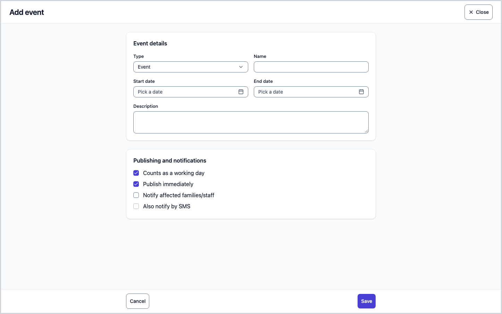
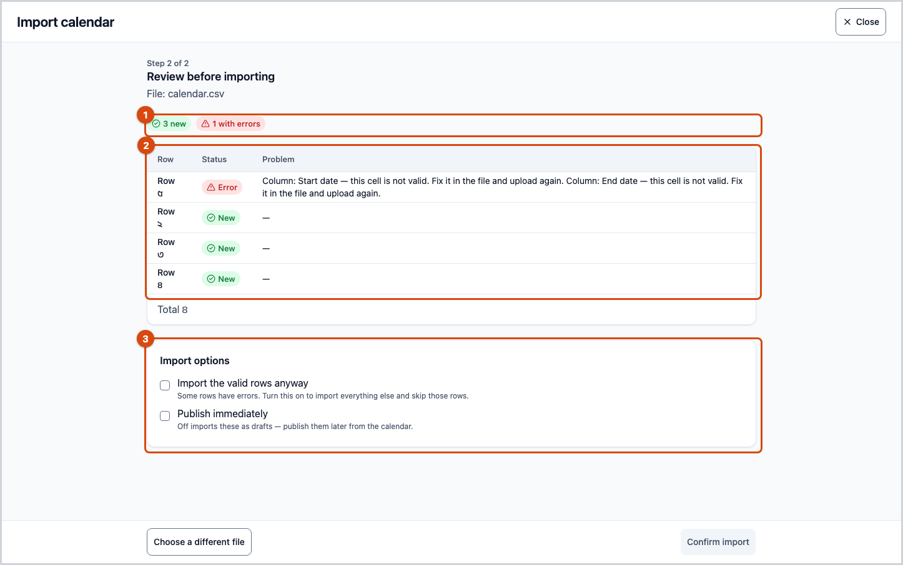
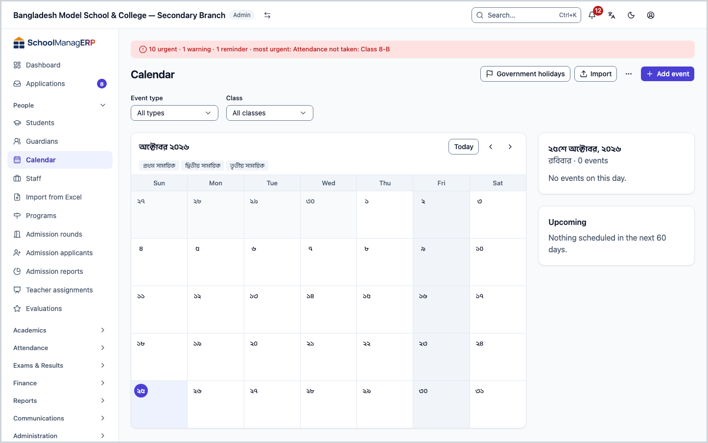
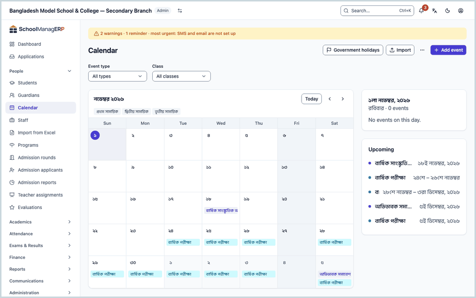
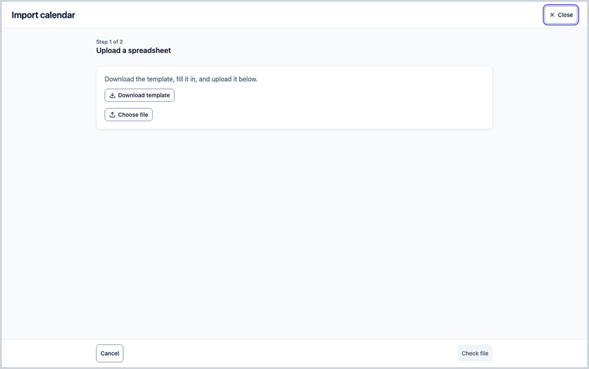

<!-- guide:meta
feature: people.calendar
title: Seeing, adding and subscribing to holidays and events in the calendar
summary: See school holidays, exams, meetings and events in a month calendar. The Admin adds them, imports them from a file or copies them from last year. Everyone can subscribe in their own phone calendar app.
roles: [ADMIN, ACCOUNTANT, TEACHER, EXECUTIVE, OFFICE_STAFF, EXAM_CONTROLLER, COMMITTEE]
sources:
  - client-admin/src/routes/_staff/calendar/index.tsx
  - client-admin/src/routes/_staff/calendar/import.tsx
  - client-admin/src/routes/_staff/calendar/-event-form-dialog.tsx
  - client-admin/src/routes/_staff/calendar/-event-details-sheet.tsx
  - client-admin/src/routes/_staff/calendar/-government-holidays-dialog.tsx
  - client-admin/src/routes/_staff/calendar/-clone-dialog.tsx
  - client-admin/src/routes/_staff/calendar/-filters.tsx
  - client-admin/src/routes/_staff/calendar/-upcoming-panel.tsx
  - client-admin/src/routes/_staff/calendar/-import-dropzone.tsx
  - client-admin/src/routes/_staff/calendar/-import-preview-table.tsx
  - client-admin/src/components/calendar-feed-card.tsx
  - server/src/modules/calendar/calendar-events.service.ts
  - server/src/modules/calendar/calendar-visibility.util.ts
  - server/src/modules/calendar/calendar-import.service.ts
  - server/src/modules/calendar/calendar-export.service.ts
  - server/src/modules/calendar/calendar-feed.service.ts
  - server/src/modules/calendar/public-holidays.service.ts
labels:
  [
    calendar:page.*,
    calendar:filters.*,
    calendar:types.*,
    calendar:eventForm.*,
    calendar:eventDetails.*,
    calendar:governmentHolidaysDialog.*,
    calendar:upcomingPanel.*,
    calendarImport:step1.*,
    calendarImport:step2.*,
    calendarImport:step3.*,
    calendarImport:success.*,
    calendarImport:clone.*,
    calendarImport:toolbar.*,
    calendarImport:columns.*,
    calendarFeed:card.*,
    calendarFeed:field.*,
    calendarFeed:regenerate.*,
    calendarFeed:howTo.*,
    nav:items.calendar,
    nav:groups.people,
  ]
helpIds:
  [
    people.calendar,
    people.calendar.action.addEvent,
    people.calendar.action.publish,
    people.calendar.action.delete,
    people.calendar.action.import,
    people.calendar.action.regenerateFeed,
    people.calendar.field.countsAsWorkingDay,
    people.calendar.field.notify,
    people.calendar.field.lateReason,
    people.calendar.action.governmentHolidays,
    people.calendar.action.clone,
  ]
devices: [desktop]
entry: [sidebar, palette]
keywords:
  [calendar, holiday, government holiday, event, exam date, working day, import, subscribe, feed, school closed]
appVersion: 0.1.0 (5f7194a2e)
owner: tareq89
lastVerified: 2026-10-24
knownIssues: []
-->

# Seeing, adding and subscribing to holidays and events in the calendar

On this page you can see the school's holidays, exams, meetings and events in a month calendar. The Admin can add and change them. Everyone can subscribe to this calendar in their own phone's calendar app.

**Go to:** **People → Calendar** in the left menu. Do the work on this page on a computer. You can also go straight there from the search box at the top (Ctrl+K): type **Add calendar event**, **Add government holidays**, **Copy calendar from another year** or **Import calendar** (Admin only). How search works: [Finding any page](../start/find-anything.md).
**Before you start:** to add an event, you must be the school's Admin ([who can do what](#roles)), and the school must have a current academic year set. The event's dates must fall inside that academic year.

The **calendar** is a list of all the school's dates. Each **event** (a holiday, exam, meeting, deadline or event) has a name and one or more days. One more thing to remember: every event is set to say whether that day **counts as a working day**. A holiday is not a working day, so attendance cannot be taken that day ([how holidays work in attendance and the routine](#task-offdays)).

[Add an event](#task-main) · [Add government holidays](#task-holidays) · [Import from a file](#task-import) · [Get it on your phone](#task-feed) · [Problems and fixes](#trouble)

**On this page**

- [Add an event](#task-main)
- [How to know the event was added](#confirm)
- [Other situations](#other)
  - [See and filter the calendar](#task-view)
  - [Add government holidays](#task-holidays)
  - [Change, publish or delete an event](#task-edit)
  - [Add a holiday for a day that has passed](#task-past)
  - [Import from a file](#task-import)
  - [Copy last year's calendar into the new year](#task-clone)
  - [Export the calendar](#task-export)
  - [Subscribe in your phone's calendar app](#task-feed)
  - [How holidays work in attendance and the routine](#task-offdays)
- [Problems and fixes](#trouble)
- [Who can do what](#roles)
- [Learn more](#more)

---

## Add an event 

Do this to put a holiday, exam, meeting or event on the calendar. (Only an Admin can do this.)

1. Press **People → Calendar** in the left menu.

   → The **Calendar** title at the top, and below it this month's calendar. On the right are the events of the chosen day and the **Upcoming** list.

2. Press **Add event** at the top of the page.

   → A full page opens with the title **Add event**. It has two parts: **Event details** and **Publishing and notifications**.

3. Choose one in the **Type** box: **Holiday**, **Exam**, **Event**, **Meeting**, **Deadline** or **Make-up school day**.

   → **Event** is chosen to start with. If you choose **Holiday**, the tick in **Counts as a working day** below is removed by itself. For the other types the tick stays. If you choose **Make-up school day**, the tick is always on and cannot be changed.

4. Write the event's name in the **Name** box, for example "Annual sports day".

   → The box is required. If you leave it empty and go on, you see **Name is required.**

5. Choose a **Start date** and an **End date**. For a one-day event, give the same date in both.

   → You cannot choose an end date before the start date. If the start date has already passed, see [Add a holiday for a day that has passed](#task-past).

6. If you need to, write a **Description**. People see it when they open the event.

7. Look at the **Publishing and notifications** part:

   | Box                                | When to tick it                                                                                                               |
   | ---------------------------------- | ----------------------------------------------------------------------------------------------------------------------------- |
   | **Counts as a working day**        | School runs on that day. If you remove the tick, the day is a closed day and attendance cannot be taken                       |
   | **Publish immediately**            | It is ticked to start with. If you remove the tick, the event stays a **Draft**. Nobody sees it, and you can publish it later |
   | **Notify affected families/staff** | A notice goes to everyone who can see the event                                                                               |
   | **Also notify by SMS**             | You can choose it only if the box above is ticked. An SMS goes to the guardians' phones                                       |

8. Press **Save**.

   → The page closes, and the event shows on the calendar on those days. If you turned off **Publish immediately**, a **Draft** mark shows next to it.

> **Remember:** nothing goes to the system until you press **Save**. Only the Admin sees a **Draft** event. It does not count in working-day calculations, and nobody is notified. The notify tick works only at the time you save or change the event.

**Who gets the notice:** if you tick **Notify affected families/staff**, the notice goes to all the staff and guardians who can see the event. If you also tick **Also notify by SMS**, an SMS goes to the guardians' phones too. This can use up the school's SMS credit.

---

## How to know the event was added 

Calendar details are saved only when you are online. You cannot save this work on a phone or computer and send it later. So there is no **Saved on this device** state here.

| State                           | How you can tell                                                    | What next                                                 |
| ------------------------------- | ------------------------------------------------------------------- | --------------------------------------------------------- |
| **Changed on screen only**      | The page is open and filled in, but has not closed                  | Press **Save**                                            |
| **Reached the school's system** | The page has closed and the event shows on the calendar on that day | Done. If a **Draft** mark shows, [publish it](#task-edit) |

**To check:** go to that month in the calendar and press the day. If the name shows in the list of the day's events on the right, it is in the system. Press the name to see the event's details.

**If no message appears:** see [Problems and fixes](#trouble). What you typed stays on the page; nothing is lost.

---

## Other situations 

### See and filter the calendar 

Everyone can do this.

1. Press **People → Calendar** in the left menu.

   → The month's boxes show. The weekly holiday days have a different colour (as set for the school; if none is set, Friday and Saturday). The academic year's terms show as a ribbon above the month's boxes.

2. To go to another month, press the arrow next to the month name.

   → The month goes into the address, so you can send someone a link to show them the same month.

3. Press a day.

   → The events of that day show on the right. If there are none, you see **No events on this day.**

4. Press an event's name.

   → A small panel opens with the event's name, **Type**, dates, and the description if there is one. If you are an Admin, you also see the buttons **Delete**, **Publish** and **Edit** at the bottom.

5. To filter, use the boxes at the top:

   | Box            | What to choose                                                                                                            |
   | -------------- | ------------------------------------------------------------------------------------------------------------------------- |
   | **Event type** | One type, for example **Holiday**. If you choose none, it says **All types**                                              |
   | **Class**      | One class. If you choose none, it says **All classes**. (You see events set for only that class, and events for everyone) |

**The Upcoming list on the right:** the **Upcoming** card has at most five published events. At the top it says "Next holiday: {name} · in {number} days" (or "today" if it is today).

> **Remember:** which events you see depends on your role. A teacher sees only events for everyone, events for staff, and events for the classes they teach. Only the Admin sees **Draft** events.

### Add government holidays 

Do this to put the list of government holidays on the calendar in one go. (Admin only.)

1. Open any month of that year in the calendar. Then press **Government holidays** at the top of the page.

   → A full page opens with the title **Government holidays**. It says "Suggested holidays for this year, from the published national calendar." Below it, each holiday's name and date has a tick box beside it. The list is for the year of the month you opened, so open a month of the right year first. If there is nothing, you see **No suggested holidays**.

2. Tick the holidays you want to add.

   → Holidays already on the calendar show ticked and grey, with **Already added**, and you cannot change them. (A holiday counts as "already added" if any holiday is already on the same date, whether or not the name matches.)

3. Press the button at the bottom. It says "Add {number} holidays".

   → The page closes, and the holidays show on the calendar.

| You pressed                           | What happens                                                                                                                     | Saved? |
| ------------------------------------- | -------------------------------------------------------------------------------------------------------------------------------- | ------ |
| **Add {number} holidays**             | The holidays you picked become events of the type Holiday, not a working day, and are published right away. Nobody gets a notice | Yes    |
| **Cancel** (when something is picked) | **Discard your changes?** opens                                                                                                  | No     |

> **Remember:** a holiday whose date has already passed shows **Date has passed** and cannot be ticked. Add it separately with [Add a holiday for a day that has passed](#task-past).

### Change, publish or delete an event 

1. Press the event's name in the calendar.

   → The event's panel opens. Three buttons can show at the bottom: **Delete**, **Publish** (only for a **Draft**), **Edit**.

2. Press **Edit**, change the boxes, then press **Save**.

   → The **Edit event** page opens. The boxes are the same as on the add page (except **Publish immediately**). When it is saved, the page closes. If you tick **Notify affected families/staff**, people are told about this change.

3. To start a **Draft** event, press **Publish** in the panel.

   → The event can now be seen by everyone, and the **Draft** mark goes away.

4. To remove an event from the calendar, press **Delete**.

   → **Delete this event?** opens, with the text "{name} will be removed from the calendar. This can't be undone."

| You pressed       | What happens                                                    | Saved? |
| ----------------- | --------------------------------------------------------------- | ------ |
| **Delete**        | The event is gone from the calendar, and cannot be brought back | Yes    |
| **Publish**       | A draft event is published                                      | Yes    |
| Closing the panel | Nothing changes                                                 | No     |

> **Remember:** an event whose end date has passed can no longer be changed or deleted. The panel says "This event is in the past and can no longer be edited." and the **Delete** and **Edit** buttons are gone. If you want to change an event from a working day to a closed day, saving is stopped when attendance has already been taken for any class on those days ([Problems and fixes](#trouble)).

### Add a holiday for a day that has passed 

Sometimes a holiday such as a strike or a sudden closure was never put on the calendar, and you only think of it later. You can add it as a holiday even after the day has passed, but there is a condition.

1. Press **Add event** at the top of the page.

2. Choose the **Type** **Holiday** (or any type with the tick removed from **Counts as a working day**), and give the name and the date that has passed.

   → A new box appears: **Why is this being added late?** Below it: "This day has already passed. It can only be added if no attendance was taken." Now **Publish immediately** and **Notify affected families/staff** are switched off: the event is published at once, and nobody is told.

3. In the **Why is this being added late?** box, write a reason of at least 3 characters.

   → If the reason is too short, you see **Give a reason of at least 3 characters.**

4. Press **Save**.

   → The holiday shows on the calendar. If any class or staff member already has attendance marked on those days, you see **Attendance has already been taken on one of these days.** and the holiday is not added.

> **Remember:** for a day that has passed, you can add only a closed day (not a working day). If you try to add an ordinary event for a day that has passed, you see **This event is in the past and can no longer be changed.**

### Import from a file 

Use an Excel or CSV file to put many events on the calendar at once. (Admin only.) You see a preview first, and nothing is written until you press **Confirm import**.

1. Press **Import** at the top of the calendar.

   → The **Import calendar** page opens. At the top it says "Step 1 of 2", and the title is **Upload a spreadsheet**.

2. Press **Download template**. Open the file, write your events with one event on each row, and save it.

   → The first row of the template has the column names, and below it are two example rows. What the columns mean: [The columns of the import file](#import-columns).

3. Press **Choose file** and give the file. Only `.xlsx` or `.csv` works, and the file must be under 2 MB.

   → The file name shows. If the file is too big, you see **This file is too large — choose a file under 2 MB**. If the type is wrong, you see **This file type isn't supported — choose a .xlsx or .csv file**.

4. Press **Check file**.

   → "Checking your file…" shows, then the page goes to "Step 2 of 2": **Review before importing**. At the top, coloured marks give the count: **{number} new**, **{number} updated**, **{number} unchanged**, **{number} with errors**. Below it, each row's **Row**, **Status** and **Problem** show. Rows with errors come first.

5. If there are rows with errors, the **Problem** box of each says "Column: {column name} — this cell is not valid. Fix it in the file and upload again." Press **Choose a different file**, fix the file and give it again. Do not rely on **Import the valid rows anyway** in **Import options**: the school's system still refuses a file with any error row, and you see **Import failed**.

6. In the **Import options** part, decide on **Publish immediately**. If you do not tick it, all the events stay as **Draft** ("Off imports these as drafts — publish them later from the calendar.").

7. Press **Confirm import**.

   → **Import complete** shows, and below it "{number} event(s) were published." or "{number} event(s) were saved as drafts." Then press **View on calendar**, or press **Import another file** to give another file.

| You pressed                        | What happens                                                                             | Saved? |
| ---------------------------------- | ---------------------------------------------------------------------------------------- | ------ |
| **Confirm import**                 | New events are made, events that match are updated, and unchanged events are not touched | Yes    |
| **Choose a different file**        | The preview goes away and you go back to the first step. Nothing was written             | No     |
| **Close** at the top of the dialog | You go back to the calendar. Nothing is written                                          | No     |

**How new, updated and unchanged are decided:** if an event with the same **Name** and the same **Start date** already exists, the row matches it. Then if anything changed, it is **updated**. If nothing changed, it is **unchanged**. If there is no match, it is **new**. So if you give the same file a second time, the events are not doubled.

**More rules:** a row whose end date is before today comes up as an error, because an event that has passed cannot be imported. The preview stays for about 30 minutes. If you press **Confirm import** after that, you see **Import failed**. Then check the file again.

### The columns of the import file 

<!-- verified from server/src/modules/calendar/import/calendar-import-rows.util.ts -->

| Column                   | What to write                                                                                                              | Required? |
| ------------------------ | -------------------------------------------------------------------------------------------------------------------------- | --------- |
| `type`                   | `HOLIDAY`, `EXAM`, `EVENT`, `MEETING`, `DEADLINE` or `MAKEUP_DAY` (in English)                                             | Yes       |
| `name`                   | The event's name, at most 120 characters                                                                                   | Yes       |
| `start_date`             | The start date, in the form `2026-03-26` (year-month-day)                                                                  | Yes       |
| `end_date`               | The end date, in the same form. If it is before the start date, it is an error                                             | Yes       |
| `start_time`, `end_time` | The time, in the form `09:00`                                                                                              | No        |
| `counts_as_working_day`  | `TRUE` or `FALSE` (`YES`/`NO` and `1`/`0` also work). If you leave it empty, it is taken as `FALSE`, which is a closed day | No        |
| `audience`               | `ALL` (for everyone) or `STAFF` (for staff only). If you leave it empty, it is `ALL`                                       | No        |
| `classes`                | Class names separated by commas, for example `Class 8, Class 9`. If you leave it empty, all classes                        | No        |
| `description`            | The description                                                                                                            | No        |

> **Careful:** in the import file, if you leave `counts_as_working_day` empty, the row is taken as a closed day. This is the opposite of the add-event page (where only the Holiday type is a closed day). For an exam or meeting row, write `TRUE` in this column, or attendance cannot be taken on that day.

### Copy last year's calendar into the new year 

Use this so you do not have to write last year's exams, meetings and events again in a new academic year. (Admin only.) Government holidays are not copied; add them separately with [Add government holidays](#task-holidays).

1. Open the **More actions** menu at the top of the page and press **Clone from another year**.

   → A dialog opens with the title **Clone from another year**. It says "Copy events from a previous academic year into a new one. Holidays are skipped by default."

2. Choose the earlier year in the **Copy from** box, and the new year in the **Copy into** box.

   → Until you choose two different years, the next button stays off.

3. Press **Preview clone**.

   → The dialog closes, and the **Import calendar** page opens straight at "Step 2 of 2". The copied events show in the preview as **New**.

4. From here, do steps 5-7 of [Import from a file](#task-import).

> **Remember:** nothing is copied until you press **Confirm import**. Each event's date moves forward by the gap between the start dates of the two years. If an event falls outside the new year, it is left out. Only published events of the earlier year are copied; **Draft** events and holidays are not copied.

### Export the calendar 

1. Open the **More actions** menu at the top of the page and press **Export**. (Admin only; if no current academic year is set, you cannot get the button.)

   → An Excel (`.xlsx`) file downloads with the events of the current academic year. The file has the same columns as the import template, so you can change it and import it again.

### Subscribe in your phone's calendar app 

Do this if you want the school's holidays and events to update by themselves in your own phone's calendar. Everyone can do this. The link is not on this page. It is on the **Security** page.

1. At the top right, open the **Account menu** and press **Security**. More about the account menu: [Your account](../start/account.md).

   → The page has a card called **Subscribe to the calendar**. It says "Add this link to your calendar app to see term dates, holidays and events, and get updates automatically."

2. Press **Copy** next to **Your personal subscribe link**.

   → **Copied** shows. The link is hidden in the box (with stars). To see it, press **Show**, and to hide it again press **Hide**. If it does not copy, you see **Couldn't copy the link. Select and copy it manually.**

3. Look at the **How to subscribe** part at the bottom of the card, and give the link to your app:

   - **Google Calendar:** "Other calendars" → "+" → "From URL", then paste the link.
   - **Apple Calendar:** File → "New Calendar Subscription", then paste the link.
   - **Outlook:** "Add calendar" → "Subscribe from web", then paste the link.

   → The app brings in the events from the link and updates them by itself from time to time.

**If you want to change the link** (for example if the link ended up in the wrong place):

1. Press **Regenerate link** at the bottom of the card.

   → **Regenerate subscribe link?** opens. It says "Your old link stops working right away. Any calendar app still using it will need the new link below."

| You pressed    | What happens                                                                                  | Saved? |
| -------------- | --------------------------------------------------------------------------------------------- | ------ |
| **Regenerate** | A new link is set, and the old one stops at once. Give the new link to all your calendar apps | Yes    |
| **Cancel**     | Nothing changes                                                                               | No     |

**What comes through the link:** your calendar gets the published events you can see, from 90 days before today to 400 days after (exactly what you see in the calendar), and the academic year's terms. **Draft** events do not come through.

> **Careful:** this link is yours alone. Anyone who has the link can see what you see. So do not send it to anyone.

### How holidays work in attendance and the routine 

A holiday or closed day on the calendar takes effect in several places by itself. You do not need to do anything extra.

<figure>
  
  <figcaption><em>Where a closed day on the calendar takes effect</em></figcaption>
</figure>

- **Attendance:** on a closed day, attendance cannot be taken in the attendance book ([Taking attendance](../attendance/attendance.md)). The page says "School is closed on this day".
- **Attendance percentages:** in attendance percentages, closed days are not counted in the total working days.
- **Absence messages:** on a closed day, absence notices do not go to guardians.
- **Routine:** on a closed day, [the routine holds no classes](../academics/routine-builder.md).
- **The other way round:** you cannot make a day a closed day if any class or staff member has attendance marked for it ([Problems and fixes](#trouble)). So put the holiday on the calendar first, and then attendance will start.

---

## Problems and fixes 

| What you see                                                | What to do                                                                                                                                               | Who can help |
| ----------------------------------------------------------- | -------------------------------------------------------------------------------------------------------------------------------------------------------- | ------------ |
| **Couldn't load the calendar. Try again.**                  | Check your internet, then try again or reload the page.                                                                                                  | Admin        |
| **Name is required.**                                       | Write the event's name in the **Name** box.                                                                                                              | Admin        |
| **The end date must be on or after the start date.**        | Fix both dates and press **Save** again. This also shows if you have not chosen a date.                                                                  | Admin        |
| **These dates fall outside the current academic year.**     | Give dates that are inside the academic year. If there is a new academic year, create it first.                                                          | Admin        |
| **This event is in the past and can no longer be changed.** | You cannot add or change an ordinary event for a day that has passed. You can add only a closed day ([a holiday for a day that has passed](#task-past)). | Admin        |
| **Give a reason of at least 3 characters.**                 | Write a reason in the **Why is this being added late?** box.                                                                                             | Admin        |
| **Attendance has already been taken on one of these days.** | Attendance is saved for a class or staff member on that date, so the day cannot be made a closed day. Change the date, or fix the attendance first.      | Admin        |
| **One of the selected classes is not valid.**               | The event is tied to a class from another academic year. Choose the classes again.                                                                       | Admin        |
| **A make-up school day always counts as a working day.**    | For this type, the **Counts as a working day** tick cannot be removed. If you want a closed day, choose another type.                                    | Admin        |
| **Couldn't save this event. Try again.**                    | Check your internet and press **Save** again. What you typed stays on the page.                                                                          | Admin        |
| **Couldn't complete that. Try again.** (in the event panel) | It came up when deleting or publishing. Check your internet and try again. A draft whose date has passed cannot be published.                            | Admin        |
| **Couldn't add the holidays. Try again.**                   | Check your internet.                                                                                                                                     | Admin        |
| **No suggested holidays**                                   | The national holiday list for that year has not been published yet. Add them yourself with **Add event**.                                                | Admin        |
| **Upload failed**                                           | Check the file is `.xlsx` or `.csv`, and the column names are the same as the template. Check your internet too.                                         | Admin        |
| **Import failed**                                           | Check your internet. If the preview is more than 30 minutes old, check the file again.                                                                   | Admin        |
| **Clone failed**                                            | Check you chose two different years, and check your internet.                                                                                            | Admin        |
| **Couldn't load your subscribe link.**                      | Press **Retry** on the card.                                                                                                                             | Anyone       |
| **Couldn't regenerate the link. Try again.**                | Check your internet and press again.                                                                                                                     | Anyone       |

---

## Who can do what 

| Role                                                                   | See the calendar                                                              | Add, change, delete, import, export, copy | Subscribe on their phone |
| ---------------------------------------------------------------------- | ----------------------------------------------------------------------------- | ----------------------------------------- | ------------------------ |
| Admin                                                                  | Yes, everything including **Draft**                                           | Yes                                       | Yes                      |
| Teacher                                                                | Yes, events for everyone and for staff, and events for the classes they teach | No                                        | Yes                      |
| Accountant, Executive, Office staff, Exam controller, Committee member | Yes, published events only                                                    | No                                        | Yes                      |

If your role is not allowed to change events, the **Government holidays**, **Import**, **Add event** and other buttons do not show on the page. Guardians and students see the calendar in their own portal; that page is separate: [**Calendar**](../portal/calendar.md).

---

## Learn more 

<strong>The parts of the page</strong> — top to bottom

1. **Calendar** — the title, and the buttons for the Admin: **Government holidays**, **Import**, **Add event**, and in the **More actions** menu **Clone from another year** and **Export**.
2. **The filters** — **Event type** and **Class**.
3. **The month grid** — the day names (**Sun** to **Sat**), the term ribbon, the colour of the weekly holidays, and the event names on each day. If a day has more, it says "+{number} more".
4. **The chosen day's list** — all the events of that day.
5. **Upcoming** — the next five events and the date of the next holiday.

<strong>Event types</strong>

| Type                   | Working day? (to start with)  | When to choose it                                 |
| ---------------------- | ----------------------------- | ------------------------------------------------- |
| **Holiday**            | No, a closed day              | National holiday, Eid holiday, sudden closure     |
| **Exam**               | Yes                           | Exam day; school runs                             |
| **Event**              | Yes                           | Sports, annual function                           |
| **Meeting**            | Yes                           | Parents' meeting, staff meeting                   |
| **Deadline**           | Yes                           | Last date for fees, forms or results              |
| **Make-up school day** | Always yes, cannot be changed | An extra school day held to make up for a closure |

<strong>What the fields mean</strong>

<!-- guide:generated:fields:calendar -->

| Field                          | What to enter                                                                                                                                                                                 | Required?                |
| ------------------------------ | --------------------------------------------------------------------------------------------------------------------------------------------------------------------------------------------- | ------------------------ |
| Type                           | Holiday, Exam, Event, Meeting, Deadline or Make-up school day. Event to start with. When you change the type, the working-day tick changes too, unless you already touched the tick yourself. | Yes                      |
| Name                           | The event's name, for example "Eid-ul-Fitr holiday".                                                                                                                                          | Yes                      |
| Start date                     | The day the event starts. It must be inside the current academic year.                                                                                                                        | Yes                      |
| End date                       | The day the event ends. For a one-day event, the same as the start date.                                                                                                                      | Yes                      |
| Why is this being added late?  | Shows when the start date has passed and the day is a closed day. At least 3 characters, at most 500.                                                                                         | Yes, then                |
| Description                    | A short description of the event. Free text.                                                                                                                                                  | No                       |
| Counts as a working day        | If ticked, school runs that day. If not ticked, it is a closed day and attendance cannot be taken. For the Holiday type it starts unticked; for other types it is ticked.                     | No                       |
| Publish immediately            | Only when adding. If ticked, everyone sees it. If not, it is a draft.                                                                                                                         | No, ticked to start with |
| Notify affected families/staff | If ticked, a notice goes to the people who can see the event.                                                                                                                                 | No                       |
| Also notify by SMS             | An SMS goes to the guardians' phones too. It stays off unless the box above is ticked.                                                                                                        | No                       |

<!-- /guide:generated -->

<strong>How the calendar works</strong> — from event to closed day, then attendance and routine

<figure>
  
  <figcaption><em>From adding an event to everyone seeing it</em></figcaption>
</figure>

- There are four ways to add events: one by one, from the government holiday list, from a file, and by copying from last year.
- Only the Admin sees a draft event, and it does not count in working-day calculations. When you publish it, it reaches everyone.
- Every event is set as a working day or not. Attendance and the routine look at that and act on it.

<strong>The whole task together</strong>

<figure>
  
  <figcaption><em>From a new event to everyone seeing it</em></figcaption>
</figure>

<figure>
  
  <figcaption><em>From the chosen file to Import complete</em></figcaption>
</figure>

**Related pages**

- [**Calendar**](../portal/calendar.md) — the calendar as guardians and students see it.

---

_Version 0.1.0 · Last checked 2026-10-24_
