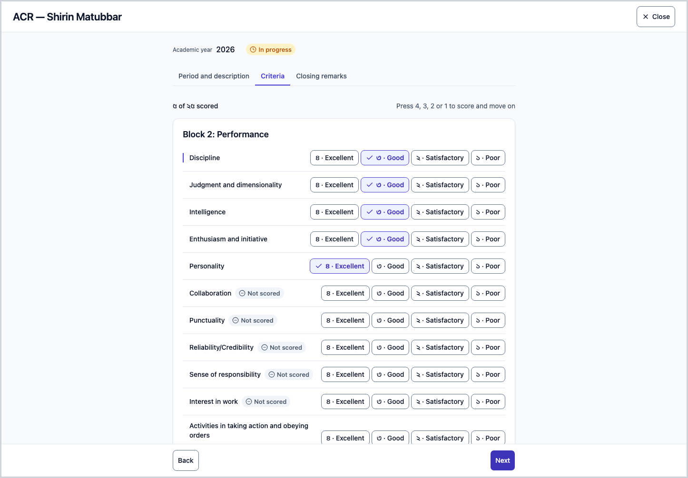
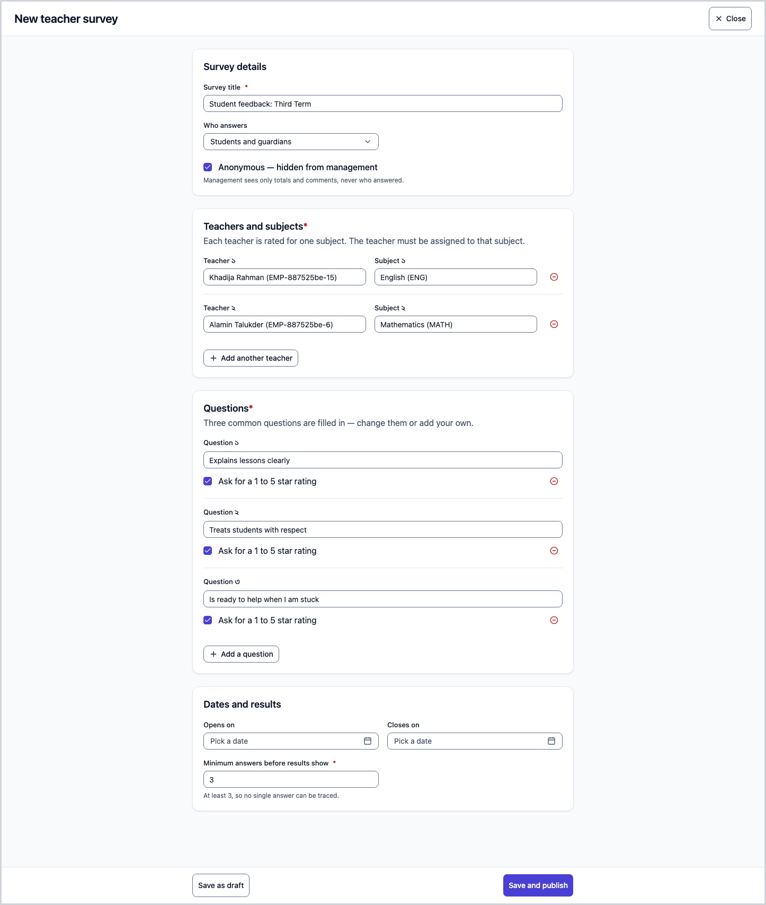
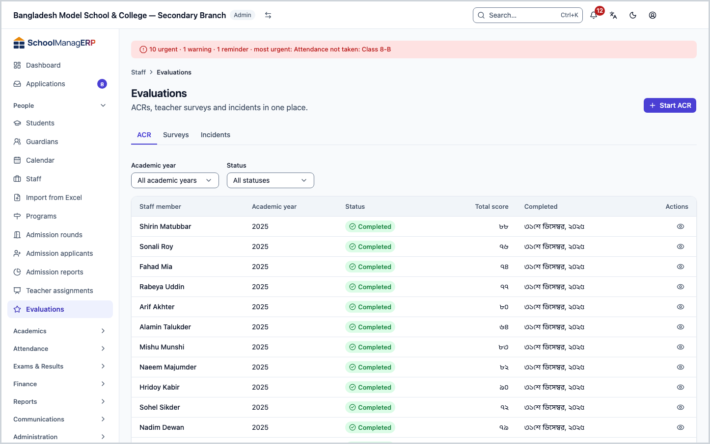
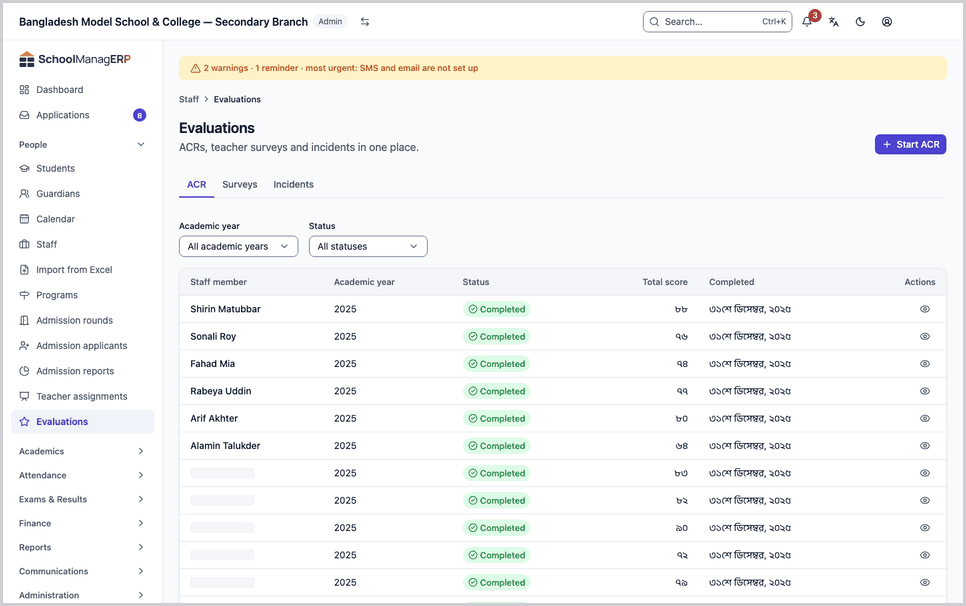

<!-- guide:meta
feature: people.evaluations
title: "Evaluations: ACR, teacher surveys and incidents"
summary: Write a staff member's Annual Confidential Report (ACR), run teacher surveys with students and guardians, and report staff incidents. This page is not for everyone.
roles: [ADMIN, COMMITTEE]
sources:
  - client-admin/src/routes/_staff/staff/evaluations.tsx
  - client-admin/src/routes/_staff/staff/evaluations_.surveys.$surveyId.tsx
  - client-admin/src/routes/_staff/staff/$userId_.acr.$assessmentId.tsx
  - client-admin/src/routes/_staff/staff/-evaluations/acr-register.tsx
  - client-admin/src/routes/_staff/staff/-evaluations/surveys-list.tsx
  - client-admin/src/routes/_staff/staff/-evaluations/survey-form-dialog.tsx
  - client-admin/src/routes/_staff/staff/-evaluations/survey-results.tsx
  - client-admin/src/routes/_staff/staff/-evaluations/incidents-list.tsx
  - client-admin/src/routes/_staff/staff/-acr/acr-form.tsx
  - client-admin/src/routes/_staff/staff/-detail/start-acr-dialog.tsx
  - client-admin/src/routes/_staff/staff/-detail/report-incident-dialog.tsx
  - server/src/modules/acr/acr-assessments.controller.ts
  - server/src/modules/surveys/surveys.controller.ts
labels: [evaluations:*, performance:*]
helpIds:
  [
    people.evaluations,
    people.evaluations.action.startAcr,
    people.evaluations.action.completeAcr,
    people.evaluations.action.reopenAcr,
    people.evaluations.action.publishSurvey,
    people.evaluations.action.closeSurvey,
    people.evaluations.action.reportIncident,
    people.evaluations.field.anonymous,
    people.evaluations.field.minResponses,
    people.evaluations.field.targets,
    people.evaluations.action.newSurvey,
  ]
devices: [desktop]
entry: [sidebar, palette]
keywords:
  [evaluations, ACR, annual confidential report, survey, teacher survey, incident, performance, মূল্যায়ন, এসিআর, জরিপ]
appVersion: 0.1.0 (5f7194a2e)
owner: tareq89
lastVerified: 2026-10-24
knownIssues: []
-->

# Evaluations: ACR, teacher surveys and incidents

Three ways to judge staff work, on one page: the **ACR** (Annual Confidential Report, scored with numbers), **surveys** (what students and guardians think), and **incidents** (a record of someone's behaviour, absence, a complaint or a commendation).

**Go to:** **People → Evaluations** in the left menu. Do the work on this page on a computer.
**Before you start:** only an Admin (see and write) and a governing committee member (see only) get this page. Look at the "who sees what" picture below first ([who can do what](#roles)). To start an ACR the person must already be on the [Staff](staff.md) list, and the school's ACR criteria must be saved once in **Settings** (the "ACR criteria" section).

[Start an ACR](#task-main) · [Publish a survey](#task-survey) · [Report an incident](#task-incident) · [See results](#task-results) · [Problems and fixes](#trouble)

**On this page**

- [How you get here](#arrive)
- [Start and write an ACR](#task-main)
- [How to know the ACR is complete](#confirm)
- [Other situations](#other)
  - [Search and open the ACR register](#task-find)
  - [Reopen or print a completed ACR](#task-reopen)
  - [Publish a teacher survey](#task-survey)
  - [Close a survey and see results](#task-results)
  - [Report an incident](#task-incident)
  - [Withdraw an incident](#task-withdraw)
- [Problems and fixes](#trouble)
- [Who can do what](#roles)
- [Learn more](#more)

---

## How you get here 

**From the left menu:** press **People → Evaluations**. Start at step 1 below.

**From search:** in the search box at the top (Ctrl+K) type **Start ACR**, **Report an incident** or **Publish teacher survey** and choose it. → The Evaluations page opens with the matching dialog or form already open. How search works: [Find any page](../start/find-anything.md).

A Committee member can open the Evaluations page to read it only: they cannot start or write an ACR or report an incident.

**From a staff member's page:** each person's own page has ACR and incident tabs; you can start an ACR and report an incident from there too ([Staff](staff.md)).

---

## Start and write an ACR 

One ACR per staff member per academic year. Whoever starts it is its assessor.

1. Press **People → Evaluations** in the left menu.

   → At the top is the title **Evaluations** and under it "ACRs, teacher surveys and incidents in one place." Three tabs: **ACR**, **Surveys**, **Incidents**. The first tab shows the **ACR register**.

2. Press **Start ACR** at the top of the page.

   → A dialog opens, titled **Start an ACR**. (The button is for Admins only, and it changes when you change tab.)

3. In **Staff member**, choose the person whose ACR you are writing. You can type a name to search.

   → The field is required. If you skip it you see **Choose a staff member.**

4. Choose an **Academic year**.

   → The field is required. If you skip it you see **Choose an academic year.**

5. Press **Start ACR**.

   → The dialog closes and the ACR's full page opens. If this person already has an ACR for this year you see **An ACR already exists for this staff member and year.**

6. On **Step 1: Period and description**, fill in **Period from**, **Period to**, **Duration of employment** and **Description of duties**, then go to the **Next** step.

   → At the top is a count such as **Step 1 of 3**. What you type saves by itself; in the corner you see **Saving…** and then **Saved**.

7. On **Step 2: Criteria**, score one criterion at a time: **4 Excellent**, **3 Good**, **2 Satisfactory**, **1 Poor**.

   → Press a score button, or press 4, 3, 2 or 1 on the keyboard: the score is set and you move to the next criterion. **Previous criterion** and **Next criterion** move you back and forward. The criteria are in two blocks: **Block 2: Performance** and **Block 3: Personal qualities**.

8. On **Step 3: Closing remarks**, fill in **Special qualification**, **Honesty and reputation**, **Eligible for promotion** (**Yes** or **No**), **Training needed** and **Recommendations**.

9. Press **Complete ACR**. (Ctrl+Enter on the keyboard works too.)

   → If every criterion is scored, the ACR becomes **Completed**, **Total score** appears (the sum of all criterion scores), and the page becomes read-only. If a criterion is missing you see **Score every criterion before completing.**, and that criterion is marked **Not scored**.

> **Remember:** until you complete it the ACR stays **In progress**; scores and text save by themselves, but nothing is final until you press **Complete ACR**. Only the person who started the ACR can write and complete it. Any other Admin can [reopen](#task-reopen) a completed ACR. Nobody can open their own ACR. (Checked in the server code.)

---

## How to know the ACR is complete 

ACR details are saved only when you are online. Work on this page cannot be stored to send later, so there is no **Saved on this device** state here. (Checked in the code, not tried in the app.)

| State                               | How you can tell                                                         | What next                               |
| ----------------------------------- | ------------------------------------------------------------------------ | --------------------------------------- |
| **Changed on screen only**          | The corner says **Saving…**; if it fails it says "Retrying…"             | Check your internet; wait for **Saved** |
| **Reached the system, in progress** | **Saved** shows; the register status is **In progress**                  | Press **Complete ACR**                  |
| **Completed**                       | Register status **Completed**, with **Total score** and a completed date | Done                                    |

**To check:** reload the page and look at the row in the **ACR register**.

**If no message appears:** see [Problems and fixes](#trouble).

---

## Other situations 

### Search and open the ACR register 

1. Go to the **ACR** tab. Filter with **Academic year** and **Status** above the list (**All academic years**, **All statuses** mean no filter).

   → The list shows **Staff member**, **Academic year**, **Status**, **Total score**, **Completed**. An ACR in progress shows "—" for the score and date.

2. Press **Open** at the end of a row.

   → The ACR page opens. **Close** takes you back to the page you came from. If there is no page to go back to, it opens that person's own page.

> **Remember:** filters only change what you see. They change no ACR.

### Reopen or print a completed ACR 

1. Open the completed ACR.

   → It says "This ACR is completed. Reopen it to make changes." All criteria show together, read-only.

2. Press **Reopen**.

   → The ACR is **In progress** again and can be edited. Afterwards you must press **Complete ACR** again.

3. To print, press **Print ACR** on a completed ACR. (The button is only on completed ACRs.)

> **Careful:** a reopened ACR is no longer final. Do not reopen unless you must. Any Admin can press **Reopen**, but only the original assessor can write and complete it again.

> **Remember:** which criteria an ACR has is set in the school's **Settings** page, in the "ACR criteria" section. A change makes a new version and applies to new ACRs only; ACRs started earlier keep their old criteria.

### Publish a teacher survey 

In a survey, students or guardians give their opinion of teachers in the portal.

1. Open the **Surveys** tab. Press **New survey** at the top of the page.

   → A full-page form opens, titled **New teacher survey**. Three common questions are already filled in.

2. Type the **Survey title**.

   → The field is required. If you skip it you see **Enter a title.**

3. In **Teachers and subjects**, choose a **Teacher** and one of their **Subject**s. To add more teachers press **Add another teacher**.

   → The teacher must be assigned to that subject. If not, you see **A teacher is not assigned to the chosen subject. Change the teacher or the subject.**; then give them the subject on the [Teacher assignments](teaching-assignments.md) page. The same teacher and subject cannot be added twice.

4. In **Questions**, change the questions or press **Add a question**. Every question needs text. Tick **Ask for a 1 to 5 star rating** if you want stars too.

5. Choose **Who answers**: **Students**, **Guardians** or **Students and guardians** (the last is preselected).

6. Decide **Anonymous — hidden from management**. It is ticked already.

   → If ticked, management sees only totals and comments, never who answered. If you untick it, the form says: "Management still sees only totals and comments. Respondents are not told their answers are anonymous." Names are never shown.

7. If you need to, set **Opens on** and **Closes on** (the closing date must be after the opening date), and set **Minimum answers before results show**.

   → The minimum is 3 already. You cannot go below 3, so no single answer can be traced.

8. Press **Save as draft** or **Save and publish**.

   → A draft appears in the survey list as **Draft**, and nobody can answer it. Publishing makes it **Open** and respondents see it in the portal. If some fields are wrong you see **Not saved: fix {n} field(s).**

> **Remember:** to publish a draft survey, open it from the list and press **Publish**. A button to change an open survey's questions or teachers was not found in the code.

### Close a survey and see results 

1. In the **Surveys** tab list (**Title**, **Who answers**, **Status**, **Closes**) press **Open** at the end of a row.

   → The survey page opens. At the top is the status (**Draft**, **Open** or **Closed**).

2. If it is a draft, press **Publish**. If it is open, press **Close survey** when it is time.

   → Before closing, the app asks **Close this survey?**: "Once “{title}” is closed nobody can answer it any more. It cannot be reopened."

3. On a closed survey, look at **Results**.

   → For each teacher and subject you see the number of responses, and for each question the star average and the comments. If there are fewer responses than the minimum, you see a **Waiting** mark and "Waiting for more responses (2 of 3)." While the survey is open, each card shows the **After closing** mark and "Results appear once the survey is closed."

> **Careful:** a closed survey cannot be opened again. Results show only after closing, so nobody can guess who answered while it is open. This applies to Admins too. A teacher who is the subject of a survey cannot see its results. (Checked in the server code.)

### Report an incident 

1. Open the **Incidents** tab. Press **Report an incident** at the top of the page.

   → A dialog opens, titled **Report an incident**.

2. Choose the **Staff member** (type a name to search), the **Type** (**Behaviour**, **Absence**, **Complaint**, **Commendation**, **Other**) and the **Severity** (**Low**, **Medium**, **High**).

   → Every field is required.

3. Set the **Date**. You cannot give a date after today.

   → A future date shows **The date cannot be in the future.**

4. Describe it in **What happened**, then press **Report**.

   → The dialog closes and "Incident reported." appears. The incident joins the list: **Staff member**, **Type**, **Severity**, **Date**, **Details**. You can filter by **Type** and **Severity** above it.

### Withdraw an incident 

A wrong incident cannot be deleted, only withdrawn. This is not on the Evaluations list; it is on the **Incidents** tab of the staff member's own page.

1. From the [Staff](staff.md) list open that person's page and go to the **Incidents** tab.

2. Press **Withdraw** on the incident's row.

   → A dialog asks **Withdraw this incident?**: "It disappears from lists and the performance view. The record is kept for audit."

3. Write the reason in **Why is it being withdrawn?** (required), then press **Withdraw incident**.

   → "Incident withdrawn" appears and the incident leaves the list.

---

## Problems and fixes 

| What you see                                                                            | What to do                                                                                                  | Who can help |
| --------------------------------------------------------------------------------------- | ----------------------------------------------------------------------------------------------------------- | ------------ |
| **You don't have access to this page.**                                                 | The page is only for Admins and committee members ([who can do what](#roles)). Press **Back to dashboard**. | Admin        |
| **Couldn't load the ACR register.**                                                     | Check your internet and reload the page.                                                                    | Admin        |
| **No ACRs** / "No ACRs yet for this filter."                                            | Remove the **Academic year** and **Status** filters and look again.                                         | Admin        |
| **Save the ACR criteria first, then start an ACR.**                                     | Save the criteria in **Settings** ("ACR criteria"), then press **Start ACR** again.                         | Admin        |
| **An ACR already exists for this staff member and year.**                               | Find that staff member and year in the list and press **Open**. You cannot start another.                   | Admin        |
| **Couldn't start the ACR.**                                                             | Check your internet and try again.                                                                          | Admin        |
| **Couldn't load this ACR.**                                                             | Check your internet and press **Retry**. This can also appear if you try to open your own ACR.              | Admin        |
| **Score every criterion before completing.**                                            | Give 4, 3, 2 or 1 to every criterion marked **Not scored**.                                                 | Admin        |
| **Couldn't complete the ACR.**                                                          | Wait for **Saved**, then try again. Someone other than the person who started it cannot complete it.        | Admin        |
| **Couldn't reopen the ACR.**                                                            | Check your internet and press **Reopen** again.                                                             | Admin        |
| **Couldn't save. Retrying…**                                                            | Check your internet. Do not close the page; wait for **Saved**.                                             | Admin        |
| **Not saved: fix {n} field(s).**                                                        | Fix the fields with red messages, then save again.                                                          | Admin        |
| **Add at least one teacher and subject.**                                               | Fill in one row in **Teachers and subjects**.                                                               | Admin        |
| **A teacher is not assigned to the chosen subject. Change the teacher or the subject.** | Give the subject on the [Teacher assignments](teaching-assignments.md) page, or choose another subject.     | Admin        |
| **Minimum answers must be 3 or more.**                                                  | Make **Minimum answers before results show** 3 or more.                                                     | Admin        |
| **The closing date must be after the opening date.**                                    | Fix the dates.                                                                                              | Admin        |
| **Couldn't publish the survey.** / **Couldn't close the survey.**                       | Check your internet and try again.                                                                          | Admin        |
| **Couldn't load results.**                                                              | Reload the page. You will not get results for a survey in which you are the teacher.                        | Admin        |
| **Choose a staff member.** / **Choose a type.** / **Choose a severity.**                | Choose the fields.                                                                                          | Admin        |
| **Describe what happened.**                                                             | Write in **What happened**.                                                                                 | Admin        |
| **The date cannot be in the future.**                                                   | Give today's date or an earlier one.                                                                        | Admin        |
| **Couldn't report the incident.** / **Couldn't withdraw the incident.**                 | Check your internet and try again.                                                                          | Admin        |
| **Give a reason.**                                                                      | Write a reason in **Why is it being withdrawn?**                                                            | Admin        |

---

## Who can do what 

| Role                                                              | See the three tabs, ACRs and survey results | Start and write ACRs, create, publish and close surveys, report incidents |
| ----------------------------------------------------------------- | ------------------------------------------- | ------------------------------------------------------------------------- |
| Admin                                                             | Yes                                         | Yes (writing an ACR only for the person who started it)                   |
| Governing committee member                                        | Yes                                         | No (the buttons do not show)                                              |
| Teacher, Accountant, Office assistant, Exam controller, Executive | No                                          | No                                                                        |

People without access who open the page see **You don't have access to this page.**, and **Evaluations** is not in their left menu. Nobody can open their own ACR. Students and guardians answer surveys in the portal.

---

## Learn more 

<strong>The parts of the page</strong> — top to bottom

1. **Evaluations** — the title and the small line under it.
2. **Start ACR** / **New survey** / **Report an incident** — one button at the top; the task of the tab you are on (only Admins see it).
3. **The tabs** — **ACR**, **Surveys**, **Incidents**.
4. **The list** — ACR: **Staff member**, **Academic year**, **Status**, **Total score**, **Completed**; surveys: **Title**, **Who answers**, **Status**, **Closes**; incidents: **Staff member**, **Type**, **Severity**, **Date**, **Details**.

<strong>What the fields mean</strong>

<!-- guide:generated:fields:evaluations -->

| Field                                                                           | What to enter                                                                          | Required?              |
| ------------------------------------------------------------------------------- | -------------------------------------------------------------------------------------- | ---------------------- |
| Staff member                                                                    | The person the ACR or incident is about. Type a name to search.                        | Yes                    |
| Academic year                                                                   | The year of the ACR. One per staff member per year.                                    | Yes                    |
| Period from, Period to                                                          | The period of work the ACR covers.                                                     | No                     |
| Duration of employment                                                          | How long the person has worked, free text.                                             | No                     |
| Description of duties                                                           | What the person's duties are, free text.                                               | No                     |
| Score for each criterion                                                        | 4 Excellent, 3 Good, 2 Satisfactory or 1 Poor for each. All are needed to complete.    | Yes, when completing   |
| Special qualification, Honesty and reputation, Training needed, Recommendations | Free text in the last step.                                                            | No                     |
| Eligible for promotion                                                          | **Yes** or **No**.                                                                     | No                     |
| Survey title                                                                    | The survey's name.                                                                     | Yes                    |
| Teacher, Subject                                                                | Which teacher is rated for which subject. The teacher must be assigned to the subject. | Yes, at least one pair |
| Questions                                                                       | The questions for respondents. Tick the box for a star rating.                         | Yes, at least one      |
| Who answers                                                                     | Students, guardians or both.                                                           | Yes                    |
| Anonymous                                                                       | If ticked, you cannot see who answered. Ticked already.                                | No                     |
| Opens on, Closes on                                                             | When the survey runs. The closing date is after the opening date.                      | No                     |
| Minimum answers before results show                                             | Results stay hidden below this number. At least 3; 3 already.                          | Yes                    |
| Type                                                                            | Behaviour, Absence, Complaint, Commendation or Other.                                  | Yes                    |
| Severity                                                                        | Low, Medium or High.                                                                   | Yes                    |
| Date                                                                            | When the incident happened. Not after today.                                           | Yes                    |
| What happened                                                                   | A description of the incident.                                                         | Yes                    |
| Why is it being withdrawn?                                                      | The reason an incident is withdrawn.                                                   | Yes                    |

<!-- /guide:generated -->

<strong>How evaluations work</strong> — the steps of an ACR, a survey and an incident

<figure>
  
  <figcaption><em>The steps of an ACR, a survey and an incident</em></figcaption>
</figure>

- A staff member's own page also shows their ACR history and incidents: [Staff](staff.md).
- Students and guardians answer surveys in the portal; that page is separate in this guide.
- To choose a teacher for a survey, they must first be assigned to the subject: [Teacher assignments](teaching-assignments.md).

<strong>The whole task in one go</strong>

<figure>
  
  <figcaption><em>From starting an ACR to completing it</em></figcaption>
</figure>

**Related pages**

- [**Adding and managing staff**](staff.md) — a staff member's page with their ACR history and incidents.
- [**Teacher assignments**](teaching-assignments.md) — the assignment a survey's teacher-subject pair needs.
- [**Surveys (parent and student)**](../portal/surveys.md) — where guardians and students fill in a survey.

---

_Version 0.1.0 · Last checked 2026-10-24_
