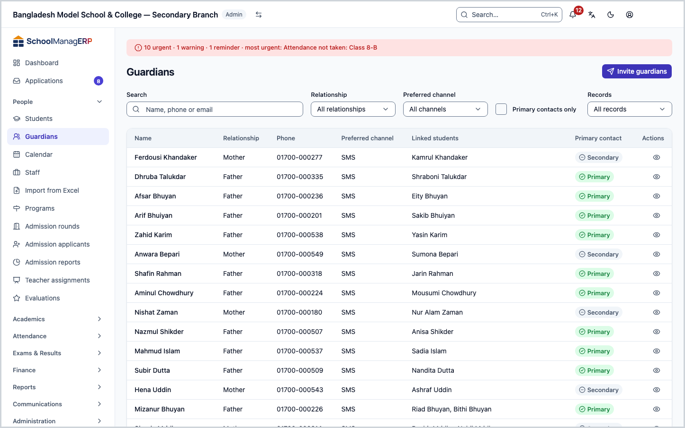
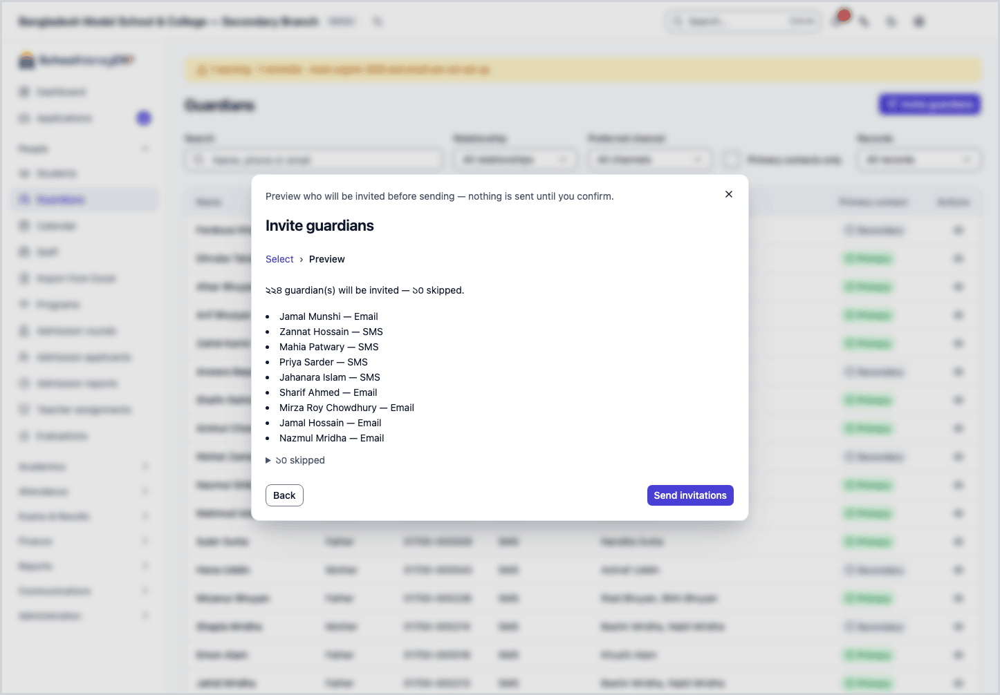
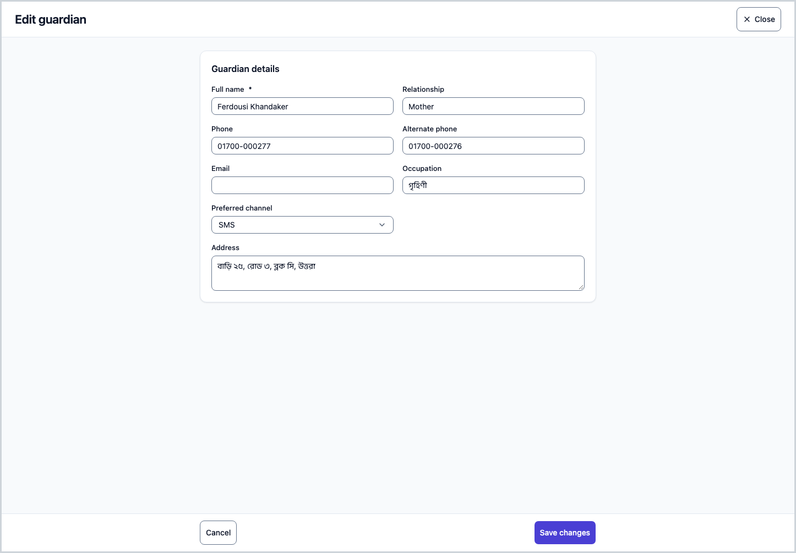
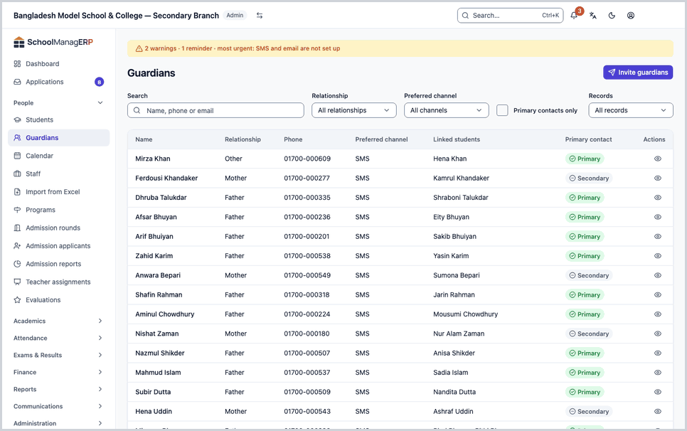

<!-- guide:meta
feature: people.guardians
title: Viewing guardians, fixing their details and sending invitations
summary: Find a guardian in the list, fix their contact details, change which students are linked to them, and send everyone an invitation to join the app.
roles: [ADMIN, ACCOUNTANT, TEACHER, OFFICE_STAFF]
sources:
  - client-admin/src/routes/_staff/guardians/index.tsx
  - client-admin/src/routes/_staff/guardians/$guardianId.tsx
  - client-admin/src/routes/_staff/guardians/-edit-guardian-dialog.tsx
  - client-admin/src/routes/_staff/guardians/-invite-guardians-dialog.tsx
  - client-admin/src/routes/_staff/guardians/-student-picker.tsx
  - client-admin/src/routes/_staff/guardians/-relationship-label.ts
  - client-admin/src/routes/_staff/guardians/-detail/information-tab.tsx
  - client-admin/src/routes/_staff/guardians/-detail/linked-students-tab.tsx
  - client-admin/src/routes/_staff/guardians/-detail/communication-tab.tsx
  - client-admin/src/routes/_staff/guardians/-detail/payments-tab.tsx
  - server/src/modules/students/students.controller.ts
  - server/src/modules/students/students.service.ts
  - server/src/modules/account-access/guardian-provisioning.service.ts
labels:
  [
    guardians:list.*,
    guardians:filters.*,
    guardians:preferredCommunicationOptions.*,
    guardians:detail.*,
    guardians:editDialog.*,
    guardians:studentPicker.*,
    guardians:invite.*,
    nav:items.guardians,
    nav:groups.people,
    common:enums.relationship.*,
    common:status.guardian.*,
  ]
helpIds:
  [
    people.guardians,
    people.guardians.action.invite,
    people.guardians.action.editLinkedStudents,
    people.guardians.action.recordPayment,
    people.guardians.field.relationship,
    people.guardians.field.phone,
    people.guardians.field.preferredCommunication,
  ]
devices: [desktop]
entry: [sidebar, palette, dashboard:guardians-incomplete, dashboard:setup-checklist]
keywords:
  [guardian, parent, father, mother, invite, contact, phone, incomplete, primary contact, invitation]
appVersion: 0.1.0 (5f7194a2e)
owner: tareq89
lastVerified: 2026-10-24
knownIssues: []
-->

# Viewing guardians, fixing their details and sending invitations

On this page you can see and fix a guardian's details, change which students are linked to a guardian, and send guardians an invitation to join the app.

**Go to:** **People → Guardians** in the left menu. Do the work on this page on a computer.
**Before you start:** the guardian must already be in the list. You cannot add a new guardian here. A guardian is added when you add a student ([Adding students and viewing their details](students.md)). To send invitations, you must be the school's Admin ([who can do what](#roles)).

A **guardian** is a student's father, mother or the person who looks after them. This page holds a list of them. Press a name to open that person's own page. There you see their details, their children, the messages sent to them and the payments for their children. A guardian's **account** is a different thing. With an account, they can sign in to the app and see their child's attendance, fees and messages. Sending an invitation sends them a link to start that account.

[Send invitations](#task-main) · [Search and filter](#task-find) · [Fix details](#task-edit) · [Add or remove students](#task-students) · [Problems and fixes](#trouble)

**On this page**

- [How you get here](#arrive)
- [Invite guardians](#task-main)
- [How to know the invitation went out](#confirm)
- [Other situations](#other)
  - [Search and filter the list](#task-find)
  - [Fix incomplete details](#task-incomplete)
  - [Fix a guardian's details](#task-edit)
  - [Change the linked students](#task-students)
  - [Record a payment](#task-payment)
  - [The guardian's page: the tabs](#task-detail)
- [Problems and fixes](#trouble)
- [Who can do what](#roles)
- [Learn more](#more)

---

## How you get here 

**From the left menu:** press **People → Guardians**. Start at step 1 below.

**From search:** in the search box at the top (Ctrl+K) type **Invite guardians** and choose it (only an Admin sees it). → The guardian list opens with the invite dialog already open. Start at step 3 below. How search works: [Finding any page](../start/find-anything.md).

**From the dashboard card "Guardian details missing" (office staff):**

1. On the dashboard, look at the **Guardian details missing** card to see how many guardian records still need work. What the card means: [What the widgets mean](../dashboard/widgets.md).
2. Press the link at the bottom of the card. → The guardian list opens with **Incomplete records only** already chosen in the **Records** box. Then see [Fix incomplete details](#task-incomplete).

**From the setup checklist of a new school (Admin):**

1. In the setup checklist on the dashboard, choose **Invite guardians**. The other steps of setting up a school: [Creating your school and the setup wizard](../admin/create-school.md).
2. → The guardian list opens with the invite dialog already open. Start at step 3 below.

---

## Invite guardians 

Do this after you add students, so that guardians can sign in to the app. You see a preview before anything is sent, and nothing goes out until you press **Send invitations**.

1. Press **People → Guardians** in the left menu.

   → The **Guardians** title at the top. Below it is the list of guardians: **Name**, **Relationship**, **Phone**, **Preferred channel**, **Linked students**, **Primary contact**.

2. Press **Invite guardians** at the top of the page. (Only an Admin sees this button.)

   → A dialog opens with the title **Invite guardians**. It says: "Preview who will be invited before sending — nothing is sent until you confirm." The first step is called **Select**.

3. Read the line in the dialog: **Every guardian in this school without an active account will be previewed.** Then press **Preview invitations**.

   → The dialog moves to the second step, **Preview**. It says "{number} guardian(s) will be invited — {number} skipped." Below that are the names of the guardians who will get an invitation, and next to each name the channel it will go by (email or SMS). To see who was skipped, press the "skipped" text; the list opens with the reason next to each person.

4. Check the list. If someone was skipped, see [Why guardians are skipped](#skip-reasons) to understand why.

5. If it looks right, press **Send invitations**.

   → Sending starts. The dialog says "Sending… {queued} of {total} still in progress." When it finishes, the text changes to "Done — {number} sent, {number} failed, {number} skipped." Then press **Close**.

> **Remember:** nothing goes out before you press **Send invitations**. You cannot pick a few guardians in this dialog: every eligible guardian comes into the preview together. If you close the dialog after sending, the work keeps going.

**Which channel the invitation goes by:** by email if the guardian has an email, otherwise by SMS to their phone. The guardian's **Preferred channel** box is not used here. It is for other messages.

**A guardian who already has an account:** if an account with a password already exists with the same email or phone, the guardian gets a join request instead of an invitation. In the preview they are in the invitation list, but they are not counted in the final "sent" number.

### Why guardians are skipped 

| What the preview says                                              | What it means                                              | What to do                                                                  |
| ------------------------------------------------------------------ | ---------------------------------------------------------- | --------------------------------------------------------------------------- |
| **No phone or email on file**                                      | There is no address to send the invitation to              | Give a phone or email with [Fix a guardian's details](#task-edit)           |
| **Already has an active account**                                  | They can already sign in to the app                        | Nothing to do                                                               |
| **Already has a pending invitation**                               | The link from the earlier invitation has not expired yet   | Wait for the earlier one                                                    |
| **Phone or email belongs to another account that is not verified** | That address is on someone else's account and not verified | Check the address is right, then use [Fix a guardian's details](#task-edit) |
| **Opted out of notifications**                                     | The guardian has said they do not want messages            | No invitation goes without their permission                                 |

---

## How to know the invitation went out 

Sending invitations needs the internet. You cannot save this work on a phone or computer and send it later. So there is no **Saved on this device** state here.

| State                           | How you can tell                                                       | What next                                       |
| ------------------------------- | ---------------------------------------------------------------------- | ----------------------------------------------- |
| **Changed on screen only**      | You can see the preview, but you have not pressed **Send invitations** | Press **Send invitations**                      |
| **Reached the school's system** | You see "Sending…" or "Done — …"                                       | Wait until it says "Done", then press **Close** |

**To check:** press the guardian's name, then open the **Communication History** tab. The row for the message sent shows there: **Date**, **Medium**, **Recipient**, **Status**. The row can take a little while to appear.

**If something failed:** if the result says "{number} failed", check that guardian's email or phone is right. Fix it and send again from the preview. Guardians who already got an invitation will be skipped as "pending invitation", so they will not get a second one.

---

## Other situations 

### Search and filter the list 

1. Type a name, phone or email in the **Search** box above the guardian list.

   → When you stop typing, the list gets shorter after a moment. If nothing matches, you see **No guardians found**, and below it: "Guardians appear here when you add them with a student."

2. To narrow the list more, use the boxes:

   | Box                       | What to choose                                                                                                                |
   | ------------------------- | ----------------------------------------------------------------------------------------------------------------------------- |
   | **Relationship**          | One relationship, for example **Father**. If you choose none, it says **All relationships**                                   |
   | **Preferred channel**     | **SMS**, **WhatsApp**, **Email**, **Phone call** or **Messenger**. If you choose none, it says **All channels**               |
   | **Primary contacts only** | Tick it to see only guardians marked **Primary**                                                                              |
   | **Records**               | Choose **Incomplete records only** to see only guardians with incomplete details. If you choose none, it says **All records** |

3. Press a column name (**Name**) to sort by name.

> **Remember:** filters only change what you see. They do not change anyone's details. The **Relationship** filter has only Father, Mother, Brother, Sister, Grandfather, Grandmother, Uncle, Aunt and Other. If someone typed something else in the relationship box, the list shows it as typed, but this filter does not catch it.

### Fix incomplete details 

A guardian's details count as incomplete if the name or relationship is empty, or if both phone and alternate phone are missing. Without a phone, no message can be sent to them.

1. In the **Records** box, choose **Incomplete records only**. (If you came from the dashboard card, this is already chosen.)

   → Only guardians with incomplete details show, and each row has **View**.

2. Press **View** on one row, then follow the steps in [Fix a guardian's details](#task-edit).

3. When you have fixed everyone, open the list again. If the list is empty, it says **No guardians found**.

### Fix a guardian's details 

1. In the guardian list, press **View** at the end of the name's row.

   → The guardian's page opens. At the top are the name, a **Primary** or **Secondary** mark, and four facts: relationship, phone, preferred channel, and how many students are linked.

2. Press **Edit** at the top of the page.

   → The **Edit guardian** page opens, with eight boxes.

3. Change the box you want to change: **Full name**, **Relationship**, **Phone**, **Email**, **Alternate phone**, **Occupation**, **Preferred channel**, **Address**. Write the phone number in English digits.

   → If you leave **Full name** empty and go on, you see **Full name is required.** If you empty any other box, that detail is deleted.

4. Press **Save changes**.

   → The page closes, and the guardian's page shows the new details.

| You pressed                             | What happens                                                                                                                             | Saved? |
| --------------------------------------- | ---------------------------------------------------------------------------------------------------------------------------------------- | ------ |
| **Save changes**                        | The new details are saved and the page closes                                                                                            | Yes    |
| **Cancel** (when nothing was changed)   | Nothing changes and the page closes                                                                                                      | No     |
| **Cancel** (when something was changed) | **Discard your changes?** opens. Press **Discard changes** and the edits are deleted. Press **Keep editing** and you go back to the page | No     |

**A guardian who signs in on their own:** if they have an account, the **Phone** and **Email** boxes cannot be changed. The boxes only show the details, with the note: "This guardian signs in with this phone and email. The parent changes them from their own account, or an admin edits their user." To change a staff member's phone as an Admin, see [Adding and managing staff](staff.md).

> **Remember:** you cannot change the **Primary** or **Secondary** mark from this page.

### Change the linked students 

A guardian can have more than one child. Here you decide which student is linked to which guardian.

1. On the guardian's page, open the **Linked Students** tab.

   → The title **Linked students**, and below it: "The students this guardian looks after." The list shows each student's **Name**, **Class**, **Roll**, **Registration number**. If there are none, you see **No students linked yet.**

2. Press **Edit linked students**.

   → A dialog with the same name opens. At the top is the list of linked students now, with **Remove** next to each one. Below it is the **Search students** box.

3. To add a student, type a name or registration number in the box and choose from the results. To remove someone, press **Remove** next to them.

   → If nothing matches, you see **No students found.**

4. Press **Save**.

   → The dialog closes, and the list changes to show the new students.

| You pressed | What happens                                                                            | Saved? |
| ----------- | --------------------------------------------------------------------------------------- | ------ |
| **Save**    | Exactly the students in the list are now linked; anyone you removed is no longer linked | Yes    |
| **Cancel**  | Nothing changes                                                                         | No     |

> **Remember:** **Save** replaces the whole list, not only the changes. So check who you are keeping before you remove anyone. Removing a student does not delete the student or the guardian's details. Only the link goes.

Press **View** on a linked student's row to open that student's page: [Adding students and viewing their details](students.md).

### Record a payment 

When a guardian pays, you can start recording the payment from the guardian's page. (Only an Admin and an Accountant see this button.)

1. Press [**Record payment**](../finance/record-payment.md) at the top of the guardian's page.

   → The record payment page opens, already set up with this guardian's children. For the other steps, see [the record payment page](../finance/record-payment.md).

2. When the payment is recorded, go back to the guardian's page and open the **Payment History** tab. The new payment is at the top of the list.

### The guardian's page: the tabs 

At the top of the guardian's page are the name, a **Primary** or **Secondary** mark, and four facts. Below are four tabs:

| Tab                       | What is in it                                                                                                                             |
| ------------------------- | ----------------------------------------------------------------------------------------------------------------------------------------- |
| **Information**           | **Contact details**: phone, alternate phone, email, occupation, preferred channel, address. An empty box shows "—"                        |
| **Linked Students**       | The list of children. You change it from here: [Change the linked students](#task-students)                                               |
| **Communication History** | Messages sent directly to this guardian: **Date**, **Medium**, **Recipient**, **Status**. For viewing only                                |
| **Payment History**       | Payments for any of this guardian's children: **Date**, **Student**, **Amount**, **Method**, **Reference**. Each row has **View payment** |

The **Messages** button at the top (Admin, Accountant, Office staff) opens the [Message log](../communications/message-log.md#task-scoped) with this guardian's messages, where each one can be opened in full.

The tab is part of the page's address, so you can send someone straight to the "Linked Students" tab.

---

## Problems and fixes 

| What you see                                              | What to do                                                                                                                                                                        | Who can help                    |
| --------------------------------------------------------- | --------------------------------------------------------------------------------------------------------------------------------------------------------------------------------- | ------------------------------- |
| **Failed to load guardians**                              | Check your internet and reload the page.                                                                                                                                          | Admin                           |
| **Couldn't load this guardian.** (on the guardian's page) | Press **Try again**.                                                                                                                                                              | Admin                           |
| **You don't have permission to view this.**               | Your role is not allowed to see this. For example, office staff cannot see the **Payment History** tab. ([Who can do what](#roles))                                               | Admin                           |
| **We could not find this record**                         | The guardian may have been deleted, or the link may be wrong. Press **Go back**. If you are a teacher, a guardian with no child in your section also shows this message.          | Admin                           |
| **Full name is required.**                                | Write the name in the **Full name** box.                                                                                                                                          | Admin, Accountant, Office staff |
| **Couldn't update the guardian. Try again.**              | Check your internet and press **Save changes** again. What you typed stays in the boxes. This also shows if you try to change a phone or email that the guardian uses to sign in. | Admin                           |
| **Couldn't update linked students. Try again.**           | Check your internet and press **Save** again.                                                                                                                                     | Admin                           |
| **Could not preview invitations. Please try again.**      | Check your internet and press **Preview invitations** again.                                                                                                                      | Admin                           |
| **Could not send invitations. Please try again.**         | Check your internet and press **Send invitations** again. Guardians whose invitation already went will not get it twice.                                                          | Admin                           |
| **No guardians found**                                    | Clear the filters. If the list is really empty, first [add students](students.md). If you are a teacher, you see only the guardians of students in your section.                  | Admin                           |

---

## Who can do what 

| Role            | See the list and a guardian's page                                                                                                                                              | Change details and linked students | Send invitations | Record a payment | See the **Payment History** tab                |
| --------------- | ------------------------------------------------------------------------------------------------------------------------------------------------------------------------------- | ---------------------------------- | ---------------- | ---------------- | ---------------------------------------------- |
| Admin           | Yes, all guardians                                                                                                                                                              | Yes                                | Yes              | Yes              | Yes                                            |
| Accountant      | Yes, all guardians                                                                                                                                                              | Yes                                | No               | Yes              | Yes                                            |
| Office staff    | Yes, all guardians                                                                                                                                                              | Yes                                | No               | No               | No ("You don't have permission to view this.") |
| Teacher         | Only guardians of students in their own section; opening anyone else's page shows **We could not find this record**. A guardian's page shows only the children in their section | No                                 | No               | No               | Yes, only for children in their own section    |
| All other roles | **Guardians** is not in their menu                                                                                                                                              | No                                 | No               | No               | No                                             |

A button that your role is not allowed to use does not show on the page.

---

## Learn more 

<strong>The parts of the page</strong> — top to bottom

1. **Guardians** — the title.
2. **Invite guardians** — the button at the top of the page (Admin only).
3. **The filter row** — **Search**, **Relationship**, **Preferred channel**, **Primary contacts only**, **Records**.
4. **The list** — **Name**, **Relationship**, **Phone**, **Preferred channel**, **Linked students**, **Primary contact**; **View** at the end of each row. The **Linked students** box shows the first two names, and a count for the rest ("+2 more").

<strong>What the fields mean</strong>

<!-- guide:generated:fields:guardians -->

| Field             | What to enter                                                                                                                                                                                                | Required? |
| ----------------- | ------------------------------------------------------------------------------------------------------------------------------------------------------------------------------------------------------------ | --------- |
| Full name         | The guardian's full name.                                                                                                                                                                                    | Yes       |
| Relationship      | Relationship to the student, for example Father, Mother, Uncle. What you type stays as typed; the list filter catches only Father, Mother, Brother, Sister, Grandfather, Grandmother, Uncle, Aunt and Other. | No        |
| Phone             | In English digits, for example 01712345678. If there is no email, the invitation goes to this number by SMS. If the guardian signs in on their own, it cannot be changed from here.                          | No        |
| Email             | The invitation goes here first. If the guardian signs in on their own, it cannot be changed from here.                                                                                                       | No        |
| Alternate phone   | A second number. If there is no phone but this one is filled in, the details do not count as incomplete.                                                                                                     | No        |
| Occupation        | The guardian's work. Free text.                                                                                                                                                                              | No        |
| Preferred channel | SMS, WhatsApp, Email, Phone call or Messenger. If you choose none, it stays SMS. It does not decide how the invitation is sent.                                                                              | No        |
| Address           | The guardian's address. Free text.                                                                                                                                                                           | No        |

<!-- /guide:generated -->

<strong>How guardians work</strong> — from student to guardian, then account

<figure>
  
  <figcaption><em>From a student to a guardian's account</em></figcaption>
</figure>

- A guardian is created together with the student. You cannot create a new guardian on this page. You can only fix the details of the guardians who are already there.
- To send messages, the app needs the guardian's phone. That is why details with no phone count as incomplete.
- Once the account is started, the guardian sees their child's attendance, fees and messages in the app. Before that, they only receive messages.

<strong>The whole task together</strong>

<figure>
  
  <figcaption><em>From the preview to sending</em></figcaption>
</figure>

**Related pages**

- [**Adding students and viewing their details**](students.md) — add and edit the students a guardian is linked to.
- [**Fee reminders**](../communications/fee-reminders.md) — Remind the guardians of one student, or of up to 500 students at once, about unpaid fees.
- [**Send a message**](../communications/send-message.md) — Send your own message to one guardian of a student by SMS, WhatsApp or email.
- [**Overview**](../portal/overview.md) — the first page a guardian sees.
- [**Account (parent and student)**](../portal/account.md) — how a guardian manages their own account.

---

_Version 0.1.0 · Last checked 2026-10-24_
