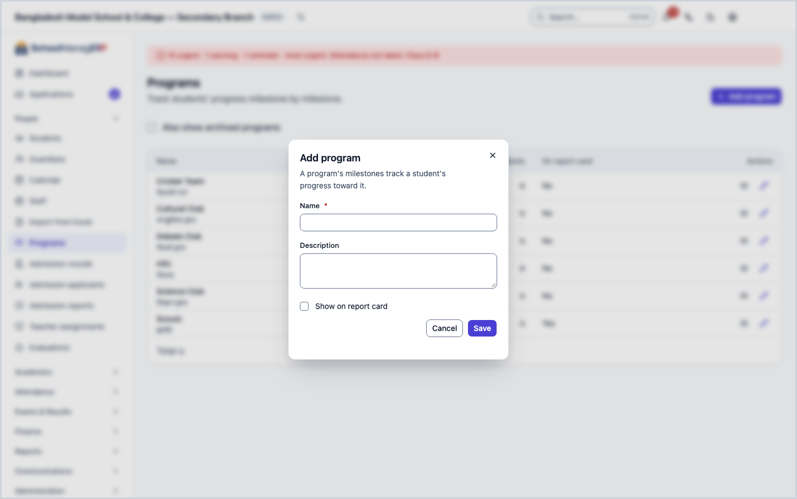
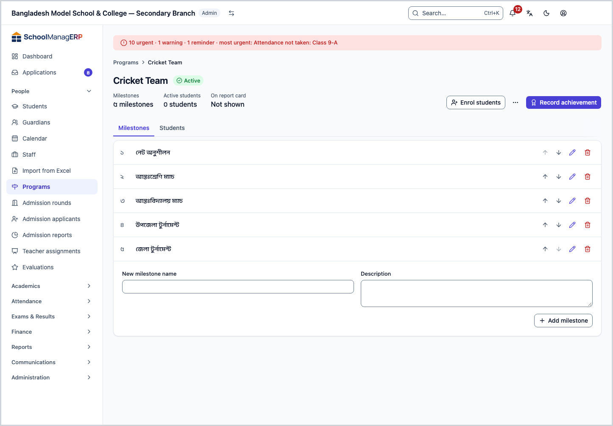
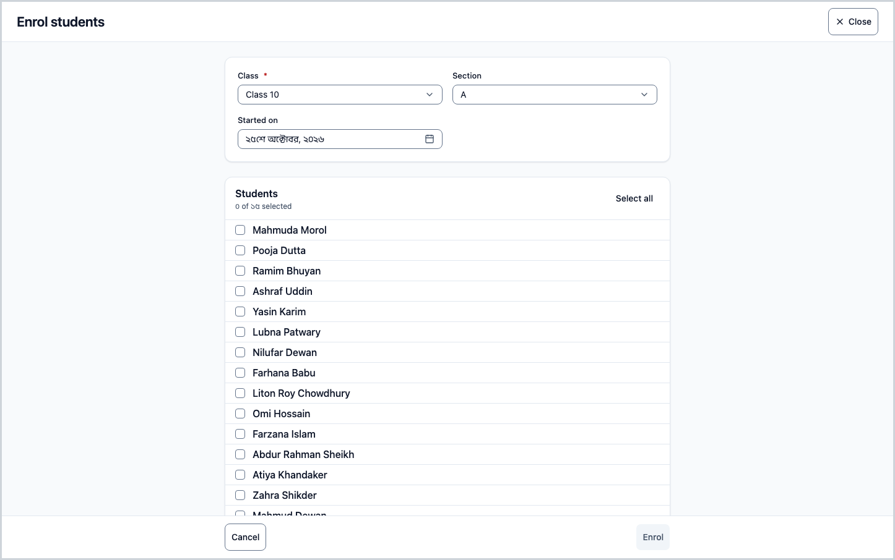
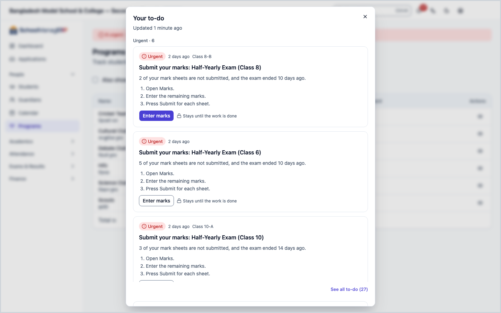
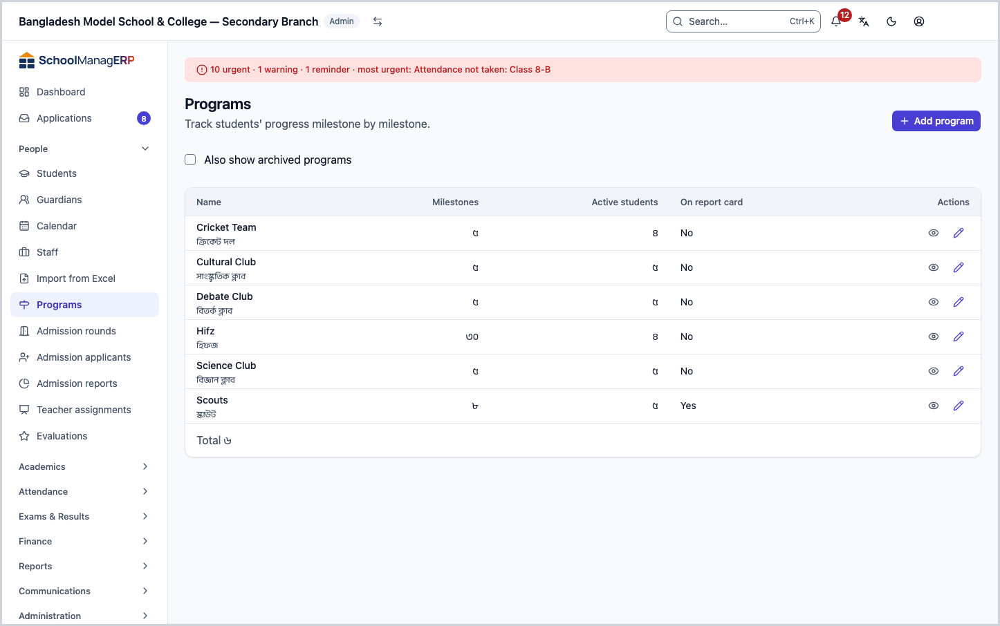
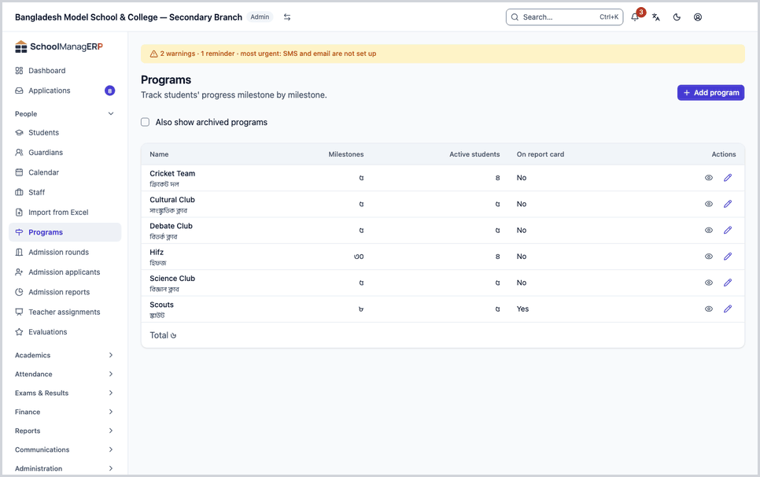

<!-- guide:meta
feature: people.programs
title: Programs and milestones
summary: Add programs such as Hifz, a club or a course, set their milestones, enrol students, and record each achievement to follow progress.
roles: [ADMIN, TEACHER, EXECUTIVE]
sources:
  - client-admin/src/routes/_staff/programs/index.tsx
  - client-admin/src/routes/_staff/programs/$programId.tsx
  - client-admin/src/routes/_staff/programs/-program-form-dialog.tsx
  - client-admin/src/routes/_staff/programs/-milestone-editor.tsx
  - client-admin/src/routes/_staff/programs/-students-tab.tsx
  - client-admin/src/routes/_staff/programs/-enrol-dialog.tsx
  - client-admin/src/routes/_staff/programs/-record-dialog.tsx
  - server/src/modules/programs/programs.controller.ts
  - server/src/modules/programs/program-enrollments.controller.ts
labels: [programs:*]
helpIds:
  [
    people.programs,
    people.programs.action.enrol,
    people.programs.action.record,
    people.programs.action.delete,
    people.programs.action.removeMilestone,
    people.programs.field.showOnReportCard,
    people.programs.field.score,
  ]
devices: [desktop]
entry: [sidebar, palette]
keywords:
  [programs, milestone, hifz, club, course, achievement, enrol, progress, প্রোগ্রাম, মাইলস্টোন, অর্জন, program, track]
appVersion: 0.1.0 (5f7194a2e)
owner: tareq89
lastVerified: 2026-10-24
knownIssues: []
-->

# Programs and milestones

Some work outside normal classes, such as Hifz, a club or a course, moves forward in steps. Make a **program**, lay out its steps as **milestones**, then record when each student passes each step.

**Go to:** **People → Programs** in the left menu. Do the work on this page on a computer.
**Before you start:** to make programs and enrol students you must be an Admin or an executive. Teachers can record achievements too ([who can do what](#roles)). The students you enrol must already be on the [Students](students.md) list.

A program has many milestones, and each student gets one achievement per milestone. The more milestones a student has passed, the more their progress grows (for example 3 / 5).

[Add a program](#task-main) · [Enrol students](#task-enrol) · [Record achievements](#task-record) · [Complete or withdraw](#task-status) · [Problems and fixes](#trouble)

**On this page**

- [How you get here](#arrive)
- [Add a program](#task-main)
- [How to know the program was created](#confirm)
- [Other situations](#other)
  - [Enrol students](#task-enrol)
  - [Record achievements](#task-record)
  - [Complete or withdraw a student](#task-status)
  - [Change, reorder or remove milestones](#task-milestone)
  - [Change a program's name](#task-edit)
  - [Archive or delete a program](#task-archive)
- [Problems and fixes](#trouble)
- [Who can do what](#roles)
- [Known issues](#known-issues)
- [Learn more](#more)

---

## How you get here 

**From the left menu:** press **People → Programs**. Start at step 1 below.

**From search:** in the search box at the top (Ctrl+K) type **Add program**, **Enrol students** or **Record achievement** and choose it. → The program list opens with the matching form already open. How search works: [Find any page](../start/find-anything.md).

**From a student's page:** the **Programs** tab on a student's page shows that student's programs. Student work: [Students](students.md).

---

## Add a program 

1. Press **People → Programs** in the left menu.

   → At the top is the title **Programs** and under it "Track students' progress milestone by milestone." Below is the list: **Name**, **Milestones**, **Active students**, **On report card**.

2. Press **Add program** at the top of the page. (If the list is empty, a button with the same name is in the middle too.)

   → A dialog opens, titled **Add program**: "A program's milestones track a student's progress toward it."

3. Type the program's name in **Name**, for example "Hifz".

   → The field is required. If you leave it empty you see **Enter a name for the program.** The name can be at most 200 characters.

4. If you like, write a line or two in **Description**.

   → The description shows in small text under the name in the list.

5. If you want the program's progress printed on the report card, tick **Show on report card**.

   → If you do not tick it, the program does not appear on the report card. In the list, the **On report card** column shows **Yes** or **No**.

6. Press **Save** at the bottom of the dialog.

   → The dialog closes and the new program is in the list. It has no milestones yet, so the **Milestones** column shows 0.

7. Press the program's name in the list.

   → The program page opens. At the top are the name, the status (**Active**) and three facts: **Milestones**, **Active students**, **On report card**. Below are two tabs: **Milestones** and **Students**.

8. On the **Milestones** tab, type the first step's name in **New milestone name**. Add a **Description** if you like. Then press **Add milestone**.

   → The milestone joins the ordered list. Add every step one by one this way. With no milestones the tab says **Add milestones to track progress**, and students' progress bars do not appear.

> **Remember:** nothing is saved until you press **Save** or **Add milestone**. Making the program is not the end of the work: now [enrol students](#task-enrol), then [record achievements](#task-record).

---

## How to know the program was created 

Program details are saved only when you are online. Work on this page cannot be stored on your phone or computer to send later, so there is no **Saved on this device** state here. (Checked in the code, not tried in the app.)

| State                         | How you can tell                                     | What next                             |
| ----------------------------- | ---------------------------------------------------- | ------------------------------------- |
| **Changed on screen only**    | The dialog is open and filled in, but has not closed | Press **Save**                        |
| **Reached the school system** | The dialog closed and the new name is in the list    | Done. Now add milestones and students |

**To check:** reload the page. If the name comes up in the program list, it is in the system. On the program page, match the number under **Milestones**.

**If no message appears:** see [Problems and fixes](#trouble). What you typed stays in the dialog; nothing is lost.

---

## Other situations 

### Enrol students 

A student's achievements cannot be recorded until they are enrolled. You can enrol many students of one class or section at once.

1. At the top of the program page press **Enrol students**. (If the Students tab is empty, a button with the same name is there too.)

   → A full-page form opens, titled **Enrol students**. Opened from the program page, the program is already chosen. Opened from search, choose it first in **Program**.

2. Choose a class in **Class**.

   → The field is required. Until you choose a class, **Choose a class to see its students.** shows below.

3. If you need to, choose a **Section**. Do this to see only one section's students.

   → The **Students** list shows everyone in that class (or section), with a count such as **2 of 30 selected**.

4. Set **Started on**. Today's date is filled in already.

5. Tick the students you want. To take everyone press **Select all**; to undo it press **Clear all**.

   → The **Enrol** button turns on once a program and at least one student are chosen.

6. Press **Enrol**.

   → The form closes and the students appear on the program's **Students** tab. If some students were already **Active**, they are skipped: the form stays open with the message "{n} students already enrolled, skipped.", and the others are enrolled. Then press **Cancel** to close the form.

> **Remember:** the same student can be **Active** in the same program only once at a time. (Checked in the server code.)

### Record achievements 

You can record one milestone for many students at once.

1. At the top of the program page press **Record achievement**. If you press **Record achievement for {name}** on a student's row, that student is already chosen.

   → A full-page form opens, titled **Record achievement**. Opened from search, choose the program first in **Program**.

2. In **Milestone**, choose the step that was passed.

   → The field is required.

3. In the **Students** list, tick everyone who passed the step.

   → Only **Active** students are listed here. If there are none, "No active students in this program." shows.

4. Set **Achieved on**. Today's date is filled in already.

5. If you like, fill in **Score**, **Grade** and **Remark**.

   → The score must be a number, with at most two digits after the decimal point and no more than 9999.99. Bangla digits work. If it is wrong you see **Enter the score as a number.**

6. Press **Save**.

   → The form closes. The student's progress bar grows (for example from 2 / 5 to 3 / 5). Recording the same milestone again for the same student replaces the earlier achievement; you do not get two. (Checked in the server code: up to 500 students at a time.)

> **Remember:** nothing is saved until you press **Save**. If you have typed something and press **Cancel**, the app asks **Discard your changes?** **Keep editing** keeps what you wrote; **Discard changes** throws it away.

### Complete or withdraw a student 

1. Open the **Students** tab on the program page.

   → The list shows each person's name, roll and, if there are milestones, a progress bar. In **Status** above you can choose **Active**, **Completed** or **Withdrawn** to see students in that state.

2. From the menu on the row of the student whose state you want to change, choose:

   | Menu text         | When it appears                            | What happens                      |
   | ----------------- | ------------------------------------------ | --------------------------------- |
   | **Mark complete** | In the **Active** list                     | The student becomes **Completed** |
   | **Withdraw**      | In the **Active** list                     | The student becomes **Withdrawn** |
   | **Reactivate**    | In the **Completed** or **Withdrawn** list | The student becomes **Active**    |

   → When every milestone is achieved, **Mark complete** reads **All milestones achieved — mark complete?** These menu items show only to people who can manage programs (Admin, executive).

> **Remember:** changing the state does not delete achievement records. The button to record an achievement is only on rows in the **Active** list. (Checked in the server code.)

### Change, reorder or remove milestones 

On the program page's **Milestones** tab each milestone has these buttons (for people who can manage programs):

- **Move milestone up** and **Move milestone down** change the order. The first cannot go up and the last cannot go down.
- **Edit milestone** changes the name and description.
- **Remove milestone** removes it. The app asks **Remove this milestone?** If the milestone has recorded achievements it says: "This milestone has {n} recorded achievements. Removing them will delete those records too."

> **Careful:** removing a milestone deletes all its achievement records, and they cannot be brought back. If only the name is wrong, press **Edit milestone**.

### Change a program's name 

1. At the end of the program's row in the list press **Edit program**. The program page has a button with the same name.

   → The dialog opens with the current name, description and **Show on report card**.

2. Change what you need and press **Save**.

   → The dialog closes. If a program with this name already exists you see **A program with this name already exists**.

### Archive or delete a program 

From the buttons at the top of the program page:

- **Archive** (or **Unarchive** for an archived one): archiving removes the program from the normal list. To see it again, tick **Also show archived programs** above the list. The **Status** column then appears, and archived programs carry an **Archived** mark. Nothing is deleted.
- **Delete**: the app then asks **Delete this program?** "Delete this program? This can't be undone." This button shows only while the program has no active students. If any student was ever enrolled (even Completed or Withdrawn) it cannot be deleted, and you see **This program has enrolled students — archive it instead of deleting.** Archive it then. (Checked in the server code.)

> **Careful:** a deleted program does not come back. If you may need it later, archive it.

---

## Problems and fixes 

| What you see                                                             | What to do                                                                                                  | Who can help |
| ------------------------------------------------------------------------ | ----------------------------------------------------------------------------------------------------------- | ------------ |
| **You don't have access to this page.**                                  | This page is not for everyone ([who can do what](#roles)). Press **Back to dashboard**.                     | Admin        |
| **Couldn't load programs**                                               | Check your internet and reload the page.                                                                    | Admin        |
| **You don't have permission to view this program**                       | If you see this on a program page, check your role and tell the Admin.                                      | Admin        |
| **Enter a name for the program.**                                        | Type a name in **Name**.                                                                                    | Admin        |
| **The name can be at most 200 characters.**                              | Shorten the name.                                                                                           | Admin        |
| **A program with this name already exists**                              | Look for the name in the list (including archived programs). Use another name, or unarchive it.             | Admin        |
| **Couldn't save this program**                                           | Check your internet and press **Save** again. What you typed stays.                                         | Admin        |
| **Couldn't save the milestone. Try again.**                              | Check your internet and press again.                                                                        | Admin        |
| **Couldn't enrol these students**                                        | Check your internet and try again.                                                                          | Admin        |
| **Couldn't record this achievement**                                     | Check your internet and try again.                                                                          | Admin        |
| **Enter the score as a number.**                                         | Type only a number in **Score** (for example 85 or 85.5).                                                   | Admin        |
| **Couldn't change the student's status. Try again.**                     | Check your internet and try again. If the student is already **Active** on another row, look at that first. | Admin        |
| **Couldn't change this program's status. Try again.**                    | Check your internet and press **Archive** again.                                                            | Admin        |
| **This program has enrolled students — archive it instead of deleting.** | Press **Archive**.                                                                                          | Admin        |
| **Couldn't delete this program. Try again.**                             | Check your internet and try again.                                                                          | Admin        |
| The program is not in the list                                           | It may be archived. Tick **Also show archived programs**.                                                   | Admin        |

---

## Who can do what 

| Role                       | See the list and pages                                         | Change programs, milestones, enrolment and status | Record achievements |
| -------------------------- | -------------------------------------------------------------- | ------------------------------------------------- | ------------------- |
| Admin                      | Yes                                                            | Yes                                               | Yes                 |
| Executive                  | Yes                                                            | Yes                                               | Yes                 |
| Teacher                    | Yes                                                            | No                                                | Yes                 |
| Accountant and other staff | No                                                             | No                                                | No                  |
| Parents and students       | Not the staff pages; they see their own programs in the portal | No                                                | No                  |

For teachers, the code shows no class or section limit: a teacher sees every program and all its active students and can record their achievements. (Not tried in the app.)

People without access who open the page see **You don't have access to this page.**, and **Programs** is not in their left menu.

---

## Known issues 

Checked in the code on version 0.1.0, 2026-10-24. Not tried in the app.

There are no known issues on this page right now.

---

## Learn more 

<strong>The parts of the page</strong> — top to bottom

1. **Programs** — the title and the small line under it.
2. **Add program** — the button at the top.
3. **Also show archived programs** — the tick box in the filter row.
4. **The list** — **Name**, **Milestones**, **Active students**, **On report card** (and **Status** when archived are shown); at the end of each row, **View** and **Edit program**.

On the program page: at the top **Name**, **Status** and three facts; buttons **Record achievement**, **Enrol students**, **Edit program**, **Archive**, **Delete**; below, the tabs **Milestones** and **Students**.

<strong>What the fields mean</strong>

<!-- guide:generated:fields:programs -->

| Field               | What to enter                                                                                     | Required?         |
| ------------------- | ------------------------------------------------------------------------------------------------- | ----------------- |
| Name                | The program's name, at most 200 characters. A school cannot have two programs with the same name. | Yes               |
| Description         | A line or two about the program. Milestones can have a description too.                           | No                |
| Show on report card | Tick it and the program's progress appears on the report card.                                    | No                |
| New milestone name  | The name of one step of the program, for example "Surah Baqarah".                                 | Yes               |
| Class               | The class whose students you will enrol.                                                          | Yes               |
| Section             | One section of the class; leave empty to list the whole class.                                    | No                |
| Started on          | When the student joins the program. Today's date is filled in.                                    | No                |
| Students            | Tick the students to enrol, or the students whose achievement you are recording.                  | Yes, at least one |
| Milestone           | Which step's achievement is being recorded.                                                       | Yes               |
| Achieved on         | When the step was passed. Today's date is filled in.                                              | No                |
| Score               | A number, at most two digits after the decimal point, no more than 9999.99.                       | No                |
| Grade               | For example A+ or "Good". Free text.                                                              | No                |
| Remark              | A short teacher's note. Free text.                                                                | No                |

<!-- /guide:generated -->

<strong>How programs work</strong> — from setup to progress, and a student's states

<figure>
  
  <figcaption><em>From creating a program to seeing progress</em></figcaption>
</figure>

<figure>
  
  <figcaption><em>A student's status in a program</em></figcaption>
</figure>

- Progress shows on the program's **Students** tab and on the **Programs** tab of the student's own page: [Students](students.md).
- Programs with **Show on report card** ticked appear on the report card and in the portal (the **Programs** page for parents and students). (The report card and portal code were not checked as part of this page.)

<strong>The whole task in one go</strong>

<figure>
  
  <figcaption><em>From a new program to its first recorded achievement</em></figcaption>
</figure>

**Related pages**

- [**Students**](students.md) — add students and see their programs on their page.
- [**Automatic billing rules**](../finance/recurring-schedules.md) — Set a rule so fee bills for active students are created on their own on a fixed day each month or week.
- [**Programs (parent and student)**](../portal/programs.md) — how guardians and students see programs.

---

_Version 0.1.0 · Last checked 2026-10-24_
