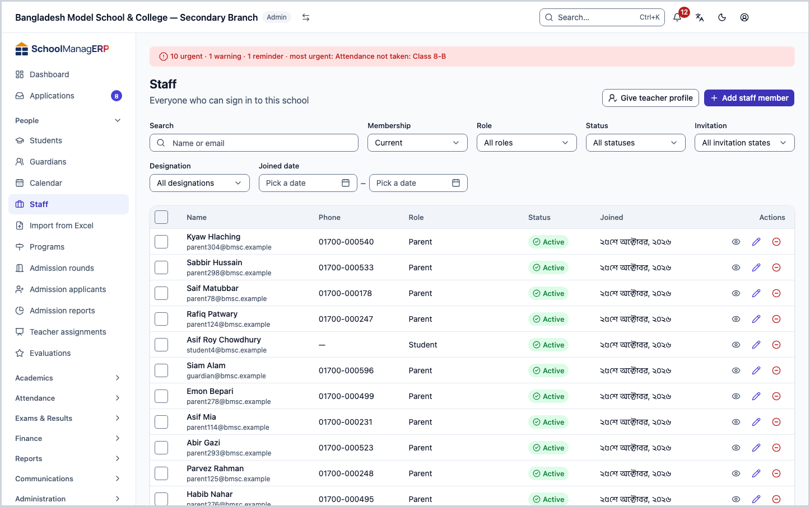
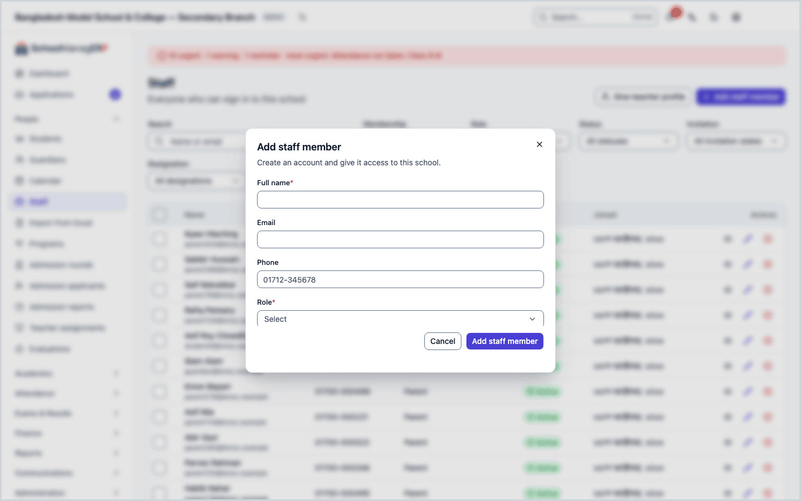
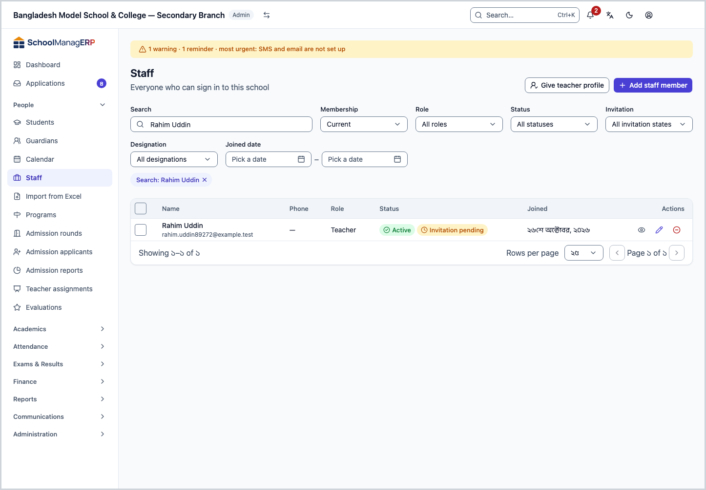

<!-- guide:meta
feature: people.staff
title: Adding and managing staff
summary: Add school staff, change their contact details, send invitations, give teacher profiles, and remove people from the school or bring them back.
roles: [ADMIN]
sources:
  - client-admin/src/routes/_staff/staff/index.tsx
  - client-admin/src/routes/_staff/staff/$userId.tsx
  - client-admin/src/routes/_staff/staff/-add-user-dialog.tsx
  - client-admin/src/routes/_staff/staff/-edit-user-dialog.tsx
  - client-admin/src/routes/_staff/staff/-promote-teacher-dialog.tsx
  - client-admin/src/routes/_staff/staff/-edit-teacher-dialog.tsx
  - client-admin/src/routes/_staff/staff/-remove-member-dialog.tsx
  - client-admin/src/routes/_staff/staff/-restore-member-dialog.tsx
  - client-admin/src/routes/_staff/staff/-detail/invitation-card.tsx
  - client-admin/src/routes/_staff/staff/-detail/reset-password-dialog.tsx
  - client-admin/src/routes/_staff/staff/-detail/profile-tab.tsx
  - client-admin/src/routes/_staff/staff/-detail/teaching-assignments-tab.tsx
  - server/src/modules/users/users.controller.ts
  - server/src/modules/users/users.service.ts
labels:
  [
    staff:list.*,
    staff:filters.*,
    staff:former.*,
    staff:roles.*,
    staff:roleDescriptions.*,
    staff:addUser.*,
    staff:editUser.*,
    staff:teacherForm.*,
    staff:removeMember.*,
    staff:resetDialog.*,
    staff:detail.*,
    nav:items.staff,
    nav:groups.people,
    common:status.user.*,
    common:status.invitation.*,
    common:accessDenied.*,
    onboardingPeople:heading,
    onboardingPeople:byHand,
  ]
helpIds:
  [
    people.staff,
    people.staff.action.add,
    people.staff.action.remove,
    people.staff.action.resetPassword,
    people.staff.action.promoteTeacher,
    people.staff.field.role,
    people.staff.field.employeeId,
    people.staff.field.designations,
    people.staff.action.edit,
  ]
devices: [desktop]
entry: [sidebar, palette, page:admin.createSchool]
keywords:
  [কর্মী, শিক্ষক, স্টাফ, কর্মী যোগ, আমন্ত্রণ, ভূমিকা, শিক্ষক প্রোফাইল, প্রাক্তন, staff, add staff, invite, remove, restore]
appVersion: 0.1.0 (e81ef857f)
owner: tareq89
lastVerified: 2026-10-24
knownIssues: []
-->

# Adding and managing staff

Add the people who can sign in to your school, change their details, and remove them from the school or bring them back when you need to.

**Go to:** **People → Staff** in the left menu. Do the work on this page on a computer.
**Before you start:** be the school's Admin ([who can do what](#roles)). Have at least one email address or phone number for the person you will add, because the sign-in invitation goes there.

This page is about the **staff list**. The list holds everyone at the school: teachers, accountants, office staff, admins and more. Each person has a **role** (for example Teacher or Accountant), and the role decides what they see and do in the app. You cannot change a role from here. The role is chosen when you add the person.

[Add a staff member](#task-main) · [Search and filter](#task-find) · [Give teacher profile](#task-teacher) · [Remove from school](#task-remove) · [Problems and fixes](#trouble)

**On this page**

- [How you get here](#arrive)
- [Add a staff member](#task-main)
- [How to know the person was added](#confirm)
- [Other situations](#other)
  - [Search and filter the list](#task-find)
  - [Change contact details](#task-edit)
  - [Give a teacher profile](#task-teacher)
  - [Resend or revoke an invitation](#task-invite)
  - [Reset a password](#task-reset)
  - [Remove from the school](#task-remove)
  - [Bring a former staff member back](#task-restore)
  - [Print staff ID cards](#task-print)
  - [The staff member's page: the tabs](#task-detail)
- [Problems and fixes](#trouble)
- [Who can do what](#roles)
- [Learn more](#more)

---

## How you get here 

**From the left menu:** press **People → Staff**. Start at step 1 below.

**From search:** in the search box at the top (Ctrl+K) type **Add staff member** or **Make a staff member a teacher** and choose it. → The staff list opens with the matching dialog already open (**Add staff member** or **Give a teacher profile**). How search works: [Find any page](../start/find-anything.md).

**From the setup wizard of a new school:**

1. In the wizard's **Add your people** step, on the **Teachers and staff** card, press **Add one by one**. The rest of the wizard: [Creating a school and the setup wizard](../admin/create-school.md).
2. → The staff list opens with the **Add staff member** dialog already open. Start at step 3 below.

---

## Add a staff member 

1. Press **People → Staff** in the left menu.

   → The **Staff** title at the top, and below it "Everyone who can sign in to this school". Below that is the list of staff: **Name**, **Phone**, **Role**, **Status**, **Joined**.

2. Press **Add staff member** at the top of the page.

   → A dialog opens with the title **Add staff member**: "Create an account and give it access to this school."

3. In **Full name**, type the person's full name.

   → The field is required. If you leave it empty, it shows **Enter the person's full name.**

4. Type an **Email** or a **Phone** (both is better). Type the phone number in English digits, for example `01712345678`.

   → The invitation goes to this address. Give at least one; if both are empty, it shows **Enter an email or a phone number so we can send the invitation.** and nothing is added.

5. In **Role**, press **Choose a role**, then pick one from the list.

   → Under each role the list shows one line about what it can do, for example for Teacher: "Own classes and sections: attendance, homework and marks." If you go on without a role, it shows **Choose a role.**

6. Press **Add staff member** at the bottom of the dialog.

   → The dialog closes and the new person appears in the list. The **Status** column shows two badges, **Active** and **Invitation pending**. A link to activate the account goes to their email or phone. The link works for 7 days.

> **Remember:** nothing reaches the system until you press **Add staff member**. Adding the person is not the end of the work: for a teacher, [give a teacher profile](#task-teacher), then give them sections on the [Teacher assignments](teaching-assignments.md) page. Otherwise they will see no section.

**If the person already has an account:** if an account already exists for the same email or phone, at another school or earlier, you see **A user with this email already exists.** (for a phone number, under the phone field) or **This person already has an account. Send them a join request instead.** Then:

| You press                                            | What happens                                                                                                                     | Saved?                                               |
| ---------------------------------------------------- | -------------------------------------------------------------------------------------------------------------------------------- | ---------------------------------------------------- |
| **Send join request**                                | The request goes to them. The message **Join request sent. They will be added when they accept.** appears and the dialog closes. | Yes, a request; they are not staff until they accept |
| Change the email or phone, then **Add staff member** | The app tries again with the other address; the earlier message goes away.                                                       | Yes, a new account                                   |
| **Cancel**                                           | Nothing changes.                                                                                                                 | No                                                   |

The request reaches someone only when that email or phone is verified on the account. The same message appears when nothing matches. So the message alone does not tell you whether the request reached anyone. Tell the person to expect the request and accept it, and check the list for them after a few days.

If the person is already on your school's staff, it shows **This person is already on your staff.**

---

## How to know the person was added 

Staff details are saved only when you are online. You cannot save this work on a phone or computer and send it later. So there is no **Saved on this device** state here.

| State                           | How you can tell                                      | What next                                          |
| ------------------------------- | ----------------------------------------------------- | -------------------------------------------------- |
| **Changed on screen only**      | The dialog is open and filled in, but has not closed  | Press **Add staff member**                         |
| **Reached the school's system** | The dialog has closed and the new name is in the list | Done. Ask them to use the invitation within 7 days |

**To check:** reload the page, then type the name in **Search**. If it appears in the list, it is in the system. Press the person's name to see their **Invitation** state on their page.

**If no message appears:** see [Problems and fixes](#trouble). What you typed stays in the dialog; nothing is lost.

---

## Other situations 

### Search and filter the list 

1. In **Search** above the staff list, type a name or an email.

   → A moment after you stop typing, the list gets shorter. If nothing matches, it shows **No users found**.

2. To narrow it further, use the other fields:

   | Field           | What to choose                                                                                                             |
   | --------------- | -------------------------------------------------------------------------------------------------------------------------- |
   | **Membership**  | **Current** (the usual view) or **Former** (people removed from the school)                                                |
   | **Role**        | One role, for example **Teacher**. If you choose none: **All roles**                                                       |
   | **Status**      | **Active**, **Inactive** or **Suspended**                                                                                  |
   | **Invitation**  | **Invitation pending**, **Invitation expired**, **Activated** and so on. This is where you catch who has not signed in yet |
   | **Designation** | One designation. If you choose none: **All designations**                                                                  |
   | **Joined date** | Two dates, **Joined from** and **Joined to**                                                                               |

3. Press a column name (**Name**, **Joined**, **Status**) to sort by it.

> **Remember:** filters only change what you see. They change nobody's details.

### Change contact details 

1. In the staff list, press **Edit** at the end of the person's row. (On the person's page, press **Edit** at the top.)

   → The **Edit user** dialog opens. It says: "Update this person's contact details. Their role and status cannot be changed here."

2. Change **Full name**, **Email** or **Phone**. If you empty the phone, the phone is deleted.

   → Under email and phone it says: **Changing this marks it unverified.** On the person's page it then shows **Not verified**.

3. Press **Save changes**.

   → The dialog closes. If the person also belongs to another school, a message appears: **This person also belongs to another school. We sent them a link to approve the new contact; it changes only after they approve.** Until they approve, the old address stays.

You cannot empty the email of someone who has one: it shows **Email cannot be empty.**

### Give a teacher profile 

Adding someone with the **Teacher** role does not create a separate **teacher profile** by itself. Without a profile you cannot give them sections on the [Teacher assignments](teaching-assignments.md) page. (When you [import](staff-import.md) from Excel, the teacher profile is created automatically.) Giving a profile does not create a new person and does not change their role.

1. Press **Give teacher profile** above the staff list.

   → The **Give a teacher profile** dialog opens.

2. In **Member**, choose the staff member.

   → People who already have a profile do not appear in the list. If nobody is left, it says **No members without a teacher profile match**.

3. Type the **Employee ID**. There is one per person in the school; it cannot match anyone else's.

4. If you need to, fill in **Designations** (for example **Assistant teacher**), **Subject specialization** and **Joining date**. You can leave these empty.

5. Press **Give teacher profile**.

   → The dialog closes. On the person's page you now see the **Teacher profile** card and the **Teacher assignments** tab.

> **Remember:** an Admin, Accountant or Academic coordinator already has an employee ID. If you give them a profile, that ID stays; the ID you type is not used.

To change profile details later, open the **Profile** tab on the person's page and press **Edit** on the **Teacher profile** card. The dialog is titled **Edit teacher profile**; make the change and press **Save changes**.

### Resend or revoke an invitation 

Until someone activates their account, a card about the invitation shows at the top of their page.

1. Press the person's name. Look at the card above the **Profile** tab.

   → The card's title is their state: **Invitation pending**, **Invitation expired** or **Invitation revoked**, with an explanation below. Once the account is active, the card is gone.

2. To send a new link, press **Resend invitation**.

   → It shows **Invitation resent to {name}.** The earlier link stops working.

3. To switch the link off, press **Revoke invitation** (the button shows only in the **Invitation pending** or **Invitation expired** state).

   → The **Revoke this invitation?** dialog opens.

| You press             | What happens                                                                                                                     | Saved? |
| --------------------- | -------------------------------------------------------------------------------------------------------------------------------- | ------ |
| **Revoke invitation** | The current link stops working. **Invitation revoked for {name}.** appears. They cannot activate the account without a new link. | Yes    |
| **Cancel**            | Nothing changes.                                                                                                                 | No     |

### Reset a password 

Do this when someone forgot their password or you suspect their account. You cannot reset your own password here; the button does not show on your own page.

1. Press **Reset password** at the top of the person's page.

   → The **Reset password?** dialog opens. It says they will get a new sign-in code and be signed out of every device they are signed in on now. If they have a phone: **A code will be sent by SMS to their phone.** If not: **A reset link will be sent to their email.**

2. Press **Reset password** in the dialog.

   → The dialog closes and the message **Password reset sent to {name}.** appears.

| You press          | What happens                                                | Saved? |
| ------------------ | ----------------------------------------------------------- | ------ |
| **Reset password** | A code or link is sent; they are signed out of every device | Yes    |
| **Cancel**         | Nothing changes                                             | No     |

If they have neither a phone nor an email, the dialog shows **This user has no phone or email on file — a reset can't be sent.** and the button is off. First [change contact details](#task-edit).

### Remove from the school 

Remove someone who has left the school. Their account is not deleted; they only lose access to this school.

1. In the staff list, press **Remove from school** at the end of the person's row. (The person's page has a button with the same name at the top.)

   → The **Remove from this school** dialog opens. It says they will lose access to this school; their account and history remain; any memberships at other schools are unaffected; you can bring them back later from the **Former** filter.

2. Press **Remove access**.

   → The dialog closes and the person leaves the **Current** list. If you removed them from their own page, you go back to the staff list.

| You press         | What happens                                                                                | Saved? |
| ----------------- | ------------------------------------------------------------------------------------------- | ------ |
| **Remove access** | They lose access to this school; account and history stay; they move to the **Former** list | Yes    |
| **Cancel**        | Nothing changes                                                                             | No     |

> **Remember:** removing someone does not delete their teacher profile; they only lose access to this school. To give a teacher's sections to someone else, see the [Teacher assignments](teaching-assignments.md) page.

You cannot remove yourself: it shows **You cannot remove your own account from this school.** and the button is off. You also cannot remove the school's only admin: **You are the only admin here. Make someone else an admin first.**

### Bring a former staff member back 

1. In **Membership** above the staff list, choose **Former**.

   → The list shows only people who were removed. The **Status** column says **Left on {date}**. If there is nobody, it shows **No former staff**.

2. Press **Bring back** at the end of the row.

   → The **Bring back** dialog opens: "Bring {name} back to this school? They get their access again."

3. Press **Bring back** in the dialog.

   → The message **{name} is back.** appears and the person leaves the former list.

| You press      | What happens                                               | Saved? |
| -------------- | ---------------------------------------------------------- | ------ |
| **Bring back** | They get their access again and return to the current list | Yes    |
| **Cancel**     | Nothing changes                                            | No     |

### Print staff ID cards 

1. In the staff list (while viewing **Current**), tick the box beside each row to choose staff. To choose everyone at once, use the box in the header row (**Select all rows on page**).

   → A button such as **Print ID cards (2)** appears; the number is how many you chose. To clear the choice, press **Clear selection**.

2. Press **Print ID cards (number)**.

   → The print preview page opens. The rest of the steps: [Staff ID cards](../administration/print-templates/id-cards.md).

### The staff member's page: the tabs 

Press a person's name in the list, or **View**, to open their page. At the top are their name, status, role, the date they joined this school and their last sign-in (**Not yet** if they have never signed in). The tabs are below:

| Tab                                                 | What it holds                                                                                                                            |
| --------------------------------------------------- | ---------------------------------------------------------------------------------------------------------------------------------------- |
| **Profile**                                         | Contact (email, phone, whether verified), the account creation date, the **Teacher profile** card for a teacher, and the invitation card |
| **Permissions**                                     | What their role can do, in groups. For viewing only; you cannot change it person by person                                               |
| **Teacher assignments**                             | Only with a teacher profile. Which duty in which class and section, and **Assign** / **Remove assignment**                               |
| **HR record**                                       | The person's personal and job details                                                                                                    |
| **ACR**, **Incidents**, **Performance**             | Staff evaluation                                                                                                                         |
| **Documents**                                       | The staff photo, ID card printing and the list of earlier prints                                                                         |
| **Attendance & Leave**                              | The person's attendance and leave balance                                                                                                |
| [**Applications**](../applications/applications.md) | Applications filed in the person's name                                                                                                  |
| **Login history**                                   | When, and from which IP address and device, they signed in                                                                               |

Which tabs you see depends on your permissions. To see and change the assignments of every teacher in one place, see the [Teacher assignments](teaching-assignments.md) page.

---

## Problems and fixes 

| What you see                                                                                                                 | What to do                                                                                                                                | Who can help |
| ---------------------------------------------------------------------------------------------------------------------------- | ----------------------------------------------------------------------------------------------------------------------------------------- | ------------ |
| **You don't have access to this page.**                                                                                      | Only an Admin sees the staff pages. Press **Back to dashboard**.                                                                          | Admin        |
| **Could not load users. Please try again.**                                                                                  | Check your internet and reload the page.                                                                                                  | Admin        |
| **Could not add the user. Please try again.**                                                                                | Check your internet. See whether the name has already come into the list; if it has, do not add it again.                                 | Admin        |
| **A user with this email already exists.**                                                                                   | Check the spelling of the email. If it is right, the person already has an account; send a join request.                                  | Admin        |
| **This person is already on your staff.**                                                                                    | Use **Search** to find the name in the list. There is nothing more to add.                                                                | Admin        |
| **Enter an email or a phone number so we can send the invitation.**                                                          | Type an **Email** or a **Phone**, then press **Add staff member** again.                                                                  | Admin        |
| **Choose a role.**                                                                                                           | Pick one in **Role**.                                                                                                                     | Admin        |
| **Could not save the changes. Please try again.**                                                                            | Check your internet and press **Save changes** again. What you typed stays.                                                               | Admin        |
| **This employee ID is already in use in this school.**                                                                       | Type a different **Employee ID**.                                                                                                         | Admin        |
| **This person already has a teacher profile.**                                                                               | You do not need to give one again. Press **Edit** on the **Teacher profile** card on their page.                                          | Admin        |
| **This person keeps their staff employee ID, and another teacher already uses it. Change that teacher's employee ID first.** | Open the page of the teacher who uses the ID, press **Edit** on the **Teacher profile** card, change the **Employee ID**, then try again. | Admin        |
| **That person is not a member of this school.**                                                                              | Reload the list. If they were removed, [bring them back](#task-restore) first.                                                            | Admin        |
| **Could not remove this member. Please try again.**                                                                          | Check your internet and press **Remove access** again.                                                                                    | Admin        |
| **Could not bring this person back. Please try again.**                                                                      | Check your internet and press **Bring back** again.                                                                                       | Admin        |
| **Could not resend the invitation. Please try again.**                                                                       | Check that they have an email or phone ([change contact details](#task-edit)), then press **Resend invitation** again.                    | Admin        |
| **Could not reset this password. Please try again.**                                                                         | Check your internet and press **Reset password** again.                                                                                   | Admin        |
| The person is not in the list                                                                                                | Check **Membership**: they may be **Former**. Also clear any other filter that is on.                                                     | Admin        |

---

## Who can do what 

| Role                                                                                       | See the list and a staff member's page | Add, edit, reset, give a teacher profile | Remove from school and bring back          |
| ------------------------------------------------------------------------------------------ | -------------------------------------- | ---------------------------------------- | ------------------------------------------ |
| Admin                                                                                      | Yes                                    | Yes (not a reset of your own password)   | Yes (not yourself, and not the only admin) |
| Academic coordinator, Teacher, Accountant, Office staff, Exam controller, Committee member | No                                     | No                                       | No                                         |

Someone without permission who opens the page sees **You don't have access to this page.**, and **Staff** is not in their left menu.

---

## Learn more 

<strong>The parts of the page</strong> — top to bottom

1. **Staff** — the title and the small line under it.
2. **Give teacher profile** and **Add staff member** — the two buttons at the top of the page.
3. **The filter row** — **Search**, **Membership**, **Role**, **Status**, **Invitation**, **Designation**, **Joined date**.
4. **The list** — **Name**, **Phone**, **Role**, **Status**, **Joined**; at the end of each row, **View**, **Edit**, **Remove from school**.

<strong>What the fields mean</strong>

<!-- guide:generated:fields:staff -->

| Field                  | What to enter                                                                                                                        | Required?                        |
| ---------------------- | ------------------------------------------------------------------------------------------------------------------------------------ | -------------------------------- |
| Full name              | The person's full name.                                                                                                              | Yes                              |
| Email                  | Where the invitation goes. If an account already exists with the same email, you must send a join request.                           | No, but give an email or a phone |
| Phone                  | In English digits, for example 01712345678. If you give no email, the invitation goes to the phone.                                  | No, but give an email or a phone |
| Role                   | Teacher, Accountant, Office staff and so on. The role decides what the person sees in the app. It cannot be changed from here later. | Yes                              |
| Member                 | The person you will give a teacher profile. Someone who already has a profile does not appear in the list.                           | Yes                              |
| Employee ID            | This teacher's own ID in the school; no two people share one. If they already have an employee ID, that one stays.                   | Yes                              |
| Designations           | One or more of Class teacher, Subject teacher, Head teacher, Assistant teacher, Principal, Vice principal, Coordinator.              | No                               |
| Subject specialization | The subject the teacher is strong in, for example Maths. Free text.                                                                  | No                               |
| Joining date           | When they joined the school.                                                                                                         | No                               |

<!-- /guide:generated -->

<strong>How staff works</strong> — from adding to sign-in, then pages by role

<figure>
  
  <figcaption><em>From adding staff to the pages for each role</em></figcaption>
</figure>

- The role decides what staff see. A teacher sees the work of their own sections; an accountant sees fees and money work. What each role sees: [How everything in the school fits together](../admin/how-it-works.md).
- A teacher really sees a section only once you give it to them on the [Teacher assignments](teaching-assignments.md) page. After that they can take that section's [attendance](../attendance/attendance.md).
- The invitation arrives by email or phone. Once the account is active, the invitation card is gone.

<strong>The whole task in one go</strong>

<figure>
  
  <figcaption><em>From a new staff member to their teacher profile</em></figcaption>
</figure>

**Related pages**

- [**Importing from Excel**](staff-import.md) — add many staff at once.
- [**Teacher assignments**](teaching-assignments.md) — give a teacher a class, section and subject.
- [**Staff attendance and leave**](../attendance/staff-attendance.md) — staff attendance and leave.
- [**Evaluations: ACR, teacher surveys and incidents**](evaluations.md) — evaluations of staff.
- [**Activity log**](../administration/audit-logs.md) — See who created, changed or deleted what in the school, and who signed in, from newest to oldest.
- [**Printing ID cards, certificates and exam papers**](../administration/print-templates.md) — Make a print design from a ready-made one, publish it and make it the default.
- [**Printing ID cards**](../administration/print-templates/id-cards.md) — Print ID cards for one student or staff member, a few people or a whole section.
- [**Roles and permissions**](../administration/roles.md) — See side by side what each staff role in the school can see and do, on one page. The page is view-only.

---

_Version 0.1.0 · Last checked 2026-10-24_
