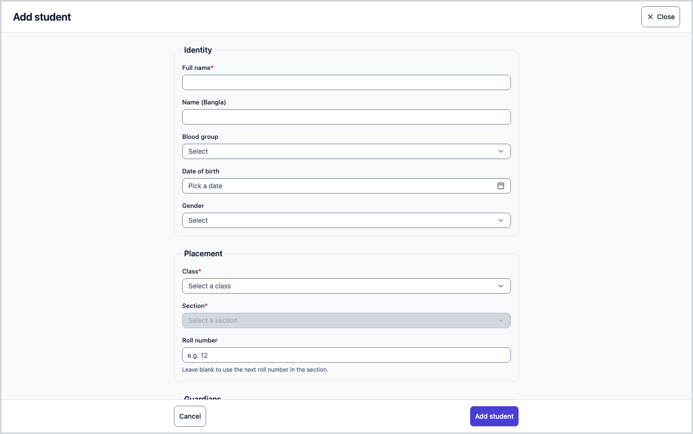
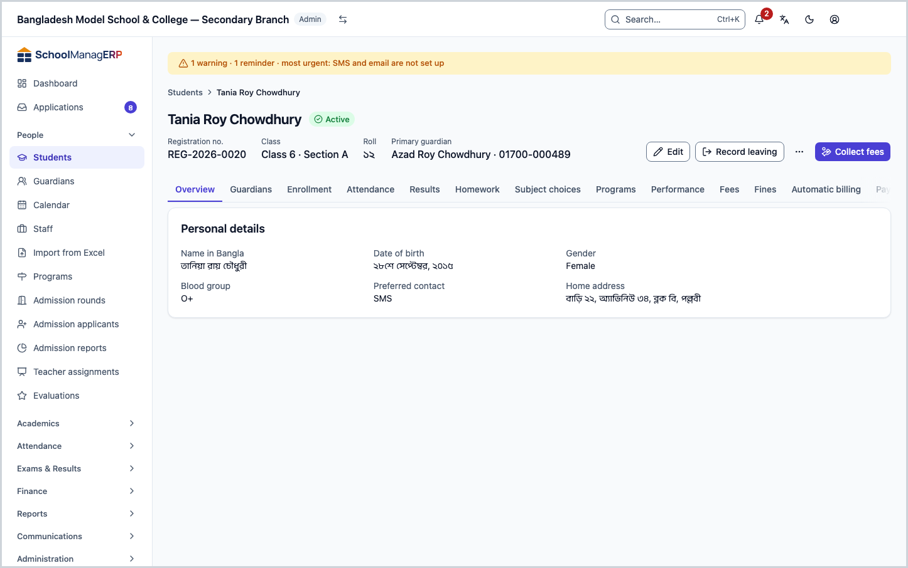

<!-- guide:meta
feature: people.students
title: Adding students and viewing their details
summary: Add a new student, import many at once, and use each student's profile to handle class, guardians, fees, notes and leaving the school.
roles: [ADMIN, ACCOUNTANT, TEACHER, EXECUTIVE, OFFICE_STAFF, EXAM_CONTROLLER]
sources:
  - client-admin/src/routes/_staff/students/index.tsx
  - client-admin/src/routes/_staff/students/new.tsx
  - client-admin/src/routes/_staff/students/$studentId.tsx
  - client-admin/src/routes/_staff/students/$studentId_.edit.tsx
  - client-admin/src/routes/_staff/students/-student-form.tsx
  - client-admin/src/routes/_staff/students/-student-form-schema.ts
  - client-admin/src/routes/_staff/students/-guardian-picker.tsx
  - client-admin/src/routes/_staff/students/-bulk-photo-dialog.tsx
  - client-admin/src/routes/_staff/students/-send-reminder-dialog.tsx
  - client-admin/src/routes/_staff/students/import.tsx
  - client-admin/src/routes/_staff/students/-import/template.ts
  - client-admin/src/routes/_staff/students/-detail/*.tsx
  - server/src/modules/students
labels:
  [
    students:*,
    fees:statement.*,
    student-lifecycle:*,
    student-notes:*,
    student-records:*,
    studentImport:*,
    bulkImport:*,
    nav:groups.people,
    nav:items.students,
    common:status.enrollment.*,
    common:actions.cancel,
    common:actions.close,
    trial:seatLimit.*,
    trial:import.backToSetup,
    backup:migrateWholeSchool,
    exams:detail.tabs.results,
    exams:detail.tabs.fourthSubject,
    programs:detail.tabs.programs,
    performance:title,
  ]
helpIds:
  [
    people.students,
    people.students.action.add,
    people.students.action.import,
    people.students.action.recordLeaving,
    people.students.action.readmit,
    people.students.action.delete,
    people.students.action.collectFees,
    people.students.action.sendReminder,
    people.students.field.rollNumber,
    people.students.field.bloodGroup,
    people.students.field.preferredCommunication,
    people.students.section.statement#task-fees,
  ]
devices: [desktop]
entry: [sidebar, palette, page:welcome]
keywords:
  [
    student,
    pupil,
    admission,
    profile,
    import,
    readmit,
    withdraw,
    transfer,
    roll number,
    leaving school,
    শিক্ষার্থী,
    ছাত্র,
    ছাত্রী,
    ভর্তি,
    প্রোফাইল,
    আমদানি,
    স্কুল ছাড়া,
    পুনরায় ভর্তি,
    রোল নম্বর,
  ]
appVersion: 0.1.0 (e81ef857f)
owner: tareq89
lastVerified: 2026-10-24
knownIssues: []
-->

# Adding students and viewing their details

Add a new student, import many at once, and use each student's profile to see and manage everything about them.

**Where to go:** In the left menu, **People → Students**. This page is written for a computer.
**Before you start:** The school needs at least one [class](../help/glossary.md#class) and a [section](../help/glossary.md#section) in it. If not, see the [school setup order](../admin/setup-order.md).

Every student has a **profile**. The profile is their own page: at the top their name, registration number, class and roll, and below it all their other details split into tabs (guardians, attendance, fees, notes and more). Everywhere else on this page, "profile" means this page.

[Add one student](#task-main) · [Import many](#task-import) · [Record leaving](#task-leave) · [Problems and fixes](#trouble)

**On this page**

- [How you get here](#arrive)
- [Add one student](#task-main)
- [How to know the student was added](#confirm)
- [Other situations](#other)
  - [Find and filter students](#task-find)
  - [Change a student's details](#task-edit)
  - [The profile page and its tabs](#task-profile)
  - [Add a guardian](#task-guardians)
  - [Collect fees and send reminders](#task-fees)
  - [Move to another class or section](#task-move)
  - [Record that a student is leaving](#task-leave)
  - [Readmit a student](#task-readmit)
  - [Write a note](#task-notes)
  - [Family, health and public exam details](#task-records)
  - [Photo, ID card and documents](#task-documents)
  - [Upload many photos at once](#task-photos)
  - [Import many students at once](#task-import)
  - [Delete a student](#task-delete)
- [Problems and fixes](#trouble)
- [Who can do what](#roles)
- [Learn more](#more)

---

## How you get here 

**From the left menu:** **People → Students**. The student list opens; start at step 1 below.

**From search:** in the [search box at the top (Ctrl+K)](../help/glossary.md#palette) type "students" and choose **Students**. The list opens.

**From step 5 of school setup**

1. While setting up a new school you are at the student step, which is where this page comes from: [School setup order, step 5](../admin/setup-order.md#step-5).
2. Press the link there to import students. → The **Import students** page opens. At the top is a **Back to setup** link. The import steps are [here](#task-import).
3. When you are done, press **Back to setup**. → You return to the setup page.

---

## Add one student 

1. In the left menu press **People**, then the inner **Students**.

   → The student list appears.

2. At the top right press **Add student**.

   → The **Add student** form opens. It has four parts: **Identity**, **Placement**, **Guardians**, **Preferences**.

3. In **Identity**, type the **Full name**. This is the only required name. If you like, also fill in **Name (Bangla)**, **Blood group**, **Date of birth** and **Gender**.

4. In **Placement**, choose the **Class**, then the **Section**. The section box does not open until you choose a class. You can leave **Roll number** empty.

   → If you leave the roll empty, the next free roll number in the section is filled in for you.

5. In **Guardians**, type a name or phone number in **Search guardians** and choose from the list. If you cannot find them, press **Add a new guardian**. More: [Add a guardian](#task-guardians).

   → The person you chose appears under **Linked guardians**.

6. In **Preferences**, check **Preferred contact** (it starts as **SMS**). If you like, type the **Home address**.

7. At the bottom press **Add student**.

   → There is no separate message. The app goes straight to the new student's profile. At the top you see their name and their new **Registration no.**.

> **Keep in mind:** the student and their guardian links reach the school's system only when you press **Add student** in the last step. A guardian you create with **Add guardian** is saved at once, even if you then leave the form. You do not type the registration number; the system creates it.

---

## How to know the student was added 

| State                           | How you can tell                                                                                                                                                             | What next              |
| ------------------------------- | ---------------------------------------------------------------------------------------------------------------------------------------------------------------------------- | ---------------------- |
| **Changed on screen only**      | You typed in the form but have not submitted. If you open the form again on this device, the top may say **You have an unsaved draft of this form.** with **Restore draft**. | Press **Add student**. |
| **Reached the school's system** | The app opened the new student's profile and the registration number is at the top.                                                                                          | Done.                  |

This form cannot keep a student on your device while the internet is off. So the middle state ("Saved on this device") does not happen here.

**To verify:** open **People → Students** and type the name in **Search**. If the name appears in the list, the student is in the system.

**If the profile did not open:** look for red text at the bottom of the form, and check [Problems and fixes](#trouble). What you typed is still on screen.

**If you try to leave the page without submitting**, the app asks **Leave without saving?**

| You press                | What happens                                        | Saved?  |
| ------------------------ | --------------------------------------------------- | ------- |
| **Stay on this page**    | You stay on the form; everything you typed remains. | Not yet |
| **Leave without saving** | You leave the page; unsaved changes are lost.       | No      |

---

## Other situations 

### Find and filter students 

1. Above the list, type a name, roll or registration number in **Search**.

   → The list shrinks to the students who match.

2. If needed, add filters: **Class**, **Section**, **Status**, **Gender**, **Date of birth** (from–to). If the school has two or more [shifts](../help/glossary.md#shift) or [versions](../help/glossary.md#version), **Shift** and **Version** filters appear too.
3. Press **Columns** to choose which columns to show. **Date of birth**, **Gender**, **Address** and **Preferred contact** are hidden at first.
4. Press the **Registration No.** or **Name** column heading to sort (ascending or descending).
5. Tick the boxes on the left to choose several students.

   → A few buttons appear at the top: **Send reminder**, **Print ID cards (N)**, **Export CSV** and **Clear selection**. You see only the ones your role may use.

If you choose both **Class** and **Section** in the filters, a **Print ID cards for whole (section name)** button appears. It prints the cards of the whole section at once.

At the end of each row in the list are **View** (opens the profile), **Edit** and **Collect fees**.

If you got here by pressing a number in the [Student count (BANBEIS)](../reports/student-count.md) report, the class and gender are already chosen, and **Go back** at the top returns you to that report.

### Change a student's details 

1. Press **Edit** on the row in the list, or **Edit** at the top of the profile.

   → The **Edit student** form opens with the current details filled in.

2. Change what you need.
3. Press **Save changes**. If nothing has changed, the button cannot be pressed.

   → The app returns to the profile with the new details.

To leave without changing anything, press **Cancel**. If something has changed, the app asks **Leave without saving?** as before ([decision table](#confirm)).

### The profile page and its tabs 

Press a name in the list, or **View**, to open the profile.

- **Top row:** **Registration no.**, **Class** (class · section), **Roll**, and the **Primary guardian** (name and phone).
- **Status:** a badge next to the name: **Active**, **Inactive**, **Transferred** or **Graduated**.
- **Action buttons:** **Edit**, **Record leaving** or **Readmit**, **Collect fees**, **Send reminder**, **Print ID card**, **Delete**. You see only what your role may do ([Who can do what](#roles)).

The tabs come in this order:

| Tab                                                 | What it shows                                                                                                                               |
| --------------------------------------------------- | ------------------------------------------------------------------------------------------------------------------------------------------- |
| **Overview**                                        | **Personal details**: date of birth, gender, Bangla name, blood group, address, preferred contact.                                          |
| **Guardians**                                       | Linked guardians: name, relationship, phone, email, and who is the **Primary contact**.                                                     |
| **Enrollment**                                      | **Enrolment history**: which class in which academic year. From here you can **Move class** ([see](#task-move)).                            |
| **Attendance**                                      | Month by month: present, absent, late, leave, and the attendance rate.                                                                      |
| **Results**                                         | Every exam result, published or not. Results not yet published are marked separately.                                                       |
| **Homework**                                        | Total homework, how many are done, how many are overdue, and the completion rate.                                                           |
| **Subject choices**                                 | Choosing one of the optional subjects the class has (for example the fourth subject).                                                       |
| **Programs**                                        | The program the student is enrolled in, with progress and milestones.                                                                       |
| **Performance**                                     | A summary built from marks. Only people who may see marks get this tab.                                                                     |
| **Fees**                                            | Total billed, total paid, dues; **Open bills**, **Credit balance**, **History**, **Discounts** and **Statement**.                           |
| [**Fines**](../finance/fines.md)                    | All of this student's [fines](../help/glossary.md#fine).                                                                                    |
| **Automatic billing**                               | Which recurring bills the student is on, and which they are left out of.                                                                    |
| [**Payments**](../finance/payments.md)              | All money received, with date and method.                                                                                                   |
| [**Invoices**](../finance/invoices.md)              | Invoices issued; you can **Print** them.                                                                                                    |
| **Communication**                                   | Messages and reminders sent to the guardian.                                                                                                |
| **Notes**                                           | Staff-only notes ([see](#task-notes)). The tab is missing if you may not see notes.                                                         |
| **Records**                                         | Family, health and public exam details ([see](#task-records)). Missing if you may not see records.                                          |
| **Documents**                                       | Photo, ID card, certificates and the list of printed papers ([see](#task-documents)). Needs print, certificate or print-history permission. |
| [**Applications**](../applications/applications.md) | Applications submitted for this student. Missing if you may not handle applications.                                                        |
| **Activity**                                        | Who changed what in this student's details, and when.                                                                                       |

### Add a guardian 

1. In the add or edit form, go to **Guardians**.
2. Type a name or phone number in **Search guardians**. Choose the person from the list.

   → They appear under **Linked guardians**. Made a mistake? Press the remove button next to the name.

3. If you cannot find them, press **Add a new guardian**. Fill in **Guardian's full name** (required), **Guardian's relationship to student**, **Guardian's phone** and **Guardian's email**, then press **Add guardian**.
4. Press the last button of the form (**Add student** or **Save changes**). Until then the guardian is not linked to the student.

   → You will see them in the profile's **Guardians** tab.

The guardian's own page (**Guardians**) is not written in this guide yet.

### Collect fees and send reminders 

- **Collect fees:** press **Collect fees** on a row in the list or at the top of the profile. → The page for taking money opens, with this student already chosen. The rest happens on the [**Payments**](../finance/payments.md) page.
- **How much is [due](../help/glossary.md#dues):** look at the profile's **Fees** tab (the [**Student dues**](../finance/dues.md) page shows all students).
- **See or print the statement:** on the profile's **Fees** tab, open **Statement**. → At the top, **Still owed now: ৳…** in large type, or **All paid**, with the date of the last payment. Under it, a table: **Date**, **What**, **Charged**, **Paid** and **Still owed** after each line, with **Still owed at the start** and **Still owed at the end** in bold. It opens at the start of the current academic year; change **From** or **To** to see other dates (with **To** set, the top line reads **Still owed up to** that date). Money kept in advance is listed under the table and is not part of what is still owed. Press **Print** to print this statement alone, with the school's name on top. You need to be allowed to read both invoices and payments to see this tab.
- **Send reminder:** on the profile, or choose several students in the list and press **Send reminder**. Type a **Message** and press **Send**. → **Reminder sent to N guardians.** The message goes out. There is a limit on how many students one reminder can go to; if you choose more, the dialog says so.

### Move to another class or section 

Only for **Active** students, and only for people who may edit students.

1. On the profile, open the **Enrollment** tab. Press **Move class**.
2. Choose the new **Section**. Only an admin can move a student to another **Class**; everyone else sees **Only an admin can move a student to another class; use promotion.**

   → If the section is full, a warning appears, but you can still continue.

3. Press **Move**.

   → The new class · section shows in the **Enrolment history**.

Moving a whole class up at the end of the year is done on the [**Class promotion**](../exams-results/promotion.md) page.

### Record that a student is leaving 

Use this when a student is withdrawn, goes to another school or finishes their studies. Only for **Active** students.

1. At the top of the profile press **Record leaving**.

   → The **Record leaving** dialog opens. If the student has unpaid dues, the top says how much; you can still continue.

2. Choose the **Reason type**: **Withdrawn**, **Transferred to another school** or **Graduated**.
3. Choose the **Date**. A date after today is not allowed.
4. If you chose **Transferred to another school**, a **New school** box appears; type the name if you like.
5. Type the **Reason** (required). **Remark (optional)** can stay empty.
6. Press **Record leaving** (or Ctrl+Enter).

   → The status changes: **Withdrawn** gives **Inactive**, **Transferred to another school** gives **Transferred**, **Graduated** gives **Graduated**. The button at the top changes from **Record leaving** to **Readmit**.

From then on no new fee bills are made in this student's name, because bills are made only for active students. But what was already due stays due until someone writes it off.

If any bill has a due date after the leave date, the dialog does not close. It shows **Bills after the leave date** and **These bills stay as dues until you write them off.**

| You press         | What happens                                                     | Saved?                                 |
| ----------------- | ---------------------------------------------------------------- | -------------------------------------- |
| **Close**         | The dialog closes and you stay on the profile.                   | Yes, the leaving was saved before this |
| **Open Fees tab** | The profile's **Fees** tab opens; you can write off bills there. | Yes, the leaving was saved before this |

### Readmit a student 

When a student who is not active comes back:

1. At the top of the profile press **Readmit**.

   → The **Readmit student** dialog opens.

2. Choose the **Date** (not after today). Choose the **Class** and **Section**.
3. If you like, type **Reason (optional)** and **Remark (optional)**.
4. Press **Readmit**.

   → The status becomes **Active** again, and the button at the top is **Record leaving** again.

If a trial school has reached its student limit, a student cannot be readmitted. The dialog then only says **Could not save. Please try again.** ([Problems and fixes](#trouble)).

### Write a note 

Only staff see notes; guardians do not.

1. On the profile open the **Notes** tab. Press **Add a note**.
2. Type in the **Note** box (up to 2000 characters). If you like, give 1 to 5 stars in **Rating (optional)**; pressing the same star again removes the rating.
3. Press **Save note** (or Ctrl+Enter).

   → The note appears in the list with the writer's name.

A saved note cannot be changed. If it is wrong, delete it and write a new one. The delete button next to a note (**Delete note**) is visible only to the note's writer and an admin. Pressing it asks **Delete this note?**

| You press  | What happens                                    | Saved?             |
| ---------- | ----------------------------------------------- | ------------------ |
| **Cancel** | Nothing happens; the note stays.                | No                 |
| **Delete** | The note is deleted; it cannot be brought back. | Yes, it is deleted |

### Family, health and public exam details 

The profile's **Records** tab has three parts:

- **Family and health details:** **Religion**, **Birth registration no.**, **Father's name**, **Mother's name**, **Health notes**. Type them and press **Save**. → **Profile details saved.**
- **Public exams:** PSC, JSC, SSC, Dakhil, HSC, Alim. Press **Add exam**, then fill in **Exam type**, **Board**, **Roll number**, **Registration number**, **GPA**, **Passing year** and press **Save**. Use **Edit** or **Delete** on a row to change or remove it.
- **Lifecycle history:** when the student left the school and when they were readmitted, with the reason, destination and remark. This is written automatically.

If you may not write, you can only read, and you see no buttons.

### Photo, ID card and documents 

In the profile's **Documents** tab:

- **Photo:** **Upload photo** (or **Replace photo**). Use a clear passport-style photo with the face in the middle. → **Photo saved**. Only people who may edit students see this button.
- **Print ID card:** a preview page opens before printing. More: [Printing ID cards](../administration/print-templates/id-cards.md). The **Print ID card** button at the top of the profile does the same.
- **Issue certificate** and **Printed documents**: the list of papers already printed for this student.

### Upload many photos at once 

1. In the menu of extra buttons above the list, press **Upload photos**.

   → The **Upload student photos** dialog opens.

2. Name each photo with the student's registration number, for example `2024-0153.jpg`.
3. Press **Choose photos** or **Choose a folder**. Then press **Upload N photos**.

   → At the end you see three groups: **Matched**, **No matching student**, **Couldn't read**. You can copy the unmatched list with **Copy list**.

If it stops halfway, the photos sent so far are kept.

### Import many students at once 

1. Above the list press **Import students**.

   → The **Import students** page opens, with three steps.

2. **1. Download the template** — press **Download template**. The file has 13 columns. Write one student per row. Do not change the first row (the headings), and delete example row 2. To see what goes in each column, press **What goes in each column** (it is also under [Learn more](#more) below).
3. **2. Upload your file** — press **Choose file**. CSV or XLSX, at most 5 MB, at most 2,000 students per file.

   → **File received. Checking it now.** Then **Check before saving** shows how many students will be created, the first few rows, and the **Rows with problems** table.

4. If there are problem rows, press **Download problem rows (CSV)**, fix them in your own file and upload again. While any row has an **Error**, the import cannot be confirmed: fix or remove every error row and upload again. A **Warning** only lets you know.
5. When it all looks right, press **Import N students**. Press it within the time shown at the top (**Save within … or upload again**).

   → **3. Result**: **All N students were imported.** or how many were imported and how many rows had problems.

6. If you like, tick **Invite the imported students' guardians now**. At the end press **Go to the student list** or **Import another file**.

A registration number you fill in is checked and kept; a blank cell gets a number from the system. The link for the large whole-school file (**Migrating a whole school?**) is visible only to people who may manage backups.

| You press             | What happens                         | Saved? |
| --------------------- | ------------------------------------ | ------ |
| **Import N students** | The good rows are added as students. | Yes    |
| **Cancel**            | The page closes; nobody is added.    | No     |

### Delete a student 

Only an admin can do this. For a student who has left the school, [record leaving](#task-leave) instead of deleting.

1. At the top of the profile press **Delete**.

   → A red **Delete student** dialog appears: the student is removed from active lists; support can bring them back, but not from the app.

| You press  | What happens                                                                                                                          | Saved?   |
| ---------- | ------------------------------------------------------------------------------------------------------------------------------------- | -------- |
| **Cancel** | Nothing happens.                                                                                                                      | No       |
| **Delete** | The student is deleted and the app returns to the list. If fees are due or credit remains, it is not deleted (see the message below). | Yes / No |

### Set a guardian's arrival notice 

On the student's **Guardians** tab, the **Arrival notice** column shows each guardian's state: **Not asked**, **Waiting for teacher**, **Once**, **Every day**, **Done**, **Stopped**, or **Set by admin: always** / **Set by admin: never**. How it is sent (**App** or **SMS**) shows beside it. Under it you see **Set by <name> on <date>** (who last changed it) and, when an admin fixed it, **Locked by <name> on <date>**. If the guardian turned off all notifications, you see **The guardian turned off all notifications. Nothing is sent.** While the column loads it shows a grey bar; if it cannot load, it shows **—** and no button (reload the page). A teacher who is not the class teacher of this student's section does not see the column.

1. Press the three-dot button on the guardian's row (**Arrival notice for** the guardian's name).
2. Choose **Once**, **Every day** or **Stop**.

   → The mark changes. If it fails you see **Could not save. Try again.** If the school has switched arrival notices off in Settings, you see **Arrival notices are turned off at this school.**

Only an admin sees the second group in the menu: **Always** (fixes the notice on), **Never** (fixes it off) and **Let the teacher decide** (takes the admin's choice away again). While **Always** or **Never** is set, **Once**, **Every day** and **Stop** are greyed out, and the note **An admin has fixed this. It cannot be changed here.** shows under the mark. **Always** and **Never** also work on a guardian who has no arrival notice yet: the school creates it and fixes it in one step. If you cannot see the three-dot button, your role may not change arrival notices.

A request from a guardian waits for the class teacher, who answers it in [**My class**](../academics/my-class.md#task-arrival). Setting **Once** or **Every day** here answers it yourself.

---

## Problems and fixes 

| What you see                                                                                                                                                               | What to do                                                                                                                                                                                | Who can help                                                         |
| -------------------------------------------------------------------------------------------------------------------------------------------------------------------------- | ----------------------------------------------------------------------------------------------------------------------------------------------------------------------------------------- | -------------------------------------------------------------------- |
| **Failed to load students**                                                                                                                                                | Check your internet, then reopen the page.                                                                                                                                                | Admin                                                                |
| **No students found**, with **You see the students of the sections you teach this year. Ask your school admin to assign you a section.**                                   | You are a teacher and no section is in your name this year.                                                                                                                               | Admin ([teacher assignment](../help/glossary.md#teacher-assignment)) |
| As a teacher, a student's profile says "not found"                                                                                                                         | The student is not in a section you teach. Teachers see only the students of their own sections.                                                                                          | Admin                                                                |
| **Couldn't load this student.**                                                                                                                                            | Press **Retry**.                                                                                                                                                                          | Admin                                                                |
| **You don't have permission to view this.**                                                                                                                                | Your role cannot see this profile.                                                                                                                                                        | Admin                                                                |
| **Full name is required.**                                                                                                                                                 | Type a name in **Full name**.                                                                                                                                                             | —                                                                    |
| **Select a class and section.**                                                                                                                                            | Choose the **Class** first, then the **Section**.                                                                                                                                         | —                                                                    |
| **Roll number must be a positive whole number.**                                                                                                                           | Give a whole number like 1, 2, 3, or leave the box empty.                                                                                                                                 | —                                                                    |
| The form will not save because the roll number is already in that section                                                                                                  | Give another roll, or leave the box empty (the next roll is filled in).                                                                                                                   | —                                                                    |
| **The Bangla name must be 200 characters or fewer.**                                                                                                                       | Shorten the Bangla name.                                                                                                                                                                  | —                                                                    |
| **Choose a blood group from the list.**                                                                                                                                    | Choose from the list, or keep **Not set**.                                                                                                                                                | —                                                                    |
| **The guardian could not be added. Check the details and try again.**                                                                                                      | Check that the name and phone number are right.                                                                                                                                           | —                                                                    |
| **Student limit reached** (when adding)                                                                                                                                    | The trial school's student count is full. **Contact us to add more students.**                                                                                                            | Admin                                                                |
| **Choose a date.** / **The date cannot be in the future.**                                                                                                                 | Give today's date or an earlier one.                                                                                                                                                      | —                                                                    |
| **Write a reason.**                                                                                                                                                        | Type the **Reason** for leaving.                                                                                                                                                          | —                                                                    |
| **Choose a class and section.**                                                                                                                                            | Choose the class and section for the readmission.                                                                                                                                         | —                                                                    |
| **Could not save. Please try again.** (leaving or readmitting)                                                                                                             | Press again. If it keeps coming up when readmitting, a trial school may have reached its student limit.                                                                                   | Admin                                                                |
| **This student still owes fees or has wallet money. Record leaving first, or clear the money.**                                                                            | Do not delete; [record leaving](#task-leave).                                                                                                                                             | Accountant                                                           |
| **Couldn't delete the student. Try again.**                                                                                                                                | Try again.                                                                                                                                                                                | Admin                                                                |
| **Couldn't move the student. Try again.**                                                                                                                                  | Try again.                                                                                                                                                                                | Admin                                                                |
| **Could not save the note. Try again.**                                                                                                                                    | Do not delete what you typed; press **Save note** again.                                                                                                                                  | —                                                                    |
| **This file type isn't supported — choose a .csv or .xlsx file**                                                                                                           | In Excel, save the file as CSV or XLSX.                                                                                                                                                   | —                                                                    |
| **This file is too large — choose a smaller file**                                                                                                                         | Split the file (within 5 MB and 2,000 students).                                                                                                                                          | —                                                                    |
| **This check has expired**                                                                                                                                                 | Upload the same file again and confirm sooner.                                                                                                                                            | —                                                                    |
| **Import failed.**                                                                                                                                                         | Upload the file again.                                                                                                                                                                    | Admin                                                                |
| **We could not read this file. …**, **Some columns are missing. Use the sample file's columns.**, **This file has too many rows. …** or **This file has no rows in it. …** | The whole file could not be checked. Do what the sentence says: save it again as .xlsx or .csv, keep the template's first-row headers, or split it into smaller files. Then upload again. | —                                                                    |
| **Couldn't send the reminder. Nothing was sent — try again.**                                                                                                              | Send it again.                                                                                                                                                                            | —                                                                    |
| **We couldn't confirm whether the reminder went out. …**                                                                                                                   | Before sending again, check the **Communication** tab so it does not go twice.                                                                                                            | —                                                                    |
| A button or tab is missing (for example **Add student**, **Notes**, **Delete**)                                                                                            | Your role does not have it. See [Who can do what](#roles).                                                                                                                                | Admin                                                                |

---

## Who can do what 

| Role                 | See list and profile                   | Add and edit | Import | Record leaving / Readmit | Notes | Records        | Collect fees | Reminders | Print ID card | Delete |
| -------------------- | -------------------------------------- | ------------ | ------ | ------------------------ | ----- | -------------- | ------------ | --------- | ------------- | ------ |
| Admin                | Yes                                    | Yes          | Yes    | Yes                      | Yes   | Read and write | Yes          | Yes       | Yes           | Yes    |
| Accountant           | Yes                                    | Yes          | Yes    | No                       | No    | No             | Yes          | Yes       | Yes           | No     |
| Teacher              | Only the sections they teach this year | No           | No     | No                       | Yes   | Read only      | No           | No        | No            | No     |
| Academic coordinator | Yes                                    | No           | Yes    | Yes                      | Yes   | Read and write | No           | No        | No            | No     |
| Office staff         | Yes                                    | Yes          | Yes    | No                       | No    | Read and write | No           | Yes       | Yes           | No     |
| Exam controller      | Yes                                    | No           | No     | No                       | No    | No             | No           | No        | Yes           | No     |

- Moving a student to another **Class** is for admins only; others who may edit can change only the **Section**.
- **Issue certificate** is for the admin, Academic coordinator and Office staff.
- The family and health details in the **Records** tab (religion, birth registration, parents' names, health) can be written by the admin, Academic coordinator and Office staff. An accountant can add a student but cannot write these.
- A note can be deleted by its writer or an admin.

---

## Learn more 

<strong>Parts of the profile page</strong> — what is where

1. **Name and status** — the student's name, and next to it **Active** / **Inactive** / **Transferred** / **Graduated**.
2. **Facts strip** — **Registration no.**, **Class**, **Roll**, **Primary guardian**.
3. **Action buttons** — **Edit**, **Record leaving** or **Readmit**, **Collect fees**, and the rest in the menu of extra buttons.
4. **Tab row** — see [The profile page and its tabs](#task-profile).
5. **Tab content.**

<strong>Keyboard shortcuts</strong> (on a computer)

| Key            | Where                            | What it does         |
| -------------- | -------------------------------- | -------------------- |
| `Ctrl + Enter` | In the **Add a note** dialog     | Saves the note       |
| `Ctrl + Enter` | In the **Record leaving** dialog | Records the leaving  |
| `Ctrl + K`     | On any page                      | Opens the search box |

<strong>What each box means</strong>

<!-- fields table: hand-written; wave close registers fields:students in guide-gen and swaps in the generated markers -->

| Box                       | What to type                                                                                                               | Required? |
| ------------------------- | -------------------------------------------------------------------------------------------------------------------------- | --------- |
| Full name                 | The student's full name.                                                                                                   | Yes       |
| Name (Bangla)             | The name in Bangla, up to 200 characters. It is printed on the ID card.                                                    | No        |
| Blood group               | One of A+, A-, B+, B-, AB+, AB-, O+, O-, or **Not set**.                                                                   | No        |
| Date of birth             | A date from the calendar.                                                                                                  | No        |
| Gender                    | **Male**, **Female** or **Other**.                                                                                         | No        |
| Class                     | A class of the current year.                                                                                               | Yes       |
| Section                   | A section of the chosen class.                                                                                             | Yes       |
| Roll number               | A positive whole number, not used by anyone else in the section. If left empty, the next roll in the section is filled in. | No        |
| Guardians                 | Search and link, or add a new one.                                                                                         | No        |
| Preferred contact         | **SMS** (chosen at first), **WhatsApp**, **Email**, **Phone call** or **Messenger**. School messages go this way.          | No        |
| Home address              | The student's home address.                                                                                                | No        |
| Reason type               | **Withdrawn**, **Transferred to another school** or **Graduated**.                                                         | Yes       |
| Date (leaving / readmit)  | Today or an earlier day.                                                                                                   | Yes       |
| New school                | Appears only if you choose **Transferred to another school**.                                                              | No        |
| Reason (leaving)          | Why the student is leaving.                                                                                                | Yes       |
| Reason / Remark (readmit) | Optional.                                                                                                                  | No        |

**Columns of the import template**

| Column                    | What to type                                                                       | Required? |
| ------------------------- | ---------------------------------------------------------------------------------- | --------- |
| `student_name`            | The student's full name, for example Arifa Khatun.                                 | Yes       |
| `class`                   | The name of a class that exists in the current academic year, for example Class 5. | Yes       |
| `section`                 | A section of that class, for example A.                                            | Yes       |
| `roll`                    | A whole number, unique within the section.                                         | No        |
| `registration_number`     | Checked and kept if filled; blank gets one.                                        | No        |
| `guardian1_name`          | The main guardian's full name.                                                     | Yes       |
| `guardian1_phone`         | A Bangladeshi mobile number, for example 01712345678 or +8801712345678.            | Yes       |
| `guardian1_email`         | An email address.                                                                  | No        |
| `guardian2_name`          | The second guardian's name. Leave empty if there is only one.                      | No        |
| `guardian2_phone`         | Required if there is a second guardian's name.                                     | No        |
| `guardian2_email`         | The second guardian's email.                                                       | No        |
| `home_address`            | The student's home address.                                                        | No        |
| `preferred_communication` | Any one of SMS, WHATSAPP, EMAIL, PHONE_CALL, MESSENGER.                            | No        |

<strong>How the Students page works</strong> — from the list to a profile, from a profile to actions

<figure>
  
  <figcaption><em>List → profile → actions</em></figcaption>
</figure>

- In the list, find students by searching or filtering; when someone new arrives, add or import them from here.
- The profile holds everything about one student, split into tabs.
- Fee, print and message actions on the profile take you to their own pages.

<strong>How a student's status changes</strong> — leaving and readmitting

<figure>
  
  <figcaption><em>Active → three ways of leaving → Readmit → Active</em></figcaption>
</figure>

- Only an **Active** student can leave; only a student in one of the other three statuses can be readmitted.
- When a student is not **Active**, no new fee bills are made; old dues stay.
- Every change is written in **Lifecycle history** in the **Records** tab.

<strong>Short help for the boxes (the (?) button)</strong>

<!-- guide:generated:fields:students -->

| Field             | What to enter                                                                       | Required? |
| ----------------- | ----------------------------------------------------------------------------------- | --------- |
| Roll number       | A positive whole number. Leave it empty to use the next roll number in the section. | No        |
| Blood group       | Choose one from the list, or leave it Not set.                                      | No        |
| Preferred contact | SMS, WhatsApp, Email, Phone call or Messenger. It starts as SMS.                    | No        |

<!-- /guide:generated -->

**Related pages**

- [**Student dues**](../finance/dues.md) — see who owes what.
- [**Payments**](../finance/payments.md) — payments, receipts and reversals.
- [**Promoting students**](../exams-results/promotion.md) — moving a whole class up at the end of the year.
- [**School setup order**](../admin/setup-order.md) — students are added or imported at step 5.
- [**Printing ID cards**](../administration/print-templates/id-cards.md) — ID cards from the list or a profile.
- [**Taking attendance**](../attendance/attendance.md) — students added here appear in the attendance register by roll number.
- [**Viewing guardians, fixing their details and sending invitations**](guardians.md) — the page for guardians linked to a student.
- [**Student dues**](../finance/dues.md) and [**Payments**](../finance/payments.md) — the pages for collecting fees.
- **Promotion** — moving classes at the end of the year.
- [**Arranging classes, sections and subjects**](../academics/classes.md) — make the class and section a student joins.
- [**Seeing your own class on one page**](../academics/my-class.md) — a teacher sees the section's students on one page.
- [**Attendance register**](../attendance/attendance-register.md) — a month of attendance for the students of a section.
- [**Attendance reports**](../attendance/attendance-reports.md) — attendance numbers for students.
- [**Programs and milestones**](programs.md) — put students into a program and track milestones.
- [**Printing ID cards, certificates and exam papers**](../administration/print-templates.md) — Make a print design from a ready-made one, publish it and make it the default.
- [**Issuing certificates**](../administration/print-templates/certificates.md) — Issue a student certificate with its own serial number, reprint it as a duplicate, and revoke it so the QR check shows revoked.
- [**Applications**](../applications/applications.md) — Submit school applications such as leave, fee waiver, transfer certificate, testimonial and section change, enter a guardian's paper.
- [**Promoting students**](../exams-results/promotion.md) — Using published results, move a class's students up to the next class in the new academic year, keep them in the same class or graduate them.
- [**Processing and publishing results**](../exams-results/results.md) — Build an exam's results from the submitted marks, check them and publish, send guardians an SMS, reopen when needed.
- [**Student dues**](../finance/dues.md) — See in one list how much each student still owes, set the overdue ones apart, then collect the fee.
- [**Creating fee bills**](../finance/generate-fees.md) — Create fee bills for chosen students for one month or week in one go.
- [**Print & documents**](../reports/printables.md) — See what was printed, which certificates were issued and what is still waiting to be printed, in three tabs.

---

_Version 0.1.0 · Last verified 2026-10-24_
