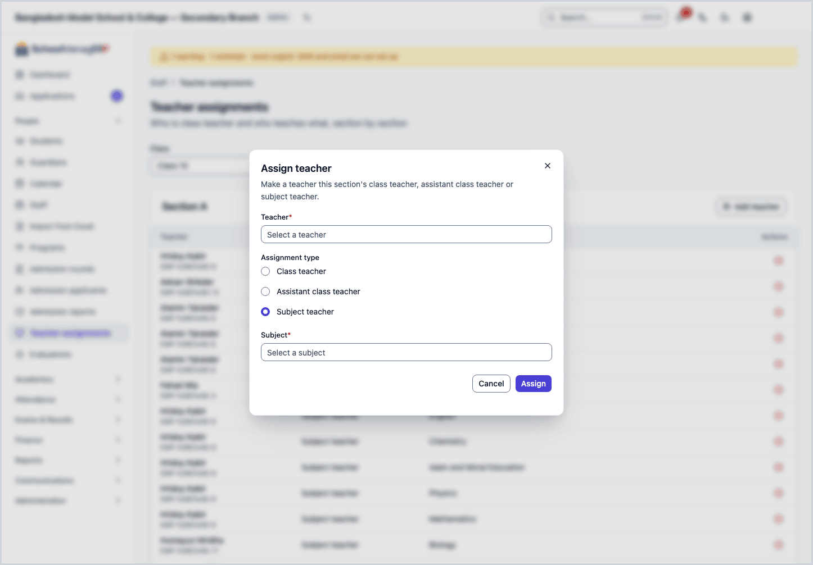
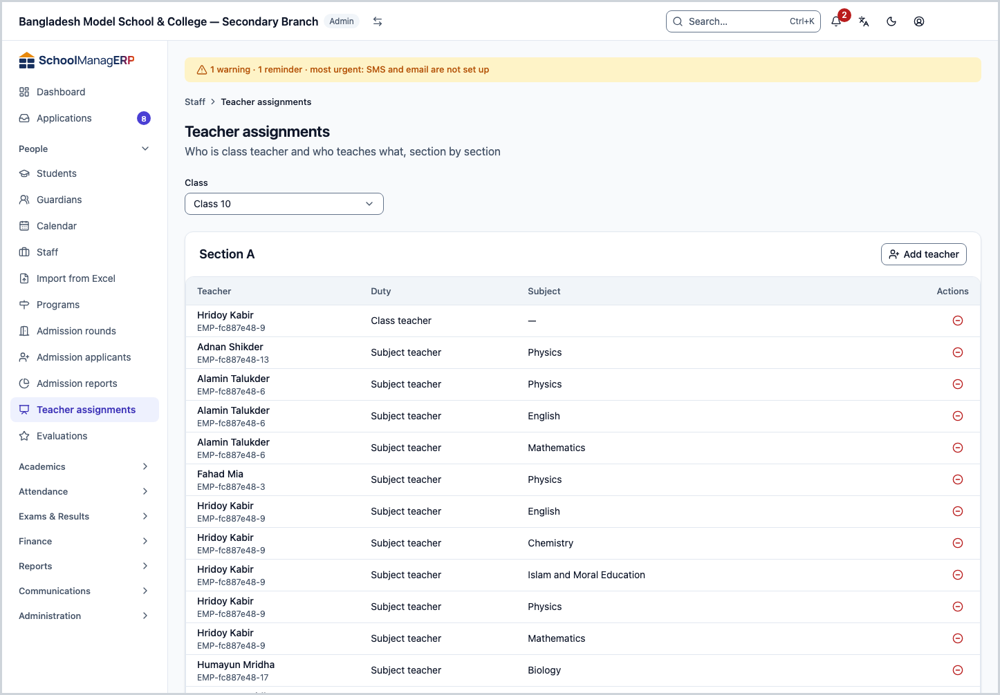
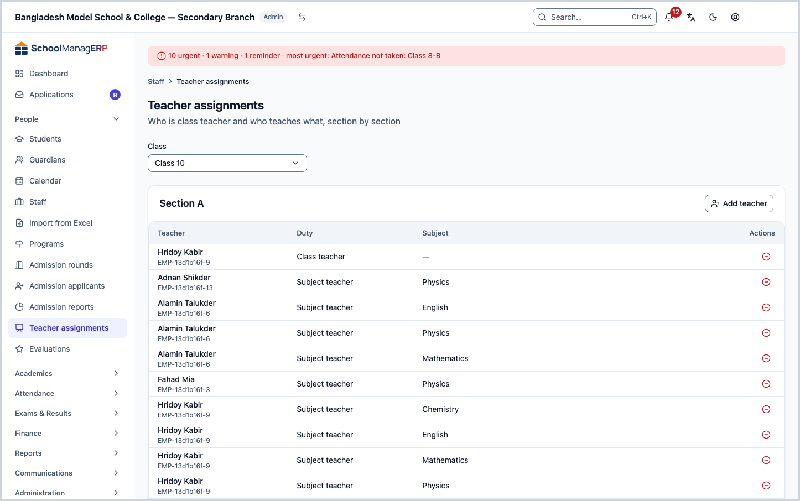
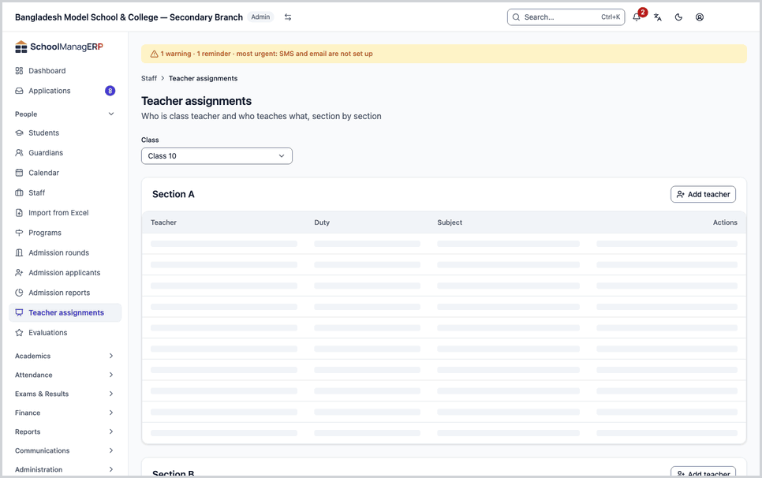

<!-- guide:meta
feature: people.teachingAssignments
title: Giving teachers class and section duties
summary: Decide who is class teacher of each section, who is assistant, and who teaches which subject; this is how a teacher gets to see their own sections.
roles: [ADMIN]
sources:
  - client-admin/src/routes/_staff/staff/teaching-assignments.tsx
  - client-admin/src/routes/_staff/classes/-assign-teacher-dialog.tsx
  - client-admin/src/routes/_staff/staff/-detail/teaching-assignments-tab.tsx
  - server/src/modules/classes/classes.service.ts
  - server/src/modules/classes/teacher-scope.service.ts
  - server/src/modules/exams/marks-authorization.util.ts
  - server/src/modules/attendance/attendance-access.service.ts
labels:
  [
    teacherAssignments:*,
    classes:assignTeacherForm.*,
    classes:assignmentType.*,
    classes:assignDialog.*,
    staff:detail.teachingAssignments.*,
    nav:items.teachingAssignments,
    nav:groups.people,
    common:accessDenied.*,
  ]
helpIds:
  [
    people.teachingAssignments,
    people.teachingAssignments.action.assign,
    people.teachingAssignments.action.unassign,
    people.teachingAssignments.field.assignmentType,
  ]
devices: [desktop]
entry: [sidebar, palette]
keywords:
  [শিক্ষকের দায়িত্ব, শ্রেণি শিক্ষক, বিষয় শিক্ষক, সহকারী শ্রেণি শিক্ষক, শাখা, নিয়োগ, teaching assignment, class teacher, subject teacher, assign]
appVersion: 0.1.0 (e81ef857f)
owner: tareq89
lastVerified: 2026-10-24
knownIssues: []
-->

# Giving teachers class and section duties

Decide here who is class teacher of a section, who is assistant class teacher, and who teaches which subject. These duties decide which sections a teacher sees in the app.

**Go to:** **People → Teacher assignments** in the left menu. Do the work on this page on a computer.
**Before you start:** be the school's Admin ([who can do what](#roles)). Classes and sections must already exist ([The order for setting up your school](../admin/setup-order.md)). The teacher must have a **Teacher profile**; if not, first [give a teacher profile](staff.md#task-teacher).

Every section has a **list of duties**. Each row of the list is one teacher and their duty. There are three kinds of duty: **Class teacher**, **Assistant class teacher**, **Subject teacher** (with a subject). On this page you build that list.

[Assign a teacher](#task-main) · [Remove from section](#task-unassign) · [Change the class teacher](#task-replace) · [Problems and fixes](#trouble)

**On this page**

- [Give a teacher a section](#task-main)
- [How to know the duty was given](#confirm)
- [Other situations](#other)
  - [Change the class teacher](#task-replace)
  - [Remove from a section](#task-unassign)
  - [See or give all of one teacher's duties](#task-teacher)
- [What the teacher sees next](#after)
- [Problems and fixes](#trouble)
- [Who can do what](#roles)
- [Learn more](#more)

---

## Give a teacher a section 

1. Press **People → Teacher assignments** in the left menu.

   → The title **Teacher assignments** at the top, with "Who is class teacher and who teaches what, section by section" below it. Under that is the **Class** field, and a card for each section of that class: **Section A**, **Section B** and so on. The first class is already chosen.

2. In **Class**, choose the class whose section you will give a duty in.

   → The cards for that class's sections appear. Each card has the columns **Teacher**, **Duty**, **Subject**. If nobody is there, it says **No one yet** and "No teacher has been given this section yet."

3. On the card of the section you are giving, press **Add teacher**.

   → The **Assign teacher** dialog opens: "Make a teacher this section's class teacher, assistant class teacher or subject teacher."

4. In **Teacher**, choose the teacher.

   → In the list, each name has the employee ID in brackets. Only staff who have a teacher profile appear.

5. In **Assignment type**, choose one: **Class teacher**, **Assistant class teacher** or **Subject teacher**. **Class teacher** is already chosen.

   → If you choose **Subject teacher**, the **Subject** field appears below. For the other two it does not.

6. For **Subject teacher**, choose the subject in **Subject**.

   → The list has only active subjects, with the code beside each name. If you open the page in Bangla, the names are in Bangla.

7. Press **Assign** at the bottom of the dialog.

   → The dialog closes and a new row appears in the section card's list. In the list, **Class teacher** comes first, then **Assistant class teacher**, then **Subject teacher**.

> **Remember:** nothing reaches the system until you press **Assign**. If you have typed something and try to close the dialog, the app first asks whether to throw away what you wrote; you can go back and carry on.

If a row went to the wrong section or the wrong teacher, [remove it from the section](#task-unassign) and assign again.

---

## How to know the duty was given 

This work does not run without internet. So there is no **Saved on this device** state here.

| State                           | How you can tell                                                           | What next        |
| ------------------------------- | -------------------------------------------------------------------------- | ---------------- |
| **Changed on screen only**      | The dialog is open, a teacher and a type are chosen, but it has not closed | Press **Assign** |
| **Reached the school's system** | The dialog has closed and the section's list has a new row for the teacher | Done             |

**To check:** reload the page, choose the same **Class**, and look for the row on the section's card. Or open that teacher's page from [Adding and managing staff](staff.md) and look in the **Teacher assignments** tab.

**If no message appears:** see [Problems and fixes](#trouble). What you chose in the dialog stays; nothing is lost.

---

## Other situations 

### Change the class teacher 

A section has only one **Class teacher**. If you make someone new the **Class teacher**, the earlier one is removed automatically.

1. On the section's card, press **Add teacher**. Keep **Assignment type** on **Class teacher**.
2. In **Teacher**, choose the new teacher.

   → A warning appears in the dialog: **{name} will be replaced as class teacher**.

3. Press **Assign**.

| You press  | What happens                                                                                                                                    | Saved? |
| ---------- | ----------------------------------------------------------------------------------------------------------------------------------------------- | ------ |
| **Assign** | The earlier class teacher loses the class teacher duty of this section; the new person gets it. The earlier person's other duties do not change | Yes    |
| **Cancel** | Nothing changes                                                                                                                                 | No     |

> **Remember:** if you make someone who was **Assistant class teacher** of that section the **Class teacher**, their assistant row goes away and only the class teacher row stays.

### Remove from a section 

1. On the section's card, press **Remove from section** at the end of the teacher's row.

   → The **Remove this teacher?** dialog opens: "{teacher name} will be removed from section {section name}."

2. Press **Remove**.

   → The dialog closes and the row leaves the list. If the teacher has no other duty in that section, it no longer appears in their own list and they lose access to it. To cut access, remove every duty they hold in that section.

| You press  | What happens                                             | Saved? |
| ---------- | -------------------------------------------------------- | ------ |
| **Remove** | This one duty goes away; the teacher's other duties stay | Yes    |
| **Cancel** | Nothing changes                                          | No     |

> **Remember:** this does not remove the teacher's profile or their access to the school; only the duty in that section goes.

### See or give all of one teacher's duties 

To see all the classes and sections of one teacher together:

1. Press **People → Staff** in the left menu, then press the teacher's name.

   → Their page opens. If they have a teacher profile, there is a **Teacher assignments** tab.

2. Press the **Teacher assignments** tab.

   → The list "Classes and sections this teacher is assigned to": **Class & section** (shown as "class · section"), **Duty**, **Subject**. If there is nothing, it says **No assignments yet**.

3. To give a new duty, press **Assign**.

   → The **Assign teacher** dialog opens. Here the teacher is already set, so there is no **Teacher** field. Instead you choose **Class** and **Section** (you can choose a section after choosing the class). The rest is as from step 5 above.

4. To remove, press **Remove assignment** at the end of the row, then **Remove** in the dialog.

   → The dialog text: "The teacher will be removed from {class · section}." When it is gone, the row leaves the list. If it does not, it shows **Couldn't remove the assignment. Try again.**

---

## What the teacher sees next 

When you give a duty, these things change in the teacher's app. They are checked against the code.

| What the teacher does                          | The rule that follows from the duty                                                                                                                                            |
| ---------------------------------------------- | ------------------------------------------------------------------------------------------------------------------------------------------------------------------------------ |
| [Take attendance](../attendance/attendance.md) | Only the sections given to them                                                                                                                                                |
| See the student list                           | Only the students of their sections. With no duty, the list is empty                                                                                                           |
| Write marks                                    | Only for their subject, as **Subject teacher**. A **Class teacher** and an **Assistant class teacher** can see the marks of every subject of the section but cannot write them |

**One condition:** the duties that count for a teacher are those on a class of the current academic year. (For marks there is one exception: if a class of the previous year has a draft exam, that works too.) The **Class** list on this page does not show the academic year; check first whether a class is of the current year, or the teacher will see nothing even after you give the duty. (Not yet run in the app; taken from the code.)

An Admin gets past all these rules and can see and work on every section.

---

## Problems and fixes 

| What you see                                                                           | What to do                                                                                                                                                                                           | Who can help |
| -------------------------------------------------------------------------------------- | ---------------------------------------------------------------------------------------------------------------------------------------------------------------------------------------------------- | ------------ |
| **You don't have access to this page.**                                                | Only an Admin sees this page. Press **Back to dashboard**.                                                                                                                                           | Admin        |
| **No classes yet**                                                                     | Press **Add class**. Create classes and sections first ([The order for setting up your school](../admin/setup-order.md)).                                                                            | Admin        |
| **Failed to load the class list.**                                                     | Check your internet and press **Try again**.                                                                                                                                                         | Admin        |
| **Couldn't load this section's teachers.**                                             | Press **Try again**.                                                                                                                                                                                 | Admin        |
| **Teacher is required**                                                                | Choose one in **Teacher**.                                                                                                                                                                           | Admin        |
| **Subject is required**                                                                | If you choose **Subject teacher**, you must choose a **Subject** too.                                                                                                                                | Admin        |
| **Class is required** or **Section is required**                                       | When giving from the teacher's page, choose **Class** first, then **Section**.                                                                                                                       | Admin        |
| **This teacher is already a class teacher or assistant class teacher of this section** | They are already in that section. To make them **Assistant class teacher**, first remove their current duty. The other way round, making them **Class teacher** removes the assistant row by itself. | Admin        |
| **This teacher is already assigned to this section for this subject**                  | The same subject cannot be given twice in the same section. Check whether the row is already in the list.                                                                                            | Admin        |
| **Failed to assign teacher**                                                           | Check your internet and press **Assign** again.                                                                                                                                                      | Admin        |
| **Couldn't remove. Try again.**                                                        | Check your internet and press **Remove from section** again. If the row is still in the list, it was not removed.                                                                                    | Admin        |
| You cannot find a teacher in the **Teacher** field                                     | They have no teacher profile. [Give a teacher profile](staff.md#task-teacher).                                                                                                                       | Admin        |
| A teacher says they see no section                                                     | Check whether their row is in the **Teacher assignments** tab, and whether the class is of the current academic year ([the condition](#after)).                                                      | Admin        |

If a page or button is missing, see [Why can't I see this?](../help/cant-see-this.md).

---

## Who can do what 

| Role                                                                                       | See the page, assign and remove |
| ------------------------------------------------------------------------------------------ | ------------------------------- |
| Admin                                                                                      | Yes                             |
| Academic coordinator, Teacher, Accountant, Office staff, Exam controller, Committee member | No                              |

Someone without permission who opens the page sees **You don't have access to this page.**, and **Teacher assignments** is not in their left menu.

---

## Learn more 

<strong>The parts of the page</strong> — top to bottom

1. **Teacher assignments** — the title and the small line.
2. **Class** — which class's sections you will look at.
3. **The section card** — each section's name (for example **Section A**) and the **Add teacher** button.
4. **The duty list** — **Teacher** (name and employee ID), **Duty**, **Subject**; at the end of each row, **Remove from section**.

<strong>What the fields mean</strong>

<!-- guide:generated:fields:teacherAssignments -->

| Field           | What to enter                                                                                                                                                | Required?                                      |
| --------------- | ------------------------------------------------------------------------------------------------------------------------------------------------------------ | ---------------------------------------------- |
| Class           | Which class's sections you will look at. You also choose it when giving from the teacher's page.                                                             | Yes (when giving from the teacher's page)      |
| Section         | Which section, when giving from the teacher's page. You can choose it after choosing the class.                                                              | Yes (when giving from the teacher's page)      |
| Teacher         | The person you will give the duty to. The employee ID is beside the name. Only staff who have a teacher profile.                                             | Yes                                            |
| Assignment type | **Class teacher** (only one per section; a new one replaces the earlier), **Assistant class teacher**, or **Subject teacher** (for one subject).             | Yes, **Class teacher** is chosen to begin with |
| Subject         | Only for a **Subject teacher**: which subject. From the active subjects.                                                                                     | Yes, for **Subject teacher**                   |
| Kind            | **Class coordinator** sees every subject of the class. **Subject coordinator** sees only one subject. Both only read; they never change marks or attendance. | Set by the subject choice                      |
| Classes         | One or more classes of this year. A coordinator sees every section of each class.                                                                            | Yes                                            |
| Subject         | Leave empty for a **Class coordinator**. Choose a subject for a **Subject coordinator**.                                                                     | No                                             |

<!-- /guide:generated -->

<strong>How teacher assignments work</strong> — from the teacher profile to the teacher's page

<figure>
  
  <figcaption><em>From staff to duties, from duties to the teacher's pages</em></figcaption>
</figure>

- Without a duty, a teacher sees no section, even though they are in the staff list.
- When a duty changes, the teacher sees the change when they open a page again; they do not need to do anything.
- Adding staff and giving a teacher profile: [Adding and managing staff](staff.md#more). Many teachers at once: [Adding staff from Excel](staff-import.md).

<strong>The whole task in one go</strong>

<figure>
  
  <figcaption><em>Choosing a class, giving a duty, taking it back</em></figcaption>
</figure>

**Related pages**

- [**Adding and managing staff**](staff.md) — add staff and give a teacher profile; the duties here can also be seen from there.
- [**Adding staff from Excel**](staff-import.md) — add many teachers at once, then give their duties here.
- [**Arranging a class's weekly routine**](../academics/routine-builder.md) — the duties given here decide who "Fill empty periods" picks; placing a teacher without a duty shows a warning.
- [**Arranging classes, sections and subjects**](../academics/classes.md) — where classes, sections and subjects are made.
- [**Giving homework**](../academics/homework.md) — a teacher can give homework only to sections assigned here.
- [**Syllabus and study plans**](../academics/syllabus.md) — study plans follow the duties given here.
- [**Attendance register**](../attendance/attendance-register.md) — which sections a teacher sees in the register.
- [**Evaluations: ACR, teacher surveys and incidents**](evaluations.md) — evaluations of the teacher who holds these duties.
- [**Taking attendance**](../attendance/attendance.md) — attendance is taken for the sections assigned here.
- [**Roles and permissions**](../administration/roles.md) — See side by side what each staff role in the school can see and do, on one page. The page is view-only.
- [**Applications**](../applications/applications.md) — Submit school applications such as leave, fee waiver, transfer certificate, testimonial and section change, enter a guardian's paper.
- [**Entering and submitting exam marks**](../exams-results/marks-entry.md) — Pick an exam, open the marks list for your section and subject, type each student's marks or mark them absent or exempt.

---

_Version 0.1.0 · Last checked 2026-10-24_
