<!-- guide:meta
feature: platformOwner.announcements
title: Sending an announcement to schools
summary: Write one message for the admins of many schools, see how many will get it, get the other owner's agreement, and read what was sent before.
roles: [SUPER_ADMIN]
sources:
  - client-admin/src/routes/_platform/announcements/
labels: [platformAnnouncements:*]
helpIds: [platformOwner.announcements]
devices: [desktop]
entry: [sidebar, palette]
keywords: [announcement, banner, sms, email, approval, ঘোষণা]
appVersion: 0.1.0 (485d3ac71)
owner: tareq89
lastVerified: 2026-11-12
knownIssues: []
-->

# Sending an announcement to schools

Tell the admins of many schools something important, once.

**Go to:** **Announcements** in the console's left menu.
**Before you start:** be a platform owner. The other owner must be able to agree ([Locking an owner and approvals](lock-and-approvals.md)).

[Send one](#task-main) · [After you press Send](#task-wait) · [Problems and fixes](#trouble)

**On this page**

- [Send one](#task-main)
- [How to know it worked](#confirm)
- [Other situations](#other)
  - [After you press Send](#task-wait)
  - [Read what was sent](#task-list)
- [Problems and fixes](#trouble)
- [Who can do what](#roles)
- [Learn more](#more)

---

## Send one 

1. Open **Announcements**. Under **New announcement**, choose **Send to**: **Only active schools**, **Only suspended schools** or **All schools**.
2. Choose the **Type**: **Reminder** or **Warning**.
3. Write the **Title** and the **Message**. The counter shows how many letters you have used.
4. Under **How it is sent**, the in-app banner is always on. Tick **SMS** or **Email** if you also want those.

   → The line **Schools: (n). Admins: (n).** shows who will get it. If no school matches it says nothing will be sent.

5. Press **Send**.

   → "The other owner must agree before it is sent."

<figure>
  
  <figcaption><em>How an announcement reaches schools</em></figcaption>
</figure>

---

## How to know it worked 

| What you see                              | What it means            | What next                    |
| ----------------------------------------- | ------------------------ | ---------------------------- |
| **Waiting for the other owner to agree.** | Nothing has gone out yet | Ask the other owner to agree |
| **The other owner agreed.**               | You may send             | Press **Send now**           |
| **Sent to (n) schools and (n) people.**   | It is done               | **Write another** if needed  |

---

## Other situations 

### After you press Send 

The other owner agrees in **Approval requests** ([how](lock-and-approvals.md#task-approve)). When they do, press **Send now**. Press **Cancel** to withdraw the request. If the other owner says no, or the time runs out, nothing is sent; the page tells you which. If you leave or reload this page while you wait, the request is kept in this browser tab: come back to **Announcements** and it carries on, and a request that was already agreed is sent when the page opens.

### Read what was sent 

**Sent announcements** lists the **Date**, the **Title**, how many schools it **Reached** ("(done) of (total) schools") and who sent it. It shows 25 at a time; use **Next** and **Previous** under the table to read older ones.

---

## Problems and fixes 

| What you see                                       | What to do              | Who can help    |
| -------------------------------------------------- | ----------------------- | --------------- |
| **Write a title.** / **Write a message.**          | Fill the empty field    | —               |
| **No school matches. Nothing will be sent.**       | Change **Send to**      | —               |
| **Could not count. Try again.**                    | Press **Count again**   | —               |
| **The request ran out of time. Nothing was sent.** | Write and send it again | The other owner |

---

## Who can do what 

| Role                                     | Announcements                          |
| ---------------------------------------- | -------------------------------------- |
| Platform owner                           | Write and send; the other owner agrees |
| School Admin and every other school role | No access; they only read the banner   |

---

## Learn more 

<strong>Why must the other owner agree?</strong>

One message reaches many schools. A second person checks it first, so one mistake or one stolen account cannot send it.

**Related pages**

- [**School control and audit**](school-control.md) — **Announcement sent** is written in the audit.

---

_Version 0.1.0 · Last checked 2026-11-12_
