<!-- guide:meta
feature: platformOwner.lockAndApprovals
title: Locking an owner and approvals
summary: Lock or unlock the other platform owner, ask the other owner to approve risky actions, and read the sign-in and lock history.
roles: [SUPER_ADMIN]
sources:
  - client-admin/src/routes/_platform/platform-owners/index.tsx
  - client-admin/src/features/cockpit/owners/owners-tab.tsx
  - client-admin/src/features/cockpit/owners/approvals-tab.tsx
  - client-admin/src/features/cockpit/owners/history-tab.tsx
labels: [platformOwners:*]
helpIds: [platformOwner.lockAndApprovals]
devices: [desktop, phone]
entry: [sidebar, palette]
keywords: [lock owner, unlock, approval, other owner, history, মালিককে আটকে দিন, অনুমতি]
appVersion: 0.1.0 (acd66b46d)
owner: tareq89
lastVerified: 2026-11-12
knownIssues: []
-->

# Locking an owner and approvals

Keep the two owners safe from each other's mistakes, and from a stolen account.

**Go to:** **Platform owners** in the console's left menu.
**Before you start:** be a platform owner with two-step sign-in on ([Recovery codes and two-step sign-in](recovery-codes.md)).

The system has two platform owners. If one account is stolen or one owner leaves, the other can **lock** it: that account is signed out at once and cannot sign in until it is unlocked. Risky actions can also need the other owner's **approval** first.

[Lock or unlock an owner](#task-main) · [Approve a request](#task-approve) · [Turn approvals on or off](#task-switch) · [Read the history](#task-history) · [Problems and fixes](#trouble)

**On this page**

- [Lock or unlock an owner](#task-main)
- [How to know it worked](#confirm)
- [Other situations](#other)
  - [Approve or deny a request](#task-approve)
  - [Turn approvals on or off](#task-switch)
  - [Read the history](#task-history)
- [Problems and fixes](#trouble)
- [Who can do what](#roles)
- [Learn more](#more)

---

## Lock or unlock an owner 

1. Open **Platform owners**, tab **Owners**. Each owner shows **Active** or **Locked**, the last sign-in and whether two-step sign-in is on.
2. On the other owner's row press **Lock**.
3. Read "Their sign-ins end at once and they cannot sign in again until you unlock them." Type the code from your authenticator app to confirm.

   → "… is locked." The row shows **Locked** and who did it.

To undo it press **Unlock** on the row and confirm with a code. They can then sign in again.

<figure>
  
  <figcaption><em>Locking an owner, with and without approvals</em></figcaption>
</figure>

---

## How to know it worked 

| What you see                                     | What it means                                | What next                                                |
| ------------------------------------------------ | -------------------------------------------- | -------------------------------------------------------- |
| **Locked** on the row                            | That owner is signed out and blocked         | Unlock when it is safe                                   |
| **Waiting for the other owner to approve this.** | Approvals are on; nothing has happened yet   | Ask the other owner to approve, then do the action again |
| Entry **Owner locked** in **History**            | The lock was written down, with who and when | —                                                        |

---

## Other situations 

### Approve or deny a request 

1. Open the tab **Approval requests**. A request says what is asked ("Lock an owner", "Unlock an owner", "Turn off approvals", "Make new recovery codes") and **Asked by** whom.
2. Press **Approve** or **Deny**, and confirm with your code.

   → The asker then repeats the action and it goes through. A request is **Waiting** until decided, then **Approved**, **Denied**, **Done** or **Expired**.

You never approve your own request.

### Turn approvals on or off 

In **Approval requests**, the switch **Ask the other owner first** is **On** or **Off**. While it is on, and both owners are active, a risky action needs the other owner's agreement. Turning it **on** needs only your code. Turning it **off** needs the other owner to agree first.

### Read the history 

The tab **History** lists, newest first, **Signed in**, **Failed sign-in**, **Owner locked**, **Owner unlocked**, **Authenticator set up**, **Recovery code used**, approvals and **Password reset**, with **Who** and **When**. Press **Load more** for older entries. Look here after any sign-in you do not recognise.

---

## Problems and fixes 

| What you see                                                                 | What to do                                          | Who can help    |
| ---------------------------------------------------------------------------- | --------------------------------------------------- | --------------- |
| **You cannot lock yourself.**                                                | Lock is only for the other owner                    | —               |
| **This is the last active owner, so it cannot be locked.**                   | The system always keeps one owner active            | —               |
| **Could not complete that. Try again.**                                      | Check the code is fresh and try again               | —               |
| **That request was denied or has expired. Confirm again to send a new one.** | Start the action again                              | —               |
| You are locked                                                               | Ask the other owner to press **Unlock** on your row | The other owner |

---

## Who can do what 

| Role                                     | Lock, unlock, approve         |
| ---------------------------------------- | ----------------------------- |
| Platform owner                           | Yes, only for the other owner |
| School Admin and every other school role | No access                     |

---

## Learn more 

<strong>Why can a lock need approval?</strong>

Locking is strong: it ends someone's sessions. A thief who got one owner's phone and password could otherwise lock the real other owner out. With approvals on, a second person must agree first.

**Related pages**

- [**Platform owner sign-in**](sign-in.md) — how a locked owner is blocked at sign-in.
- [**Recovery codes and two-step sign-in**](recovery-codes.md) — making new codes can need approval.

---

_Version 0.1.0 · Last checked 2026-11-12_
