<!-- guide:meta
feature: platformOwner.loginAs
title: Logging in as a school's person
summary: Open a school as one of its people to help them, choose why, wait for approval when the school asks for it, and end the visit.
roles: [SUPER_ADMIN]
sources:
  - client-admin/src/routes/_platform/schools/$schoolId.tsx
  - client-admin/src/features/cockpit/login-as/
  - client-admin/src/features/support-access/
  - client-admin/src/routes/_platform/users/
labels: [loginAs:*, supportBanner:*]
helpIds: [platformOwner.loginAs]
devices: [desktop]
entry: [sidebar, palette]
keywords: [login as, support, emergency access, view only, হিসেবে ঢুকুন, জরুরি প্রবেশ]
appVersion: 0.1.0 (485d3ac71)
owner: tareq89
lastVerified: 2026-11-12
knownIssues: []
-->

# Logging in as a school's person

Open a school the way one of its people sees it, so you can find out what went wrong.

**Go to:** **Schools** in the console's left menu, then press the school. You can also start from **Users**.
**Before you start:** be a platform owner with two-step sign-in on ([Recovery codes and two-step sign-in](recovery-codes.md)). Have your authenticator app ready.

Every school decides whether Biddaloy support may log in: **Allowed**, **Ask each time** or **Blocked**. What you do next depends on that choice. Everything you do is written in the school's list and in the [audit](school-control.md#task-audit).

[Log in as someone](#task-main) · [The three choices of a school](#task-states) · [Emergency access](#task-emergency) · [End the visit](#task-end) · [Problems and fixes](#trouble)

**On this page**

- [Log in as someone](#task-main)
- [How to know it worked](#confirm)
- [Other situations](#other)
  - [The three choices of a school](#task-states)
  - [Emergency access](#task-emergency)
  - [What the school sees](#task-school)
  - [End the visit](#task-end)
- [Problems and fixes](#trouble)
- [Who can do what](#roles)
- [Learn more](#more)

---

## Log in as someone 

1. Press **Schools** in the left menu, then press the school.

   → The school's page opens. The tabs are **Overview**, **People**, **Support access**, **Notes** and **Health**.

2. Press **Login as** at the top.

   → The box **Login as - (school name)** opens. The role **Admin** is already chosen, and the first person who can be chosen is already picked.

3. To log in as someone else, change **Role**, then pick a name under **Person**. Type in **Search by name** to find one. A person with no login account, or who is not active, is greyed out and cannot be chosen.
4. Write the **Reason**. You can press one of **Support request**, **Checking a bug** or **Setup help**, and add more words. If the school left a note, it shows above as **Note from the school**.
5. Tick **View only (nothing can be changed)** if you only want to look. Then press **Login as** and type the code from your authenticator app when asked.

   → A new tab opens inside the school, with a banner on top.

<figure>
  
  <figcaption><em>From pressing Login as to the school opening</em></figcaption>
</figure>

---

## How to know it worked 

| What you see                                                    | What it means                                    | What next                               |
| --------------------------------------------------------------- | ------------------------------------------------ | --------------------------------------- |
| A new tab with the banner "Biddaloy support, as (name), (role)" | You are inside the school                        | Do the work, then press **End**         |
| **Waiting for approval**                                        | The school asks every time; its admins were told | Wait; see below                         |
| **This school does not allow Biddaloy support access.**         | The school chose **Blocked**                     | See [Emergency access](#task-emergency) |

---

## Other situations 

### The three choices of a school 

| School's choice   | What happens when you press **Login as**                                                                                                                           |
| ----------------- | ------------------------------------------------------------------------------------------------------------------------------------------------------------------ |
| **Allowed**       | After your code, the school opens in a new tab at once.                                                                                                            |
| **Ask each time** | The box shows **Waiting for approval. We told the school admins.** and **Time left 24 h**. When an admin approves, the school opens. Press **Cancel** to withdraw. |
| **Blocked**       | The box says "This school does not allow Biddaloy support access." Only [emergency access](#task-emergency) is left.                                               |

The school's choice also shows in the school's tab **Support access**, with the last 20 visits. Only a school admin can change it; you cannot.

### Emergency access 

Use this only when a **Blocked** school really needs help.

1. In the box, press **Emergency access**.

   → "Emergency access is view only and needs the other owner to agree."

2. Pick the person, then write **Why is this an emergency?**
3. Press **Login as** and confirm with your code.

   → **Waiting for the other owner to agree.** When the other owner agrees, the school opens, view only.

The school's admins are told right away, and the visit shows in their list as **Emergency**.

### What the school sees 

While you are inside, the school sees the banner "Biddaloy support, as (name), (role)", with **View only** if you chose it. Five minutes before the time runs out it says "5 minutes left. Biddaloy support will close." and then "1 minute left." The school's admins see the visit in **Settings → Biddaloy support access**: who, when, why, normal or emergency, and how many changes were made ([the school admin's page](../administration/support-access.md)).

### End the visit 

Press **End** in the banner. The tab closes by itself. If the browser does not close it, the tab says "Biddaloy support has ended. You can close this tab." A school admin can also end it, and it ends by itself when the time is over. A link that was already used says "This link has already been used or has run out of time"; open Login as again.

---

## Problems and fixes 

| What you see                                           | What to do                                           | Who can help     |
| ------------------------------------------------------ | ---------------------------------------------------- | ---------------- |
| **This school has no active admin. Invite one first.** | Press **Invite admin**, then try again               | —                |
| **No login account. They cannot be chosen.**           | Pick another person; this one never got a login      | —                |
| **Write at least … letters.**                          | Make the reason longer                               | —                |
| **Could not start. Try again.**                        | Check the code is fresh and press **Login as** again | —                |
| The request ran out of time                            | Press **Login as** and ask again                     | The school admin |

---

## Who can do what 

| Role                                     | Login as                                      |
| ---------------------------------------- | --------------------------------------------- |
| Platform owner                           | Yes, with a code every time                   |
| School Admin and every other school role | No access; the Admin sets the school's choice |

---

## Learn more 

<strong>Why a reason and a code every time?</strong>

Logging in as someone is strong. The reason and the code make sure it is really you, and the visit is written down for the school to read. Nothing you do is hidden from the school.

**Related pages**

- [**School control and audit**](school-control.md) — the tabs, trial, rename, archive and the Login as log.
- [**Biddaloy support access (school admin)**](../administration/support-access.md) — what the school admin sees and decides.

---

_Version 0.1.0 · Last checked 2026-11-12_
