<!-- guide:meta
feature: platformOwner.schoolControl
title: School control, operations, users and audit
summary: Read one school at a glance, extend its trial, rename or archive it, help a stuck admin, watch the queues, find a person in every school and search the audit.
roles: [SUPER_ADMIN]
sources:
  - client-admin/src/routes/_platform/schools/$schoolId.tsx
  - client-admin/src/features/cockpit/school-360/
  - client-admin/src/features/cockpit/school-controls/
  - client-admin/src/features/cockpit/school-support/
  - client-admin/src/routes/_platform/operations/
  - client-admin/src/routes/_platform/users/
  - client-admin/src/routes/_platform/audit/
labels: [school360:*, schoolControl:*, schoolSupport:*, platformOperations:*, platformUsers:*, platformAudit:*]
helpIds: [platformOwner.schoolControl]
devices: [desktop]
entry: [sidebar, palette]
keywords: [school 360, trial, rename, archive, stuck admin, queues, users, audit, স্কুল নিয়ন্ত্রণ, অডিট]
appVersion: 0.1.0 (485d3ac71)
owner: tareq89
lastVerified: 2026-11-12
knownIssues: []
-->

# School control, operations, users and audit

See how a school is doing, fix what it cannot fix itself, and read what happened.

**Go to:** **Schools**, then the school; or **Operations**, **Users** and **Audit** in the console's left menu.
**Before you start:** be a platform owner with two-step sign-in on ([Recovery codes and two-step sign-in](recovery-codes.md)). Some actions ask for your authenticator code.

[Read a school](#task-main) · [School controls](#task-controls) · [Operations](#task-operations) · [Users](#task-users) · [Audit](#task-audit) · [Problems and fixes](#trouble)

**On this page**

- [Read a school](#task-main)
- [How to know it worked](#confirm)
- [Other situations](#other)
  - [School controls: trial, rename, archive, stuck admin](#task-controls)
  - [Operations: queues, system and restore lock](#task-operations)
  - [Users: find a person in every school](#task-users)
  - [Audit: what happened](#task-audit)
- [Problems and fixes](#trouble)
- [Who can do what](#roles)
- [Learn more](#more)

---

## Read a school 

1. Press **Schools**, then press the school.
2. Read the tab **Overview**, "At a glance": **Admins**, **People by role**, **SMS balance**, **Files size**, **Open alerts**, **Last active** and **Latest changes**. A change made inside a Login as visit says "via Login as".
3. Press another tab: **People** (people by role), **Support access** (the school's choice and its last 20 visits), **Notes** or **Health** (open alerts, with their severity).

   → Each tab shows its own part. If one cannot load, press **Try again**.

**Notes:** type in **New note** (up to 2000 letters) and press **Add note**. It shows when someone uses Login as. Press **Delete note** to remove one.

<figure>
  
  <figcaption><em>What you can do with a school</em></figcaption>
</figure>

---

## How to know it worked 

| What you see                              | What it means               | What next |
| ----------------------------------------- | --------------------------- | --------- |
| **Trial extended.** / **School renamed.** | The change is saved         | —         |
| **School archived.**                      | The school stopped working  | —         |
| The new entry in [**Audit**](#task-audit) | The action was written down | —         |

---

## Other situations 

### School controls: trial, rename, archive, stuck admin 

At the top of the school's page the button **School controls** holds four actions.

- **Extend trial.** Enter **Number of seats** (1 to 100,000), **For how many months** (1 to 24) and a **Reason** of at least 10 letters. Press **Extend trial**.
- **Rename school.** Type the **New name** and a **Reason** (at least 5 letters). Press **Rename**, then confirm with your code.
- **Archive school.** The school will stop working, so first download a copy. Step 1 lists what is included: students and guardians, teachers and staff, fees, payments and invoices, attendance, exams and results. Step 2: press **Prepare the copy**, then **Download the copy**. Step 3: write the reason and press **Archive school**, then confirm with your code. You cannot archive until the copy is downloaded.
- **Send admin a reset link** (for a school admin who cannot get in). Choose an admin and press **Send password reset link**; it goes by email or SMS. You can also **Invite another admin**, or **Log out everyone in this school** (confirmed with your code).

### Operations: queues, system and restore lock 

Press **Operations**. **System** shows the version, the last database change, and whether the database and Redis are **OK** or **Down**. When something is down the page says "Schools may not work properly right now." **Queues** lists the waiting and failed jobs of each queue. Press **Retry failed** on a row to start its failed jobs again. **Restore lock** lists a school that is being restored, with **Writes stopped**. Press **Release** only after you have checked that no restore is running.

### Users: find a person in every school 

Press **Users** and type at least 3 letters of a phone number or email. Each result shows the person's schools and roles, the last login, and **Locked** or **No login account** when it applies. On a row you can press **Login as** for one school and role, or **Sign out everywhere** (confirmed with your code) to end all their sessions.

### Audit: what happened 

Press **Audit**. The tab **All activity** lists what anyone did in any school, newest first. Filter by **School**, **Action**, **Who** and dates, and press **Clear all filters** to start again. The tab **Login as visits** has one row for each visit: who, as whom, the reason, start, length and changes made. Press **See all activity** on a row to see everything done in that visit.

---

## Problems and fixes 

| What you see                                    | What to do                         | Who can help |
| ----------------------------------------------- | ---------------------------------- | ------------ |
| **Enter a whole number from 1 to 100,000.**     | Use a whole number in range        | —            |
| **Write the reason in at least 10 characters.** | Make the reason longer             | —            |
| **Download the copy first to archive.**         | Finish step 2, then archive        | —            |
| **Could not search. Try again.**                | Try the full phone number or email | —            |
| **Could not load operations. Try again.**       | Open the page again after a minute | —            |

---

## Who can do what 

| Role                                     | These pages |
| ---------------------------------------- | ----------- |
| Platform owner                           | Yes         |
| School Admin and every other school role | No access   |

---

## Learn more 

<strong>Why does archiving need a copy first?</strong>

An archived school stops working. The copy makes sure its records are not lost.

**Related pages**

- [**Logging in as a school's person**](login-as.md) — the **Login as** button.
- [**Announcements**](announcements.md) — send one message to every school.

---

_Version 0.1.0 · Last checked 2026-11-12_
