<!-- guide:meta
feature: platformOwner.signIn
title: Platform owner sign-in
summary: Sign in to the platform owner console with your password and a second step; set your first password, use a new device, and get in when your phone is lost.
roles: [SUPER_ADMIN]
sources:
  - client-admin/src/routes/sign-in.tsx
  - client-admin/src/routes/sign-in.forgot.tsx
  - client-admin/src/routes/sign-in.reset.tsx
  - client-admin/src/features/cockpit/sign-in/cockpit-sign-in-card.tsx
  - client-admin/src/features/cockpit/sign-in/password-step.tsx
  - client-admin/src/features/cockpit/sign-in/code-step.tsx
  - client-admin/src/features/cockpit/sign-in/device-step.tsx
  - client-admin/src/features/cockpit/use-idle-timer.ts
labels: [cockpit:*]
helpIds: [platformOwner.signIn]
devices: [desktop, phone]
entry: [page:platformOwner.signIn]
keywords: [platform owner, owner sign in, cockpit, authenticator, forgot password, new device, প্ল্যাটফর্ম মালিক, সাইন-ইন]
appVersion: 0.1.0 (acd66b46d)
owner: tareq89
lastVerified: 2026-11-12
knownIssues: []
-->

# Platform owner sign-in

Sign in to the platform owner console with your password and one more code.

**Go to:** the console's own web address (not a school's address). The owner of the system gives it to you.
**Before you start:** be a platform owner, with your email and phone number saved in the system, and an authenticator app on your phone ([how you arrive](#arrive)).

The platform owner console is where the owners of the whole system work: schools, plans and the owners themselves. It is a separate address from the school app, and a school login does not work there. Every sign-in needs **two proofs**: your password, and a code that only your phone can make. That second proof is called the **second step**.

[Sign in](#task-main) · [First time: set your password and your second step](#task-first) · [New device](#task-device) · [Lost phone](#task-lost) · [Problems and fixes](#trouble)

**On this page**

- [How you arrive here](#arrive)
- [Sign in](#task-main)
- [How to know you are in](#confirm)
- [Other situations](#other)
  - [First time: set your password and your second step](#task-first)
  - [A new phone or computer](#task-device)
  - [Lost phone](#task-lost)
- [Problems and fixes](#trouble)
- [Who can do what](#roles)
- [Learn more](#more)

---

## How you arrive here 

- You open the console's address, and the sign-in card **Platform owner sign-in** appears.
- You are also sent back to this card when the console signs you out, for example after 30 minutes with no activity (a warning comes one minute before). Only your own activity counts: the alert bar refreshing by itself does not keep you signed in.

---

## Sign in 

1. Type your email or phone number in **Email or phone number**, and your password in **Password**. Press **Next**.

   → The card now asks for **Enter the code from your authenticator app**.

2. Open the authenticator app on your phone, find this account, and type the 6-digit code in **6-digit code from your authenticator app**. Press **Sign in**.

   → You enter the console.

Each code works only once. If the app shows the code you just used, wait for the next one (every 30 seconds).

<figure>
  
  <figcaption><em>The two proofs of a platform owner sign-in</em></figcaption>
</figure>

---

## How to know you are in 

| What you see                                                  | What it means                          | What next                                                         |
| ------------------------------------------------------------- | -------------------------------------- | ----------------------------------------------------------------- |
| The console, with your own name                               | You are signed in                      | Do your work                                                      |
| **Code did not match. Check it and try again.**               | The app code was wrong or already used | Wait for the next code and type it                                |
| **Sign-in did not work. Check what you typed and try again.** | Email, phone or password was wrong     | Check them and try again. The card never says which one was wrong |

---

## Other situations 

### First time: set your password and your second step 

Nobody gives you a password. You make it yourself:

1. On the sign-in card press **Forgot your password?**. Type your email and press **Send the link**.

   → "If this email belongs to an owner, a link to set a new password is on its way." The link comes by email.

2. Open the link, choose a password in **Set a new password**, and press **Save password**.

   → "Your new password is saved. Sign in with it."

3. Sign in with the password. The card says **Set up two-step sign-in** and tells you it sent **one code by SMS and one code by email**. Type both and continue.

4. Add the authenticator app: scan the picture with the app (on a phone, press **Open authenticator app**), then type the 6-digit code it shows. Press **Next**.

5. Save your **ten recovery codes**: press **Copy** or **Download**, keep them in two safe places away from your phone, tick **I saved them** and press **Finish**. The codes are shown only now. More in [Recovery codes and two-step sign-in](recovery-codes.md).

### A new phone or computer 

After your password and app code (or a recovery code), a new device needs a second check. The card says **New-device check**: "We sent one code by SMS and one code by email. Enter both."

1. Type **Code from the SMS** and **Code from the email**.
2. Tick **Remember this device** on your own computer, so the next sign-in only asks for the app code.

Do not tick it on a shared computer.

### Lost phone 

1. On the code step press **Use a recovery code**.
2. Type one of the codes you saved in **Recovery code**, and sign in. Each recovery code works once.
3. On a new device, the card then asks for the SMS code and email code ([new-device check](#task-device)). If you cannot receive them, tell the other owner. The person who runs the server can reset your second step.
4. Your phone's authenticator is still the lost one, and new recovery codes cannot replace it. Ask the person who runs the server to reset your second step (below), then set up again.

If you lost the phone **and** the recovery codes, no screen can help. Tell the other owner. The person who runs the server can reset your second step; you then sign in with your password and set up again (a new SMS code and email code, a new authenticator, new recovery codes).

---

## Problems and fixes 

| What you see                                                           | What to do                                                                                     | Who can help    |
| ---------------------------------------------------------------------- | ---------------------------------------------------------------------------------------------- | --------------- |
| **Too many tries. Wait a little and try again.**                       | Wait a few minutes, then try again                                                             | —               |
| **A code did not match. Check both codes and try again.** (new device) | Check both: the SMS code and the email code. Press **Start again** to begin once more          | —               |
| No email after **Send the link**                                       | The email must belong to an owner. Check spam, then ask the other owner to confirm the address | The other owner |
| **This link does not work**                                            | The link is old or used. Press **Get a new link**                                              | —               |
| You were signed out after a quiet half hour                            | Normal. Sign in again                                                                          | —               |

---

## Who can do what 

| Role                                     | Use this sign-in                                                          |
| ---------------------------------------- | ------------------------------------------------------------------------- |
| Platform owner                           | Yes                                                                       |
| School Admin and every other school role | No. They use the school's own sign-in ([Signing in](../start/sign-in.md)) |

---

## Learn more 

<strong>Why two steps?</strong>

A password alone can be stolen. The code comes from an app only your phone has, so a thief with your password still cannot get in. A new device needs two more codes (SMS and email), so a stolen password and a copied app are still not enough.

**Related pages**

- [**Recovery codes and two-step sign-in**](recovery-codes.md) — set up, keep and renew your codes.
- [**Locking an owner and approvals**](lock-and-approvals.md) — what the two owners can do to each other.

---

_Version 0.1.0 · Last checked 2026-11-12_
