<!-- guide:meta
feature: portal.account
title: Account (parent and student)
summary: Change your name, phone, email and password, sign out a lost phone, and change the language. A new phone or email only takes effect once it is verified; until then the old one stays.
roles: [PARENT, STUDENT]
sources:
  - client-admin/src/routes/portal.tsx
  - client-admin/src/routes/portal/account.tsx
  - client-admin/src/routes/verify-email.tsx
  - server/src/modules/account-access/contact-change.service.ts
  - server/src/modules/students/students.controller.ts
  - server/src/modules/students/dto/students.dto.ts
  - server/src/modules/auth/auth.service.ts
labels:
  [
    portal:account.*,
    auth:sessions.*,
    auth:verifyEmail.*,
    signInMethods:*,
    push:settings.*,
    calendarFeed:card.*,
    nav:items.portalAccount,
    nav:items.more,
    nav:userMenu.*,
    nav:language.*,
  ]
helpIds: [portal.account]
devices: [phone]
entry: [sidebar, palette, menu]
keywords: [অ্যাকাউন্ট, প্রোফাইল, পাসওয়ার্ড, ডিভাইস, সাইন আউট, ফোন বদল, ইমেইল বদল, ভাষা, account, profile, password, devices, sign out, change phone]
appVersion: 0.1.0 (cba7dfad7)
owner: tareq89
lastVerified: 2026-10-25
knownIssues: []
-->

# Account (parent and student)

Your name, contact details, password and signed-in devices, on one page.

**Go to:** On a phone, the bottom bar's **More** → **Account**. Or the **Account menu** at the top right → **Security**.
**Before you start:** To change a phone or email you need your current password.

[Sign out a lost phone](#task-devices) · [Change phone or email](#task-contact) · [Problems and fixes](#trouble)

**On this page**

- [How to get to this page](#arrive)
- [Sign out a lost phone](#task-devices)
- [Change phone or email](#task-contact)
- [Other situations](#other)
  - [Change your name](#task-profile)
  - [If the school wants to change your phone or email](#task-approve)
  - [Which number gets school messages (parent)](#task-guardian)
  - [Change your password](#task-password)
  - [Change the language](#task-language)
  - [Sign out of this phone](#task-signout)
- [Problems and fixes](#trouble)
- [Who can do what](#roles)
- [Learn more](#more)

---

## How to get to this page 

**On a phone:** The bottom bar's **More** → **Account**. Or the **Account menu** at the top right → **Security**.

**On a computer:** **Account** in the left menu.

The cards on the page, from top to bottom: **Profile**, **Email & phone**, **Contact numbers** (parents only), **Change password**, **Sign-in methods**, **Push notifications**, notification preferences, **Devices**, **Subscribe to the calendar**, and last the **Sign out** button.

---

## Sign out a lost phone 

If you lose your phone, sign it out from another phone or a computer.

1. Sign in on another phone or computer and open the **Account** page.

2. Go down to the **Devices** card.

   → A list of the devices you are signed in on. The current one says **This device**, then the most recent ones. The first 5 show; if there are more, tap **Show all 8 devices**.

<!-- image pending: img/portal-account-01-devices.png (width 300) — The Devices card on a phone: 1 This device, 2 sign out another device, 3 sign out everywhere -->

3. On the lost phone's row, tap **Sign out**.

   → **That device has been signed out.** The row leaves the list.

If you cannot tell which one is the lost phone, tap **Sign out everywhere**, then **Sign out everywhere** again in the question. You are signed out everywhere, including this phone. You will have to sign in again.

> **Remember:** If you think someone has learned your password, change the password too ([Change your password](#task-password)).

---

## Change phone or email 

You sign in with this phone or email, and you get a code on it if you forget your password.

1. In the **Email & phone** card, tap **Change** on the row you want to change. If the row is empty, the button says **Add**.

2. Type the new number or email. Type your **Current password**. Tap **Continue**.

<!-- image pending: img/portal-account-02-contact.png (width 300) — Change phone number on a phone: 1 new phone number, 2 current password, 3 Continue -->

3. **For a phone:** A 6-digit code goes to the new number. Type it in the **Verification code** box and tap **Confirm**.

   → **Profile updated**. The row shows the new number, with **Verified** beside it.

4. **For an email:** **Check your inbox** appears. Tap **Done**. Then tap the link that came to the new email.

   → The **/verify-email** page opens: **Your contact details have been updated.** Tap **Sign in** and sign in again.

| State                                | What your account has                           | How long                                |
| ------------------------------------ | ----------------------------------------------- | --------------------------------------- |
| Code or link sent                    | The **old** phone or email, nothing has changed | Phone code 5 minutes, email link 1 hour |
| You gave the code or opened the link | The **new** phone or email, **verified**        | —                                       |
| Time ran out                         | The **old** one stays                           | Tap **Change** again                    |

If you type the new number wrong, do not worry. If you do not give the code, nothing changes.

---

## Other situations 

### Change your name 

In the **Profile** card, change **Full name** and tap **Save changes**. → **Profile updated**. The name must be 100 characters or fewer and cannot be empty.

### If the school wants to change your phone or email 

If your account is at more than one school (for example two children at two schools), no single school can change your phone or email alone. The change stays **pending** until **you yourself** approve it.

1. Tap the link that came to your **current** email or phone.

   → The **/verify-email** page opens: **(School name) wants to change your contact details**, with the new email or phone. Just opening the link changes nothing.

2. If you want it, tap **Approve**. If you do not, tap **Decline**.

3. If you tap **Approve**, a 6-digit code goes to the new address. Type the code and tap **Confirm**.

   → **Your contact details have been updated.** Nothing changes until you give the code.

- **Who approves:** Only you, the owner of the account. Not the school admin.
- **What stays pending:** The new phone or email. Until then you sign in with the old one.
- **Other schools:** Their admins are told that a change was requested. The new number or email is not shown to them.
- The link works for 72 hours. If you tap **Decline**, nothing changes, and the school that asked is told.

If your account is at only one school, an admin's change takes effect at once, and the new phone or email shows as **Unverified**. More: [Your account](../start/account.md#task-contact).

### Which number gets school messages (parent) 

Only a parent's page has the **Contact numbers** card. Fee reminder calls and texts go to these numbers.

- **Phone** and **Email** cannot be changed here. Change them in **Email & phone** above; school messages will follow to the new number.
- Change **Alternate phone**, **Preferred contact method** and **Receive fee reminders and notifications** here, then tap **Save changes**. → **Contact details updated**.
- The alternate phone must be a valid Bangladeshi mobile number.

### Change your password 

1. In the **Change password** card, type **Current password**, **New password** and **Confirm new password**.

2. Tap **Change password**.

   → **Password changed**. You are signed out of every other device. This device stays signed in.

If the new password is weak, the card's list shows which rule it did not meet. If you are a teacher or staff member at another school, the stricter staff rules apply.

### Change the language 

**On a phone:** **Account menu** at the top right → **Language**. **On a computer:** the **Change language** button in the top bar. Full steps: [Changing the language](../start/language.md).

### Sign out of this phone 

At the very bottom of the page, tap **Sign out**. → You go back to the **Sign in** page. If the whole family uses one phone, tap this when you are done.

---

## Problems and fixes 

| What you see                                                                                                  | What to do                                                                                                          | Who can help |
| ------------------------------------------------------------------------------------------------------------- | ------------------------------------------------------------------------------------------------------------------- | ------------ |
| **That password is not correct**                                                                              | Type the current password again. If you do not remember it, sign out and use **Forgot password?** to get a new one. | —            |
| **That email or phone number is already in use**                                                              | It is on another account. Give a different number, or tell the school.                                              | School admin |
| **Your account has no password set — ask an admin to update this for you**                                    | First set a password in the **Sign-in methods** card, or ask an admin.                                              | School admin |
| **That code is incorrect or has expired**                                                                     | Check the code again. After 5 minutes, tap **Change** again.                                                        | —            |
| **This link has expired or has already been used.**                                                           | Request the change again from the Account page.                                                                     | —            |
| **Too many wrong codes. Wait 15 minutes, then open the link again to get a new code.** (on the approval page) | Wait 15 minutes, then open the link again.                                                                          | —            |
| **Could not sign that device out. Try again.**                                                                | Check your connection and tap again. If that fails, tap **Sign out everywhere**.                                    | —            |
| No **Contact numbers** card                                                                                   | The card is for parents only. It does not appear on a student's account.                                            | —            |

---

## Who can do what 

| Task                                                               | Parent         | Student        |
| ------------------------------------------------------------------ | -------------- | -------------- |
| Change name, phone, email, password                                | Yes, their own | Yes, their own |
| Sign out devices                                                   | Yes, their own | Yes, their own |
| **Contact numbers** (alternate phone, preferred method, reminders) | Yes            | No             |
| Change anyone else's account                                       | No             | No             |

Each person sees and changes only their own account. A school admin changes a parent's details on the [**Viewing guardians, fixing their details and sending invitations**](../people/guardians.md) page.

---

## Learn more 

<strong>When a new phone or email takes effect</strong>

<figure>
  
</figure>

- Whichever way, the old phone or email stays until verification is done.

**Related pages**

- [**Your account**](../start/account.md) — signing out, sign-in methods, switching schools.
- [**Changing the language**](../start/language.md)
- [**Alerts and notifications**](notifications.md) — which notifications you will get.
- [**Viewing guardians, fixing their details and sending invitations**](../people/guardians.md) — a guardian's details on the school side.

---

_Version 0.1.0 · Last checked 2026-10-25_
