<!-- guide:meta
feature: portal.applications
title: Applications (parent and student)
summary: Submit a leave, fee waiver, testimonial, transfer certificate, ID card or general application for your child from your phone, and see which step it is at. You can withdraw your own application before a decision.
roles: [PARENT, STUDENT]
sources:
  - client-admin/src/routes/portal.tsx
  - client-admin/src/routes/portal/applications/index.tsx
  - client-admin/src/routes/portal/applications/new.tsx
  - client-admin/src/routes/portal/applications/$applicationId.tsx
  - client-admin/src/features/applications/forms/registry.ts
  - shared/src/enums/applications.ts
  - server/src/modules/applications/applications.controller.ts
  - server/src/modules/applications/applications.service.ts
  - server/src/modules/applications/application-notify.service.ts
labels:
  [
    portalApplications:*,
    applications:types.*,
    applications:statuses.*,
    applications:addressees.*,
    applicationsDetail:actions.*,
    applicationsDetail:facts.*,
    applicationForms:fields.*,
    applicationsNew:attachments.*,
    nav:items.portalApplications,
    nav:items.more,
  ]
helpIds:
  [
    portal.applications,
    portal.applications.action.submit,
    portal.applications.action.withdraw,
    portal.applications.field.type,
    portal.applications.field.addressee,
    portal.applications.field.attachments,
  ]
devices: [phone]
entry: [sidebar, palette]
keywords:
  [আবেদন, ছুটির আবেদন, ফি মওকুফ, প্রশংসাপত্র, ছাড়পত্র, টিসি, পরিচয়পত্র, অভিভাবক, application, leave, waiver, testimonial]
appVersion: 0.1.0 (cba7dfad7)
owner: tareq89
lastVerified: 2026-10-25
knownIssues: []
-->

# Applications (parent and student)

Apply to the school for your child, and see where each application is.

**Go to:** On a phone, the bottom bar's **More** → **Applications**. On a computer, **Applications** in the left menu.
**Before you start:** Your account must be linked to at least one student at the school. A student who signs in can apply only for themselves.

Every application has a **type**. The type decides who at the school gets it. A leave application goes to the class teacher. A transfer certificate goes first to the class teacher, then to a staff member who can see student records. When it moves to the next step you do not get a separate alert; the **Step** on the page changes. You do not decide anything. You submit, watch, and withdraw if needed.

[Submit an application](#task-main) · [Withdraw an application](#task-withdraw) · [Problems and fixes](#trouble)

**On this page**

- [How to get to this page](#arrive)
- [Submit an application](#task-main)
- [How to tell it was submitted](#confirm)
- [Other situations](#other)
  - [If you have more than one child](#task-child)
  - [See where an application is](#task-follow)
  - [Withdraw an application](#task-withdraw)
  - [A file did not upload](#task-upload)
- [Who sees which application](#visibility)
- [Problems and fixes](#trouble)
- [Who can do what](#roles)
- [Learn more](#more)

---

## How to get to this page 

**On a phone:** Tap **More** in the bottom bar → **Applications**. The bottom bar itself has no Applications button.

**On a computer:** **Applications** in the left menu.

**By search:** Tap the search button at the top and type "application" ([**Finding any page**](../start/find-anything.md)).

---

## Submit an application 

1. On the **Applications** page, tap **New application**.

   → The **New application** page opens. The top says **Step 1 of 4**.

<!-- image pending: img/portal-applications-01-list.png (width 300) — The application list on a phone: 1 New application button, 2 one application card and its state -->

2. Under **What do you want to apply for?**, tap a type, then **Next**.

   → The **Details** step opens. The fields change with the type ([list of fields](#fields)).

3. Fill in the fields. For a **General application**, first choose **Class teacher**, **Headmaster** or **Office** under **Who should get this letter?**. Then tap **Next**.

   → If something is wrong, a red message appears under the field. If all is fine, the **Attachments** step opens.

4. If needed, tap **Attach files** to add a doctor's note or other proof. If not, tap **Next**.

   → The **Review letter** step opens. It shows the draft of the letter the school will get, and a **Summary**.

5. Read the letter. If all is right, tap **Submit application**.

   → A message like **Application submitted · 2026/12** appears, and the application's page opens. The state is **Pending**.

<!-- image pending: img/portal-applications-02-preview.png (width 300) — The last step on a phone: 1 the draft letter, 2 the summary, 3 Submit application -->

> **Remember:** After you submit, the text cannot be changed. If it is wrong, [withdraw it](#task-withdraw) and submit a new one.

---

## How to tell it was submitted 

| State                   | How you can tell                                                     | What next                                                  |
| ----------------------- | -------------------------------------------------------------------- | ---------------------------------------------------------- |
| **Pending**             | The card has a line like **Now with: Class teacher**.                | Wait. You can withdraw it if you want.                     |
| **Under consideration** | The school is holding the application for now.                       | Wait. You can withdraw it if you want.                     |
| **Approved**            | The card says **Decided on** and a date. The page shows who decided. | Done. An approved leave is marked in attendance by itself. |
| **Rejected**            | Same, with a red mark. The reason may be written under **Activity**. | If needed, apply again or talk to the school.              |
| **Withdrawn**           | You, or whoever submitted it, withdrew it.                           | Nothing to do.                                             |
| **Cancelled**           | The school cancelled a leave after approving it.                     | Ask the school.                                            |

**To check:** Go back to the **Applications** page. The new application is at the top of the list, with its number and **You submitted this** beside it.

---

## Other situations 

### If you have more than one child 

The **Applications** page has a child picker at the top. Pick the child you are applying for first. Then tap **New application**. The application goes in that child's name.

### See where an application is 

1. On the **Applications** page, tap an application card.

   → The application's page opens. At the top: **Number**, **Submitted**, **Applicant**, and **Step** or **Decision**.

2. Under **Activity**, see who did what and when. You can also tell the school something in the **Write a comment** box.

To put the letter on paper, tap **Print** on the page.

<!-- image pending: img/portal-applications-03-detail.png (width 300) — An application's page on a phone: 1 state, 2 step, 3 activity, 4 Withdraw -->

### Withdraw an application 

Only the person who submitted the application can withdraw it. And only before a decision (state **Pending** or **Under consideration**).

1. Open the application's page.
2. Tap **Withdraw**, then confirm.

   → The state becomes **Withdrawn**. The button is gone.

If another parent or the school office submitted the application, you do not get a **Withdraw** button.

### A file did not upload 

If your connection drops while you submit, you may see **Your application was submitted, but a file did not upload.** The application is already submitted. Tap **Retry attaching files**, or tap **Open the application** to see it. Do not submit again, or you will have two applications.

---

## Who sees which application 

- A **parent** sees every application for their linked children. This includes one another parent submitted, or one the school office entered from paper. The card says who submitted it: **You submitted this**, **Rahima Khatun submitted this**, or **Submitted on paper at school**.
- A **student** sees every application about themselves, even one a parent submitted.
- **At the school,** the application is seen by whoever it goes to for a decision (for example the class teacher), the headmaster, and anyone with permission to see all applications.
- **Comments** can be read by everyone who can see the application. There are no private comments.
- **Alerts:** When the state changes (approved, rejected, under consideration, withdrawn), the person who submitted it, the student, and every parent linked to the student get a push notification on their phone (if notifications are on). If the school has it turned on, the final decision also sends an SMS to the parent. News of your comment goes only to the school staff tagged on the application.

---

## Problems and fixes 

| What you see                                                                                     | What to do                                                                                                                        | Who can help         |
| ------------------------------------------------------------------------------------------------ | --------------------------------------------------------------------------------------------------------------------------------- | -------------------- |
| **No students linked to you yet**                                                                | Ask the school office to link your child to your account. Then tap **Check again**.                                               | School office        |
| No type for section change, readmission or script recheck                                        | These are not offered here. Give the school office a paper application. The office enters it in the app, and you can see it here. | School office        |
| **This student's section has no class teacher yet. Choose another addressee or ask the office.** | The section has no class teacher, so the application cannot go to them. Pick another addressee, or ask the office to assign one.  | School office        |
| No **Withdraw** button                                                                           | Either the application has been decided, or someone else submitted it. Ask whoever submitted it, or tell the school.              | Whoever submitted it |
| **This application could not be found.**                                                         | The application is not your child's, or the link is wrong. Tap **Back to applications**.                                          | —                    |
| A file is not accepted                                                                           | Only PDF, JPG or PNG. Each under 5 MB, 3 files in all.                                                                            | —                    |

---

## Who can do what 

| Role    | Can submit              | Can see                             | Can withdraw                 | Can decide |
| ------- | ----------------------- | ----------------------------------- | ---------------------------- | ---------- |
| Parent  | Yes, for a linked child | All applications for a linked child | Their own, before a decision | No         |
| Student | Yes, for themselves     | All applications about themselves   | Their own, before a decision | No         |

How school staff decide is on the [**Applications**](../applications/applications.md) page.

---

## Learn more 

<strong>Which application goes where</strong>

<figure>
  
</figure>

| Type                      | Who gets it                                                    |
| ------------------------- | -------------------------------------------------------------- |
| Student leave             | Class teacher                                                  |
| Fee waiver                | Class teacher, then a staff member who can see fees            |
| Testimonial               | Class teacher, then the headmaster                             |
| Transfer certificate (TC) | Class teacher, then a staff member who can see student records |
| ID card reprint           | Office staff or the headmaster                                 |
| General application       | Whoever you chose                                              |

An approved leave is marked in attendance by itself. An approved fee waiver is applied to the fees by itself.

<strong>What to enter in each field</strong>

<!-- guide:generated:fields:portalApplications -->

| Field                       | What to enter                                                                                                                                   | Required?                      |
| --------------------------- | ----------------------------------------------------------------------------------------------------------------------------------------------- | ------------------------------ |
| Application type            | What the application is for. Only the six student types appear here: leave, fee waiver, testimonial, transfer certificate, ID card and general. | Yes                            |
| Who is the letter to?       | General applications only: class teacher, headmaster or office. A named staff member cannot be picked.                                          | Yes, for a general application |
| Reason for leave            | Student leave: sick, family or other.                                                                                                           | Yes                            |
| Start date                  | First day of leave. Past dates are allowed.                                                                                                     | Yes                            |
| End date                    | Last day of leave. Same as or after the start date.                                                                                             | Yes                            |
| Details                     | Explain the reason for the leave, 3 to 1000 characters.                                                                                         | Yes                            |
| Waiver type                 | Percent or a fixed amount.                                                                                                                      | Yes                            |
| Percent (1 to 100) / Amount | Percent: 1 to 100. Amount: more than zero, at most 2 decimals.                                                                                  | Yes                            |
| Fees it applies to          | Which fees the waiver is for. Leave empty for all fees.                                                                                         | No                             |
| From (optional)             | When the waiver should start. Can be left empty.                                                                                                | No                             |
| Until (optional)            | When the waiver should end. Same as or after the start.                                                                                         | No                             |
| Purpose                     | What the testimonial is for, such as college admission; 3 to 300 characters.                                                                    | Yes                            |
| Leaving date                | The day the student leaves the school.                                                                                                          | Yes                            |
| Where to (optional)         | Name or place of the new school, up to 200 characters.                                                                                          | No                             |
| Reason                      | Reason for a fee waiver, transfer certificate or ID card, 3 to 1000 characters.                                                                 | Yes                            |
| Subject                     | One-line subject of a general application, 3 to 200 characters.                                                                                 | Yes                            |
| Letter                      | The main text of a general application, 3 to 5000 characters.                                                                                   | Yes                            |
| Attachments (optional)      | Up to 3 files, 5 MB each. PDF, JPG or PNG.                                                                                                      | No                             |

<!-- /guide:generated -->

**Related pages**

- [**Applications**](../applications/applications.md) — how school staff decide on an application.
- [**Overview**](overview.md) — the parent's first page.
- [**Alerts and notifications**](notifications.md) — the school's other alerts and reminders.
- [**Your account**](../start/account.md) — name, phone and password.

---

_Version 0.1.0 · Last checked 2026-10-25_
