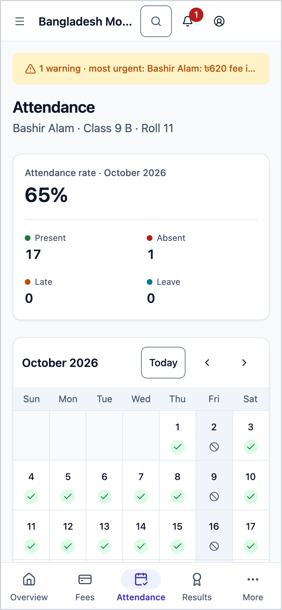
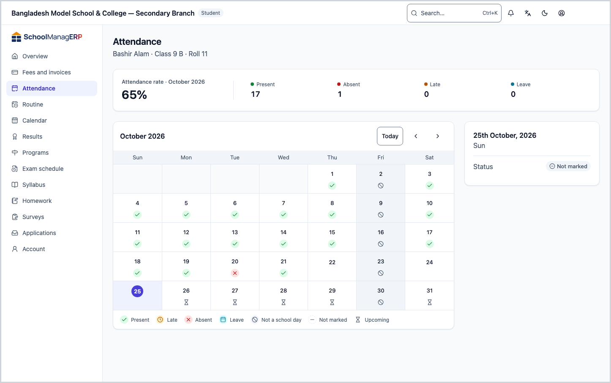

<!-- guide:meta
feature: portal.attendance
title: Attendance
summary: See in a calendar which days your child came to school, missed, was late or on leave, along with the month's attendance rate.
roles: [PARENT, STUDENT]
sources:
  - client-admin/src/routes/portal/attendance.tsx
  - client-admin/src/routes/portal/-arrival-notice-card.tsx
  - server/src/modules/attendance/attendance-summary.controller.ts
  - server/src/modules/attendance/attendance-summary.service.ts
  - server/src/modules/attendance/dto/attendance-summary.dto.ts
  - server/src/modules/students/family-access.service.ts
labels:
  [
    portal:attendance.*,
    portal:attendanceGrid.*,
    portal:empty.*,
    portal:arrivalNotice.*,
    nav:items.portalAttendance,
  ]
helpIds:
  [
    portal.attendance,
    portal.attendance.action.pickDay,
    portal.attendance.action.changeMonth,
  ]
devices: [phone, desktop]
entry: [sidebar]
keywords:
  [attendance, absent, late, leave, attendance rate, present, calendar]
appVersion: 0.1.0 (978d9b96a)
owner: tareq89
lastVerified: 2026-10-25
knownIssues: []
-->

# Attendance

See day by day when your child came to school this month and when they did not.

**Where to go:** on a phone, **Attendance** in the bottom bar. On a computer, **Attendance** in the left menu. You can also get here from the **This month's attendance** card on [**Overview**](overview.md) by tapping **Full attendance**.
**Before you start:** the school office must have linked you to your child. Days only fill in once the teacher takes attendance.

This page is for looking only. If a day looks wrong, tell the school.

[See the month](#task-main) · [One day](#task-day) · [Another month](#task-month) · [Troubleshooting](#trouble)

**On this page**

- [See this month's attendance](#task-main)
- [How to know you are looking at the right thing](#confirm)
- [Other situations](#other)
  - [See the details of one day](#task-day)
  - [See another month](#task-month)
  - [See another child's attendance](#task-pick)
- [Troubleshooting](#trouble)
- [Who can do what](#roles)
- [Learn more](#more)

---

## See this month's attendance 

1. On a phone, tap **Attendance** in the bottom bar.

   → The top card shows **Attendance rate · …** (the month name) and the percentage in large type. Below it, four boxes with a number of days each: **Present**, **Absent**, **Late**, **Leave**.

2. Scroll down to the month's calendar. The colour of each day shows what happened that day.

> **Remember:** if no day in the month has been marked, the rate shows only a dash (—) and the text **Not enough marked days this month**. This does not mean 0%; the teacher has not taken attendance yet.

---

## How to know you are looking at the right thing 

Each day in the calendar is one of these:

| What it says         | What it means                              |
| -------------------- | ------------------------------------------ |
| **Present**          | Came to school that day                    |
| **Late**             | Came, but late                             |
| **Absent**           | Did not come                               |
| **Leave**            | Was on leave                               |
| **Not a school day** | A holiday or weekly off day                |
| **Not marked**       | A school day, but attendance was not taken |
| **Upcoming**         | A day still to come                        |

**How the rate is worked out:** days present ÷ days counted × 100. Whether a late day counts as present, whether leave days are counted, and whether you divide by all school days or only marked days are all set by your school's own rules. So the rate for the same days can differ between two schools.

---

## Other situations 

### See the details of one day 

1. Tap a day in the calendar.

   → The details for that day appear below: **Status**; if late, **Minutes late**; if the teacher wrote something, **Remarks**; on a holiday, **Holiday** and the holiday's name.

In the current month, today is chosen at the start. In any other month nothing is chosen, and it says **Pick a day on the calendar to see its details**.

### See another month 

Tap the arrows at the top of the calendar to go to the month before or after. The rate and the four boxes change to that month's figures. If that month has no records, it says **No attendance records for this month yet.**

### See another child's attendance 

With more than one child, tap a name in the **Choose a student** row at the top. With one child this row does not appear.

### Get a message when your child reaches school 

Parents only. The **Arrival notices** card shows near the top of the page, only when your school has turned arrival notices on.

1. In the **Arrival notices** card, find your child's name and turn on the **Notify me** switch.

   → A **Waiting for the teacher** mark shows beside the name. The class teacher has to confirm your request.

2. Below the switch, choose **In the app** or **By SMS**. **By SMS** is greyed out, with the text **Your school sends this in the app only**, when the school has not allowed SMS.

   If you choose **In the app** and no phone on your account has the app yet, you see **No phone on your account has the app yet. Choose SMS or install the app.** Press **Turn on app messages** to set it up.

3. When the teacher confirms, the mark changes to **Once** (one message, then it stops) or **Every day** (a message each school day). After a **Once** message goes, the mark says **Done**.

To stop, turn **Notify me** off. If the mark says **Set by the admin**, the school has fixed it and you cannot turn the switch on or off here. When the admin has turned it on for you, you see **The admin has turned this on. You can still choose how it is sent.** and you can still choose **In the app** or **By SMS**. If a change does not save, you see **Could not save. Try again.**

---

## Troubleshooting 

| What you see                                            | What to do                                                               | Who can help  |
| ------------------------------------------------------- | ------------------------------------------------------------------------ | ------------- |
| **Not enough marked days this month**                   | It shows once the teacher takes attendance. Check again in a few days.   | Class teacher |
| **Could not load this student's attendance.** …         | Check your connection and tap **Try again**.                             | —             |
| A day's status looks wrong                              | Tell the class teacher or school office; it cannot be changed from here. | Class teacher |
| **No students linked to you yet**                       | Ask the school office to link your child, then tap **Check again**.      | School office |
| Your child is absent today and you want to say so ahead | Tap **Tell the school** on [**Overview**](overview.md#task-tell).        | —             |

---

## Who can do what 

| Role    | See attendance       | Change |
| ------- | -------------------- | ------ |
| Parent  | Only linked children | No     |
| Student | Only themselves      | No     |

**Parent:** you see attendance only for the children the school office has linked to you, and only at this school. If you ask for another student's attendance, the server does not return it.

**Student:** you see only your own attendance.

The teacher takes attendance from the [**Taking attendance**](../attendance/attendance.md) page.

---

## Learn more 

<strong>Parts of the page</strong> — Attendance

1. The **Attendance** heading, with name · class · roll under it; with more than one child, **Choose a student**.
2. The **Attendance rate** card and **Present**, **Absent**, **Late**, **Leave**.
3. The month's calendar, with arrows at the top to change month.
4. The details of the chosen day.

<strong>How attendance works</strong>

<figure>
  
  <figcaption><em>The path of attendance, from the teacher's register to your phone</em></figcaption>
</figure>

- **A day's status:** exactly what the teacher marked.
- **Rate:** worked out by the school's attendance rules; if there are no days to divide by, no rate shows.
- **Month:** from the first to the last day of the calendar month.

**Related pages**

- [**Overview**](overview.md) — whether your child is at school today, at a glance.
- [**Fees and invoices**](fees.md) — the month-by-month fee account.
- [**Routine**](routine.md) — classes today and over the coming days.
- [**Calendar**](calendar.md) — holidays and school events.
- [**Exam schedule**](exam-schedule.md) — exam dates and the admit card.
- [**Results**](results.md) — results of published exams.
- [**Taking attendance**](../attendance/attendance.md) — where the teacher takes attendance.
