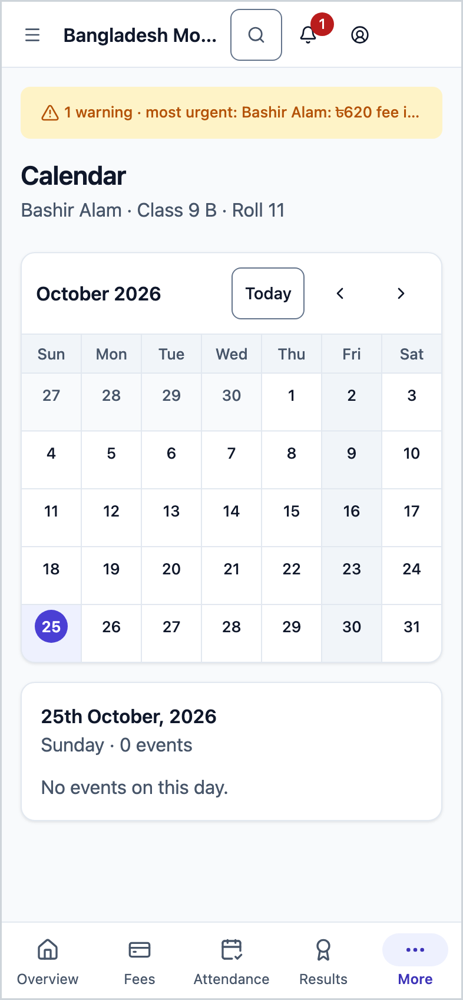
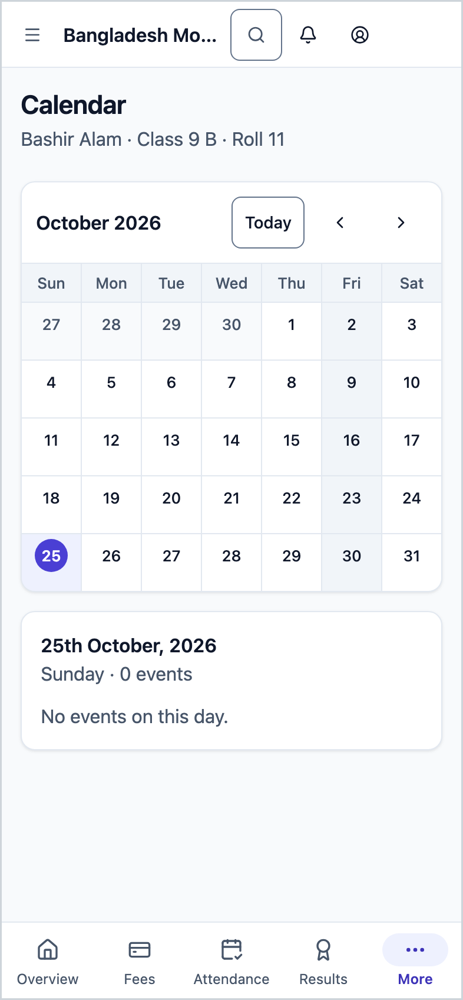

<!-- guide:meta
feature: portal.calendar
title: Calendar
summary: See your child's class's school holidays, exams, events, meetings and deadlines in a month calendar; tap a day to see everything on it.
roles: [PARENT, STUDENT]
sources:
  - client-admin/src/routes/portal/calendar.tsx
  - server/src/modules/calendar/calendar-events.controller.ts
  - server/src/modules/calendar/calendar-events.service.ts
  - server/src/modules/calendar/calendar-visibility.util.ts
  - server/src/modules/students/family-access.service.ts
labels:
  [
    portal:calendar.*,
    portal:empty.*,
    portal:children.*,
    nav:items.portalCalendar,
    nav:items.more,
  ]
helpIds:
  [
    portal.calendar,
    portal.calendar.action.pickDay,
    portal.calendar.action.changeMonth,
  ]
devices: [phone]
entry: [sidebar]
keywords:
  [calendar, holiday, holiday list, exam, event, meeting, deadline]
appVersion: 0.1.0 (978d9b96a)
owner: tareq89
lastVerified: 2026-10-25
knownIssues: []
-->

# Calendar

See by the month when the school is closed and when there are exams or events.

**Where to go:** on a phone, tap **More** in the bottom bar, then **Calendar**. On a computer, **Calendar** in the left menu. You can also get here from the **Next holiday** card on [**Overview**](overview.md) by tapping **Open calendar**.
**Before you start:** the school office must have linked you to your child, and the school must have published items on the calendar.

This page is for looking only. You cannot add or change anything here.

[See the month](#task-main) · [One day](#task-day) · [Another month](#task-month) · [Troubleshooting](#trouble)

**On this page**

- [See this month's calendar](#task-main)
- [How to know you are looking at the right thing](#confirm)
- [Other situations](#other)
  - [See what is on one day](#task-day)
  - [See another month](#task-month)
  - [See another child's calendar](#task-pick)
- [Troubleshooting](#trouble)
- [Who can do what](#roles)
- [Learn more](#more)

---

## See this month's calendar 

1. On a phone, tap **More** in the bottom bar, then **Calendar**.

   → This month's calendar opens. The child's name · class · roll is at the top.

2. A day with something on it has a small dot on a phone; on a computer the item's name is written in the box. If a day has more items, it says, for example, **+2 more**.
3. Below the calendar, see what is on today.

> **Remember:** the school's weekly off days, and which day the week starts on, follow your school's own rules.

---

## How to know you are looking at the right thing 

Each item has its type written beside it:

| What it says            | What it means                                           |
| ----------------------- | ------------------------------------------------------- |
| **Holiday**             | The school is closed                                    |
| **Exam**                | An exam day                                             |
| **Event**               | A school event                                          |
| **Meeting**             | A meeting, for example a parents' meeting               |
| **Deadline**            | The last day to hand something in                       |
| **Make-up school day**  | Classes on an off day, to make up for an earlier holiday |

Items that run for several days (for example a week-long holiday) show on every one of those days.

Only items the school has published and made visible to everyone appear here. Items kept for staff only (for example a teachers' meeting) do not.

---

## Other situations 

### See what is on one day 

1. Tap a day in the calendar.

   → Everything on that day appears below, each with its name and type.

In the current month, today is chosen at the start; in any other month, the 1st. If you tap a day of the neighbouring month, the calendar moves to that month and the day stays chosen.

### See another month 

Tap the arrows at the top of the calendar to go to the month before or after. The back button on your phone returns you to the month you looked at before.

### See another child's calendar 

With more than one child, tap a name in the **Choose a student** row at the top. When you change child, you get that child's class items, because one class's exams may not match another's. With one child this row does not appear.

This page shows only items the school has tied to your child's class. An item the school did not tie to any class (for example a holiday entered for the whole school with no class chosen) does not show here.

---

## Troubleshooting 

| What you see                                              | What to do                                                                | Who can help  |
| --------------------------------------------------------- | ------------------------------------------------------------------------- | ------------- |
| **Could not load the school calendar.** …                 | Check your connection and tap **Try again**.                              | —             |
| **No students linked to you yet**                         | Ask the school office to link your child, then tap **Check again**.       | School office |
| A holiday or event you heard of is not on the calendar    | The school may not have published it yet, or did not tie it to your child's class. Ask the school office. | School office |
| The calendar is empty                                     | Look at another month; there may be nothing this month.                   | —             |

---

## Who can do what 

| Role    | See the calendar                                             | Change |
| ------- | ------------------------------------------------------------ | ------ |
| Parent  | Items tied to the chosen linked child's class                | No     |
| Student | Items tied to their own class                                | No     |

**Parent:** you see only this school's published items. If an item is for a particular class, you see it only when one of your linked children is in that class. You never see staff-only items.

**Student:** the same rule, using your own class.

The school adds and publishes items from the [**Seeing, adding and subscribing to holidays and events in the calendar**](../people/calendar.md) page.

---

## Learn more 

<strong>Parts of the page</strong> — Calendar

1. The **Calendar** heading, with name · class · roll under it; with more than one child, **Choose a student**.
2. The month calendar, with arrows at the top to change month.
3. The chosen day's items.

<strong>How the calendar works</strong>

<figure>
  
  <figcaption><em>The path of the calendar, from the school's items to your phone</em></figcaption>
</figure>

- **Which items:** published only. Draft items are not seen by families.
- **For whom:** only items the school tied to the chosen child's class. Items tied to no class do not show here.
- **Month:** fetched with a week on either side of the month, so items show on the neighbouring month's days too.

**Related pages**

- [**Overview**](overview.md) — how many days until the next holiday, at a glance.
- [**Fees and invoices**](fees.md) — the month-by-month fee account.
- [**Attendance**](attendance.md) — every day of the month.
- [**Routine**](routine.md) — classes today and over the coming days.
- [**Exam schedule**](exam-schedule.md) — exam dates and the admit card.
- [**Results**](results.md) — results of published exams.
- [**Seeing, adding and subscribing to holidays and events in the calendar**](../people/calendar.md) — where the school adds items.
