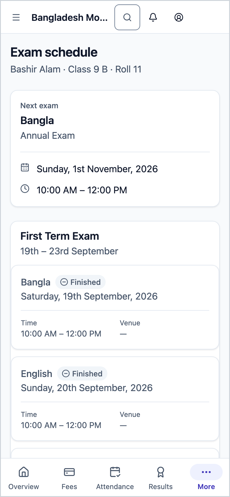
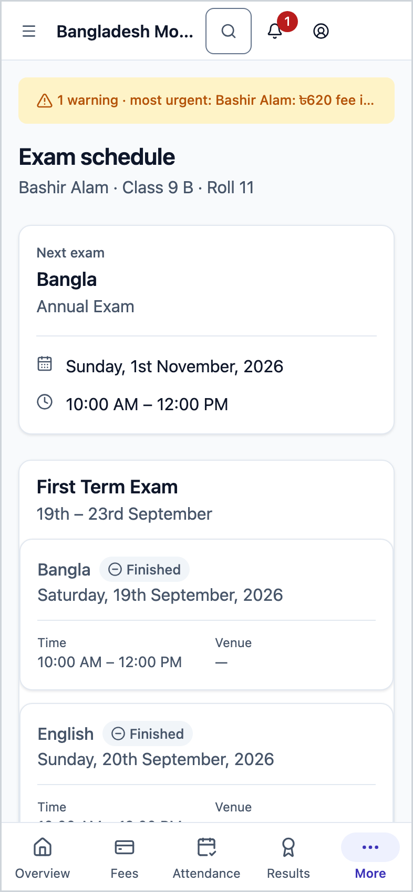

<!-- guide:meta
feature: portal.examSchedule
title: Exam schedule
summary: See the date, time, subject and venue of every exam for your child's class, with the next exam set apart, and print the admit card for an upcoming exam yourself.
roles: [PARENT, STUDENT]
sources:
  - client-admin/src/routes/portal/exam-schedule.tsx
  - client-admin/src/routes/portal/-admit-card-panel.tsx
  - client-admin/src/routes/portal/-admit-card-print.ts
  - server/src/modules/exams/exam-schedules.controller.ts
  - server/src/modules/exams/exam-schedules.service.ts
  - server/src/modules/print/exam-documents/family-admit-card.controller.ts
  - server/src/modules/print/exam-documents/family-admit-card.service.ts
  - server/src/modules/students/family-access.service.ts
labels:
  [
    portal:examSchedule.*,
    portal:empty.*,
    portal:children.*,
    portal:fees.pickerLabel,
    nav:items.portalExamSchedule,
    nav:items.more,
  ]
helpIds:
  [
    portal.examSchedule,
    portal.examSchedule.action.printAdmitCard,
  ]
devices: [phone]
entry: [sidebar]
keywords:
  [exam schedule, exam routine, admit card, hall ticket, when is the exam, seat, print]
appVersion: 0.1.0 (978d9b96a)
owner: tareq89
lastVerified: 2026-10-25
knownIssues: []
-->

# Exam schedule

Which exam is when, at what time and where, and printing the admit card.

**Where to go:** on a phone, tap **More** in the bottom bar, then **Exam schedule**. On a computer, **Exam schedule** in the left menu.
**Before you start:** the school office must have linked you to your child, and the school must have made the full exam schedule.

The schedule is for looking only. You can print the admit card from here.

[See the schedule](#task-main) · [Print the admit card](#task-admit) · [Why no button](#admit-missing) · [Troubleshooting](#trouble)

**On this page**

- [See the exam schedule](#task-main)
- [How to know you are looking at the right thing](#confirm)
- [Other situations](#other)
  - [Print the admit card](#task-admit)
  - [No admit card button, or it will not print](#admit-missing)
  - [See another child's schedule](#task-pick)
- [Troubleshooting](#trouble)
- [Who can do what](#roles)
- [Learn more](#more)

---

## See the exam schedule 

1. On a phone, tap **More** in the bottom bar, then **Exam schedule**.

   → The **Next exam** card is at the top: subject, exam name, date, time and, if given, venue. If the exam is today, **Today** shows beside it.

2. Scroll down. Each exam has its own card, with the exam name and its first and last day at the top.
3. Each row in a card shows **Date**, **Time**, **Subject**, **Venue**. Rows are sorted by date and start time.

> **Remember:** an exam only shows here once the school has set the day and time of all its subjects. A half-finished schedule does not show, so what you see is the full schedule.

---

## How to know you are looking at the right thing 

- A subject whose exam is over has a faded row and **Finished** beside it. An exam on an earlier day, or today's exam whose end time has passed, both count as finished.
- Today's exam that has not finished yet has its row picked out in colour.
- If a subject's name is not set, it says **Subject not set**.
- When every exam is over, the **Next exam** card does not appear.
- Only exams for the child's current class show.

---

## Other situations 

### Print the admit card 

1. Go to the card of the exam you need the admit card for. Under the heading it says **Admit card ready.** **It opens as a page you can print or save on your phone.**
2. Tap **Print admit card**.

   → A new page opens with the admit card, at A4 size. Print it if you have a printer; on a phone, save it as a PDF.

3. If nothing opens, look for the message **Allow pop-ups for this site, then try again.** at the top. Allow pop-ups for this site in your browser and tap again.

> **Remember:** each time you tap print, the school's records note a copy. Do not tap again and again without need; if you tap very often you may have to wait a while.

### No admit card button, or it will not print 

**No button at all:** the admit card part only appears on the card of an exam that has at least one subject still to be held. Once the whole exam is over, the part no longer shows.

**There is a button, but you get another message when you tap:** the school's server checks a few things before printing.

| What you see after tapping                            | Why                                                                                                   | What to do                                                        |
| ----------------------------------------------------- | ----------------------------------------------------------------------------------------------------- | ----------------------------------------------------------------- |
| **The admit card is not ready yet.**                  | The school has not published the seat plan for this exam yet, or it has no seat for your child        | Check again later, or ask the school office                       |
| **The admit card cannot be printed now**              | The school has a rule that the admit card is not given while dues are unpaid, and your child has dues | Tap **See dues and pay**; once paid, tap **Try again**            |
| **The admit card could not be printed. Try again.**   | Some other problem, for example the school has not yet set the admit card's main design, or the connection dropped | Tap again; if it keeps happening, tell the school office |
| **Allow pop-ups for this site, then try again.**     | Your browser stopped the new admit card page from opening | Allow pop-ups for this site in the browser settings, then tap again |

The dues message usually also carries your child's name and the total amount due. If the school gave a phone number, a **Call the office (…)** button also appears. Any amount above zero triggers this rule; if the school has switched this rule off, dues are not checked.

### See another child's schedule 

With more than one child, tap a name in the **Choose a student** row at the top. When you change child, the admit card part starts again from **Admit card ready.** With one child this row does not appear.

---

## Troubleshooting 

| What you see                                            | What to do                                                                  | Who can help  |
| ------------------------------------------------------- | --------------------------------------------------------------------------- | ------------- |
| **No exam schedule yet**                                | It will appear once the school finalises the full schedule. Check again later. | School office |
| **Could not load the exam schedule.** …                 | Check your connection and tap **Try again**.                                | —             |
| **No students linked to you yet**                       | Ask the school office to link your child, then tap **Check again**.         | School office |
| An exam you heard of is not in the list                 | The time for all its subjects has not been set yet. Ask the school office.  | School office |
| No admit card button, or another message appears        | See [the list above](#admit-missing).                                       | School office |
| You paid the dues, but the admit card is still held     | It only opens once the school records the payment. Take your receipt to the office. | Accountant |

---

## Who can do what 

| Role    | See schedule         | Print admit card     |
| ------- | -------------------- | -------------------- |
| Parent  | Only linked children | Only linked children |
| Student | Only themselves      | Only themselves      |

**Parent:** you get the schedule and admit card only for the children the school office has linked to you, and only at this school. If you ask for another student's, the server does not return it.

**Student:** only your own.

Staff cannot print admit cards from this page; they do it from the exam pages. Seat plans are published from the [**Making and publishing seat plans**](../exams-results/seat-plans.md) page.

---

## Learn more 

<strong>Parts of the page</strong> — Exam schedule

1. The **Exam schedule** heading, with name · class · roll under it; with more than one child, a row to pick the child.
2. The **Next exam** card (on the right on a computer).
3. A card for each exam: name, range of days, the admit card part (while the exam is still to come) and subject rows.

<strong>How the exam schedule works</strong>

<figure>
  
  <figcaption><em>The path from the schedule to the admit card</em></figcaption>
</figure>

- **Which exams show:** those for the child's class where every subject that carries marks has its day and time set.
- **Admit card conditions, in order:** (1) you are linked to the child; (2) the child has a seat in a published seat plan for this exam; (3) if the school keeps the dues rule on, the child's total dues are zero; (4) the school has set a main design for the admit card.
- **Paper:** A4, two admit cards to a page.

**Related pages**

- [**Syllabus (parent and student)**](syllabus.md) — what is being taught, subject by subject.

- [**Overview**](overview.md) — dues and today's news, at a glance.
- [**Fees and invoices**](fees.md) — see dues and news of payment.
- [**Attendance**](attendance.md) — every day of the month.
- [**Routine**](routine.md) — classes today and over the coming days.
- [**Calendar**](calendar.md) — holidays and school events.
- [**Results**](results.md) — results of published exams.
- [**Making and publishing seat plans**](../exams-results/seat-plans.md) — where the school sets the seats.
