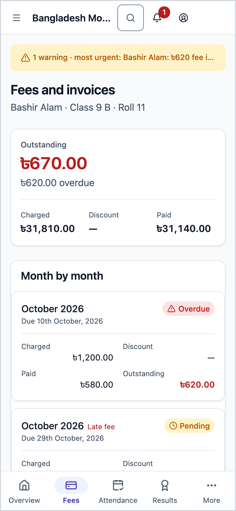
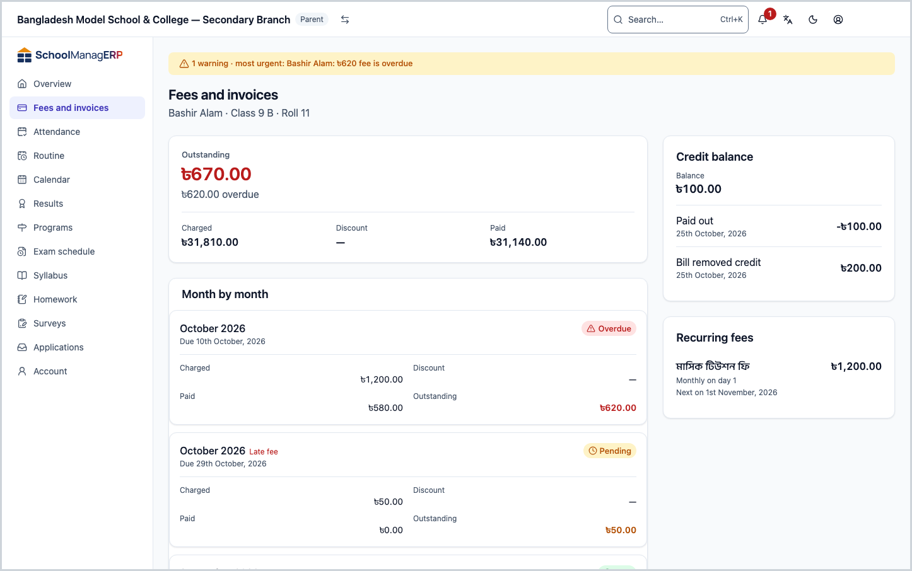

<!-- guide:meta
feature: portal.fees
title: Fees and invoices
summary: See your child's fees month by month; a parent can pay a bill with bKash or send a payment proof, follow the proof until the school confirms it, and print invoices.
roles: [PARENT, STUDENT]
sources:
  - client-admin/src/routes/portal/fees.tsx
  - client-admin/src/routes/portal/fees_/pay.tsx
  - client-admin/src/routes/portal/fees_/pay_/result.tsx
  - client-admin/src/routes/portal/-my-proofs-tab.tsx
  - client-admin/src/routes/portal/-pay-line.tsx
  - server/src/modules/payment-submissions/proof-submissions.controller.ts
  - server/src/modules/payment-submissions/online-payments.controller.ts
  - server/src/modules/fees/fees.controller.ts
  - server/src/modules/fees/fees.service.ts
  - server/src/modules/fees/fines/fines.controller.ts
  - server/src/modules/fees/wallet.controller.ts
  - server/src/modules/fees/recurring-schedules.controller.ts
  - server/src/modules/invoices/invoices.controller.ts
  - server/src/modules/students/family-access.service.ts
labels:
  [
    portal:fees.*,
    portal:hero.nothingDue,
    portal:hero.overdueAmount,
    portal:hero.lastPaid,
    portal:hero.dueOn,
    portal:empty.*,
    portal:proofs.*,
    portal:fees.dueThisMonth,
    portalPay:*,
    nav:items.portalFees,
    common:walletTransactionKind.*,
  ]
helpIds:
  [
    portal.fees,
    portal.fees.action.print,
    portal.fees.action.pickStudent,
  ]
devices: [phone, desktop]
entry: [sidebar, page:portal.overview]
keywords:
  [fees, invoice, outstanding, charged, discount, paid, fine, credit balance, wallet, print, receipt, pay, bKash, payment proof, transaction ID, TrxID, pay online]
appVersion: 0.1.0 (4fa6d3d1b)
owner: tareq89
lastVerified: 2026-11-15
knownIssues: []
-->

# Fees and invoices

Every month's fee for your child, what has been paid and what is left, on one page.

**Where to go:** on a phone, **Fees** in the bottom bar. On a computer, **Fees and invoices** in the left menu. You can also get here from [**Overview**](overview.md) by tapping **View fee breakdown**.
**Before you start:** the school office must have linked you to your child. If the school has not charged any fees, the month-by-month list stays empty.

Looking at the account is read-only. To pay, press **Pay …** on the **Due this month** card of [**Overview**](overview.md) (see [Pay a bill](#task-pay)), or pay at the school office. When the school records or confirms a payment, the figures here update by themselves.

[See the account](#task-main) · [Pay a bill](#task-pay) · [Send a payment proof](#task-proof) · [My payment proofs](#task-proofs) · [Print an invoice](#task-print) · [Troubleshooting](#trouble)

**On this page**

- [How you get here](#arrive)
- [See your child's fee account](#task-main)
- [How to know you are looking at the right thing](#confirm)
- [Other situations](#other)
  - [See another child's fees](#task-pick)
  - [Pay a bill](#task-pay)
  - [Send a payment proof](#task-proof)
  - [After you pay with bKash](#task-result)
  - [See and withdraw your payment proofs](#task-proofs)
  - [Print an invoice](#task-print)
  - [See fines](#task-fines)
  - [Credit balance and recurring fees](#task-wallet)
- [Troubleshooting](#trouble)
- [Who can do what](#roles)
- [Learn more](#more)

---

## How you get here 

**From the sidebar:** on a phone, **Fees** in the bottom bar; on a computer, **Fees and invoices** in the left menu. The page opens on the **Fees and invoices** tab.

**To pay, from Overview:**

1. On [**Overview**](overview.md), find the **Due this month** card. It ends with the **Total to pay this month** and a **Pay …** button.
2. Press **Pay …**. → The **Pay fees** page opens with that child's open bills already ticked. Carry on at [Pay a bill](#task-pay).

If the school has turned both ways of paying off, the card says **Pay at the school office** instead of a button.

---

## See your child's fee account 

1. On a phone, tap **Fees** in the bottom bar.

   → The child's name, class, section and roll are at the top. The first card is **Outstanding**: the total still owed in large type, or **Nothing due** if nothing is owed.

2. Under **Outstanding**, look at three figures: **Charged**, **Discount**, **Paid**.
3. Scroll down to **Month by month**.

   → Each month is separate, newest first. For each month: **Charged**, **Discount**, **Paid**, **Outstanding** and **Status**, with **Due …** underneath.

> **Remember:** a month that is fully paid stays in the list, with 0 under outstanding. It is kept so you can see how much was charged.

---

## How to know you are looking at the right thing 

| Figure          | How it is worked out                                                     |
| --------------- | ------------------------------------------------------------------------ |
| **Charged**     | The sum of the totals of all of the child's bills                        |
| **Discount**    | The sum of the discounts on all bills. With no discount, only a dash (—) |
| **Paid**        | The sum of the money paid against all bills                              |
| **Outstanding** | **Charged** − **Paid** − **Discount**                                    |

A line under **Outstanding** may show:

- **… overdue** — the sum of what is still owed on bills whose due date has passed.
- If nothing is overdue, **Last paid …** — the date of the last successful payment.

In the **Status** column:

| What it says       | What it means                                     |
| ------------------ | ------------------------------------------------- |
| **Paid**           | The whole amount for that month has been paid     |
| **Overdue**        | The due date has passed and money is still owed   |
| **Partially paid** | Some money has been paid, but not all             |
| **Pending**        | Nothing paid yet, and the due date has not passed |

The due date itself is not yet overdue; it starts the next day. If the school made a separate bill for lateness, the month is marked **Late fee**.

A bill the school waives counts its waived amount under **Discount**, so it adds nothing to **Outstanding**.

**When you pay or send a proof, how do you know it went through?**

| State                           | How you know                                                                                                                            | What next                                                                |
| ------------------------------- | --------------------------------------------------------------------------------------------------------------------------------------- | ------------------------------------------------------------------------ |
| **Changed on screen only**      | You have ticked bills or filled the form on **Pay fees**, but not pressed the last button. Nothing has gone to the school.              | Press **Pay … with bKash** or **Submit payment proof**.                  |
| **Reached the school's system** | After a proof, **Payment proof sent** appears, and the bills carry **Waiting for confirmation**. After bKash, **Payment done** appears. | Wait for the school to confirm a proof; a bKash payment is already paid. |

Nothing on **Pay fees** is saved on the device while you are offline, so there is no **Saved on this device** state.

**To check for yourself:** open the **My payment proofs** tab. The proof is the first card. After a bKash payment, the month shows **Paid** on the **Fees and invoices** tab.

**If the message does not come:** see [Troubleshooting](#trouble). A proof that was not sent is not lost from the form until you leave the page.

---

## Other situations 

### See another child's fees 

With more than one child, a **Choose a student** row at the top lists all their names. Tap the name of the child whose fees you want. The whole page changes to their account. With one child this row does not appear.

### Pay a bill 

1. On [**Overview**](overview.md), press **Pay …** on the **Due this month** card.

   → The **Pay fees** page opens. Step **1. Which bills are you paying** lists each child's open bills with the amount. The child you came from is ticked; open **Pay …** from the overview to start with a different child.

2. Untick any bill you are not paying now. A bill tagged **Waiting for confirmation** is already in a payment proof and cannot be ticked. The **Total** at the bottom follows your ticks.
3. In **2. How are you paying**, choose **Pay with bKash**. This choice is there only when the school has turned bKash on. If it has, it is already chosen.

   → A line says **You pay exactly …. No extra charge.**

4. Press **Pay … with bKash**.

   → The bKash page opens. Pay there. When you finish, bKash brings you back to the **Payment result** page (see [After you pay with bKash](#task-result)).

If the school offers only payment proofs, **Already paid — submit proof** is chosen at once and the button reads **Submit payment proof**. Carry on at [Send a payment proof](#task-proof).

> **Remember:** nothing is paid until you finish on the bKash page. Pressing **Close** before that pays nothing.

### Send a payment proof 

Use this when you have already paid in some way (for example by bKash or the bank) and want the bills to show it.

1. On the **Pay fees** page, tick the bills as in [Pay a bill](#task-pay).
2. In **2. How are you paying**, choose **Already paid — submit proof**.

   → **3. Payment proof** appears.

3. Fill in the fields:

   | Field                                 | What to enter                                                                         |
   | ------------------------------------- | ------------------------------------------------------------------------------------- |
   | **How did you pay**                   | Choose the way you paid, for example bKash. The school decides which ways are listed. |
   | **Amount**                            | Filled in from the ticked bills. You cannot change it.                                |
   | **Transaction ID (TrxID)**            | The number from your payment message, for example 8N7A6D5EFG. Up to 64 characters.    |
   | **When did you pay**                  | The day you paid. It cannot be after today.                                           |
   | **Photos (up to 2: JPG, PNG or PDF)** | A photo of your payment message or slip.                                              |

   If the school wrote instructions for the way you chose, they show as **School instructions: …**.

4. Give the transaction ID or a photo, at least one. Both is best.
5. Press **Submit payment proof**.

   → **Payment proof sent** appears: "The school will confirm it soon. Your bills show Waiting for confirmation until then." Press **Back to fees**.

| What happens                 | What you see                                                                                                                                                                                                                |
| ---------------------------- | --------------------------------------------------------------------------------------------------------------------------------------------------------------------------------------------------------------------------- |
| You leave something out      | A red line under the field: **Choose how you paid.**, **Choose the date you paid.**, **The date cannot be in the future.**, **Give the transaction ID or add a photo.** or **You can add up to 2 photos.** Nothing is sent. |
| The proof reaches the school | **Payment proof sent**. The bills now carry **Waiting for confirmation**.                                                                                                                                                   |

### After you pay with bKash 

When you come back from bKash, the **Payment result** page checks your payment and says one of three things:

| What it says                 | What it means                                                                                                                                                    | What to do                                                                                                                                                                                                                                                                                                                               |
| ---------------------------- | ---------------------------------------------------------------------------------------------------------------------------------------------------------------- | ---------------------------------------------------------------------------------------------------------------------------------------------------------------------------------------------------------------------------------------------------------------------------------------------------------------------------------------- |
| **Payment done**             | "The money reached the school. Your bills are now paid." It shows "Paid … Receipt …".                                                                            | If a **View receipt** button shows, press it to open the receipt. Then press **Back to fees**.                                                                                                                                                                                                                                           |
| **Waiting for confirmation** | "We are waiting for bKash to answer. This page updates by itself. If money was taken, do not worry: the bills show paid once it is confirmed."                   | Keep the page open, or come back later. Do not pay again.                                                                                                                                                                                                                                                                                |
| **Payment not done**         | "This payment did not complete. Your money may still have been taken, so do not pay again until the school confirms. If you already paid, submit payment proof." | Do not pay again. If the payment was cancelled or expired and bKash took the money, the page keeps checking and turns to **Payment done** by itself; the school checks bKash about every 10 minutes for up to 3 days. If it failed and you already paid, press **Submit payment proof**. Press **Try again** only if no money was taken. |

If some bills were already paid while you were paying, **Payment done** adds: "Some bills were already paid, so the rest of the money went to your wallet. The school will adjust it for you." That money shows as **Credit balance**.

If the page cannot check the payment, it says **Could not load the payment result. Check your connection and try again.** Press **Try again**.

### See and withdraw your payment proofs 

1. On the fees page, press the **My payment proofs** tab.

   → One card for each proof sent for your children, newest first: the child's name, the amount, a status tag, **Method**, **Transaction ID** and **Submitted on**. If there are none, it says **No payment proofs yet**.

2. Read the status tag:

   | Tag                          | What it means                                                                                                                                                |
   | ---------------------------- | ------------------------------------------------------------------------------------------------------------------------------------------------------------ |
   | **Waiting for confirmation** | The school has not checked it yet.                                                                                                                           |
   | **Confirmed**                | The school confirmed it. The bills show paid.                                                                                                                |
   | **Rejected**                 | The school did not accept it. The card says **Reason:** and the reason, for example **Image unclear**, and a note if the school wrote one. Send a new proof. |
   | **Discarded — already paid** | The bill was paid another way meanwhile. The card says "Bill already paid — submit again next month".                                                        |
   | **Withdrawn**                | You took it back.                                                                                                                                            |

3. To take back a waiting proof, press **Withdraw** on its card, then **Withdraw** again in **Withdraw this payment proof?**

   → **Payment proof withdrawn** appears. The school will not look at it. You can send a new proof for the same bills.

Only the guardian who sent a proof can withdraw it, and only while it says **Waiting for confirmation**.

### Print an invoice 

1. Scroll down to **Invoices**. They are listed **Newest first**, with **Invoice no.**, **Issued on**, **Amount** and **Status**.
2. Tap **Print** beside the invoice you need.

   → A printable invoice opens. Print it from there, or keep it on your phone.

The page shows at most the 100 most recent invoices. If there are more, a line at the top says how many of how many are shown; for older invoices, ask the school office.

### See fines 

If your child has any fines, a **Fines** section appears. Each shows its name, the **Reason** and the date of the incident if the school wrote them, the fine amount and a status (for example **Pending**, **Paid** or **Waived**). A fine bill that is still unpaid is also added to **Outstanding** above.

### Credit balance and recurring fees 

- **Credit balance** — this card appears when money paid in advance is held in your child's name. It shows the **Balance** and the last five transactions. The school uses this money to pay bills when it takes a payment.
- **Recurring fees** — fees the school sets to repeat each period (for example the monthly tuition): the name, the amount, how often, and **Next on …**.

Each card only appears when there is something to show.

---

## Troubleshooting 

| What you see                                                                                                 | What to do                                                                                                                                                                                                             | Who can help  |
| ------------------------------------------------------------------------------------------------------------ | ---------------------------------------------------------------------------------------------------------------------------------------------------------------------------------------------------------------------- | ------------- |
| **No months yet**                                                                                            | The school has not charged any fees yet. They will show here once it does.                                                                                                                                             | Accountant    |
| **Could not load these fees.** …                                                                             | Check your connection and tap **Try again**.                                                                                                                                                                           | —             |
| **Could not open the printable invoice. Try again.**                                                         | Tap **Print** again.                                                                                                                                                                                                   | —             |
| You paid, but the amount has not gone down                                                                   | If you paid at the school, it goes down once the school records the payment; take your receipt to the office. If you sent a payment proof, it goes down once the school confirms it; look under **My payment proofs**. | Accountant    |
| **Could not load your bills. Check your connection and try again.**                                          | Press **Try again** on the **Pay fees** page.                                                                                                                                                                          | —             |
| **bKash is not available right now. Pay at the school office, or submit payment proof if you already paid.** | Try again later, pay at the school office, or press **Already paid — submit proof** if you already paid.                                                                                                               | Accountant    |
| **Could not start the bKash payment. Please try again.**                                                     | Press the bKash pay button again.                                                                                                                                                                                      | —             |
| **One of these bills already has a payment waiting for confirmation. Reload and pick again.**                | Open **Pay fees** again. A bill with **Waiting for confirmation** cannot be ticked.                                                                                                                                    | —             |
| **Proof cannot be saved right now. Please try again in a little while.**                                     | Wait a little and press **Submit payment proof** again.                                                                                                                                                                | —             |
| **Could not send your payment proof. Check the form and try again.**                                         | Check each field and press **Submit payment proof** again.                                                                                                                                                             | Accountant    |
| **Could not withdraw the payment proof. Try again.**                                                         | Press **Withdraw** again.                                                                                                                                                                                              | —             |
| Your payment proof says **Rejected**                                                                         | Read the **Reason**, then send a new proof or call the school office.                                                                                                                                                  | Accountant    |
| **No students linked to you yet**                                                                            | Ask the school office to link your child, then tap **Check again**.                                                                                                                                                    | School office |
| You cannot find an old invoice                                                                               | If there are more than 100, the older ones do not show here. Ask the school office.                                                                                                                                    | Accountant    |

---

## Who can do what 

| Role    | See fee account      | Print invoice | Pay with bKash or send a payment proof |
| ------- | -------------------- | ------------- | -------------------------------------- |
| Parent  | Only linked children | Yes           | Yes                                    |
| Student | Only themselves      | Yes           | No                                     |

**Parent:** you see fees, invoices, fines and credit balance only for the children the school office has linked to you, and only at this school. If someone puts another student's ID in the address, the server still returns nothing.

**Student:** you see only your own account. Paying and sending a payment proof are for a parent; a student does not have them. The **My payment proofs** tab does not show on a student's page.

The school's internal details (for example who took a payment) do not appear on this page.

---

## Learn more 

<strong>Parts of the page</strong> — Fees and invoices

1. The **Fees and invoices** heading, with name · class · roll under it; with more than one child, **Choose a student**.
2. The **Outstanding** card, with **Charged**, **Discount**, **Paid**.
3. **Month by month**.
4. **Fines** (if any).
5. **Invoices**, with **Print** beside each.
6. Beside or below, **Credit balance** and **Recurring fees** (if any).

<strong>How paying works</strong>

<figure>
  
  <figcaption><em>From Due this month to a paid bill or a payment proof</em></figcaption>
</figure>

- **bKash:** the money goes straight to the school's bKash account. You pay exactly the total, with no extra charge.
- **Payment proof:** the school checks it and confirms or rejects it. Until then the bills say **Waiting for confirmation**. How the school does this: [**Online payments**](../finance/online-payments.md).

<strong>How the fee account works</strong>

<figure>
  
  <figcaption><em>The path of fees, from charged to outstanding</em></figcaption>
</figure>

- **Outstanding each month:** charged − discount − paid. **Outstanding** at the top of the page is the sum of all months.
- **Every month shows:** not only months with money owed, but paid months too.
- **Payment news:** **Last paid** uses successful payments only; a returned cheque is not counted.
- **Difference from Overview:** **Due this month** on [**Overview**](overview.md) shows only this month's bills and earlier unpaid ones; this page has the whole history.

**Related pages**

- [**Alerts and notifications (parent and student)**](notifications.md) — the unpaid fees alert.

- [**Statement**](statement.md) — every bill and payment by date, with what is still owed after each, to print or save.
- [**Overview**](overview.md) — total outstanding and what is due this month.
- [**Attendance**](attendance.md) — every day of the month.
- [**Routine**](routine.md) — classes today and over the coming days.
- [**Calendar**](calendar.md) — holidays and school events.
- [**Exam schedule**](exam-schedule.md) — exam dates and the admit card.
- [**Results**](results.md) — results of published exams.
- [**Student dues**](../finance/dues.md) — where the school's accountant sees dues.
- [**Fines**](../finance/fines.md) — where the school adds fines.
- [**Online payments**](../finance/online-payments.md) — where the school checks your payment proofs and sees bKash payments.
