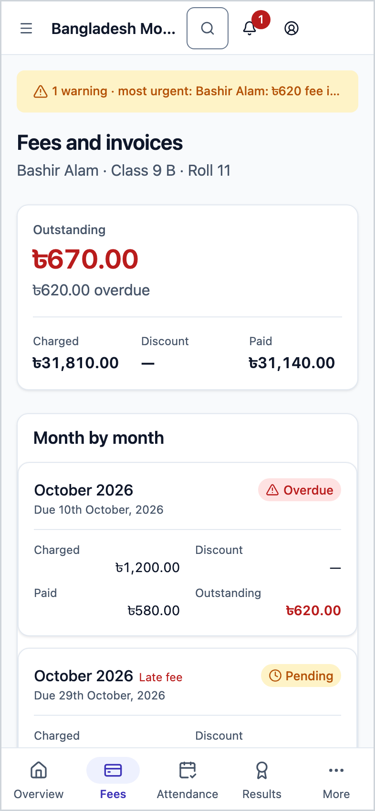
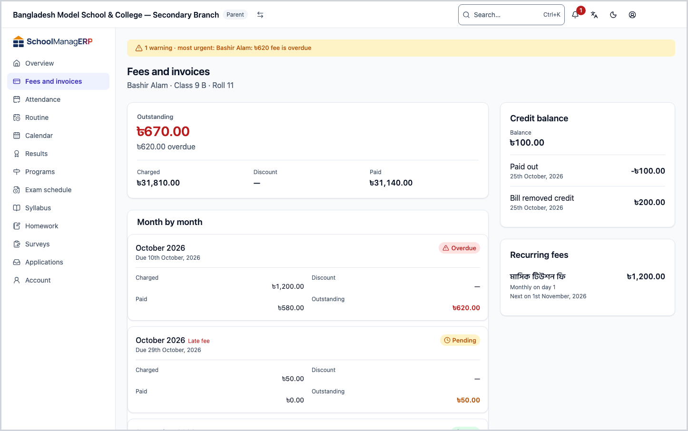

<!-- guide:meta
feature: portal.fees
title: Fees and invoices
summary: See your child's fees month by month — what was charged, discounted, paid and is still due — along with fines, credit balance, recurring fees and invoice printing.
roles: [PARENT, STUDENT]
sources:
  - client-admin/src/routes/portal/fees.tsx
  - server/src/modules/fees/fees.controller.ts
  - server/src/modules/fees/fees.service.ts
  - server/src/modules/fees/fines/fines.controller.ts
  - server/src/modules/fees/wallet.controller.ts
  - server/src/modules/fees/recurring-schedules.controller.ts
  - server/src/modules/invoices/invoices.controller.ts
  - server/src/modules/students/family-access.service.ts
labels:
  [
    portal:fees.*,
    portal:hero.nothingDue,
    portal:hero.overdueAmount,
    portal:hero.lastPaid,
    portal:hero.dueOn,
    portal:empty.*,
    nav:items.portalFees,
    common:walletTransactionKind.*,
  ]
helpIds:
  [
    portal.fees,
    portal.fees.action.print,
    portal.fees.action.pickStudent,
  ]
devices: [phone, desktop]
entry: [sidebar]
keywords:
  [fees, invoice, outstanding, charged, discount, paid, fine, credit balance, wallet, print, receipt]
appVersion: 0.1.0 (978d9b96a)
owner: tareq89
lastVerified: 2026-10-25
knownIssues: []
-->

# Fees and invoices

Every month's fee for your child, what has been paid and what is left, on one page.

**Where to go:** on a phone, **Fees** in the bottom bar. On a computer, **Fees and invoices** in the left menu. You can also get here from [**Overview**](overview.md) by tapping **View fee breakdown**.
**Before you start:** the school office must have linked you to your child. If the school has not charged any fees, the month-by-month list stays empty.

This page is for looking only. You cannot pay here; payment is made at the school. When the school records a payment, the figures here update by themselves.

[See the account](#task-main) · [Print an invoice](#task-print) · [Change child](#task-pick) · [Troubleshooting](#trouble)

**On this page**

- [See your child's fee account](#task-main)
- [How to know you are looking at the right thing](#confirm)
- [Other situations](#other)
  - [See another child's fees](#task-pick)
  - [Print an invoice](#task-print)
  - [See fines](#task-fines)
  - [Credit balance and recurring fees](#task-wallet)
- [Troubleshooting](#trouble)
- [Who can do what](#roles)
- [Learn more](#more)

---

## See your child's fee account 

1. On a phone, tap **Fees** in the bottom bar.

   → The child's name, class, section and roll are at the top. The first card is **Outstanding**: the total still owed in large type, or **Nothing due** if nothing is owed.

2. Under **Outstanding**, look at three figures: **Charged**, **Discount**, **Paid**.
3. Scroll down to **Month by month**.

   → Each month is separate, newest first. For each month: **Charged**, **Discount**, **Paid**, **Outstanding** and **Status**, with **Due …** underneath.

> **Remember:** a month that is fully paid stays in the list, with 0 under outstanding. It is kept so you can see how much was charged.

---

## How to know you are looking at the right thing 

| Figure          | How it is worked out                                                                  |
| --------------- | ------------------------------------------------------------------------------------- |
| **Charged**     | The sum of the totals of all of the child's bills                                     |
| **Discount**    | The sum of the discounts on all bills. With no discount, only a dash (—)              |
| **Paid**        | The sum of the money paid against all bills                                           |
| **Outstanding** | **Charged** − **Paid** − **Discount**                                                 |

A line under **Outstanding** may show:

- **… overdue** — the sum of what is still owed on bills whose due date has passed.
- If nothing is overdue, **Last paid …** — the date of the last successful payment.

In the **Status** column:

| What it says       | What it means                                            |
| ------------------ | -------------------------------------------------------- |
| **Paid**           | The whole amount for that month has been paid            |
| **Overdue**        | The due date has passed and money is still owed          |
| **Partially paid** | Some money has been paid, but not all                    |
| **Pending**        | Nothing paid yet, and the due date has not passed        |

The due date itself is not yet overdue; it starts the next day. If the school made a separate bill for lateness, the month is marked **Late fee**.

A bill the school waives counts its waived amount under **Discount**, so it adds nothing to **Outstanding**.

---

## Other situations 

### See another child's fees 

With more than one child, a **Choose a student** row at the top lists all their names. Tap the name of the child whose fees you want. The whole page changes to their account. With one child this row does not appear.

### Print an invoice 

1. Scroll down to **Invoices**. They are listed **Newest first**, with **Invoice no.**, **Issued on**, **Amount** and **Status**.
2. Tap **Print** beside the invoice you need.

   → A printable invoice opens. Print it from there, or keep it on your phone.

The page shows at most the 100 most recent invoices. If there are more, a line at the top says how many of how many are shown; for older invoices, ask the school office.

### See fines 

If your child has any fines, a **Fines** section appears. Each shows its name, the **Reason** and the date of the incident if the school wrote them, the fine amount and a status (for example **Pending**, **Paid** or **Waived**). A fine bill that is still unpaid is also added to **Outstanding** above.

### Credit balance and recurring fees 

- **Credit balance** — this card appears when money paid in advance is held in your child's name. It shows the **Balance** and the last five transactions. The school uses this money to pay bills when it takes a payment.
- **Recurring fees** — fees the school sets to repeat each period (for example the monthly tuition): the name, the amount, how often, and **Next on …**.

Each card only appears when there is something to show.

---

## Troubleshooting 

| What you see                                              | What to do                                                                            | Who can help  |
| --------------------------------------------------------- | ------------------------------------------------------------------------------------- | ------------- |
| **No months yet**                                         | The school has not charged any fees yet. They will show here once it does.            | Accountant    |
| **Could not load these fees.** …                          | Check your connection and tap **Try again**.                                          | —             |
| **Could not open the printable invoice. Try again.**      | Tap **Print** again.                                                                  | —             |
| You paid, but the amount has not gone down                | It only goes down once the school records the payment. Take your receipt to the office. | Accountant  |
| **No students linked to you yet**                         | Ask the school office to link your child, then tap **Check again**.                   | School office |
| You cannot find an old invoice                            | If there are more than 100, the older ones do not show here. Ask the school office.   | Accountant    |

---

## Who can do what 

| Role    | See fee account       | Print invoice | Pay |
| ------- | --------------------- | ------------- | --- |
| Parent  | Only linked children  | Yes           | No  |
| Student | Only themselves       | Yes           | No  |

**Parent:** you see fees, invoices, fines and credit balance only for the children the school office has linked to you, and only at this school. If someone puts another student's ID in the address, the server still returns nothing.

**Student:** you see only your own account.

The school's internal details (for example who took a payment) do not appear on this page.

---

## Learn more 

<strong>Parts of the page</strong> — Fees and invoices

1. The **Fees and invoices** heading, with name · class · roll under it; with more than one child, **Choose a student**.
2. The **Outstanding** card, with **Charged**, **Discount**, **Paid**.
3. **Month by month**.
4. **Fines** (if any).
5. **Invoices**, with **Print** beside each.
6. Beside or below, **Credit balance** and **Recurring fees** (if any).

<strong>How the fee account works</strong>

<figure>
  
  <figcaption><em>The path of fees, from charged to outstanding</em></figcaption>
</figure>

- **Outstanding each month:** charged − discount − paid. **Outstanding** at the top of the page is the sum of all months.
- **Every month shows:** not only months with money owed, but paid months too.
- **Payment news:** **Last paid** uses successful payments only; a returned cheque is not counted.
- **Difference from Overview:** **Due this month** on [**Overview**](overview.md) shows only this month's bills and earlier unpaid ones; this page has the whole history.

**Related pages**

- [**Alerts and notifications (parent and student)**](notifications.md) — the unpaid fees alert.

- [**Statement**](statement.md) — every bill and payment by date, with what is still owed after each, to print or save.
- [**Overview**](overview.md) — total outstanding and what is due this month.
- [**Attendance**](attendance.md) — every day of the month.
- [**Routine**](routine.md) — classes today and over the coming days.
- [**Calendar**](calendar.md) — holidays and school events.
- [**Exam schedule**](exam-schedule.md) — exam dates and the admit card.
- [**Results**](results.md) — results of published exams.
- [**Student dues**](../finance/dues.md) — where the school's accountant sees dues.
- [**Fines**](../finance/fines.md) — where the school adds fines.
