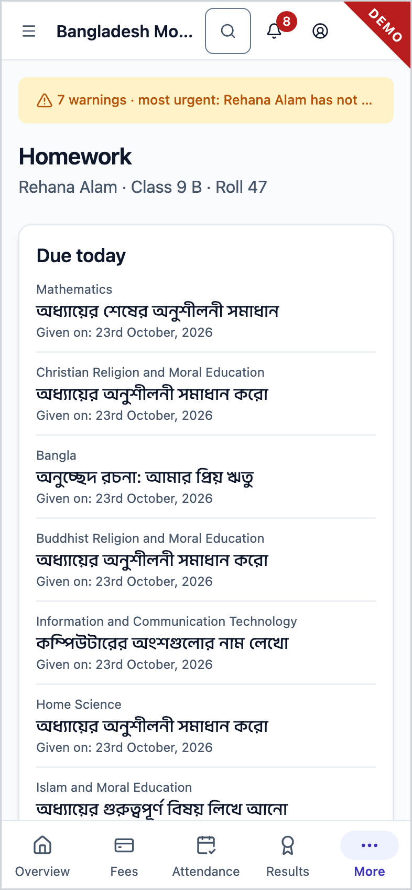

<!-- guide:meta
feature: portal.homework
title: Homework (parent and student)
summary: See on your phone the homework your child has to hand in today and later, grouped by due date, with the subject, the task and the day it was given. This page is view only; nothing can be changed or handed in here.
roles: [PARENT, STUDENT]
sources:
  - client-admin/src/routes/portal.tsx
  - client-admin/src/routes/portal/homework.tsx
  - client-admin/src/routes/portal/-use-family-homework.ts
  - client-admin/src/routes/portal/-homework-card.tsx
  - server/src/modules/homework/homework.controller.ts
  - server/src/modules/homework/homework.service.ts
labels: [portal:homework.*, portal:homeworkCard.*, portal:empty.*, portal:children.*, nav:items.portalHomework, nav:items.more]
helpIds: [portal.homework]
devices: [phone]
entry: [sidebar, palette]
keywords: [হোমওয়ার্ক, বাড়ির কাজ, জমার দিন, আজকের হোমওয়ার্ক, homework, due today, due tomorrow]
appVersion: 0.1.0 (fb209bd7c)
owner: tareq89
lastVerified: 2026-10-25
knownIssues: []
-->

# Homework (parent and student)

See the homework that is due today and later.

**Go to:** On a phone, the bottom bar's **More** → **Homework**. On a computer, **Homework** in the left menu.
**Before you start:** The student must be in a class. A teacher must have given homework to the class's section or to the student.

This page is view only. Homework is not handed in here.

[See it at a glance](#task-main) · [More than one child](#task-child) · [Problems and fixes](#trouble)

**On this page**

- [How to get to this page](#arrive)
- [See it at a glance](#task-main)
- [How to know you are looking at the right thing](#confirm)
- [Other situations](#other)
  - [More than one child](#task-child)
  - [From the first page](#task-card)
- [Problems and fixes](#trouble)
- [Who can do what](#roles)
- [Learn more](#more)

---

## How to get to this page 

**On a phone:** The bottom bar's **More** → **Homework**.

**On a computer:** **Homework** in the left menu.

**By search:** Tap the search button at the top and type "homework".

**From the first page:** **All homework** on the **Today's homework** card.

---

## See it at a glance 

1. Open the **Homework** page.

   → At the top: the student's name, class and roll.

2. Look at the first card.

   → Its heading is the soonest due day: **Due today**, **Due tomorrow**, or **Due** with a date.

3. Read each task in the card.

   → The subject, then the task's title in bold, then the teacher's note if there is one, then **Given on** with a date.

4. Scroll down for the later due days. Each day has its own card.

> **Remember:** "Today" is the school's day, not your phone's. Homework leaves this page once its due day has passed.

---

## How to know you are looking at the right thing 

At the top you see the student's name, class and roll, then one card per due day, soonest first. If the name at the top is your child, you are on the right page. With more than one child, check the name before reading the tasks.

---

## Other situations 

### More than one child 

If more than one child is linked, **Choose a student** appears at the top. Tap the name of the child whose homework you want. With one child, this part does not appear.

### From the first page 

The [**Overview**](overview.md) page has a **Today's homework** card with the next few tasks that are due, for all your children together. Tap **All homework** to open this page.

### Texts about homework 

If the school has homework texts switched on, you get an SMS when your child is given new homework. You also get one when the teacher moves the due date, or withdraws the homework or gives it to another section or student. A withdrawn task leaves this page and does not need to be handed in. If the teacher switches it back on, you get a text with its due date and it shows here again. The page always shows the latest due date.

---

## Problems and fixes 

| What you see                                | What to do                                                                     | Who can help    |
| ------------------------------------------- | ------------------------------------------------------------------------------ | --------------- |
| **No homework due**                         | Nothing is due today or later. Homework the teachers give will show up here.   | Subject teacher |
| **Homework could not load.**                | Check your connection, then tap **Try again**.                                 | —               |
| **No students linked to you yet**           | No child is linked to your account. Tell the school, then tap **Check again**. | School admin    |
| Homework given for a later day is not shown | It shows from the day it is given.                                             | —               |
| Old homework is gone                        | Homework leaves this page after its due day.                                   | —               |

---

## Who can do what 

| Role    | What they see                     | Can change |
| ------- | --------------------------------- | ---------- |
| Parent  | The homework of each linked child | No         |
| Student | Their own homework                | No         |

Teachers give homework on the [**Giving homework**](../academics/homework.md) page.

---

## Learn more 

<strong>When homework shows here</strong>

<figure>
  
</figure>

- Homework given to the whole section and homework given only to this student both show.
- Up to 50 tasks show, soonest due first.

**Related pages**

- [**Giving homework**](../academics/homework.md) — homework on the school side.
- [**Overview**](overview.md) — the first page, with the **Today's homework** card.
- [**Syllabus (parent and student)**](syllabus.md) — what is being taught, subject by subject.

---

_Version 0.1.0 · Last checked 2026-10-25_
