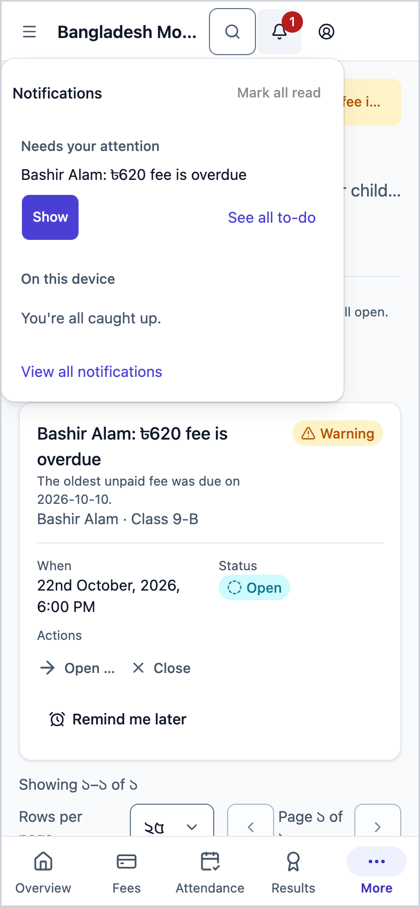
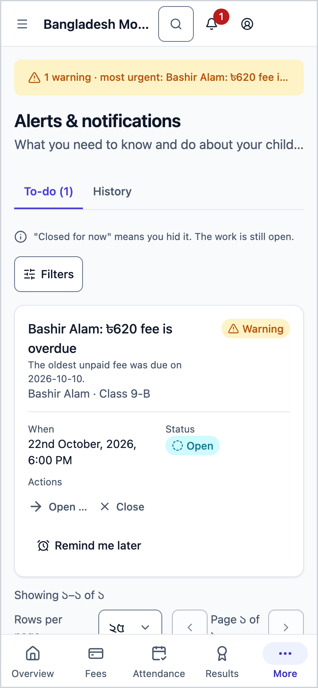

<!-- guide:meta
feature: portal.notifications
title: Alerts and notifications (parent and student)
summary: See news about your child in one place: absence, unpaid fees, tomorrow's exam, published results, homework and surveys. An alert goes away by itself once the work is done.
roles: [PARENT, STUDENT]
sources:
  - client-admin/src/routes/portal.tsx
  - client-admin/src/routes/portal/notifications.tsx
  - client-admin/src/features/attention/attention-worklist.tsx
  - shared/src/attention/rule-catalogue.ts
labels: [attention:worklist.*, attention:item.*, attention:state.*, attention:severity.*, attention:snooze.*, nav:notifications.*]
helpIds: [portal.notifications]
devices: [phone]
entry: [bell]
keywords: [বিজ্ঞপ্তি, সতর্কতা, ঘণ্টা, করণীয়, রিমাইন্ডার, notification, alert, bell, reminder]
appVersion: 0.1.0 (cba7dfad7)
owner: tareq89
lastVerified: 2026-10-25
knownIssues: []
-->

# Alerts and notifications (parent and student)

See what you need to know and do about your child, in one place.

**Go to:** The **Notifications** bell at the top right → **See all to-do**. This page is not in the menu.
**Before you start:** Nothing is needed. If your account has a child linked, you get news about that child.

The school's system creates alerts by itself. For example, your child did not come to school today, or fees are unpaid. When the work is done (you paid the fee, the exam is over), the alert becomes **Fixed** by itself and moves to **History**.

[Open from the bell](#task-main) · [Close an alert](#task-close) · [Problems and fixes](#trouble)

**On this page**

- [How to get to this page](#arrive)
- [See your to-do and do the work](#task-main)
- [How to tell the work is done](#confirm)
- [Other situations](#other)
  - [Close an alert](#task-close)
  - [Remind me later](#task-snooze)
  - [See news for one child](#task-child)
  - [Past alerts and messages on this device](#task-history)
- [Which news goes to whom](#which)
- [Problems and fixes](#trouble)
- [Who can do what](#roles)
- [Learn more](#more)

---

## How to get to this page 

**On a phone and on a computer:** Tap the **Notifications** bell at the top right. A number on the bell is how many things need you. Under the open panel, tap **See all to-do**.

This page is not in the left menu or the bottom bar.

---

## See your to-do and do the work 

1. Tap the bell.

   → A small panel opens: **Needs your attention**, with the first few alerts below.

2. Tap **See all to-do**.

   → The **Alerts & notifications** page opens, on the **To-do** tab. Each row shows the type (**Urgent**, **Warning** or **Reminder**), the subject, which child, and the time.

3. Tap the row's action button, such as the button to see the fees.

   → The page where the work is done opens. When the work is finished, the alert goes away by itself.

---

## How to tell the work is done 

| State              | How you can tell                             | What next              |
| ------------------ | -------------------------------------------- | ---------------------- |
| **Open**           | It is on the **To-do** tab.                  | Do the work.           |
| **Closed for now** | You hid it, or asked to be reminded later.   | The work is still due. |
| **Fixed**          | It is in **History**, with a time beside it. | Done.                  |
| **Expired**        | It is in **History**. The time has passed.   | Nothing to do.         |

**To check:** Open the **History** tab. If the alert is there marked **Fixed**, the work is done.

---

## Other situations 

### Close an alert 

Tap **Close** on the row. The alert becomes **Closed for now**. The work is still due.

An **Urgent** alert has no **Close** button. It does not go away until the work is done.

### Remind me later 

This button appears only on rows of the **Warning** type, not **Reminder** or **Urgent**.

1. Tap **Remind me later** on the row.
2. Choose: **In 2 hours**, **Tomorrow morning**, **Next school day**, or **Pick a date…**.

   → The row shows until when it stays hidden. At that time it becomes **Open** again.

### See news for one child 

If you have more than one child, pick one from the **Child** list. From the **Type** list you can also see only fees or only homework. To see everything again, choose **All children** and **All types**.

### Past alerts and messages on this device 

On the **History** tab, fixed and expired alerts stay for 12 months.

Lower on the same tab is **Recent messages on this device**. It holds short messages from the app, such as "Application submitted". They are kept only on this phone or computer; other devices do not show them. Tap **Mark all read** to mark them all as read.

---

## Which news goes to whom 

| News                                | Parent                         | Student                        |
| ----------------------------------- | ------------------------------ | ------------------------------ |
| Child is absent today               | Yes                            | No                             |
| Fee due date near / unpaid fees     | Yes                            | No                             |
| Exam tomorrow                       | Yes                            | Yes                            |
| Results published                   | Yes                            | Yes                            |
| Routine change today                | Yes                            | Yes                            |
| Homework due tomorrow               | Yes                            | Yes                            |
| Homework due today                  | No                             | Yes                            |
| Homework not submitted              | Yes                            | Yes                            |
| Survey answer pending               | Yes                            | Yes                            |
| My contact details are incomplete   | Yes                            | No                             |
| Behind in the study plan            | Yes                            | No                             |
| Holiday tomorrow                    | Yes                            | Yes                            |
| A separate alert sent by the school | Whoever the school sends it to | Whoever the school sends it to |

A parent gets news only for their own linked children. News from one school is never shown at another school. The school can turn some news off, and then it does not come.

---

## Problems and fixes 

| What you see                                           | What to do                                                                         | Who can help  |
| ------------------------------------------------------ | ---------------------------------------------------------------------------------- | ------------- |
| **Nothing to do**                                      | Nothing is pending now. New alerts will show up here.                              | —             |
| **Could not load alerts.**                             | Check your connection, then tap **Try again**.                                     | —             |
| **That did not work. Try again.**                      | Closing or remind-me-later did not go through. Tap again after a moment.           | —             |
| No Close button                                        | An **Urgent** alert does not go away until the work is done. Do the work.          | —             |
| No news about your child                               | Check whether the child is linked to your account. If not, tell the school office. | School office |
| "On this device" messages are missing on another phone | They stay only on the device where they arrived.                                   | —             |

---

## Who can do what 

| Role    | Can see                    | Can close or be reminded later | Can pick a child |
| ------- | -------------------------- | ------------------------------ | ---------------- |
| Parent  | News about linked children | Yes, where there is a button   | Yes              |
| Student | Their own news             | Yes, where there is a button   | —                |

Closing an alert hides it only from your own list. It stays on another parent's list.

---

## Learn more 

<strong>How alerts work</strong>

<figure>
  
</figure>

- You do not create alerts. The school's system creates them by rule.
- Look at **Urgent** first, then **Warning**, then **Reminder**.
- News of an application decision does not come into this list. It goes to your phone as a separate notification. To see the state of an application, open the [**Applications**](applications.md) page.

**Related pages**

- [**Applications**](applications.md) — the state and decision of an application.
- [**Surveys**](surveys.md) — from the "Survey answer pending" alert.
- [**Fees and invoices**](fees.md) — from the unpaid fees alert.
- [**Seeing and settling alerts**](../dashboard/alerts.md) — the alerts page for school staff.
- [**Account (parent and student)**](account.md) — turn alerts on or off for your account.
- [**Overview**](overview.md) — the first page, with the bell.
- [**Send an alert**](../communications/send-alert.md) — how the school sends an alert by hand.

---

_Version 0.1.0 · Last checked 2026-10-25_
