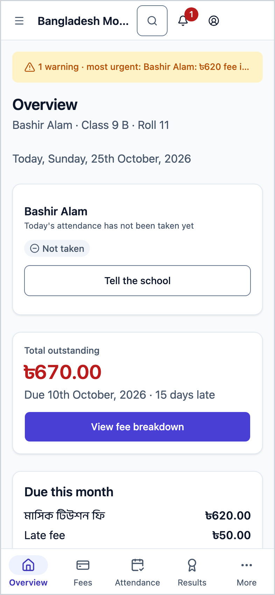
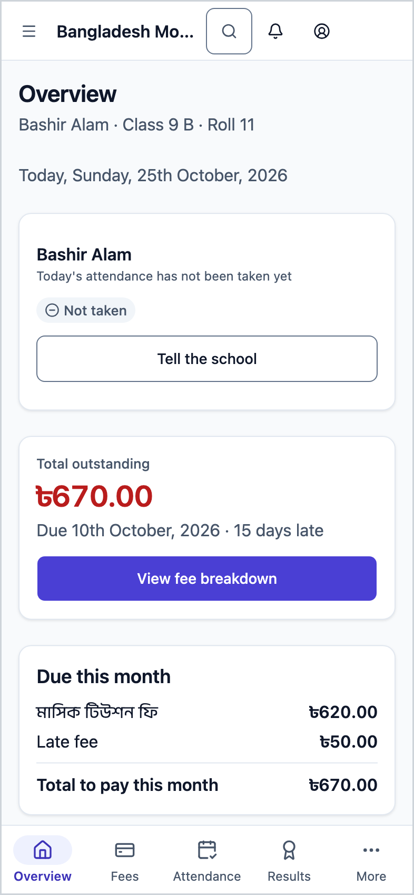

<!-- guide:meta
feature: portal.overview
title: Overview
summary: The first page you see when you sign in as a parent or student — total outstanding, what is due this month, whether your child is at school today, this month's attendance, homework, the latest result and the next holiday, all in one place.
roles: [PARENT, STUDENT]
sources:
  - client-admin/src/routes/portal.tsx
  - client-admin/src/routes/portal/index.tsx
  - client-admin/src/routes/portal/-due-this-month-card.tsx
  - client-admin/src/routes/portal/-today-strip.tsx
  - client-admin/src/routes/portal/-attendance-heatmap-card.tsx
  - server/src/modules/students/family-access.service.ts
  - server/src/modules/fees/fees.controller.ts
  - server/src/modules/attendance/attendance-summary.controller.ts
labels:
  [
    portal:hero.*,
    portal:children.*,
    portal:actions.*,
    portal:fees.dueThisMonth,
    portal:fees.carriedOver,
    portal:fees.totalToPayThisMonth,
    portal:fees.nothingDueThisMonth,
    portal:fees.fineBadge,
    portal:payments.*,
    portal:today.*,
    portal:heatmap.*,
    portal:homeworkCard.*,
    portal:latestResult.*,
    portal:nextHoliday.*,
    portal:empty.*,
    portal:error.*,
    nav:items.portalOverview,
    nav:items.more,
  ]
helpIds:
  [
    portal.overview,
    portal.overview.action.viewFeeBreakdown,
    portal.overview.action.tellSchool,
  ]
devices: [phone, desktop]
entry: [sidebar]
keywords:
  [overview, portal, parent, guardian, student, child, total outstanding, due this month, at school today, home]
appVersion: 0.1.0 (978d9b96a)
owner: tareq89
lastVerified: 2026-10-25
knownIssues: []
-->

# Overview

Your child's fees, today's attendance and school news on one page.

**Where to go:** on a phone, **Overview** in the bottom bar. On a computer, **Overview** in the left menu. This is the first page that opens when you sign in to the portal.
**Before you start:** your account must be set up as a parent or student at the school, and the school office must have linked you to your child.

With one child (or if you are the student), the page shows their name and class at the top. With more than one child, each gets their own card. You cannot change anything here and you cannot pay here; you can only look.

[See dues](#task-main) · [At school today](#task-today) · [Tell the school](#task-tell) · [Troubleshooting](#trouble)

**On this page**

- [See your child's dues at a glance](#task-main)
- [How to know you are looking at the right thing](#confirm)
- [Other situations](#other)
  - [See whether your child is at school today](#task-today)
  - [Tell the school about an absence](#task-tell)
  - [This month's attendance, homework, result and holiday](#task-cards)
  - [Go to another page](#task-nav)
- [Troubleshooting](#trouble)
- [Who can do what](#roles)
- [Learn more](#more)

---

## See your child's dues at a glance 

1. On a phone, tap **Overview** in the bottom bar.

   → The **Total outstanding** card is at the top. It shows the amount still owed in large type; if nothing is owed it says **Nothing due**.

2. With one child, look under the card for **Due …** and, if late, **… days late**. Below that is the **Due this month** card.
3. With more than one child, scroll down to **Your children**. Each card shows name, class, section, roll, the amount due and a status (**Overdue**, **Partially paid**, **Pending** or **Paid**).
4. For details, tap **View fee breakdown** at the bottom of a card.

   → The [**Fees and invoices**](fees.md) page opens with that child already chosen.

> **Remember:** with more than one child, **Total outstanding** adds up only the children who owe something. A line under it says so, for example **Across 2 of 3 children**. A child who owes nothing still has a card that says **Nothing due**.

---

## How to know you are looking at the right thing 

The **Due this month** card lists two kinds of bills:

- Unpaid bills due this month, each with its name and the amount still owed.
- **Carried over** — bills from earlier months whose due date has passed but are not fully paid. The total sits beside it.

At the end, **Total to pay this month** = this month's unpaid amount + carried over. A fine bill is marked **Fine**, with the school's reason underneath if it gave one. If there is nothing, it says **Nothing due this month**.

- **Overdue** shows when at least one bill's due date has passed. The due date itself is not yet overdue.
- With more than one child, **… overdue** under **Total outstanding** counts only the part past its due date, not the whole amount.
- With one child, the **Recent payments** card shows the last three payments: date, how it was paid (for example **Cash**, **Cheque**) and amount. A payment that did not go through (for example a returned or not yet cleared cheque) shows its status beside it. Tap **See all payments** for the full list.
- If nothing is owed and there is a last successful payment, **Last paid …** appears under the total.

---

## Other situations 

### See whether your child is at school today 

At the top, under **Today, …** and the date, each child's status for today:

| What it says                 | What it means                                      |
| ---------------------------- | -------------------------------------------------- |
| **At school today**          | The teacher marked them present                    |
| **Came late today**          | Present, but late                                  |
| **Absent today**             | The teacher marked them absent                     |
| **On leave today**           | Approved leave                                     |
| **Attendance not taken yet** | A school day, but the teacher has not taken it yet |
| **No school today**          | A holiday or weekly off day                        |

Below it you see when attendance was taken (**Attendance was taken at …**), or **Today's attendance has not been taken yet**.

### Tell the school about an absence 

1. If today's status is **Absent today** or **Attendance not taken yet**, a **Tell the school** button appears beside it.
2. Tap **Tell the school**.

   → The leave application form opens with that child already chosen. See [**Applications (parent and student)**](applications.md).

The button only appears if your account is allowed to submit applications. It does not appear on a day the school is closed.

### This month's attendance, homework, result and holiday 

- **This month's attendance** — how many days present this month and which days missed. With more than one child, tap a name at the top to switch child. For the full record tap **Full attendance**; the [**Attendance**](attendance.md) page opens.
- **Today's homework** — homework to hand in, with the due date. Tap **All homework** to open the homework page.
- **Latest result** — the GPA of the latest published exam for the child chosen in **This month's attendance**, and whether it is better or lower than the exam before. Tap **Full result** to open the [**Results**](results.md) page.
- **Next holiday** — the name of the next holiday and how many days away. If there is none in the next 60 days, it says so. Tap **Open calendar** to open the [**Calendar**](calendar.md).

If a form asking for feedback about teachers is waiting, a survey card also appears at the top. See [**Surveys (parent and student)**](surveys.md).

### Go to another page 

On a phone, the bottom bar has four pages: **Overview**, **Fees**, **Attendance** and **Results**. For the rest (**Routine**, **Calendar**, **Exam schedule** and others) tap **More**. The bell at the top shows notifications. See [**Alerts and notifications (parent and student)**](notifications.md).

---

## Troubleshooting 

| What you see                                | What to do                                                                              | Who can help  |
| ------------------------------------------- | --------------------------------------------------------------------------------------- | ------------- |
| **No students linked to you yet**           | Ask the school office to link your child, then tap **Check again**.                     | School office |
| **Could not load your portal.** …           | Check your connection and tap **Try again**.                                            | —             |
| One child is missing from the list          | The school office has not linked them to you yet. Tell the office.                      | School office |
| **Could not load recent payments.**         | Tap **Try again**.                                                                      | —             |
| You paid, but the amount is still due       | It only goes down once the school records the payment. Take your receipt to the office. | Accountant    |
| No **Tell the school** button               | It only appears when absent or attendance not taken; not on a school-closed day.        | —             |

---

## Who can do what 

| Role    | What they see                  | Tell the school |
| ------- | ------------------------------ | --------------- |
| Parent  | Only their own linked children | Yes, if allowed |
| Student | Only themselves                | Yes, if allowed |

**Parent:** you see only the children the school office has linked to you, and only at this school. The server does not return any other student's data.

**Student:** you see only your own information.

Staff do not see this page; they have a separate [**Seeing today's work on the dashboard**](../dashboard/dashboard.md).

---

## Learn more 

<strong>Parts of the page</strong> — Overview

1. The **Overview** heading (with name · class · roll under it when there is one child).
2. **Today, …** and each child's status for today, with **Tell the school** when needed.
3. The **Total outstanding** card; with one child the **View fee breakdown** button, **Due this month** and **Recent payments**; with several, the **Your children** cards.
4. **This month's attendance**.
5. **Today's homework**, **Latest result**, **Next holiday**.

<strong>How the overview works</strong>

<figure>
  
  <figcaption><em>The path of the overview, from linked children to Fees and invoices</em></figcaption>
</figure>

- **Who shows up:** the children the school office has linked to you. A child with no unpaid bills still has a card.
- **Each bill's balance:** the bill total − discount − paid. Total outstanding is the sum over all unpaid bills.
- **Which bills count:** only those not fully paid yet (pending or partially paid).
- **Dates:** "today" and "this month" follow the school's calendar.

**Related pages**

- [**Alerts and notifications (parent and student)**](notifications.md) — alerts and notifications.

- [**Syllabus (parent and student)**](syllabus.md) — what is being taught, subject by subject.
- [**Homework (parent and student)**](homework.md) — all homework due, from the **Today's homework** card.

- [**Programs (parent and student)**](programs.md) — your child's programs and progress.

- [**Surveys (parent and student)**](surveys.md) — fill in a survey about teachers.

- [**Applications (parent and student)**](applications.md) — send a leave or other application.

- **Roles** — the guardian's and the student's own pages: [Guardian](../roles/guardian.md), [Student](../roles/student.md).
- [**Fees and invoices**](fees.md) — month-by-month account, invoices and printing.
- [**Attendance**](attendance.md) — every day of the month.
- [**Routine**](routine.md) — classes today and over the coming days.
- [**Calendar**](calendar.md) — holidays and school events.
- [**Exam schedule**](exam-schedule.md) — exam dates and the admit card.
- [**Results**](results.md) — results of published exams.
- [**Viewing guardians, fixing their details and sending invitations**](../people/guardians.md) — where the school office links a guardian to a child.
