<!-- guide:meta
feature: portal.programs
title: Programs (parent and student)
summary: See on your phone how far the student has come in a hifz, coaching or other program, which milestones are achieved and what comes next. This page is view only.
roles: [PARENT, STUDENT]
sources:
  - client-admin/src/routes/portal.tsx
  - client-admin/src/routes/portal/programs.tsx
  - server/src/modules/programs/program-enrollments.controller.ts
labels: [portal:programs.*, portal:empty.*, portal:fees.pickerLabel, programs:status.*, nav:items.portalPrograms, nav:items.more]
helpIds: [portal.programs]
devices: [phone]
entry: [sidebar, palette]
keywords: [প্রোগ্রাম, মাইলফলক, অগ্রগতি, হিফজ, program, milestone, progress]
appVersion: 0.1.0 (cba7dfad7)
owner: tareq89
lastVerified: 2026-10-25
knownIssues: []
-->

# Programs (parent and student)

See how far the student has come in a program.

**Go to:** On a phone, the bottom bar's **More** → **Programs**. On a computer, **Programs** in the left menu.
**Before you start:** The school must have enrolled the student in a program.

A program has a few milestones. For example, a hifz program has "Para 1", "Para 2". When a teacher marks one as achieved, a tick appears here.

[See progress](#task-main) · [Problems and fixes](#trouble)

**On this page**

- [How to get to this page](#arrive)
- [See progress](#task-main)
- [Other situations](#other)
  - [More than one child](#task-child)
  - [See all milestones](#task-all)
- [Problems and fixes](#trouble)
- [Who can do what](#roles)
- [Learn more](#more)

---

## How to get to this page 

**On a phone:** The bottom bar's **More** → **Programs**.

**On a computer:** **Programs** in the left menu.

**By search:** Tap the search button at the top and type "program".

---

## See progress 

1. Open the **Programs** page.

   → One card for each program. The card shows the program's name and its state: **Active**, **Completed** or **Withdrawn**.

2. Look at the bar.

   → For example **4 of 10 milestones achieved**.

<!-- image pending: img/portal-programs-01-card.png (width 300) — A program card on a phone: 1 name and state, 2 the progress bar, 3 the "Next" tag -->

3. Look at the list below.

   → An achieved milestone has a green tick, with the date beside it and a mark or grade (if one was given). The first one not yet done has **Next** beside it.

---

## How to know you are looking at the right thing 

Each program has its own card with the program name and its state, a progress bar such as **4 of 10 milestones achieved**, and the milestone list below. An achieved milestone has a green tick; the first one not yet done has **Next** beside it. If you see these, you are on the right page.

---

## Other situations 

### More than one child 

If more than one child is linked, a child picker appears at the top. Tap the name of the child whose program you want to see.

### See all milestones 

If there are more than 4 milestones, at first you see only the last 3 achieved and the next one. To see the rest, tap **Show all 10 milestones**. To fold them back, tap **Show fewer**.

---

## Problems and fixes 

| What you see                       | What to do                                                                      | Who can help      |
| ---------------------------------- | ------------------------------------------------------------------------------- | ----------------- |
| **No programs yet**                | The school has not enrolled the student in a program.                           | School admin      |
| **Could not load these programs.** | Check your connection, then tap **Try again**.                                  | —                 |
| A milestone has no tick            | The teacher has not marked it achieved yet. If it looks wrong, ask the teacher. | Program's teacher |

---

## Who can do what 

| Role    | What they see                     | Can change |
| ------- | --------------------------------- | ---------- |
| Parent  | The programs of each linked child | No         |
| Student | Their own programs                | No         |

Programs are made, students are enrolled and milestones are ticked on the [**Programs and milestones**](../people/programs.md) page.

---

## Learn more 

<strong>Where the ticks come from</strong>

<figure>
  
</figure>

- When a program is completed or withdrawn, the card stays, and the state tag changes.

**Related pages**

- [**Programs and milestones**](../people/programs.md) — programs and milestones on the school side.
- [**Results**](results.md) — exam results.
- [**Overview**](overview.md) — the first page.

---

_Version 0.1.0 · Last checked 2026-10-25_
