<!-- guide:meta
feature: portal.results
title: Results
summary: See the GPA, grade, total marks, position in class and subject-by-subject marks for each exam the school has published; print the report card.
roles: [PARENT, STUDENT]
sources:
  - client-admin/src/routes/portal/results.tsx
  - server/src/modules/exams/results.controller.ts
  - server/src/modules/exams/results.service.ts
  - server/src/modules/exams/result-rules.ts
  - server/src/modules/students/family-access.service.ts
labels:
  [
    portal:results.*,
    portal:empty.*,
    portal:children.*,
    portal:fees.pickerLabel,
    exams:reportCard.*,
    exams:kind.*,
    nav:items.portalResults,
  ]
helpIds:
  [
    portal.results,
    portal.results.action.showSubjects,
    portal.results.action.printReportCard,
  ]
devices: [phone, desktop]
entry: [sidebar]
keywords:
  [results, gpa, grade, position, merit position, marks, report card, print]
appVersion: 0.1.0 (978d9b96a)
owner: tareq89
lastVerified: 2026-10-25
knownIssues: []
-->

# Results

The result of every published exam, with marks by subject.

**Where to go:** on a phone, **Results** in the bottom bar. On a computer, **Results** in the left menu. You can also get here from the **Latest result** card on [**Overview**](overview.md) by tapping **Full result**.
**Before you start:** the school office must have linked you to your child, and the school must have published exam results.

This page is for looking only. If a mark looks wrong, tell the school.

[See results](#task-main) · [Subject marks](#task-subjects) · [Print](#task-print) · [Troubleshooting](#trouble)

**On this page**

- [See exam results](#task-main)
- [How to know you are looking at the right thing](#confirm)
- [Other situations](#other)
  - [See marks by subject](#task-subjects)
  - [Print the report card](#task-print)
  - [See another child's results](#task-pick)
- [Troubleshooting](#trouble)
- [Who can do what](#roles)
- [Learn more](#more)

---

## See exam results 

1. On a phone, tap **Results** in the bottom bar.

   → Each published exam has its own card, the newest at the top.

2. At the top of a card is the exam name, with **Pass** or **Fail** beside it, and under it the exam type (**Term**, **Monthly**, **Model** or **Other**).
3. Below that are four figures: **GPA**, **Grade**, **Total marks**, **Position**.

<!-- image pending: Results, two exams, subject marks open on the top one; 1 · Pass 2 · GPA Grade Total marks Position 3 · Subject list; parent, phone -->

> **Remember:** an exam does not show here until the school **publishes** the result, even if the marks have been entered. The card appears only after publishing.

---

## How to know you are looking at the right thing 

| What you see    | What it means                                                                |
| --------------- | ---------------------------------------------------------------------------- |
| **GPA**         | The GPA of the whole exam, to two decimal places                             |
| **Grade**       | The grade of the whole exam, by the school's grading rules                   |
| **Total marks** | The sum of the marks obtained in all subjects                                |
| **Position**    | The merit position in the whole class (all sections together)                |

- **Position** is decided by GPA first, then total marks. If two students have the same GPA and the same total marks, they share the same position.
- If the result is **Fail**, **Position** shows only a dash (—). Students who fail are not ranked.

---

## Other situations 

### See marks by subject 

1. Tap **Show subject marks** under a card. The newest exam's list is already open.

   → Each subject's name, **Obtained** marks and **Grade**. On a computer the subject's **GPA** shows too.

2. The fourth subject is marked **4th subject**. A grade for a subject the child failed is in red.
3. To close it, tap **Hide subject marks**.

### Print the report card 

1. On the card of the exam whose report card you need, tap **Print**.

   → The print screen of your phone or computer opens, with the whole report card carrying the school's name and logo; print it or save it as a PDF.

> **Remember:** every print is written in the school's records. If that cannot be written, it does not print either, and you see **Could not record this print, so it was not printed. Try again.**

### See another child's results 

With more than one child, tap a name in the **Choose a student** row at the top. With one child this row does not appear.

---

## Troubleshooting 

| What you see                                                   | What to do                                                                  | Who can help  |
| -------------------------------------------------------------- | --------------------------------------------------------------------------- | ------------- |
| **No results yet**                                             | They appear once the school publishes them. Check again later.              | Class teacher |
| The exam is over, but there is no card for it                  | The result has not been published yet. Wait for the school's announcement.  | Class teacher |
| **Could not load your results.** …                             | Check your connection and tap **Try again**.                                | —             |
| **Could not load this exam's breakdown.**                      | Close the list and open it again.                                           | —             |
| **Could not load this report card to print. Try again.**       | Tap **Print** again.                                                        | —             |
| A dash (—) under **Position**                                  | A position is not given when the result is Fail.                            | Class teacher |
| A subject's marks look wrong                                   | Tell the class teacher or school office; it cannot be changed from here.    | Class teacher |
| **No students linked to you yet**                              | Ask the school office to link your child, then tap **Check again**.         | School office |

---

## Who can do what 

| Role    | See results                              | Print                |
| ------- | ---------------------------------------- | -------------------- |
| Parent  | Linked children, published results only  | Only linked children |
| Student | Their own, published results only        | Only themselves      |

**Parent:** you see results only for the children the school office has linked to you, and only at this school. If you ask for another student's result, the server does not return it. The server never sends unpublished results at all.

**Student:** you see only your own published results.

The school works out and publishes results from the [**Processing and publishing results**](../exams-results/results.md) page.

---

## Learn more 

<strong>Parts of the page</strong> — Results

1. The **Results** heading, with name · class · roll under it; with more than one child, a row to pick the child.
2. A card for each exam: name, **Pass**/**Fail**, type, and **GPA**, **Grade**, **Total marks**, **Position**.
3. The **Show subject marks** and **Print** buttons.
4. The subject list, when open.

<!-- image pending: Results, four parts numbered; student, desktop -->

<strong>How results work</strong>

<figure>
  
  <figcaption><em>The path of results, from entering marks to your phone</em></figcaption>
</figure>

- **Which results come:** published only. The same rule applies to subject marks and printing.
- **Order:** by publication date, newest first.
- **Position:** among those who passed, by GPA and then total marks.

**Related pages**

- [**Programs (parent and student)**](programs.md) — programs and their progress.

- [**Overview**](overview.md) — the latest result's GPA, at a glance.
- [**Fees and invoices**](fees.md) — the month-by-month fee account.
- [**Attendance**](attendance.md) — every day of the month.
- [**Routine**](routine.md) — classes today and over the coming days.
- [**Calendar**](calendar.md) — holidays and school events.
- [**Exam schedule**](exam-schedule.md) — exam dates and the admit card.
- [**Processing and publishing results**](../exams-results/results.md) — where the school publishes results.
