<!-- guide:meta
feature: portal.routine
title: Routine
summary: See your child's classes from today for the next seven days — which subject in which period, until when, in which room, and which class is cancelled or has a substitute teacher.
roles: [PARENT, STUDENT]
sources:
  - client-admin/src/routes/portal/routine.tsx
  - server/src/modules/routines/resolve-routine.controller.ts
  - server/src/modules/students/family-access.service.ts
labels:
  [
    portal:routine.*,
    portal:empty.*,
    routines:agenda.*,
    routines:grid.weekday.*,
    nav:items.portalRoutine,
    nav:items.more,
  ]
helpIds:
  [
    portal.routine,
    portal.routine.action.pickDay,
  ]
devices: [phone]
entry: [sidebar]
keywords:
  [routine, timetable, class, period, subject, substitute teacher, cancelled, schedule]
appVersion: 0.1.0 (978d9b96a)
owner: tareq89
lastVerified: 2026-10-25
knownIssues: []
-->

# Routine

Your child's classes today and over the next six days, day by day.

**Where to go:** on a phone, tap **More** in the bottom bar, then **Routine**. On a computer, **Routine** in the left menu.
**Before you start:** the school office must have linked you to your child, and the school must have published the routine for your child's academic year.

The routine comes by itself from your child's class and section; you do not have to pick anything. This page is for looking only.

[Today's classes](#task-main) · [Another day](#task-day) · [Troubleshooting](#trouble)

**On this page**

- [See today's classes](#task-main)
- [How to know you are looking at the right thing](#confirm)
- [Other situations](#other)
  - [See another day's classes](#task-day)
  - [See another child's routine](#task-pick)
- [Troubleshooting](#trouble)
- [Who can do what](#roles)
- [Learn more](#more)

---

## See today's classes 

1. On a phone, tap **More** in the bottom bar, then tap **Routine**.

   → Seven day tabs at the top, starting from today. Today's tab is chosen.

2. Under the tabs, look at how many periods there are (for example **6 periods**), then the list of periods.

   → Each period shows the subject name, the start time and **until …**, then **Period …** and the room (if the school gave one).

<!-- image pending: Routine, today's tab; 1 · Day tabs 2 · Period count 3 · A substitute teacher period; parent, phone -->

> **Remember:** subject names come in the language you are viewing the portal in; if a subject has no name in that language, its name in the other language shows.

---

## How to know you are looking at the right thing 

| Beside a period     | What it means                                     |
| ------------------- | ------------------------------------------------- |
| **Cancelled**       | The school cancelled that class on that day       |
| **Substitute teacher** | Another teacher will take that class           |
| Nothing written     | The class goes ahead as in the routine            |

On a holiday, instead of periods it says **Holiday — …** (the holiday's name), and on a weekly off day **Weekly off day**.

If the teacher has given a lesson plan, **Lesson …: …** shows under the chosen day's period, saying which lesson will be taught. <!-- unverified: the lesson line comes from the lesson plan (study plan); the conditions for when it does not appear were not fully verified -->

---

## Other situations 

### See another day's classes 

Tap the day tab you want at the top. You can see up to seven days, starting today.

### See another child's routine 

With more than one child, tap a name in the **Choose a student** row at the top. With one child this row does not appear.

---

## Troubleshooting 

| What you see                                         | What to do                                                                    | Who can help  |
| ---------------------------------------------------- | ----------------------------------------------------------------------------- | ------------- |
| **No routine yet**                                   | It shows once the school publishes the routine for your child's academic year. | Admin         |
| **Could not load this student's routine.** …         | Check your connection and tap **Try again**.                                  | —             |
| **No periods.** on one day                           | That day your child's section has no class in the routine. Ask the school.    | School office |
| **No students linked to you yet**                    | Ask the school office to link your child, then tap **Check again**.           | School office |

---

## Who can do what 

| Role    | See routine          | Change |
| ------- | -------------------- | ------ |
| Parent  | Only linked children | No     |
| Student | Only themselves      | No     |

**Parent:** you see the routine only for the children the school office has linked to you, and only at this school. The portal cannot ask for another section's or teacher's routine; the server only gives the routine under your child's name.

**Student:** you see only your own routine.

The school makes the routine, from the [**Arranging a class's weekly routine**](../academics/routine-builder.md) page.

---

## Learn more 

<strong>Parts of the page</strong> — Routine

1. The **Routine** heading, with name · class · roll under it; with more than one child, **Choose a student**.
2. Seven day tabs, from today.
3. The period count and the list of periods for the chosen day.

<!-- image pending: Routine, three parts numbered, one cancelled period; student, phone -->

<strong>How the routine works</strong>

<figure>
  
  <figcaption><em>The path of the routine, from the published routine to your child's day</em></figcaption>
</figure>

- **Section:** the server looks at the child's current enrolment to work out the section.
- **Days:** seven days from today, each on its real date; so a cancelled class or a substitute teacher shows on exactly the right day.
- **Holidays:** from the school calendar's holidays and the weekly off days.

**Related pages**

- [**Overview**](overview.md) — whether your child is at school today, at a glance.
- [**Fees and invoices**](fees.md) — the month-by-month fee account.
- [**Attendance**](attendance.md) — every day of the month.
- [**Calendar**](calendar.md) — holidays and school events.
- [**Exam schedule**](exam-schedule.md) — exam dates and the admit card.
- [**Results**](results.md) — results of published exams.
- [**Arranging a class's weekly routine**](../academics/routine-builder.md) — where the school makes the routine.
