<!-- guide:meta
feature: portal.statement
title: See and print the statement
summary: See what was charged, what was paid and what is still owed for your child, by date, and download or print the statement.
roles: [PARENT, STUDENT]
sources:
  - client-admin/src/routes/portal/statement.tsx
  - client-admin/src/features/statement/statement-shared.tsx
  - client-admin/src/features/statement/statement-print.css
  - server/src/modules/fees/statement/student-statement.controller.ts
  - server/src/modules/fees/statement/student-statement.service.ts
  - server/src/modules/students/family-access.service.ts
labels: [fees:statement.*, nav:items.portalStatement, portal:empty.*]
helpIds: [portal.statement, portal.statement.action.print#task-print]
devices: [phone, desktop]
entry: [sidebar]
keywords: [statement, account, still owed, charged, paid, print, download, pdf, হিসাব, বাকি, বিল, জমা]
appVersion: 0.1.0 (a5ac53db0)
owner: tareq89
lastVerified: 2026-10-31
knownIssues: []
-->

# See and print the statement

See on one page what was charged, what was paid and what is still owed for your child, and download or print the statement if you want a copy.

**Where to go:** on a phone, tap **More** in the bottom bar, then **Statement**. On a computer, **Statement** in the left menu, just under **Fees and invoices**.
**Before you start:** the school office must have linked you to your child.

This page is for looking and for keeping a copy. You cannot pay here; payment is made at the school. When the school records a payment, the figures here update by themselves.

[See what is still owed](#task-main) · [Download or print](#task-print) · [Pick dates](#task-dates) · [Change child](#task-pick) · [Troubleshooting](#trouble)

**On this page**

- [See what is still owed](#task-main)
- [How to know you are looking at the right thing](#confirm)
- [Other situations](#other)
  - [Download or print](#task-print)
  - [See another period](#task-dates)
  - [See another child's statement](#task-pick)
  - [Advance money](#task-wallet)
- [Troubleshooting](#trouble)
- [Who can do what](#roles)
- [Learn more](#more)

---

## See what is still owed 

1. On a phone, tap **More** in the bottom bar, then choose **Statement**.

   → The child's name, class, section and roll are at the top. Under them, in large type, **Still owed now: ৳…**. If nothing is owed it reads **All paid**. Below it, in smaller type, **Last paid on** and the date.

2. Scroll down. First **Still owed at the start**, then one card for each bill or payment, and last **Still owed at the end**.

   → Each card shows the date, what it was for, the **Charged** or **Paid** amount, and **Still owed after** that line.

> **Remember:** **Still owed at the end** is the same figure as **Still owed now** at the top, and, when you have not picked a **To** date, the same figure the school's accountant sees on the student's fees page.

---

## How to know you are looking at the right thing 

| What it says                | What it means                                                                               |
| --------------------------- | ------------------------------------------------------------------------------------------- |
| **Charged**                 | Money the school charged, or a payment that was taken back (it says **Payment taken back**) |
| **Paid**                    | Money paid, or a discount given (it says **Discount**)                                      |
| **Still owed after**        | How much is owed in total, counting up to and including this line                           |
| **Still owed at the start** | How much was owed before the From date you picked                                           |
| **Still owed at the end**   | How much is owed after the last line, which is **Still owed now** at the top                |

If you pick a **To** date, the top line reads **Still owed up to … : ৳…**, because it then shows the position on that date, not today.

---

## Other situations 

### Download or print 

1. Tap **Download / Print**.

   → The browser's print window opens. The printed page starts with the school's name, your child's name and the dates; only the statement is printed.

2. To print on paper, choose a printer. To keep a file, choose **Save as PDF** instead of a printer.

There is one button: downloading and printing both happen from the same window.

### See another period 

At first every line from the start up to today is shown, and a line on the page says so. To see less, tap **From** or **To** and pick a date. Clear the date to see everything again.

Changing the From date only changes which lines are listed; the earlier lines are added into **Still owed at the start**, so **Still owed at the end** stays the same.

### See another child's statement 

With more than one child, a **Choose a student** row at the top lists all their names. Tap the name of the child whose statement you want. With one child this row does not appear.

### Advance money 

If the school holds money paid in advance for your child, a separate **Advance money** part appears at the bottom: how much is held, and when money was **Added** or **Taken**. This money is not counted in what is still owed, and the page says so. With none, the part does not appear.

---

## Troubleshooting 

| What you see                                    | What to do                                                                              | Who can help  |
| ----------------------------------------------- | --------------------------------------------------------------------------------------- | ------------- |
| **Could not load the statement. Try again.**    | Check your connection and try again.                                                    | —             |
| **No bills or payments in these dates**         | Clear or change the **From** or **To** date.                                            | —             |
| **No students linked to you yet**               | Ask the school office to link your child, then tap **Check again**.                     | School office |
| You paid, but the amount owed has not gone down | It only goes down once the school records the payment. Take your receipt to the office. | Accountant    |

---

## Who can do what 

| Role    | See statement        | Download / Print | Pay |
| ------- | -------------------- | ---------------- | --- |
| Parent  | Only linked children | Yes              | No  |
| Student | Only themselves      | Yes              | No  |

**Parent:** you see a statement only for the children the school office has linked to you. If someone puts another student's ID in the address, the server still returns nothing.

**Student:** you see only your own statement.

---

## Learn more 

<strong>How the statement is worked out</strong>

<figure>
  
  <figcaption><em>From bills and payments to what is still owed</em></figcaption>
</figure>

- **Which lines appear:** every bill, every discount and every payment. A payment that is taken back shows as its own line, in the **Charged** place.
- **On the same day:** the bill comes first, then the discount, then the payment.
- **There is no "Pay now" button:** paying online is not available yet.

**Related pages**

- [**Fees and invoices**](fees.md) — fees month by month, fines and invoice printing.
