<!-- guide:meta
feature: portal.surveys
title: Surveys (parent and student)
summary: Tell the school what you think of the teachers. Give stars or write once for each teacher and subject. In an anonymous survey the school does not see your name, and does not see the result if too few answers come in.
roles: [PARENT, STUDENT]
sources:
  - client-admin/src/routes/portal.tsx
  - client-admin/src/routes/portal/surveys.tsx
  - server/src/modules/surveys/survey-respond.controller.ts
  - server/src/modules/surveys/survey-respond.service.ts
  - server/src/modules/surveys/survey-results.service.ts
  - server/src/modules/surveys/entities/survey.entity.ts
  - server/src/modules/surveys/dto/survey.dto.ts
labels: [evaluations:portalSurveys.*, portal:surveys.*, nav:items.portalSurveys, nav:items.more]
helpIds: [portal.surveys, portal.surveys.action.submit]
devices: [phone]
entry: [sidebar, palette, bell]
keywords: [জরিপ, মতামত, শিক্ষক মূল্যায়ন, তারকা, গোপন, survey, feedback, teacher evaluation, anonymous]
appVersion: 0.1.0 (cba7dfad7)
owner: tareq89
lastVerified: 2026-10-25
knownIssues: []
-->

# Surveys (parent and student)

Tell the school what you think of the teachers.

**Go to:** On a phone, the bottom bar's **More** → **Surveys**. On a computer, **Surveys** in the left menu.
**Before you start:** The school must have opened a survey. A survey shows up if its teachers teach in the section your child (or you, if you are a student) is in.

A survey has a few questions. There is a separate form for each teacher and subject. For example "Mr. Rahim · Maths" is one form, and "Mr. Rahim · Science" is another.

[Send answers](#task-main) · [Who sees your answers](#privacy) · [Problems and fixes](#trouble)

**On this page**

- [How to get to this page](#arrive)
- [Send answers](#task-main)
- [How to tell the answers went](#confirm)
- [Other situations](#other)
  - [Only stars or only writing](#task-partial)
  - [When the survey ends](#task-deadline)
- [Who sees your answers](#privacy)
- [Problems and fixes](#trouble)
- [Who can do what](#roles)
- [Learn more](#more)

---

## How to get to this page 

**On a phone:** The bottom bar's **More** → **Surveys**.

**On a computer:** **Surveys** in the left menu.

**From the overview:** If answers are pending, tap **Answer now** on the **Surveys** card on the first page.

**From the bell:** Tap the "Survey answer pending" reminder ([**Alerts and notifications**](notifications.md)).

---

## Send answers 

1. Open the **Surveys** page.

   → A card appears for each survey. The card says whether answers are anonymous, the closing date, and a line like **3 forms left to fill in**.

<!-- image pending: img/portal-surveys-01-list.png (width 300) — Survey cards on a phone: 1 the privacy line, 2 the closing date, 3 the teacher and subject rows -->

2. Tap the row of the teacher you want.

   → The row opens and shows the questions. Under each question are stars (if the question has them) and a box to write in.

3. Give stars, write, or do both. Tapping the same star again clears it.

4. Tap **Send answers**.

   → **Thank you. Your answers were sent.** The row leaves the list.

<!-- image pending: img/portal-surveys-02-form.png (width 300) — An open form on a phone: 1 stars, 2 the writing box, 3 Send answers -->

> **Remember:** After you send, the answers cannot be changed or taken back. Each person can answer only once for each teacher and subject.

---

## How to tell the answers went 

| State        | How you can tell                                            | What next                             |
| ------------ | ----------------------------------------------------------- | ------------------------------------- |
| **Sent**     | The thank-you message appears, and the row leaves the list. | Fill in the next row.                 |
| **All done** | The page says **Nothing waiting**.                          | Done.                                 |
| **Not sent** | Red text **Couldn't send your answers. Try again.**         | Check your connection and send again. |

**To check:** Reload the page. A row you have answered does not come back.

---

## Other situations 

### Only stars or only writing 

Every question is optional. But you must give stars or writing for at least one question. If you send with everything empty, you see **Answer at least one question.** Stars go from 1 to 5. Writing can be up to 4000 characters.

On a computer, with the focus on the stars, pressing 1 to 5 on the keyboard sets the stars; Backspace clears them.

### When the survey ends 

If the card has a line like **Closes on 20 November**, answer before then. After it ends, the survey leaves the page and no more answers are taken. If there is no such line, the survey stays open until the school closes it.

---

## Who sees your answers 

- **Anonymous survey** (the card says **Your answer is hidden from management.**): your name does not appear on the school's results page. The time you answered does not appear either.
- **Minimum answers rule:** The school sees the result for a teacher and subject only when the survey is closed **and** at least a set number of people have answered. That number is usually **5**. The school can raise it, but cannot set it below **3**. Until then the school sees only how many answers have come in.
- **The same rule for each question:** If fewer people than that gave stars on a question, that question's average stars is not shown.
- **Written comments** are shown exactly as written once the rule is met, in alphabetical order. So do not write your own or your child's name in the text.
- **Who sees it:** The headmaster (admin). The teacher the survey is about cannot see their own result on this results page.
- **Survey that shows names** (the card says **Your name will be shown with your answer.**): the app says the name will be shown, but right now no survey shows the person's name on the school's results page. The minimum answers rule stays the same.

---

## Problems and fixes 

| What you see                                   | What to do                                                                                           | Who can help |
| ---------------------------------------------- | ---------------------------------------------------------------------------------------------------- | ------------ |
| **Nothing waiting**                            | Either every answer is sent, or no survey is open now.                                               | —            |
| **You already answered this one.**             | Your answer for this teacher and subject has already gone. It cannot be sent again.                  | —            |
| **Couldn't load your surveys.**                | Check your connection, then try again.                                                               | —            |
| No row for a teacher                           | The survey does not include that teacher, or they do not teach your child's section. Ask the school. | School admin |
| A survey comes to my child's account, not mine | The school made the survey for students only. Some surveys are for parents only, some for both.      | School admin |

---

## Who can do what 

| Role    | Can answer                                                              | Can see results |
| ------- | ----------------------------------------------------------------------- | --------------- |
| Parent  | Yes, in a survey made for parents, about the teachers of a linked child | No              |
| Student | Yes, in a survey made for students, about their own teachers            | No              |

Surveys are made and results are seen on the [**Evaluations: ACR, teacher surveys and incidents**](../people/evaluations.md) page.

---

## Learn more 

<strong>From answer to result</strong>

<figure>
  
</figure>

- Even if more than one of your children is taught by the same teacher, you answer once for that teacher and subject.
- Answers cannot be sent before the survey opens or after it ends.

**Related pages**

- [**Evaluations: ACR, teacher surveys and incidents**](../people/evaluations.md) — making surveys and seeing results on the school side.
- [**Alerts and notifications**](notifications.md) — the "Survey answer pending" reminder.
- <!-- link pending: portal/overview.md --> **Overview** — the Surveys card.

---

_Version 0.1.0 · Last checked 2026-10-25_
