<!-- guide:meta
feature: portal.syllabus
title: Syllabus (parent and student)
summary: See on your phone how far each subject has been taught in class, which subject is behind, and how much of the next exam's syllabus is done. This page is view only; nothing can be changed.
roles: [PARENT, STUDENT]
sources:
  - client-admin/src/routes/portal.tsx
  - client-admin/src/routes/portal/syllabus.tsx
  - client-admin/src/routes/portal/-study-plan-subject.tsx
labels: [portal:syllabus.*, portal:empty.*, portal:children.*, nav:items.portalSyllabus, nav:items.more]
helpIds: [portal.syllabus]
devices: [phone]
entry: [sidebar, palette]
keywords: [সিলেবাস, পাঠ পরিকল্পনা, পিছিয়ে, পরীক্ষার সিলেবাস, টপিক, syllabus, study plan, lessons behind]
appVersion: 0.1.0 (cba7dfad7)
owner: tareq89
lastVerified: 2026-10-25
knownIssues: []
-->

# Syllabus (parent and student)

See where the class is in each subject.

**Go to:** On a phone, the bottom bar's **More** → **Syllabus**. On a computer, **Syllabus** in the left menu.
**Before you start:** The student must be in a class. The school must have added a study plan or a topic list.

This page is view only. Nothing can be changed here.

[See it at a glance](#task-main) · [If a subject is behind](#task-behind) · [Problems and fixes](#trouble)

**On this page**

- [How to get to this page](#arrive)
- [See it at a glance](#task-main)
- [Other situations](#other)
  - [More than one child](#task-child)
  - [A subject is behind](#task-behind)
  - [A subject with no study plan](#task-noplan)
- [Problems and fixes](#trouble)
- [Who can do what](#roles)
- [Learn more](#more)

---

## How to get to this page 

**On a phone:** The bottom bar's **More** → **Syllabus**.

**On a computer:** **Syllabus** in the left menu.

**By search:** Tap the search button at the top and type "syllabus".

---

## See it at a glance 

1. Open the **Syllabus** page.

   → At the top: the student's name, class, roll and the name of the current term.

2. Look at the first card: the next exam.

   → The exam name, then **From 20 November · how much of the syllabus is taught**. Under each subject is a bar, such as **6/10 lessons**.

<!-- image pending: img/portal-syllabus-01-overview.png (width 300) — The Syllabus page on a phone: 1 the exam card, 2 the subject that is most behind, 3 the list of other subjects -->

3. Look at the open card below.

   → The subject that is furthest behind is open first. It has the teacher's name, **Where now**, when the whole plan should finish, and the **Next 5 lessons**.

4. Tap any subject in the **Other subjects** list.

   → The subject opens and shows the same details. Tap again to close it.

> **Remember:** The dates of the next lessons are estimates. They move later when a class is cancelled or a holiday falls.

---

## How to know you are looking at the right thing 

At the top you see the student's name, class, roll and the name of the current term, then the exam card, then one subject open and the other subjects listed below it, each with a bar such as **6/10 lessons**. If the name at the top is your child, you are on the right page. With more than one child, check the name before reading the bars.

---

## Other situations 

### More than one child 

If more than one child is linked, **Choose a student** appears at the top. Tap the name of the child whose syllabus you want. With one child, this part does not appear.

### A subject is behind 

Each subject has a tag beside it:

| Tag                  | What it means                                                                 |
| -------------------- | ----------------------------------------------------------------------------- |
| **On time**          | As much has been taught as the routine says should be.                        |
| **2 lessons behind** | By the routine, 2 more lessons should have been done by now.                  |
| **No study plan**    | The school has not added a plan for this subject. Only the topic list exists. |

When you open a subject that is behind, **Why behind** says how many periods were not taught. If you have questions, talk to the subject's teacher or the school.

### A subject with no study plan 

Such a subject says **Only the topic list · 5 of 12 done**. When you open it, the topics come in order, each with its state beside it.

---

## Problems and fixes 

| What you see                      | What to do                                                          | Who can help    |
| --------------------------------- | ------------------------------------------------------------------- | --------------- |
| **Not in a class yet**            | The school has not put the student in a class yet. Tell the school. | School admin    |
| **No syllabus yet**               | The school has not added a study plan or topics for this class.     | Subject teacher |
| **Couldn't load the syllabus.**   | Check your connection, then tap **Try again**.                      | —               |
| No exam card                      | No syllabus is set for an upcoming exam. Past exams are not shown.  | —               |
| **No students linked to you yet** | No child is linked to your account. Tell the school.                | School admin    |

---

## Who can do what 

| Role    | What they see                             | Can change |
| ------- | ----------------------------------------- | ---------- |
| Parent  | The syllabus of each linked child's class | No         |
| Student | The syllabus of their own class           | No         |

Teachers and the school add study plans and topics on the [**Syllabus and study plans**](../academics/syllabus.md) page.

---

## Learn more 

<strong>How "behind" is worked out</strong>

<figure>
  
</figure>

- The subject that is furthest behind comes to the top of the list.
- The exam card shows the nearest exam, today or later.

**Related pages**

- [**Syllabus and study plans**](../academics/syllabus.md) — study plans and topics on the school side.
- [**Routine**](routine.md) — which subject has class on which day.
- [**Exam schedule**](exam-schedule.md) — exam dates.
- [**Overview**](overview.md) — the first page.

---

_Version 0.1.0 · Last checked 2026-10-25_
