<!-- guide:meta
feature: reports.alertsReport
title: Alerts report
summary: See for one month how many alerts the school's rules raised, in which section, how many were fixed and how fast, and how many are still open; filter by rule or section and download a CSV.
roles: [ADMIN, EXECUTIVE]
sources:
  - client-admin/src/routes/_staff/reports/alerts.tsx
  - client-admin/src/features/attention/report/alerts-report-view.tsx
  - client-admin/src/features/attention/report/alerts-report-facts.tsx
  - client-admin/src/features/attention/report/alerts-report-table.tsx
  - server/src/modules/attention/report/alerts-report.controller.ts
  - server/src/modules/attention/report/alerts-report.service.ts
labels: [attention:report.*, attention:rules.*, attention:severity.*, nav:items.alertsReport, nav:groups.reports]
helpIds: [reports.alertsReport]
devices: [desktop, phone]
entry: [sidebar, palette]
keywords: [alerts report, alerts per month, rule, section, time to fix, open alerts, csv, সতর্কতা প্রতিবেদন]
appVersion: 0.1.0 (fb209bd7c)
owner: tareq89
lastVerified: 2026-10-25
knownIssues: []
-->

# Alerts report

See which of the school's rules raised alerts in a month, in which section, and how quickly they were fixed.

**Where to go:** in the left menu, **Reports → Alerts report**. It works on a computer or a phone.
**Before you start:** be an Admin or Academic coordinator ([who can do what](#roles)). This page is view-only; nothing here changes an alert.

The alerts themselves are on [**Seeing and settling alerts**](../dashboard/alerts.md). Alerts sent by hand from [**Send an alert**](../communications/send-alert.md) are not counted here.

[See this month](#task-main) · [Another month](#task-month) · [Download a CSV](#task-export) · [Problems and fixes](#trouble)

**On this page**

- [See this month's alerts](#task-main)
- [How to know you are reading it right](#confirm)
- [Other situations](#other)
  - [Another month](#task-month)
  - [One rule or one section](#task-filter)
  - [Download a CSV](#task-export)
- [Problems and fixes](#trouble)
- [Who can do what](#roles)
- [Learn more](#more)

---

## See this month's alerts 

1. In the left menu press **Reports**, then **Alerts report**.

   → The **Alerts report** page opens on the current month.

2. Read the four boxes at the top.

   | Box                     | What it shows                                                                                               |
   | ----------------------- | ----------------------------------------------------------------------------------------------------------- |
   | **Total alerts**        | Alerts raised this month, and below it the change from last month, such as **3 fewer than September 2026**. |
   | **Fixed**               | How many were fixed, and what share, such as **75%**.                                                       |
   | **Average time to fix** | For the fixed ones, in minutes or hours. **—** when none was fixed.                                         |
   | **Still open**          | How many are not fixed yet. If some are urgent, an **Urgent** tag shows how many.                           |

3. Read the **By rule and section** table below.

   → One row per rule, with its **Type**, one column per section, and **Total**. An alert with no section counts under **No section**.

<!-- image pending: Alerts report, current month, four boxes and the By rule and section table; admin, desktop -->

> **Remember:** an alert counts in the month it was raised, even if it was fixed later.

---

## How to know you are reading it right 

The **Month** filter shows the month you want. The **Total** column of the table adds up to **Total alerts** when **Rule** and **Section** are set to all. On a phone, the section columns are hidden; each rule shows its non-zero sections under its name, such as **Class 6 A: 4 · Class 7 B: 2**.

---

## Other situations 

### Another month 

Open **Month** and pick one. You can go back 11 months before the current one. Older alerts are not kept.

### One rule or one section 

Pick a rule in **Rule**, or a section in **Section**. The boxes and the table both follow the filter. Choose **All rules** or **All sections** to go back.

### Download a CSV 

Press **Download CSV**. A file named like `alerts-report-2026-10.csv` downloads, with the same month and filters. It has one line per rule and section that has alerts: **Rule key**, **Category**, **Severity**, **Section**, **Count**. The headers and rule keys are in English, such as `class.absent_streak`.

---

## Problems and fixes 

| What you see                          | What to do                                                                                                                     | Who can help |
| ------------------------------------- | ------------------------------------------------------------------------------------------------------------------------------ | ------------ |
| **No alerts in October 2026**         | No rule raised an alert that month, or none matches the filters. Try **All rules**.                                            | —            |
| **Could not load the report.**        | Check your connection and press **Retry**.                                                                                     | —            |
| A rule has many **No section** alerts | The rule does not name a section, usually because it is about the whole school.                                                | —            |
| An alert you sent by hand is missing  | Hand-sent alerts are not counted here. See them under **Sent alerts** on [**Send an alert**](../communications/send-alert.md). | —            |
| The CSV did not download              | A message says something went wrong. Press **Download CSV** again.                                                             | —            |

---

## Who can do what 

| Role                 | Sees the report | Downloads the CSV |
| -------------------- | --------------- | ----------------- |
| Admin                | Yes             | Yes               |
| Academic coordinator | Yes             | Yes               |

For other roles, **Alerts report** is not in the left menu.

---

## Learn more 

<strong>Parts of the page</strong>

1. The title and **Download CSV**.
2. The filters: **Month**, **Rule**, **Section**.
3. The four boxes: **Total alerts**, **Fixed**, **Average time to fix**, **Still open**.
4. **By rule and section**: **Rule**, **Type**, one column per section, **Total**.

<!-- image pending: Alerts report, four parts marked with numbers; admin, desktop -->

<strong>What is counted</strong>

<figure>
  
  <figcaption><em>From an alert to the report</em></figcaption>
</figure>

- **Which month:** the alert's raise time, in school time.
- **Fixed:** the rule saw the problem was solved. An alert that ended any other way, such as the school switching the rule off, is neither **Fixed** nor **Still open**.
- **Which section:** the section the rule names. A rule about the whole school counts under **No section**.

**Related pages**

- [**Seeing and settling alerts**](../dashboard/alerts.md) — the alerts themselves and what each rule means.
- [**Send an alert**](../communications/send-alert.md) — alerts sent by hand, which this report leaves out.
- [**Fee collection report**](collections-report.md) — another report for the school, about money collected.

---

_Version 0.1.0 · Last verified 2026-10-25_
