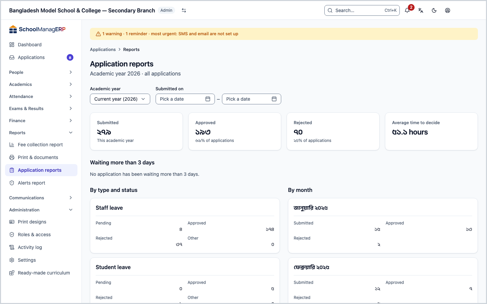

<!-- guide:meta
feature: reports.applications
title: Application reports
summary: See on one page how many applications were submitted, how many were approved or rejected, the average time to decide, which ones have waited more than 3 days, who is on leave today and how many days each staff member took.
roles: [ADMIN, EXECUTIVE, OFFICE_STAFF]
sources:
  - client-admin/src/routes/_staff/applications/reports.tsx
  - client-admin/src/routes/_staff/applications/-reports/applications-reports.tsx
  - client-admin/src/routes/_staff/applications/-reports/report-tables.tsx
  - server/src/modules/applications/application-reports.controller.ts
  - server/src/modules/applications/application-reports.service.ts
labels:
  [
    applicationsReports:*,
    nav:items.applicationsReportsNav,
    nav:groups.reports,
  ]
helpIds:
  [
    reports.applications,
    reports.applications.field.academicYear,
    reports.applications.field.submitted,
  ]
devices: [desktop]
entry: [sidebar, palette]
keywords:
  [application, applications report, report, pending, approved, rejected, leave, on leave today, staff leave]
appVersion: 0.1.0 (3f7e424fc)
owner: tareq89
lastVerified: 2026-10-25
knownIssues: []
-->

# Application reports

See the count of all the school's applications, and who is on leave today, on one page.

**Where to go:** in the left menu, **Reports → Application reports**. View this page on a computer.
**Before you start:** be an Admin, Academic coordinator or Office staff ([who can do what](#roles)). This page is view-only; you cannot decide on an application from here.

The numbers come from the school's [applications](../applications/applications.md), such as leave applications. Staff leave counts come from the record of approved leave.

[See the count](#task-main) · [Open old applications](#task-stale) · [Change the time](#task-filter) · [Problems and fixes](#trouble)

**On this page**

- [See this year's application count](#task-main)
- [How to know the numbers are right](#confirm)
- [Other situations](#other)
  - [Open applications waiting more than 3 days](#task-stale)
  - [See another academic year or dates](#task-filter)
  - [Who is on leave today, and how many days each took](#task-leave)
- [Problems and fixes](#trouble)
- [Who can do what](#roles)
- [Learn more](#more)

---

## See this year's application count 

1. In the left menu press **Reports**, then press **Application reports**.

   → The page opens. Under the title it says **Academic year … · all applications**.

2. Look at the four boxes at the top: **Submitted**, **Approved**, **Rejected** and **Average time to decide**.

   → Under **Submitted** it says **This academic year**; if you filter by dates only (no year), it says **In the dates you picked**. Under **Approved** and **Rejected** it says what share of the total, for example **60% of applications**. **Average time to decide** is in hours, for example **12.5 hours**.

3. Below, look at the **Waiting more than 3 days** list. These are still waiting for someone's decision.
4. Look at the **By type and status** and **By month** tables.

---

## How to know the numbers are right 

| State                               | How you know                                          | What next |
| ----------------------------------- | ----------------------------------------------------- | --------- |
| **Only picked on screen**           | When you change a filter, the numbers change at once  | —         |
| **Loaded from the school's system** | The four boxes show numbers, with no grey placeholder | Done      |

This page does not keep anything on your phone or computer, so there is no "saved on this device" state. The filters are kept in the page address; if you send the link, the other person sees the same count.

---

## Other situations 

### Open applications waiting more than 3 days 

In the **Waiting more than 3 days** list each application is one row: **Number**, **Submitted** (date · **waiting … days**), **Type**, **Applicant**, **Step**, **Status**. The oldest comes first, at most 50.

1. Press **View — …** on a row.

   → The application's own page opens. Decide on it from there.

If there is nothing, it says **No application has been waiting more than 3 days.**

### See another academic year or dates 

1. From **Academic year** choose a year.
2. If needed, enter the **From** and **To** days under **Submitted on**.

   → The dates are added under the title too; with only one date it says **From {date}** or **Up to {date}**. If no application matches, it says **No applications in this period**; press **Clear all filters** to remove the filters.

| You pick            | Which applications are counted                                      | The **Academic year** box says |
| ------------------- | ------------------------------------------------------------------- | ------------------------------ |
| Nothing             | The current year, plus applications that have no year               | **Current year (…)**           |
| A year              | Only that year                                                      | The year's name                |
| Only dates, no year | Every year, within the dates; the year is not shown under the title | **All years**                  |

### Who is on leave today, and how many days each took 

- The **On leave today** part has two lists: **Staff** (name, leave type, **until …**) and **Students** (name, class · section, **until …**). If nobody is, it says **No one is on leave today.**
- The **Staff leave days** table has each staff member's days **By leave type** and **Total days**. Only approved leave, counted in working days.

**On leave today** ignores every filter and always shows today. The staff list and **Staff leave days** come from the record of approved staff leave, so they show even when there is no application. The students list comes from approved student leave applications.

---

## Problems and fixes 

| What you see                                         | What to do                                                                                           | Who can help |
| ---------------------------------------------------- | ---------------------------------------------------------------------------------------------------- | ------------ |
| **Could not load the report.**                       | Press **Try again**, or reload the page.                                                             | Admin        |
| **No applications in this period**                   | Press **Clear all filters**, or choose another year.                                                 | —            |
| **Average time to decide** shows **—**               | No application was decided in this time.                                                             | —            |
| Staff leave days do not change when the year changes | Leave days are filtered by **Submitted on** only, by the day the leave starts; not by academic year. | —            |
| **Application reports** is not in the left menu      | Your role cannot see this page. See [who can do what](#roles).                                       | Admin        |

---

## Who can do what 

| Role                                                   | View the report |
| ------------------------------------------------------ | --------------- |
| Admin                                                  | Yes             |
| Academic coordinator                                   | Yes             |
| Office staff                                           | Yes             |
| Accountant, Teacher, Exam controller, Committee member | No              |

**Admin, Academic coordinator and Office staff:** all three see the same count for the whole school; there is no difference in the code. All applications are counted, not only your own share.

Other roles may be able to submit applications, but they do not get **Application reports** in the left menu.

---

## Learn more 

<strong>Parts of the page, top to bottom</strong>

- The title and **Academic year … · all applications**.
- Filters: **Academic year**, **Submitted on** (**From**, **To**).
- Four boxes: **Submitted**, **Approved**, **Rejected**, **Average time to decide**.
- **Waiting more than 3 days**.
- **By type and status** (**Pending**, **Approved**, **Rejected**, **Other**) and **By month** (**Submitted**, **Approved**, **Rejected**).
- **On leave today** and **Staff leave days**.

<strong>What each field means</strong>

<!-- guide:generated:fields:applicationsReports -->

| Field         | What to enter                                                                                                                                         | Required? |
| ------------- | ----------------------------------------------------------------------------------------------------------------------------------------------------- | --------- |
| Academic year | Which academic year to count. When chosen, only that year’s applications are counted.                                                                 | No        |
| Submitted     | Filters by the day an application was submitted; both the start and end days count. Staff leave days use the same dates, by the day the leave starts. | No        |

<!-- /guide:generated -->

<strong>How the numbers are counted</strong>

<figure>
  
  <figcaption><em>The report's two sources</em></figcaption>
</figure>

- **Submitted:** all applications that match the filters, in any status.
- **By type and status:** pending and under review together make **Pending**; everything other than approved and rejected is **Other**.
- **Average time to decide:** for approved or rejected applications, the average hours from submitting to the decision, to one decimal place.
- **Waiting more than 3 days:** pending or under review, more than 3 days after submitting; at most 50.
- **Submitted on:** by the day of submitting, in Bangladesh time.
- **Staff leave days:** approved leave; a leave that falls in two months is counted in the month it starts.

**Related pages**

- [**Applications**](../applications/applications.md) — Submit school applications such as leave, fee waiver, transfer certificate, testimonial and section change, enter a guardian's paper.
- [**Staff attendance and leave**](../attendance/staff-attendance.md) — staff leave

---

_Version 0.1.0 · last verified 2026-10-25_
