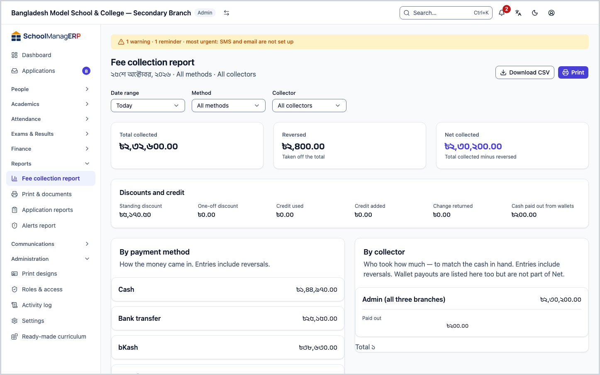

<!-- guide:meta
feature: reports.collectionsReport
title: Fee collection report
summary: See how much money was collected, how much was reversed and the net in hand for a day, week, month or your own dates, by method, collector, fee type and day; print it or download a CSV.
roles: [ADMIN, ACCOUNTANT, EXECUTIVE]
sources:
  - client-admin/src/routes/_staff/reports/collections.tsx
  - server/src/modules/reports/reports.controller.ts
  - server/src/modules/reports/collections-report.service.ts
  - server/src/modules/reports/dto/collections-report.dto.ts
labels:
  [
    reports:*,
    nav:items.collectionsReport,
    nav:groups.reports,
  ]
helpIds:
  [
    reports.collectionsReport,
    reports.collectionsReport.action.downloadCsv,
    reports.collectionsReport.action.print,
    reports.collectionsReport.field.preset,
    reports.collectionsReport.field.collector,
    reports.collectionsReport.section.byMethod,
    reports.collectionsReport.section.byCollector,
    reports.collectionsReport.section.byFeeType,
  ]
devices: [desktop, phone]
entry: [sidebar, palette]
keywords:
  [collections, fee collection, end-of-day count, cash close, net collected, reversal, collector, csv]
appVersion: 0.1.0 (3f7e424fc)
owner: tareq89
lastVerified: 2026-10-25
knownIssues: []
-->

# Fee collection report

See on one page how much money came in, who took it and how it came. Use it at the end of the day to match the cash in hand.

**Where to go:** in the left menu, **Reports → Fee collection report**. It works on a computer or a phone.
**Before you start:** be an Admin, Accountant or Academic coordinator ([who can do what](#roles)). This page is view-only; nothing here changes any money.

The report's money comes from the [payments](../finance/payments.md) taken. When a payment is reversed, it goes into **Reversed** and is taken off the net.

[See today's collection](#task-main) · [Other dates](#task-range) · [One collector](#task-collector) · [Problems and fixes](#trouble)

**On this page**

- [See and match today's collection](#task-main)
- [How to know the count is right](#confirm)
- [Other situations](#other)
  - [Yesterday, this week, this month or your own dates](#task-range)
  - [One collector or one method](#task-collector)
  - [Print or download a CSV](#task-export)
- [Problems and fixes](#trouble)
- [Who can do what](#roles)
- [Learn more](#more)

---

## See and match today's collection 

1. In the left menu press **Reports**, then press **Fee collection report**.

   → The **Fee collection report** opens. **Date range** starts on **Today**. Under the title you see the date · **All methods** · **All collectors**.

2. Look at the three boxes at the top: **Total collected**, **Reversed** and **Net collected**.

   → **Net collected** = **Total collected** minus **Reversed**. This is how much money really came in today.

3. In the **By collector** table, find each staff member's row. Match the **Net** amount with the cash they hold.

   → **Paid out** is cash given back to a family from the student's credit. It is not taken off **Net**; it is shown beside it. So to match the cash in hand, take **Paid out** off **Net** yourself.

4. Look at the other tables: **By payment method** (cash, bKash and so on), **By fee type** and **By day**.

> **Remember:** only successful payments are counted. Pending or failed payments are not. A reversed payment shows twice: the original money in **Total collected**, and the refund in **Reversed**.

---

## How to know the count is right 

| State                               | How you know                                                           | What next                                   |
| ----------------------------------- | ---------------------------------------------------------------------- | ------------------------------------------- |
| **Only picked on screen**           | When you change a filter, the numbers change at once; nothing is saved | —                                           |
| **Loaded from the school's system** | The three boxes show money, with no grey placeholder                   | Match it; print or download a CSV if needed |

This page does not keep anything on your phone or computer, so there is no "saved on this device" state. The filters you pick are kept in the page address, so a reload shows the same count.

**If the numbers do not match:** someone may have taken a new payment just now. Reload the page. The numbers are always as of that moment.

---

## Other situations 

### Yesterday, this week, this month or your own dates 

1. From **Date range** choose **Yesterday**, **This week**, **This month** or **Custom**.
2. If you choose **Custom**, the **Custom range** box appears. Enter the **From** and **To** dates.

| You choose     | Days covered                            |
| -------------- | --------------------------------------- |
| **Today**      | Today only                              |
| **Yesterday**  | Yesterday only                          |
| **This week**  | From this week's Monday up to today     |
| **This month** | From the 1st of this month up to today  |
| **Custom**     | **From** and **To**, both days included |

Days are counted in Bangladesh time, by the date the payment was taken.

### One collector or one method 

- From **Collector** choose one staff member. The list holds only people who took money in this range.
- From **Method** choose one, such as **Cash** or **bKash**.

→ The whole page, the three boxes and all tables, shows the count for that person or method only. If you choose a method other than cash, **Paid out** stays zero, because credit is paid back in cash.

### Print or download a CSV 

- Press **Print**. The browser's print window opens. The filters and buttons are not printed; the title, the dates and all tables are.
- Press **Download CSV**. A file named `collections-report.csv` downloads. It has one row for each payment: Date, Invoice No, Student, Method, Reference, Collector, Amount, Discount, Reversal. The same filters apply. The file opens correctly in Excel, Bangla names included.

> **Remember:** the CSV has students' names. Do not send the file outside the school.

---

## Problems and fixes 

| What you see                                                | What to do                                                                                                                                                                                   | Who can help |
| ----------------------------------------------------------- | -------------------------------------------------------------------------------------------------------------------------------------------------------------------------------------------- | ------------ |
| **Could not load the collections report.**                  | Press **Try again**, or reload the page.                                                                                                                                                     | Admin        |
| **No rows for this range.**                                 | There are no payments in this time. Choose another **Date range** or filter.                                                                                                                 | —            |
| **Could not download the CSV. Please try again.**           | Press it again after a little while.                                                                                                                                                         | Admin        |
| The method table's total does not match **Total collected** | The method and collector tables show the money that reached the hand: the part taken from credit is left out, the part kept as credit is added. See [How the money is counted](#more) below. | Accountant   |
| A collector named **Unknown**                               | The payment does not say who took the money. Open the payment's details.                                                                                                                     | Accountant   |
| **Fee collection report** is not in the left menu           | Your role cannot see this page. See [who can do what](#roles).                                                                                                                               | Admin        |

---

## Who can do what 

| Role                                                     | View the report | Print and CSV |
| -------------------------------------------------------- | --------------- | ------------- |
| Admin                                                    | Yes             | Yes           |
| Accountant                                               | Yes             | Yes           |
| Academic coordinator                                     | Yes             | Yes           |
| Teacher, Office staff, Exam controller, Committee member | No              | No            |

**Admin, Accountant and Academic coordinator:** all three see the same page, the same filters and the same tables; there is no difference in the code. The **Collector** list comes from the report itself, so you do not need permission to view the staff list.

**Committee member:** does not get this page, because the CSV has students' names.

For the other roles, **Fee collection report** is not in the left menu.

---

## Learn more 

<strong>Parts of the page, top to bottom</strong>

- The title, the date-method-collector line, **Download CSV** and **Print**.
- The filters: **Date range**, **Custom range** (Custom only), **Method**, **Collector**.
- The three boxes: **Total collected**, **Reversed**, **Net collected**.
- **Discounts and credit**: **Standing discount**, **One-off discount**, **Credit used**, **Credit added**, **Change returned**, **Cash paid out from wallets**.
- Four tables: **By payment method**, **By collector**, **By fee type**, **By day** (oldest first).

<strong>What each field means</strong>

<!-- guide:generated:fields:reports -->

| Field        | What to enter                                                                                         | Required? |
| ------------ | ----------------------------------------------------------------------------------------------------- | --------- |
| Date range   | Which days to show. Starts on Today. This week starts on Monday. Days are counted in Bangladesh time. | No        |
| Custom range | Shows only when Date range is Custom. Both the From and To days are included.                         | No        |
| Method       | Show money that came one way only, such as Cash or bKash. Leave empty for all methods.                | No        |
| Collector    | Show money taken by one staff member only. The list holds only people who took money in this range.   | No        |

<!-- /guide:generated -->

<strong>How the money is counted</strong> — which payments, which day, what goes in which table

<figure>
  
  <figcaption><em>Where the money goes in the report</em></figcaption>
</figure>

- **Which payments:** only this school's successful payments, and reversals. Deleted, pending or failed payments are left out.
- **Which day:** the date the payment was taken, in Bangladesh time. Money taken after 12 midnight goes to the next day.
- **The three boxes and the By day table:** the full amount of the payment.
- **The method and collector tables:** money in hand = payment amount − the part taken from credit + the part kept as credit. So when credit is used, these two tables can add up to less than **Total collected**.
- **The fee type table:** how much was booked for each fee. A reversed payment is not taken off here, and the **Discount** column adds two kinds of discount.
- **Standing discount:** the part of a bill's standing discount that falls on this payment, estimated by the payment's share.
- **Cash paid out from wallets:** cash given to a family from the student's credit. It is not taken off the net; it is shown separately.

**Related pages**

- [**Payments**](../finance/payments.md) — payments, receipts and reversals
- [**Record payment**](../finance/record-payment.md) — take a payment
- [**Student dues**](../finance/dues.md) — see who owes what
- [**Alerts report**](alerts-report.md) — alerts raised by the school's rules each month

---

_Version 0.1.0 · last verified 2026-10-25_
