<!-- guide:meta
feature: reports.hub
title: All reports
summary: Find every school report in one place, open it, download it to Excel, print it on A4 and say if it helped. An admin can also keep a list as a report.
roles: [ADMIN, ACCOUNTANT, TEACHER, EXECUTIVE, COMMITTEE]
sources:
  - client-admin/src/routes/_staff/reports/index.tsx
  - client-admin/src/routes/_staff/reports/$reportId.tsx
  - client-admin/src/routes/_staff/reports/-coded-reports.ts
  - ui/src/components/report-prompts.tsx
  - ui/src/components/export-menu.tsx
  - client-admin/src/routes/_staff/print/-document/report-pages.tsx
  - client-admin/src/routes/_staff/-save-as-report/save-as-report-dialog.tsx
  - client-admin/src/routes/_staff/-save-as-report/list-to-definition.ts
  - server/src/modules/reports/report-meta.controller.ts
  - server/src/modules/reports/report-runs.controller.ts
  - server/src/modules/reports/report-definitions.controller.ts
labels:
  [
    reports:hub.*,
    reports:runner.*,
    reports:prompts.*,
    common:export.*,
    common:saveAsReport.*,
    common:reportPrint.*,
    nav:items.allReports,
    nav:groups.reports,
  ]
helpIds: [reports.hub]
devices: [desktop, phone]
entry: [sidebar, palette]
keywords:
  [রিপোর্ট, সব রিপোর্ট, রিপোর্ট খুঁজুন, পছন্দের রিপোর্ট, Excel, CSV, প্রিন্ট, রিপোর্ট হিসেবে রাখুন, মতামত, reports, all reports, catalogue, favourite, keep as report, print, download]
appVersion: 0.1.0 (0d2ba6bc5)
owner: tareq89
lastVerified: 2026-10-31
knownIssues:
  - { id: viewers-cannot-change-choices, checked: 2026-10-31, issue: null }
  - { id: teacher-student-count-card, checked: 2026-10-31, issue: null }
  - { id: keep-as-report-roles, checked: 2026-10-31, issue: null }
-->

# All reports

Find every school report in one place, open it, download it to Excel, print it on A4 paper, and say whether the report was useful.

**How to get there:** in the left menu, **Reports → All reports**. It works on a computer or a phone. The A4 print page opens on a computer only.
**Before you start:** you must be an admin, an accountant, a teacher, an academic coordinator or a committee member. What each role can do is in [Who can do what](#roles). This page is for viewing; opening a report never changes any data.

This page shows the list of **reports**. The list holds two kinds. One kind is the **ready reports**: reports the school's admin has made. They open on this page and show their answer at once. The other kind has its own page, such as the [Fee collection report](collections-report.md). Pressing its card opens that report's own page. You only see the reports your role may open.

[Find and open a report](#task-main) · [Change the choices](#task-answer) · [Download to Excel](#task-download) · [Print](#task-print) · [Say if it helped](#task-feedback) · [Keep as a report](#task-keep) · [Problems and fixes](#trouble)

**On this page**

- [Find and open a report](#task-main)
- [How to know it worked](#confirm)
- [Other situations](#other)
  - [Change a report's questions](#task-answer)
  - [Download to Excel](#task-download)
  - [Print on A4 paper](#task-print)
  - [Say whether the report was useful](#task-feedback)
  - [Keep a list as a report](#task-keep)
  - [Star a favourite report](#task-favourite)
- [Problems and fixes](#trouble)
- [Who can do what](#roles)
- [Known issues](#known-issues)
- [Learn more](#more)

---

## Find and open a report 

1. In the left menu press **Reports**, then press **All reports**.

   → The **All reports** page opens. Under the title it says "Open a report and the answer is on screen at once." Each report is a card: the name on top, one line about it below. The cards are grouped, for example **Ready reports**, **Fees and money** and **Attendance**, depending on your role.

2. In the **Find a report** box type part of a report's name. Bangla and English names both work.

   → Only the cards whose name matches stay. If nothing matches, **No report matches** appears with a **Clear search** button.

3. Press the name of a report.

   → A ready report opens on this page and runs at once. You fill in no form; the answer is on screen. Any other report opens its own page.

4. Read the result table. A plain table shows 100 rows at a time; if there are more, use the page buttons under the table.

   → One report brings at most 10,000 rows. If there are more, a line at the top says **Showing the first … rows only. Narrow the choices to see the rest.**

<figure>
  
  <figcaption><em>Who can do what from All reports</em></figcaption>
</figure>

> **Remember:** an opened report always shows the data of that moment. If you change the choices, the old result stays until you press **Show report** again.

---

## How to know it worked 

| State                                              | How to tell                                                                                                                                          | What next                                        |
| -------------------------------------------------- | ---------------------------------------------------------------------------------------------------------------------------------------------------- | ------------------------------------------------ |
| **Changed on screen only**                         | You changed an answer in the choices form but did not press **Show report**. The result below is for the old choices                                 | Press **Show report**                            |
| **Reached the school's system**                    | The result table has appeared. It was fetched live from the school's system and the grey placeholder is gone                                         | Read it, download or print if you need           |
| **Reached the school's system** (kept as a report) | The **Kept as a report** message appeared. To check, open **All reports**; the new report is under **Ready reports**                                 | Press its card, or press **Open** in the message |
| **Saved on this device**                           | Starred favourites and your "Was this report useful?" answer stay only in this browser, on this computer or phone. Another device will not show them | Nothing to do                                    |

---

## Other situations 

### Change a report's questions 

Only the admin can do this. Other roles do not get this line; they see the report with its starting choices ([Known issues](#known-issues)).

Some reports ask questions when they run, such as which academic year or which class.

1. Look at the line above the result. It lists the current answers together, for example "2026 · Class 6 · All sections". At the end of the line press **Change**.

   → The **Choices for this report** form opens, with one field for each question the report asks.

2. Fill in the fields:
   - **Academic year**: pick one year. It starts as the current year.
   - **Class**: pick one or more classes. If you pick none, it is **All classes**.
   - **Section**: shows only the sections of the classes you picked. If you change the class, the section choice is cleared. If you pick none, it is **All sections**.
   - Dates: **From** and **To**.

   → If a required field is empty, a message appears next to it, such as **Pick a class**.

3. Press **Show report**, or press Enter in any field.

   → The form closes and the result changes to the new choices. The choices are kept in the page address, so reloading the page or sending the address opens the same view.

**Start again** puts every answer back to the report's starting answer; you still have to press **Show report**.

**On a phone:** the form opens as a sheet from the bottom. Change something and close the sheet, and the report runs with the new choices.

| You press       | What happens                                                                     | Saved?                |
| --------------- | -------------------------------------------------------------------------------- | --------------------- |
| **Show report** | The form closes, the result is shown for the new choices, the address holds them | No, nothing is stored |
| **Start again** | The answers go back to the starting answers; the result stays as it was          | No                    |

### Download to Excel 

Only the admin and the accountant get this. For other roles the button is not there at all.

1. After the result appears, press **Download to Excel · … items** at the top right. The number is how many rows this choice has in all.

   → An Excel file downloads. It holds every row for these choices, not only the page you see.

2. For a CSV file instead, press the arrow beside the button (**More ways to download**), then **For other software (CSV)**.

   → A CSV file downloads.

With more than 5,000 rows the file does not download at once. The message **This file is large, so it is being prepared. You will see it under the bell when it is ready.** appears; when it is ready you find the file under the bell icon. If the result has no rows at all, the button is grey.

> **Remember:** the file may hold student or staff names. Do not send it outside the school.

### Print on A4 paper 

Only the admin and the accountant get this. The print page opens on a computer.

1. After the result appears, press **Print** at the top. Until the result is there, the button is grey.

   → The print page opens in a new tab. At the top it shows the report name and your choices. Below, **Preparing the document…** shows, then the A4 pages appear.

2. Look at the pages. They hold the school's name and address, the report name, your choices on one line, the print date, and the table. All rows are printed, not only the page you were looking at.

   → A wide table (more than seven columns) is put on a landscape sheet by itself. In Chrome or Edge a page number such as **Page 1 of 3** prints at the bottom; other browsers print without a number.

3. At the top press **Print**.

   → The browser's print window opens. Print from there, or save as PDF.

The choices that were shown with the result are used. Anything you changed in the form but did not run is not printed. If a report is very long, a line at the bottom says **This report is very long. Only the first … rows are printed.**

**On a phone:** the print page shows **Open this on a computer**. Press **Copy link** and open the link on a computer.

When you are done, **Close** takes this tab to the **All reports** page. You can also close the tab and go back to the earlier tab.

### Say whether the report was useful 

Everyone who can open reports gets this. A small line appears under the result the first time a result shows for a report.

1. Next to **Was this report useful?** press **Yes** or **No** (the thumb buttons).

   → **Yes** sends your answer at once and **Thank you.** appears. **No** opens the **What was missing?** box.

2. After **No**, write what was missing if you like (up to 500 characters), then press **Send**. You may send it empty.

   → **Thank you.** appears.

Once you answer, the question does not come back for that report in this browser. The line never blocks the result and does not print. If the answer cannot be sent, **Could not send your answer.** appears; press the button again.

### Keep a list as a report 

Only the admin gets this. It is not done on the **All reports** page; it is done from three lists: [Students](../people/students.md), [Student dues](../finance/dues.md) and [Payments](../finance/payments.md). Whatever choices are set on the list become the report. The report then appears on **All reports** under **Ready reports**.

1. Open one of the three lists and set the class, section or other choices.

   → The list changes to your choices.

2. At the top press the arrow beside the **Download to Excel** button (**More ways to download**), then press **Keep this as a report**.

   → The **Keep this as a report** window opens. (The overdue-only dues list has no arrow; there **Keep this as a report** is a separate button.)

3. In **Report name** fix the name. A name is filled in for you: with a class chosen it is "Class name — Students", without one just "Students" (for dues "Dues", for payments "Payments"). If you empty it, **Give the report a name.** appears.

4. In **Who can see it** pick which roles will see the report. Admins can always see it, so that box is locked. Your own role is ticked at the start.

5. If an **Ask when running** part shows, check each switch. On the students list it is the academic year; on the payments list it is the dates. With the switch on, the report asks that question each time it runs ("Starts as … "). With it off, the report keeps that value ("It stays …").

6. Read the notes at the bottom. What will not go into the report is written there, for example **This filter will not go into the report: What you typed in search**.

   → Dues and payments become **totals** in the report: dues by class and section, payments by day and method. There is no row for each student or each payment; this is also written in the notes.

7. Press **Keep as report**.

   → The button shows **Keeping…**. When it ends, the window closes and **Kept as a report** appears with **Open**. Press **Open** to run the report.

| You press          | What happens                                                    | Saved? |
| ------------------ | --------------------------------------------------------------- | ------ |
| **Keep as report** | The report is made and switched on; it shows on **All reports** | Yes    |
| **Cancel**         | Nothing changes; you go back to the list                        | No     |

> **Remember:** nothing is kept until you press **Keep as report**. The report does not hold that moment's rows; it holds the rules of the choices. Each time you open it, fresh data comes.

### Star a favourite report 

1. Press the star at the top right of a card (**Add … to favourites**).

   → The card moves up into the **Favourites** group. A report never shows twice.

2. To remove it, press the star again (**Remove … from favourites**).

   → The card goes back to its earlier group.

Favourites stay in this browser only ([Saved on this device](#confirm)). If the browser does not let the page store anything, the star works for that visit only and is not remembered.

---

## Problems and fixes 

| What you see                                                                              | What to do                                                                                                                                          | Who can help |
| ----------------------------------------------------------------------------------------- | --------------------------------------------------------------------------------------------------------------------------------------------------- | ------------ |
| **The ready reports could not be loaded.**                                                | Press **Try again**. The cards of the other reports stay on the page.                                                                               | Admin        |
| **No report matches**                                                                     | Try another word, or press **Clear search**.                                                                                                        | —            |
| **This report is not available**                                                          | It was removed, or it is not meant for your role. Press **See all reports**.                                                                        | Admin        |
| **Nobody matches these choices**                                                          | Try another class, or change the choices above.                                                                                                     | —            |
| **This report is taking too long. Narrow the filters and try again.**                     | For the admin the choices form opens by itself. Narrow the class, section or dates and press **Show report**. Other roles tell the admin.           | Admin        |
| **Answer the questions above first, then show the report.**                               | The admin answers in the form and presses **Show report**. Other roles do not see the questions, so tell the admin ([Known issues](#known-issues)). | Admin        |
| **This report has nothing to show yet.**                                                  | The report is empty. Tell the admin.                                                                                                                | Admin        |
| **The report could not be shown. Try again.**                                             | Press **Try again**. If it still fails, reload the page.                                                                                            | Admin        |
| **The file could not be downloaded. Try again.**                                          | Press **Download to Excel** again after a while.                                                                                                    | Admin        |
| **The document could not be loaded.**                                                     | On the print page press **Retry**.                                                                                                                  | Admin        |
| **Open this on a computer**                                                               | The print page does not open on a phone. Press **Copy link** and open it on a computer.                                                             | —            |
| You cannot find **Download to Excel**, **Print**, **Change** or **Keep this as a report** | Your role cannot do this. See [Who can do what](#roles).                                                                                            | Admin        |
| **The report could not be kept. Nothing was saved. Try again.**                           | Press **Keep as report** again.                                                                                                                     | Admin        |
| **The report was saved but could not be switched on. Try again.**                         | The report is made, only not switched on. The form is locked. Pressing **Keep as report** again does not make a new report; it only switches it on. | Admin        |
| **We could not confirm whether this was saved. Check the list before trying again.**      | First open **All reports** and see whether the new report is there. If it is, do not keep it again.                                                 | Admin        |
| **Could not send your answer.**                                                           | Press **Yes** or **Send** again.                                                                                                                    | —            |

---

## Who can do what 

| Role                          | See reports                | Download to Excel | Print | Change choices and the report's own layout | Keep as a report |
| ----------------------------- | -------------------------- | ----------------- | ----- | ------------------------------------------ | ---------------- |
| Admin                         | All reports                | Yes               | Yes   | Yes                                        | Yes              |
| Accountant                    | Those made visible to them | Yes               | Yes   | No                                         | No               |
| Teacher                       | Those made visible to them | No                | No    | No                                         | No               |
| Academic coordinator          | Those made visible to them | No                | No    | No                                         | No               |
| Committee member              | Those made visible to them | No                | No    | No                                         | No               |
| Office staff, Exam controller | No (no menu item)          | No                | No    | No                                         | No               |

**Which cards you see:** the admin sees every **ready report**. Others see only the ones whose maker let their role see them. A card for another report shows only when your role may open that report's page; for example the Fee collection report is for the admin, the accountant and the academic coordinator.

**Change choices and the report's own layout:** a report's layout (grouped list, table of counts, chart) and its questions come only to the admin. Others see the report in a plain table, with its starting choices. Printing follows the same rule.

---

## Known issues 

Verified on version 0.1.0 on 2026-10-31. This section is removed once the fixes ship.

| Issue                                                                                                                                                                                                 | Who and when                                           | Data saved?                          | What to do for now                                                                                   |
| ----------------------------------------------------------------------------------------------------------------------------------------------------------------------------------------------------- | ------------------------------------------------------ | ------------------------------------ | ---------------------------------------------------------------------------------------------------- |
| Only the admin can change a report's answers. If a question has no answer, **Answer the questions above first, then show the report.** appears for others, though they have no question fields at all | Everyone except the admin, when opening a ready report | A report only views; nothing changes | Ask the admin to change the choices and show the result, or to keep another report for other choices |
| A teacher sees the [**Student count (BANBEIS)**](student-count.md) card in **All reports**, but when it opens no count loads ([details](student-count.md#known-issues))                               | Teachers, every time                                   | A report only views; nothing changes | Nothing to do. An admin or an academic coordinator can see the count                                 |
| The **Who can see it** list in **Keep this as a report** includes Office staff and Exam controller, but these roles do not get permission to see reports, so ticking them changes nothing             | The admin, when keeping a report                       | Yes, the report is kept correctly    | No need to tick them                                                                                 |

---

## Learn more 

<strong>Parts of the page, top to bottom</strong>

**The All reports page**

- The title and a one-line description.
- The **Find a report** box (it shows whenever there are cards).
- The **Favourites** group, holding starred reports.
- The ready-report groups. The group with no name is called **Ready reports**.
- The groups for other reports: Students, Fees and money, Attendance, Exams and results, Printouts and documents, Messages and alerts, Applications. A group where you can open nothing does not show.

**The page where a report opens**

- The report's name.
- (Admin) the line of current answers and **Change**.
- At the top right **Print** and **Download to Excel** (depending on your role).
- (Admin) the **Choices for this report** form.
- The result: a table, a grouped list, a table of counts or a chart. A table of counts can be switched with **See as table** and **See as list**, a chart with **See as chart** and **See as table**.
- Under the result, **Was this report useful?**

<strong>What each list becomes when kept as a report</strong>

| List         | What goes into the report                                     | Question when running                 |
| ------------ | ------------------------------------------------------------- | ------------------------------------- |
| Students     | The choices and the columns you see; one row for each student | Academic year                         |
| Student dues | Totals by class and section                                   | None                                  |
| Payments     | Totals by day and method                                      | Dates (if dates were set on the list) |

Class and section go into the report by name, not by id. If a class is renamed, check the report again.

**Related pages**

- [**Student count (BANBEIS)**](student-count.md) — student numbers by class and gender, on its own page

---

_Version 0.1.0 · last verified 2026-10-31_
