<!-- guide:meta
feature: reports.studentCount
title: Student count (BANBEIS)
summary: See students by class and gender and the number of teachers and staff. Download to Excel or print the numbers for the BANBEIS annual survey.
roles: [ADMIN, ACCOUNTANT, TEACHER, EXECUTIVE, COMMITTEE]
sources:
  - client-admin/src/routes/_staff/reports/student-count.tsx
  - server/src/modules/reports/system/student-count-banbeis.definition.ts
  - server/src/modules/reports/system/staff-by-type-gender.definition.ts
labels: [reports:studentCount.*, reports:hub.title, nav:items.studentCount, nav:groups.reports]
helpIds: [reports.studentCount]
devices: [desktop, phone]
entry: [sidebar, palette]
keywords:
  [ছাত্রসংখ্যা, শিক্ষার্থী সংখ্যা, BANBEIS, ব্যানবেইস, বার্ষিক জরিপ, শ্রেণি, লিঙ্গ, ধর্ম, শিক্ষক ও কর্মচারী, student count, head count, enrolment, survey, gender, religion, staff]
appVersion: 0.1.0 (0d2ba6bc5)
owner: tareq89
lastVerified: 2026-10-31
knownIssues:
  - { id: teacher-count-not-found, checked: 2026-10-31, issue: null }
-->

# Student count (BANBEIS)

See, in an academic year, how many boys and girls each class has, and how many teachers and staff the school has. Take the numbers for the BANBEIS (Bangladesh Bureau of Educational Information and Statistics) annual survey from here.

**How to get there:** in the left menu, **Reports → Student count (BANBEIS)**, or press the same name in the search palette. Both open the ready report **Students by class and gender (BANBEIS)**; you can also open it from the card on the [All reports](hub.md) page. A bookmark of the old address still works.
**Before you start:** the school needs at least one **current** academic year. If there is none, make one year current on the [Academic years](../academics/academic-years.md) page. This page is for viewing; it changes no data.

The student count is an ordinary **ready report**, the same kind as every other report in [All reports](hub.md): it opens at once, and download, print and the choices work as that page describes. It counts the students who have an active (ACTIVE) enrolment in the chosen year, each student once, by class, gender and religion. The teachers and staff are in a second ready report, **Teachers and staff by type**.

[See the count](#task-main) · [Another academic year](#task-year) · [Download to Excel](#task-download) · [Print](#task-print) · [Open the list](#task-list) · [Hidden numbers](#task-hidden) · [Problems and fixes](#trouble)

**On this page**

- [See the student count](#task-main)
- [How to know the numbers are right](#confirm)
- [Other situations](#other)
  - [See another academic year](#task-year)
  - [Download to Excel](#task-download)
  - [Print](#task-print)
  - [Open the list behind a number](#task-list)
  - [Numbers hidden for committee members](#task-hidden)
- [Problems and fixes](#trouble)
- [Who can do what](#roles)
- [Known issues](#known-issues)
- [Learn more](#more)

---

## See the student count 

1. In the left menu press **Reports**, then press **Student count (BANBEIS)**.

   → The page switches at once to the report **Students by class and gender (BANBEIS)** and runs it for the current academic year. You press no button. Pressing **Back** in the browser does not return to the old address, because the page replaced it.

2. Or press **Reports**, then [**All reports**](hub.md), type **BANBEIS** in the **Find a report** box and press the report's name.

   → The same report opens.

3. Read the table. Each class is a row. The columns are the genders (**Boys**, **Girls**, and **Other** if present), split by religion, with **Total** at the end of the row and the column.

   → The bottom right cell is the school's total number of students. A student with no gender or religion recorded is counted under **Not given**.

4. For the teachers and staff, open [**All reports**](hub.md) and press **Teachers and staff by type**.

   → It shows the number of teachers and other staff by post. It is today's count, not a year's. It has no gender, because the school's data does not record staff gender.

<figure>
  
  <figcaption><em>Where the student count comes from</em></figcaption>
</figure>

> **Remember:** the report stores nothing. Each time you open it, the numbers come from the enrolment data of that moment.

---

## How to know the numbers are right 

| State                           | How to tell                                               | What next                                 |
| ------------------------------- | --------------------------------------------------------- | ----------------------------------------- |
| **Changed on screen only**      | You changed a choice but have not pressed **Show report** | Press **Show report**                     |
| **Reached the school's system** | The table shows numbers and the grey placeholder is gone  | Check them; download or print if you need |

**If the numbers do not match:** someone may have enrolled or moved a student at the same time. Press **Show report** again. Only **active** enrolments are counted; enrolments that are not active are left out.

---

## Other situations 

### See another academic year 

Anyone who can open the report gets the question. See [Change a report's questions](hub.md#task-answer).

1. On the line above the result press **Change**, pick another year, and press **Show report**.

   → The table shows that year's numbers. The year is kept in the page address, so a link reopens the same year.

The report opens on the current year; pick another year in the same way.

### Download to Excel 

Only the admin and the accountant get this. For other roles the button is not there. See [Download to Excel](hub.md#task-download).

1. After the table appears, press **Download to Excel**.

   → An Excel file with the whole result downloads, with the class, gender, religion and student columns.

### Print 

Only the admin and the accountant get this. See [Print on A4 paper](hub.md#task-print).

1. Press **Print**.

   → The A4 page opens in a new tab. It starts with the school's name and its EIIN (the EIIN prints only when the school's profile has a registration ID), then the report's name and the chosen year.

### Open the list behind a number 

Everyone who opens the report sees its links; the student list opens only for a role that may open it. See [Colours and links in a report](hub.md#task-drill).

1. Press a class in the table.

   → The **Student list** report opens for that class and that year. At the top is **Go back**.

A number that is hidden (**—**) or is 0 has no link.

### Numbers hidden for committee members 

If you sign in as a committee member, a cell with fewer than five people shows **—** instead of a number, never **0**. The school's total number of students is never hidden; it is the true number.

For other roles nothing is hidden.

---

## Problems and fixes 

| What you see                                       | What to do                                                                                                                                    | Who can help |
| -------------------------------------------------- | --------------------------------------------------------------------------------------------------------------------------------------------- | ------------ |
| **Student count report not found for your role**   | Your role cannot open this report ([Known issues](#known-issues)). Press [**All reports**](hub.md) to see what you may open, or ask an admin. | Admin        |
| **The ready reports could not be loaded.**         | Press **Try again**.                                                                                                                          | Admin        |
| **Nobody matches these choices**                   | This year has no active enrolments. Pick another year ([see above](#task-year)).                                                              | —            |
| You cannot find **Download to Excel** or **Print** | Your role cannot take files out or print. See [Who can do what](#roles).                                                                      | Admin        |
| A cell shows **—**                                 | You are a committee member and the cell has fewer than five people. See [hidden numbers](#task-hidden).                                       | —            |

---

## Who can do what 

| Role                          | See the count                                                                       | Download to Excel | Print | Teachers and staff report |
| ----------------------------- | ----------------------------------------------------------------------------------- | ----------------- | ----- | ------------------------- |
| Admin                         | Yes, with every column                                                              | Yes               | Yes   | Yes                       |
| Accountant                    | Yes, without religion                                                               | Yes               | Yes   | Yes                       |
| Academic coordinator          | Yes, without religion                                                               | No                | No    | Yes                       |
| Committee member              | Yes, without religion; numbers under 5 show **—**                                   | No                | No    | No                        |
| Teacher                       | No. The menu item shows but the report is not found ([Known issues](#known-issues)) | No                | No    | No                        |
| Office staff, Exam controller | No (no menu item)                                                                   | No                | No    | No                        |

**Religion:** it is private information, so only the admin sees the religion split. Everyone else sees the same table by class and gender.

---

## Known issues 

Verified on version 0.1.0 on 2026-10-31. This section is removed once the fixes ship.

| Issue                                                                                                                                                                          | Who and when         | Data saved?                          | What to do for now                                        |
| ------------------------------------------------------------------------------------------------------------------------------------------------------------------------------ | -------------------- | ------------------------------------ | --------------------------------------------------------- |
| **Student count (BANBEIS)** is in a teacher's menu, but opening it shows **Student count report not found for your role**, because a teacher is not among the report's readers | Teachers, every time | A report only views; nothing changes | Ask an admin or an academic coordinator to read the count |

---

## Learn more 

<strong>How the numbers are counted</strong>

- **Students:** those whose enrolment in the chosen academic year is **active**. Deleted students or classes are left out. Each student is counted once.
- **Order of classes:** by class number, smallest first.
- **If gender or religion is not recorded:** a separate **Not given** group.
- **Teachers and staff:** every staff profile of the school, by today's open post, in the report **Teachers and staff by type**. It does not depend on the academic year.
- **Committee member:** numbers under 5 are hidden; totals are true.

<strong>Why the old page is gone</strong>

Before the report engine, the school had a small page of its own for this count. It is now the ready report above, so the count looks and works like every other report. The old address `/reports/student-count` and the menu item remain and open the report.

**Related pages**

- [**All reports**](hub.md) — find and open every report in one place

---

_Version 0.1.0 · last verified 2026-10-31_
