# Accountant

This role keeps the school's fees, bills and collections in order.

As an Accountant your day is about money. At the start of the month you generate fee bills. When someone pays, you record the payment and give a receipt. You look at what is overdue and send reminders to guardians. At the end of the day you check the collection report. You can also add students and guardians and change their details.

**At a glance:** [Your first day](#first-day) · [Who does what diagram](#diagram) · [Your 5 common tasks](#tasks) · [All features](#features) · [What you cannot do](#cannot) · [Desk card](#card)

---

## Your first day 

1. [Sign in](../start/sign-in.md#task-main). The dashboard shows today's collection as soon as you are in.
2. [Set up the fee structure](../finance/fee-structures.md#task-main). It says how much each fee is for each class.
3. [Generate fee bills](../finance/generate-fees.md#task-main). Guardians see the bills in their app.
4. When someone pays, [record the payment](../finance/record-payment.md#task-main).
5. At the end of the day, [look at the fee collection report](../reports/collections-report.md#task-main).

---

## Who does what 

<!-- diagram brief: Accountant -> portal (guardian, student) : fee bills and invoices (FEE_GENERATE, INVOICE_CREATE -> FEE_READ, INVOICE_READ); guardian -> Accountant : money, recorded as a payment (PAYMENT_RECORD); Accountant -> guardian : fee reminders and messages (COMMUNICATION_SEND); Accountant -> Admin : requests for approval and for cancelling a payment (FEE_APPROVE, PAYMENT_REVERSE Admin only); Accountant -> Academic coordinator : collection report (REPORT_COLLECTIONS_READ) -->

How money and bills travel, in one picture.

---

## Your 5 common tasks 

1. **[Record a payment](../finance/record-payment.md#task-main)** — find the student, enter the amount, give a receipt.
2. **[Generate fee bills](../finance/generate-fees.md#task-main)** — pick the month and class, generate the bills.
3. **[See what is overdue](../finance/dues.md#task-main)** — see in the list who owes how much.
4. **[Send fee reminders](../communications/fee-reminders.md#task-main)** — pick the overdue ones and send reminders.
5. **[See the collection report](../reports/collections-report.md#task-main)** — pick a date and check the collection.

---

## All features 

All your features, in the order of the left menu. The list is built automatically.

<!-- guide:generated:roles:accountant -->

- [Dashboard](../dashboard/dashboard.md) — See on the first page after sign-in what needs your attention today, and go to the right page in one press.
- [Applications](../applications/applications.md) — Submit school applications such as leave, fee waiver, transfer certificate, testimonial and section change, enter a guardian's paper application into the app, and approve or reject applications waiting for your decision. When the last step is approved, work such as leave or a waiver happens by itself.

**People**

- [Students](../people/students.md) — Add a new student, import many at once, and use each student's profile to handle class, guardians, fees, notes and leaving the school.
- [Guardians](../people/guardians.md) — Find a guardian in the list, fix their contact details, change which students are linked to them, and send everyone an invitation to join the app.
- [Calendar](../people/calendar.md) — See school holidays, exams, meetings and events in a month calendar. The Admin adds them, imports them from a file or copies them from last year. Everyone can subscribe in their own phone calendar app.

**Attendance**

- [Attendance](../attendance/attendance.md) — Take your section's attendance, mark late arrivals and leave, and fix mistakes.
- [Attendance reports](../attendance/attendance-reports.md) — See a section's monthly attendance figures, find who is falling behind, and send a reminder if needed.
- [Attendance register](../attendance/attendance-register.md) — See a section's whole month of attendance laid out like the paper register, print it, and correct several days at once on a computer.
- [Staff attendance](../attendance/staff-attendance.md) — Record teachers' and staff attendance every day, check your own leave balance, request leave, and approve requests.

**Finance**

- [Student dues](../finance/dues.md) — See in one list how much each student still owes, set the overdue ones apart, then collect the fee, send a reminder or export the list as CSV from there.
- [Record payment](../finance/record-payment.md) — Take money against the open bills of one or more students — the money is split across the oldest bills, give a discount if needed, work out change in cash or keep it as credit, then print or send the receipt.
- [Fee structures](../finance/fee-structures.md) — Write down which fee costs how much for each academic year; set a fee for the whole school, one class or one section, then change the amount later or delete a structure you no longer need.
- [Fee bills created](../finance/generate-fees.md) — Create fee bills for chosen students for one month or week in one go; decide what happens when bills for the same period already exist, and view, change or delete an earlier billing round.
- [Automatic billing](../finance/recurring-schedules.md) — Set a rule so fee bills for active students are created on their own on a fixed day each month or week; exclude someone, switch a rule off, or copy it to a new academic year.
- [Fines](../finance/fines.md) — Add a student's fine by hand, make the month's fines at month end from absence or lateness rules, set the fine rules, and waive a fine in full or in part when needed.
- [Payments](../finance/payments.md) — Find every payment taken at the school, open one to see which bills the money went to, print the receipt again, and reverse a wrong payment in full.
- [Invoices](../finance/invoices.md) — Find the invoice and credit note of every payment, print them, send them to a guardian by WhatsApp or SMS, and give a 30-day share link that opens without signing in.

**Reports**

- [Fee collection report](../reports/collections-report.md) — See how much money was collected, how much was reversed and the net in hand for a day, week, month or your own dates, by method, collector, fee type and day; print it or download a CSV.

**Communications**

- [Send message](../communications/send-message.md) — Send your own message to one guardian of a student by SMS, WhatsApp or email; check before sending how many SMS it will use, and see afterwards whether it arrived.
- [Fee reminders](../communications/fee-reminders.md) — Remind the guardians of one student, or of up to 500 students at once, about unpaid fees; names and amounts fill in by themselves, and the preview shows who will get it, who is skipped and how many SMS are needed.
- [Reminder history](../communications/reminder-history.md) — See every round of fee reminders sent together, which guardians the message reached and which it did not, who was skipped before sending, and retry the failed ones.
- Message log (coming soon)

<!-- /guide:generated -->

---

## What you cannot do 

- Approve money-risk actions, cancel a payment or refund money. Who can: the [Admin](./admin.md).
- Delete students, fee structures or invoices. Who can: the [Admin](./admin.md).
- Take student attendance. You only view it. Who can: the [Teacher](./teacher.md).
- Anything about exams, marks or results. Who can: the [Exam controller](./exam-controller.md).
- Change school settings. Who can: the [Admin](./admin.md).

---

## Desk card 

The five common tasks on one page, to print and keep on your desk.

[Open the card (PDF)](cards/accountant.en.pdf) · [বাংলা কার্ড (PDF)](cards/accountant.bn.pdf)

---

## Learn more 

**Related pages**

- [Roles and access](../administration/roles.md) — what each role can do, side by side.
- [Signing in](../start/sign-in.md) — the first time in, and passwords.
- [Invoices](../finance/invoices.md) — viewing and printing bills.
- [Recurring fee schedules](../finance/recurring-schedules.md) — bills that go out by themselves each month.
- [All roles](./README.md)
