# Admin

This role sets up the school in the app and keeps it running.

As an Admin you can see and change everything in the school. At the start you set the school up: academic year, classes, sections, staff and students. After that you check the dashboard every day and help others with their work. Only you can approve money-risk actions and cancel payments.

**At a glance:** [Your first day](#first-day) · [Who does what diagram](#diagram) · [Your 5 common tasks](#tasks) · [All features](#features) · [What you cannot do](#cannot) · [Desk card](#card)

---

## Your first day 

1. [Sign in](../start/sign-in.md#task-main). For a new school, the dashboard shows the setup checklist first.
2. Read [How everything in the school fits together](../admin/how-it-works.md). In five minutes you see the whole picture.
3. Follow the [School setup order](../admin/setup-order.md). First [create the academic year](../academics/academic-years.md#task-main).
4. [Set up classes, sections and subjects](../academics/classes.md#task-main).
5. [Add staff](../people/staff.md#task-main) and [give teachers their sections](../people/teaching-assignments.md#task-main).
6. [Add students](../people/students.md#task-main).

---

## Who does what 

<!-- diagram brief: Admin -> all staff : adding staff and giving roles (USER_CREATE); Admin -> teacher : class-section duty (CLASS_MANAGE, teacher assignment); Admin -> everyone : arranging and publishing the routine (ROUTINE_MANAGE); Accountant -> Admin : fee actions that need approval, cancelling payments (FEE_APPROVE, PAYMENT_REVERSE, PAYMENT_REFUND Admin only); Admin -> guardian : invitation (GUARDIAN_CREATE); Admin -> school : settings and backup (SETTINGS_MANAGE, BACKUP_MANAGE); Admin -> Exam controller : grading scale (GRADING_SCALE_MANAGE) -->

What you give to whom, and who asks you for approval.

---

## Your 5 common tasks 

1. **[See today's work](../dashboard/dashboard.md#task-main)** — see attendance, collection and approvals on the dashboard.
2. **[Add a staff member](../people/staff.md#task-main)** — add staff with a name, phone and role.
3. **[Add a student](../people/students.md#task-main)** — pick the class-section and save the student's details.
4. **[Give a teacher sections](../people/teaching-assignments.md#task-main)** — pick the teacher, give class-sections and subjects.
5. **[Change the settings](../administration/settings.md#task-main)** — change the school profile and rules, then save.

---

## All features 

All your features, in the order of the left menu. The list is built automatically.

<!-- guide:generated:roles:admin -->

- [Dashboard](../dashboard/dashboard.md) — See on the first page after sign-in what needs your attention today, and go to the right page in one press.
- [Applications](../applications/applications.md) — Submit school applications such as leave, fee waiver, transfer certificate, testimonial and section change, enter a guardian's paper application into the app, and approve or reject applications waiting for your decision. When the last step is approved, work such as leave or a waiver happens by itself.

**People**

- [Students](../people/students.md) — Add a new student, import many at once, and use each student's profile to handle class, guardians, fees, notes and leaving the school.
- [Guardians](../people/guardians.md) — Find a guardian in the list, fix their contact details, change which students are linked to them, and send everyone an invitation to join the app.
- [Calendar](../people/calendar.md) — See school holidays, exams, meetings and events in a month calendar. The Admin adds them, imports them from a file or copies them from last year. Everyone can subscribe in their own phone calendar app.
- [Staff](../people/staff.md) — Add school staff, change their contact details, send invitations, give teacher profiles, and remove people from the school or bring them back.
- [Import from Excel](../people/staff-import.md) — Write all the school's teachers and staff in one file and add them at once, and send everyone an invitation if you want.
- [Programs](../people/programs.md) — Add programs such as Hifz, a club or a course, set their milestones, enrol students, and record each achievement to follow progress.
- [Admission rounds](../people/admission-intakes.md) — Decide which class takes how many seats, and from when to when applications are open online; guardians fill in the form on their phone, get a reference number and check their application status later.
- [Admission applicants](../people/admission-applicants.md) — Open applications submitted online, check the documents, add them to the shortlist, then admit or reject them.
- [Admission reports](../people/admission-reports.md) — See, class by class, how many students were admitted online in an academic year, how many were withdrawn or transferred out, how many graduated and how many were readmitted.
- [Teacher assignments](../people/teaching-assignments.md) — Decide who is class teacher of each section, who is assistant, and who teaches which subject; this is how a teacher gets to see their own sections.
- [Evaluations](../people/evaluations.md) — Write a staff member's Annual Confidential Report (ACR), run teacher surveys with students and guardians, and report staff incidents. This page is not for everyone.

**Academics**

- [Academic Years](../academics/academic-years.md) — Add academic years, set which one is current, arrange the terms of a year, and delete a year nobody uses.
- [Classes](../academics/classes.md) — Add classes to an academic year, open sections in a class, attach subjects, and give sections their teachers.
- [Routine setup](../academics/routine-setup.md) — Before you build routines, set the school's shifts, the period and break times of each shift, the list of rooms and the routine rules.
- [Class routine](../academics/routine-builder.md) — Place subjects and teachers in each section's weekly routine table, see rule clashes, fill empty cells in one go, and check teacher workload.
- [Routine review](../academics/routine-review.md) — See every period of the arranged routine in one list, send it for review so teachers can look, publish it, handle teachers' change requests, and copy the routine to another academic year.
- [Substitute teachers](../academics/routine-substitutions.md) — When a teacher is absent, give a substitute teacher for a specific period on a specific day, or cancel the period; the weekly routine does not change. Filter the list of earlier substitutions.
- [My routine](../academics/my-routine.md) — Teachers see their own periods for today and the next days, see whom they are covering for, and report whether each period was taught.
- [Homework](../academics/homework.md) — Create homework for a class and subject, give it to a section or one student, give the same homework to more sections, change or deactivate what was given, check each student's work, and import many homework from a file at once.
- [Syllabus](../academics/syllabus.md) — Put a class and subject's syllabus topics in order, make a study plan for each section's subject, and see which section is behind.

**Attendance**

- [Attendance](../attendance/attendance.md) — Take your section's attendance, mark late arrivals and leave, and fix mistakes.
- [Attendance reports](../attendance/attendance-reports.md) — See a section's monthly attendance figures, find who is falling behind, and send a reminder if needed.
- [Attendance register](../attendance/attendance-register.md) — See a section's whole month of attendance laid out like the paper register, print it, and correct several days at once on a computer.
- [Staff attendance](../attendance/staff-attendance.md) — Record teachers' and staff attendance every day, check your own leave balance, request leave, and approve requests.

**Exams & Results**

- [Exams](../exams-results/exams.md) — Add an exam for a class, set the parts and marks of each subject, give a schedule, and follow the exam from marks submission to published results.
- [Exam structures](../exams-results/exam-templates.md) — Write the parts and marks of every class and subject once in a structure, then pick the structure when you add an exam to get all the parts at once.
- [Enter marks](../exams-results/marks-entry.md) — Pick an exam, open the marks list for your section and subject, type each student's marks or mark them absent or exempt, then submit the list.
- [Seat plans](../exams-results/seat-plans.md) — Pick the subjects of an exam and the rooms to make who sits in which room and seat, change seats if needed, give rooms an invigilator, then publish.
- [Grading scales](../exams-results/grading-scales.md) — Set which percentage of marks gives which grade and GPA for each academic year; start from the NCTB grades, copy to another class or year, and see how many results will be recalculated before you save a change.
- [Results](../exams-results/results.md) — Build an exam's results from the submitted marks, check them and publish, send guardians an SMS, reopen when needed, and print each student's report card.
- [Result analysis](../exams-results/analysis.md) — See an exam's merit list, the students who failed or were absent and the pass/fail by subject, filter by section, print or download a CSV.
- [Class promotion](../exams-results/promotion.md) — Using published results, move a class's students up to the next class in the new academic year, keep them in the same class or graduate them; first a draft list, then check it and finalise.

**Finance**

- [Student dues](../finance/dues.md) — See in one list how much each student still owes, set the overdue ones apart, then collect the fee, send a reminder or export the list as CSV from there.
- [Record payment](../finance/record-payment.md) — Take money against the open bills of one or more students — the money is split across the oldest bills, give a discount if needed, work out change in cash or keep it as credit, then print or send the receipt.
- [Fee structures](../finance/fee-structures.md) — Write down which fee costs how much for each academic year; set a fee for the whole school, one class or one section, then change the amount later or delete a structure you no longer need.
- [Fee bills created](../finance/generate-fees.md) — Create fee bills for chosen students for one month or week in one go; decide what happens when bills for the same period already exist, and view, change or delete an earlier billing round.
- [Automatic billing](../finance/recurring-schedules.md) — Set a rule so fee bills for active students are created on their own on a fixed day each month or week; exclude someone, switch a rule off, or copy it to a new academic year.
- [Fines](../finance/fines.md) — Add a student's fine by hand, make the month's fines at month end from absence or lateness rules, set the fine rules, and waive a fine in full or in part when needed.
- [Payments](../finance/payments.md) — Find every payment taken at the school, open one to see which bills the money went to, print the receipt again, and reverse a wrong payment in full.
- [Invoices](../finance/invoices.md) — Find the invoice and credit note of every payment, print them, send them to a guardian by WhatsApp or SMS, and give a 30-day share link that opens without signing in.

**Reports**

- [All reports](../reports/hub.md) — Find every school report in one place, open it, download it to Excel, print it on A4 and say if it helped. An admin can also keep a list as a report.
- [Fee collection report](../reports/collections-report.md) — See how much money was collected, how much was reversed and the net in hand for a day, week, month or your own dates, by method, collector, fee type and day; print it or download a CSV.
- [Student count (BANBEIS)](../reports/student-count.md) — See students by class and gender and the number of teachers and staff. Download to Excel or print the numbers for the BANBEIS annual survey.
- [Print & documents](../reports/printables.md) — See what was printed, which certificates were issued and what is still waiting to be printed, in three tabs; reprint or revoke a card, or download the certificate list for Excel.
- [Application reports](../reports/applications.md) — See on one page how many applications were submitted, how many were approved or rejected, the average time to decide, which ones have waited more than 3 days, who is on leave today and how many days each staff member took.
- [Alerts report](../reports/alerts-report.md) — See for one month how many alerts the school's rules raised, in which section, how many were fixed and how fast, and how many are still open; filter by rule or section and download a CSV.

**Communications**

- [Send message](../communications/send-message.md) — Send your own message to one guardian of a student by SMS, WhatsApp or email; check before sending how many SMS it will use, and see afterwards whether it arrived.
- [Send an alert](../communications/send-alert.md) — Write a short alert by hand and send it to chosen roles, sections, guardians or named staff; it shows in their bar at the top and in their notifications until the end date, and you can withdraw it early.
- [Fee reminders](../communications/fee-reminders.md) — Remind the guardians of one student, or of up to 500 students at once, about unpaid fees; names and amounts fill in by themselves, and the preview shows who will get it, who is skipped and how many SMS are needed.
- [Reminder history](../communications/reminder-history.md) — See every round of fee reminders sent together, which guardians the message reached and which it did not, who was skipped before sending, and retry the failed ones.

**Administration**

- [Print designs](../administration/print-templates.md) — Make a print design from a ready-made one, publish it and make it the default; check the preview and print on your own printer; when a card is lost and revoked, its QR code no longer shows as valid.
- [Roles & access](../administration/roles.md) — See side by side what each staff role in the school can see and do, on one page. The page is view-only; nothing changes from here.
- [Activity log](../administration/audit-logs.md) — See who created, changed or deleted what in the school, and who signed in, from newest to oldest; filter to find things, and open a row to compare before and after. The record can only be viewed, never changed.
- [Settings](../administration/settings.md) — Set the school's profile, academic rules, fee rules, communication, printing, sign-in, backup and alerts on one page, in nine categories.
- [Ready-made curriculum](../administration/curriculum-preset.md) — In a brand-new school, choose a ready-made curriculum and create the academic year, classes, subjects, grading scale and exam templates in one go. It cannot be added if the school already has classes, subjects, students or exams, and once added you cannot undo it yourself.

<!-- /guide:generated -->

---

## What you cannot do 

- Create a new role or change a role's permissions. A school has seven fixed staff roles. See [Roles and access](../administration/roles.md).
- See another school's data. Every role sees only its own school.
- Platform work, such as closing a school or giving the Super admin role. SchoolManager's own team does this; no school can give this role.

---

## Desk card 

The five common tasks on one page, to print and keep on your desk.

[Open the card (PDF)](cards/admin.en.pdf) · [বাংলা কার্ড (PDF)](cards/admin.bn.pdf)

---

## Learn more 

**Related pages**

- [Roles and access](../administration/roles.md) — what each role can do, side by side.
- [Signing in](../start/sign-in.md) — the first time in, and passwords.
- [School setup order](../admin/setup-order.md) — which job comes first, which comes later.
- [Activity log](../administration/audit-logs.md) — who changed what, and when.
- [All roles](./README.md)
