# Committee member

This role lets you check once a month, in totals, how the school is doing.

As a Committee member you only look in the app; you change nothing. The dashboard shows admissions, attendance, the money position and the pass rate as totals. Before the monthly meeting you can print the report. You do not see any student's name or personal details.

**At a glance:** [Your first day](#first-day) · [Who does what diagram](#diagram) · [Your 5 common tasks](#tasks) · [All features](#features) · [What you cannot do](#cannot) · [Desk card](#card)

---

## Your first day 

1. [Sign in](../start/sign-in.md#task-main). If it is your first time, [sign in with a code](../start/sign-in.md#task-code).
2. [Look at your dashboard](../dashboard/dashboard.md#task-committee). At the top are the month and academic year, below are four totals.
3. [Understand what the widgets mean](../dashboard/widgets.md). What each number means is written there.
4. Before the meeting, [print the monthly meeting report](../dashboard/customise.md#task-committee-report).

---

## Who does what 

<!-- diagram brief: teacher -> Committee member : attendance, as totals only (COMMITTEE_REPORT_READ); Accountant -> Committee member : collection and dues, as totals only (COMMITTEE_REPORT_READ); Exam controller -> Committee member : pass rate (COMMITTEE_REPORT_READ); Admin -> Committee member : staff evaluations / ACR, view only (ACR_WRITE -> ACR_READ); school -> Committee member : published calendar events (CALENDAR_READ); Committee member -> nobody : no write permission at all -->

How the school's news reaches you as totals.

---

## Your 5 common tasks 

1. **[See the dashboard](../dashboard/dashboard.md#task-committee)** — see the month's admissions, attendance, collection and pass rate.
2. **[Print the meeting report](../dashboard/customise.md#task-committee-report)** — press the print report button to print it.
3. **[Understand a widget](../dashboard/widgets.md)** — read what each number means.
4. **[See staff evaluations](../people/evaluations.md#arrive)** — only view the ACRs, teacher surveys and incidents.
5. **[See the calendar](../people/calendar.md#task-main)** — see the coming holidays and events.

---

## All features 

All your features, in the order of the left menu. The list is built automatically.

<!-- guide:generated:roles:committee -->

- [Dashboard](../dashboard/dashboard.md) — See on the first page after sign-in what needs your attention today, and go to the right page in one press.

**People**

- [Calendar](../people/calendar.md) — See school holidays, exams, meetings and events in a month calendar. The Admin adds them, imports them from a file or copies them from last year. Everyone can subscribe in their own phone calendar app.
- [Evaluations](../people/evaluations.md) — Write a staff member's Annual Confidential Report (ACR), run teacher surveys with students and guardians, and report staff incidents. This page is not for everyone.

<!-- /guide:generated -->

---

## What you cannot do 

- See any student's or guardian's name, phone or other personal details. You see only totals.
- Change, add or delete anything. All your permissions are view-only.
- Write staff evaluations. Who can: the [Admin](./admin.md).
- Mark your own attendance or apply for yourself. Every other staff role can; you cannot.
- See the details of money, exams or results. Who sees them: the [Accountant](./accountant.md), the [Exam controller](./exam-controller.md).

---

## Desk card 

The five common tasks on one page, to print and keep on your desk.

[Open the card (PDF)](cards/committee.en.pdf) · [বাংলা কার্ড (PDF)](cards/committee.bn.pdf)

---

## Learn more 

**Related pages**

- [Roles and access](../administration/roles.md) — what each role can do, side by side.
- [Signing in](../start/sign-in.md) — the first time in, and passwords.
- [Seeing today's work on the dashboard](../dashboard/dashboard.md) — the parts of your dashboard.
- [Evaluations: ACR, teacher surveys and incidents](../people/evaluations.md) — staff evaluations.
- [All roles](./README.md)
