# Exam controller

This role keeps everything about exams in one pair of hands, from setting them up to publishing results.

As an Exam controller you are busiest in exam season. First you create the exams, make seat plans and print the exam papers. When teachers submit marks, you see who is still left. When all the marks are in, you generate the results and publish them. After you publish, guardians and students see the results in their app.

**At a glance:** [Your first day](#first-day) · [Who does what diagram](#diagram) · [Your 5 common tasks](#tasks) · [All features](#features) · [What you cannot do](#cannot) · [Desk card](#card)

---

## Your first day 

1. [Sign in](../start/sign-in.md#task-main). The dashboard shows the state of mark submission and results as soon as you are in.
2. [Build an exam template](../exams-results/exam-templates.md#task-main). It says how many marks each subject has; set it once and use it again and again.
3. [Create an exam](../exams-results/exams.md#task-main).
4. [Create a seat plan](../exams-results/seat-plans.md#task-main).
5. [See the state of mark submission](../exams-results/marks-entry.md#task-main). You can tell which teacher has not submitted yet.

---

## Who does what 

<!-- diagram brief: teacher -> Exam controller : submitted marks (MARK_ENTER -> MARK_VIEW); Admin -> Exam controller : grading scale (GRADING_SCALE_MANAGE Admin only); Exam controller -> portal (guardian, student) : published results (RESULT_PUBLISH -> RESULT_READ); Exam controller -> student : seat plan and exam papers (SEAT_PLAN_MANAGE, DOCUMENT_PRINT); Exam controller -> Academic coordinator : results and analysis (RESULT_READ); Exam controller -> Admin : results for promotion (PROMOTION_MANAGE Admin only) -->

Where marks come from, and where results go.

---

## Your 5 common tasks 

1. **[Create an exam](../exams-results/exams.md#task-main)** — pick the name, class and template, then create the exam.
2. **[Create a seat plan](../exams-results/seat-plans.md#task-main)** — pick the exam and rooms, publish the plan.
3. **[Print exam papers](../administration/print-templates/exam-documents.md#task-main)** — pick admit cards or attendance sheets, then print.
4. **[See submitted marks](../exams-results/marks-entry.md#task-main)** — see which subject's marks are left, and remind the teacher.
5. **[Publish results](../exams-results/results.md#task-main)** — generate the results, check them, then publish.

---

## All features 

All your features, in the order of the left menu. The list is built automatically.

<!-- guide:generated:roles:exam-controller -->
<!-- /guide:generated -->

---

## What you cannot do 

- Enter or change marks. You only view marks. Who can: the [Teacher](./teacher.md).
- Set the grading scale, or promote students. Who can: the [Admin](./admin.md).
- Issue certificates. Who can: the [Academic coordinator](./headmaster.md) or [Office staff](./office-staff.md).
- Add students or change their details. Who can: [Office staff](./office-staff.md).
- Anything about money, fees or invoices. Who can: the [Accountant](./accountant.md).
- Take student attendance. Who can: the [Teacher](./teacher.md).

---

## Desk card 

The five common tasks on one page, to print and keep on your desk.

[Open the card (PDF)](cards/exam-controller.en.pdf) · [বাংলা কার্ড (PDF)](cards/exam-controller.bn.pdf)

---

## Learn more 

**Related pages**

- [Roles and access](../administration/roles.md) — what each role can do, side by side.
- [Signing in](../start/sign-in.md) — the first time in, and passwords.
- [Merit list and results analysis](../exams-results/analysis.md) — understanding results after publishing.
- [Setting the grading scale](../exams-results/grading-scales.md) — how marks become a grade.
- [All roles](./README.md)
