# Guardian

This role lets you see your child's fees, attendance, routine and results on your phone.

As a guardian you sign in at the school's address. Instead of the staff dashboard, a separate page for you opens, the **portal**. There you can see whether your child came to school today, how much money is due, and what homework there is. You see only your own child's details, nobody else's. If you have more than one child, each one has a separate card.

**At a glance:** [Your first day](#first-day) · [Who does what diagram](#diagram) · [Your 5 common tasks](#tasks) · [All features](#features) · [What you cannot do](#cannot) · [Desk card](#card)

---

## Your first day 

1. Use the link or code you got from the school to [sign in for the first time](../start/sign-in.md#task-code). If you like, [install it on your phone as an app](../start/phone.md#task-main).
2. [Look at the overview](../portal/overview.md#task-main). The total due and today's attendance are at the top.
3. [See fees and invoices](../portal/fees.md#task-main). You can see how much is due for which month.
4. [See your child's attendance](../portal/attendance.md#task-main).
5. When results are published, [see the results](../portal/results.md#task-main).

---

## Who does what 

<!-- diagram brief: teacher -> guardian (portal) : attendance and homework (ATTENDANCE_MARK, HOMEWORK_ASSIGN -> ATTENDANCE_READ, HOMEWORK_READ); Accountant -> guardian (portal) : fee bills and invoices (FEE_GENERATE, INVOICE_CREATE -> FEE_READ, INVOICE_READ); Exam controller -> guardian (portal) : published results (RESULT_PUBLISH -> RESULT_READ); Admin -> guardian (portal) : published routine (ROUTINE_MANAGE -> ROUTINE_READ); guardian -> teacher / Academic coordinator / office : applications (APPLICATION_SUBMIT); Office staff -> guardian : invitation (GUARDIAN_CREATE) -->

Which school news reaches you, and from whom.

---

## Your 5 common tasks 

1. **[See the overview](../portal/overview.md#task-main)** — see your child's dues and today's attendance at a glance.
2. **[See fees](../portal/fees.md#task-main)** — see how much is due on which bill, and see invoices.
3. **[See attendance](../portal/attendance.md#task-main)** — pick a month and see which days were absent.
4. **[See results](../portal/results.md#task-main)** — pick an exam and see your child's marks and grade.
5. **[Send an application](../portal/applications.md#task-main)** — pick a type, write the reason and send it to the school.

---

## All features 

All your features, in the order of the left menu. The list is built automatically.

<!-- guide:generated:roles:parent -->

- [Overview](../portal/overview.md) — The first page you see when you sign in as a parent or student — total outstanding, what is due this month, whether your child is at school today, this month's attendance, homework, the latest result and the next holiday, all in one place.
- [Fees and invoices](../portal/fees.md) — See your child's fees month by month — what was charged, discounted, paid and is still due — along with fines, credit balance, recurring fees and invoice printing.
- [Statement](../portal/statement.md) — See what was charged, what was paid and what is still owed for your child, by date, and download or print the statement.
- [Attendance](../portal/attendance.md) — See in a calendar which days your child came to school, missed, was late or on leave, along with the month's attendance rate.
- [Routine](../portal/routine.md) — See your child's classes from today for the next seven days — which subject in which period, until when, in which room, and which class is cancelled or has a substitute teacher.
- [Calendar](../portal/calendar.md) — See your child's class's school holidays, exams, events, meetings and deadlines in a month calendar; tap a day to see everything on it.
- [Results](../portal/results.md) — See the GPA, grade, total marks, position in class and subject-by-subject marks for each exam the school has published; print the report card.
- [Programs](../portal/programs.md) — See on your phone how far the student has come in a hifz, coaching or other program, which milestones are achieved and what comes next. This page is view only.
- [Exam schedule](../portal/exam-schedule.md) — See the date, time, subject and venue of every exam for your child's class, with the next exam set apart, and print the admit card for an upcoming exam yourself.
- [Syllabus](../portal/syllabus.md) — See on your phone how far each subject has been taught in class, which subject is behind, and how much of the next exam's syllabus is done. This page is view only; nothing can be changed.
- [Homework](../portal/homework.md) — See on your phone the homework your child has to hand in today and later, grouped by due date, with the subject, the task and the day it was given. This page is view only; nothing can be changed or handed in here.
- [Surveys](../portal/surveys.md) — Tell the school what you think of the teachers. Give stars or write once for each teacher and subject. In an anonymous survey the school does not see your name, and does not see the result if too few answers come in.
- [Applications](../portal/applications.md) — Submit a leave, fee waiver, testimonial, transfer certificate, ID card or general application for your child from your phone, and see which step it is at. You can withdraw your own application before a decision.
- [Account](../portal/account.md) — Change your name, phone, email and password, sign out a lost phone, and change the language. A new phone or email only takes effect once it is verified; until then the old one stays.

<!-- /guide:generated -->

---

## What you cannot do 

- See another student's details. You see only your own child's details.
- Pay fees from the app. The portal only shows them; the school's [Accountant](./accountant.md) takes the money.
- Change attendance, marks or results. If something looks wrong, tell the school. Who can: the [Teacher](./teacher.md), the [Exam controller](./exam-controller.md).
- Link your child to yourself. The school office links you to your child. Who can: [Office staff](./office-staff.md).

---

## Desk card 

The five common tasks on one page, to print and keep on the fridge or a table.

[Open the card (PDF)](cards/guardian.en.pdf) · [বাংলা কার্ড (PDF)](cards/guardian.bn.pdf)

---

## Learn more 

**Related pages**

- [Signing in](../start/sign-in.md) — the first time in, and passwords.
- [Account (guardian and student)](../portal/account.md) — phone number, password and language.
- [Alerts and notifications (guardian and student)](../portal/notifications.md) — the school's messages and alerts.
- [Routine](../portal/routine.md) — your child's weekly routine.
- [All roles](./README.md)
