# Academic coordinator

This role gives you one view of teaching, attendance and results across the whole school.

The head of the school (the headmaster or principal) usually gets this role in the app. In the app the role is called **Academic coordinator**. Your day starts on the dashboard, with today's attendance and the approvals that are waiting. You decide on staff leave and applications, look at results and reports, and issue certificates. Taking money or entering marks is not your job.

**At a glance:** [Your first day](#first-day) · [Who does what diagram](#diagram) · [Your 5 common tasks](#tasks) · [All features](#features) · [What you cannot do](#cannot) · [Desk card](#card)

---

## Your first day 

1. [Sign in](../start/sign-in.md#task-main). The dashboard opens as soon as you are in.
2. [Check today on the dashboard](../dashboard/dashboard.md#task-main). You see what percent of students came today, who is on leave and what approvals are waiting.
3. [Look at the alerts](../dashboard/alerts.md#task-main). For example, a section that has not taken attendance long after it should have.
4. [Open the applications that are waiting](../applications/applications.md#task-main) and decide on them.
5. [Open the attendance reports](../attendance/attendance-reports.md#task-main). You can see which section is falling behind, month by month.

---

## Who does what 

<!-- diagram brief: teacher/staff -> Academic coordinator : applications and leave (APPLICATION_SUBMIT -> APPLICATION_MANAGE, LEAVE_APPROVE); teacher -> Academic coordinator : attendance and marks, which they view (ATTENDANCE_READ, MARK_VIEW); Exam controller -> Academic coordinator : published results and analysis (RESULT_READ); Accountant -> Academic coordinator : collection report (REPORT_COLLECTIONS_READ); Academic coordinator -> guardian : alerts (ALERT_SEND); Academic coordinator -> student : certificates (CERTIFICATE_ISSUE); Academic coordinator -> teacher : running programs (PROGRAM_MANAGE) -->

What comes to you, and what you give to whom.

---

## Your 5 common tasks 

1. **[See today's work](../dashboard/dashboard.md#task-main)** — see attendance, leave and approvals on the dashboard.
2. **[Decide on an application](../applications/applications.md#task-main)** — open it, read it, then approve or reject.
3. **[See staff attendance and leave](../attendance/staff-attendance.md#task-main)** — see today's staff attendance and leave.
4. **[See the results analysis](../exams-results/analysis.md#task-main)** — pick an exam, see the merit list and results.
5. **[Issue a certificate](../administration/print-templates/certificates.md#task-main)** — pick the student and the certificate, then print.

---

## All features 

All your features, in the order of the left menu. The list is built automatically.

<!-- guide:generated:roles:executive -->

- [Dashboard](../dashboard/dashboard.md) — See on the first page after sign-in what needs your attention today, and go to the right page in one press.
- [Applications](../applications/applications.md) — Submit school applications such as leave, fee waiver, transfer certificate, testimonial and section change, enter a guardian's paper application into the app, and approve or reject applications waiting for your decision. When the last step is approved, work such as leave or a waiver happens by itself.

**People**

- [Students](../people/students.md) — Add a new student, import many at once, and use each student's profile to handle class, guardians, fees, notes and leaving the school.
- [Calendar](../people/calendar.md) — See school holidays, exams, meetings and events in a month calendar. The Admin adds them, imports them from a file or copies them from last year. Everyone can subscribe in their own phone calendar app.
- [Programs](../people/programs.md) — Add programs such as Hifz, a club or a course, set their milestones, enrol students, and record each achievement to follow progress.
- [Admission reports](../people/admission-reports.md) — See, class by class, how many students were admitted online in an academic year, how many were withdrawn or transferred out, how many graduated and how many were readmitted.

**Academics**

- [Routine review](../academics/routine-review.md) — See every period of the arranged routine in one list, send it for review so teachers can look, publish it, handle teachers' change requests, and copy the routine to another academic year.
- [My routine](../academics/my-routine.md) — Teachers see their own periods for today and the next days, see whom they are covering for, and report whether each period was taught.
- [Syllabus](../academics/syllabus.md) — Put a class and subject's syllabus topics in order, make a study plan for each section's subject, and see which section is behind.

**Attendance**

- [Attendance](../attendance/attendance.md) — Take your section's attendance, mark late arrivals and leave, and fix mistakes.
- [Attendance reports](../attendance/attendance-reports.md) — See a section's monthly attendance figures, find who is falling behind, and send a reminder if needed.
- [Attendance register](../attendance/attendance-register.md) — See a section's whole month of attendance laid out like the paper register, print it, and correct several days at once on a computer.
- [Staff attendance](../attendance/staff-attendance.md) — Record teachers' and staff attendance every day, check your own leave balance, request leave, and approve requests.

**Exams & Results**

- [Enter marks](../exams-results/marks-entry.md) — Pick an exam, open the marks list for your section and subject, type each student's marks or mark them absent or exempt, then submit the list.
- [Result analysis](../exams-results/analysis.md) — See an exam's merit list, the students who failed or were absent and the pass/fail by subject, filter by section, print or download a CSV.

**Finance**

- [Fines](../finance/fines.md) — Add a student's fine by hand, make the month's fines at month end from absence or lateness rules, set the fine rules, and waive a fine in full or in part when needed.

**Reports**

- [Fee collection report](../reports/collections-report.md) — See how much money was collected, how much was reversed and the net in hand for a day, week, month or your own dates, by method, collector, fee type and day; print it or download a CSV.
- [Print & documents](../reports/printables.md) — See what was printed, which certificates were issued and what is still waiting to be printed, in three tabs; reprint or revoke a card, or download the certificate list for Excel.
- [Application reports](../reports/applications.md) — See on one page how many applications were submitted, how many were approved or rejected, the average time to decide, which ones have waited more than 3 days, who is on leave today and how many days each staff member took.
- [Alerts report](../reports/alerts-report.md) — See for one month how many alerts the school's rules raised, in which section, how many were fixed and how fast, and how many are still open; filter by rule or section and download a CSV.

**Communications**

- [Send an alert](../communications/send-alert.md) — Write a short alert by hand and send it to chosen roles, sections, guardians or named staff; it shows in their bar at the top and in their notifications until the end date, and you can withdraw it early.

<!-- /guide:generated -->

---

## What you cannot do 

- Take money, or generate fee bills or invoices. You only see fees. Who can: the [Accountant](./accountant.md).
- Enter marks. You only view marks. Who can: the [Teacher](./teacher.md).
- Create exams, or generate or publish results. Who can: the [Exam controller](./exam-controller.md).
- Take student attendance. You only view attendance. Who can: the [Teacher](./teacher.md).
- Add one student by hand, change a student's main details, or add or edit guardians. You can [import many students from a file](../people/students.md#task-import). Who can: [Office staff](./office-staff.md).
- Add staff, arrange the routine, or change school settings. Who can: the [Admin](./admin.md).

---

## Desk card 

The five common tasks on one page, to print and keep on your desk.

[Open the card (PDF)](cards/headmaster.en.pdf) · [বাংলা কার্ড (PDF)](cards/headmaster.bn.pdf)

---

## Learn more 

**Related pages**

- [Roles and access](../administration/roles.md) — what each role can do, side by side.
- [Signing in](../start/sign-in.md) — the first time in, and passwords.
- [Understanding the widgets](../dashboard/widgets.md) — what each box on the dashboard means.
- [Programs and milestones](../people/programs.md) — running programs.
- [All roles](./README.md)
