# Office staff

This role handles the school office's everyday work, such as admissions, student details and papers.

As Office staff you are the first person to deal with whoever comes to the office. You look at admission applications and add new students and guardians. You print ID cards and certificates, and send messages to guardians. You can view fees and invoices, but the Accountant takes the money.

**At a glance:** [Your first day](#first-day) · [Who does what diagram](#diagram) · [Your 5 common tasks](#tasks) · [All features](#features) · [What you cannot do](#cannot) · [Desk card](#card)

---

## Your first day 

1. [Sign in](../start/sign-in.md#task-main). The dashboard shows today's admissions and new students as soon as you are in.
2. [Check the admission applications](../people/admission-applicants.md#task-main). Applications that come in online collect here.
3. [Add a student](../people/students.md#task-main).
4. [Correct the guardian's details](../people/guardians.md#task-main) and send an invitation, so they can get into their own app.
5. [Print ID cards](../administration/print-templates/id-cards.md#task-main).

---

## Who does what 

<!-- diagram brief: applicant family -> Office staff : online admission application (ADMISSION_REVIEW); Office staff -> teacher : new student into a section (STUDENT_CREATE); Office staff -> guardian : invitation and messages (GUARDIAN_CREATE, COMMUNICATION_SEND); Office staff -> student : ID card and certificates (DOCUMENT_PRINT, CERTIFICATE_ISSUE); guardian -> Office staff : applications, decided at their own step (APPLICATION_MANAGE); money -> Accountant, not Office staff (no PAYMENT_RECORD) -->

What comes into the office, and where it goes from your hands.

---

## Your 5 common tasks 

1. **[Add a student](../people/students.md#task-main)** — pick the class-section and save the student's details.
2. **[See admission applications](../people/admission-applicants.md#task-main)** — open an application, check it, admit the student.
3. **[Invite a guardian](../people/guardians.md#task-main)** — find the guardian, correct the details, send an invitation.
4. **[Send a message](../communications/send-message.md#task-main)** — pick who to send to, write and send.
5. **[Issue a certificate](../administration/print-templates/certificates.md#task-main)** — pick the student and the certificate, then print.

---

## All features 

All your features, in the order of the left menu. The list is built automatically.

<!-- guide:generated:roles:office-staff -->

- [Dashboard](../dashboard/dashboard.md) — See on the first page after sign-in what needs your attention today, and go to the right page in one press.
- [Applications](../applications/applications.md) — Submit school applications such as leave, fee waiver, transfer certificate, testimonial and section change, enter a guardian's paper application into the app, and approve or reject applications waiting for your decision. When the last step is approved, work such as leave or a waiver happens by itself.

**People**

- [Students](../people/students.md) — Add a new student, import many at once, and use each student's profile to handle class, guardians, fees, notes and leaving the school.
- [Guardians](../people/guardians.md) — Find a guardian in the list, fix their contact details, change which students are linked to them, and send everyone an invitation to join the app.
- [Calendar](../people/calendar.md) — See school holidays, exams, meetings and events in a month calendar. The Admin adds them, imports them from a file or copies them from last year. Everyone can subscribe in their own phone calendar app.
- [Admission rounds](../people/admission-intakes.md) — Decide which class takes how many seats, and from when to when applications are open online; guardians fill in the form on their phone, get a reference number and check their application status later.
- [Admission applicants](../people/admission-applicants.md) — Open applications submitted online, check the documents, add them to the shortlist, then admit or reject them.

**Academics**

- [Routine review](../academics/routine-review.md) — See every period of the arranged routine in one list, send it for review so teachers can look, publish it, handle teachers' change requests, and copy the routine to another academic year.
- [My routine](../academics/my-routine.md) — Teachers see their own periods for today and the next days, see whom they are covering for, and report whether each period was taught.

**Attendance**

- [Attendance](../attendance/attendance.md) — Take your section's attendance, mark late arrivals and leave, and fix mistakes.
- [Attendance reports](../attendance/attendance-reports.md) — See a section's monthly attendance figures, find who is falling behind, and send a reminder if needed.
- [Attendance register](../attendance/attendance-register.md) — See a section's whole month of attendance laid out like the paper register, print it, and correct several days at once on a computer.
- [Staff attendance](../attendance/staff-attendance.md) — Record teachers' and staff attendance every day, check your own leave balance, request leave, and approve requests.

**Finance**

- [Fines](../finance/fines.md) — Add a student's fine by hand, make the month's fines at month end from absence or lateness rules, set the fine rules, and waive a fine in full or in part when needed.
- [Invoices](../finance/invoices.md) — Find the invoice and credit note of every payment, print them, send them to a guardian by WhatsApp or SMS, and give a 30-day share link that opens without signing in.

**Reports**

- [Print & documents](../reports/printables.md) — See what was printed, which certificates were issued and what is still waiting to be printed, in three tabs; reprint or revoke a card, or download the certificate list for Excel.
- [Application reports](../reports/applications.md) — See on one page how many applications were submitted, how many were approved or rejected, the average time to decide, which ones have waited more than 3 days, who is on leave today and how many days each staff member took.

**Communications**

- [Send message](../communications/send-message.md) — Send your own message to one guardian of a student by SMS, WhatsApp or email; check before sending how many SMS it will use, and see afterwards whether it arrived.
- [Fee reminders](../communications/fee-reminders.md) — Remind the guardians of one student, or of up to 500 students at once, about unpaid fees; names and amounts fill in by themselves, and the preview shows who will get it, who is skipped and how many SMS are needed.
- [Reminder history](../communications/reminder-history.md) — See every round of fee reminders sent together, which guardians the message reached and which it did not, who was skipped before sending, and retry the failed ones.
- Message log (coming soon)

<!-- /guide:generated -->

---

## What you cannot do 

- Take money, record a payment or generate fee bills. You only view fees and invoices. Who can: the [Accountant](./accountant.md).
- Delete students or guardians. Who can: the [Admin](./admin.md).
- Take student attendance or enter marks. Who can: the [Teacher](./teacher.md).
- Create exams, or generate or publish results. You only view results. Who can: the [Exam controller](./exam-controller.md).
- View the admission report. Who can: the [Academic coordinator](./headmaster.md).
- Change school settings. Who can: the [Admin](./admin.md).

---

## Desk card 

The five common tasks on one page, to print and keep on your desk.

[Open the card (PDF)](cards/office-staff.en.pdf) · [বাংলা কার্ড (PDF)](cards/office-staff.bn.pdf)

---

## Learn more 

**Related pages**

- [Roles and access](../administration/roles.md) — what each role can do, side by side.
- [Signing in](../start/sign-in.md) — the first time in, and passwords.
- [Prints and documents](../reports/printables.md) — printing lists and papers.
- [Admission intakes and the online admission form](../people/admission-intakes.md) — where applications come from.
- [All roles](./README.md)
