# Teacher

This role lets you do attendance, homework and marks in one place between classes.

As a Teacher your day starts with your own routine. In each class you take attendance, you give homework, and after an exam you enter marks. You can do everything from your phone. You see only the sections that have been given to you.

**At a glance:** [Your first day](#first-day) · [Who does what diagram](#diagram) · [Your 5 common tasks](#tasks) · [All features](#features) · [What you cannot do](#cannot) · [Desk card](#card)

---

## Your first day 

1. Open the app on your phone and [sign in](../start/sign-in.md#task-main). If it is your first time, [sign in with a code](../start/sign-in.md#task-code). If you like, [install it on your phone as an app](../start/phone.md#task-main).
2. [Look at today's routine](../academics/my-routine.md#task-main). You see which class to go to and when, one after another.
3. In the first class, [take attendance](../attendance/attendance.md#task-main). Once you submit, guardians see it in their app.
4. After class, [give homework](../academics/homework.md#task-main).
5. After an exam, [enter marks and submit them](../exams-results/marks-entry.md#task-main).
6. At the end of the day, [look at the alerts](../dashboard/alerts.md#task-main), for example which section still has attendance to take.

---

## Who does what 

<!-- diagram brief: Admin -> teacher : class-section duty (teacher assignment); teacher -> Exam controller : submitted marks (MARK_ENTER -> RESULT_PROCESS); teacher -> portal (guardian, student) : attendance (ATTENDANCE_MARK -> ATTENDANCE_READ); teacher -> portal (guardian, student) : homework (HOMEWORK_ASSIGN -> HOMEWORK_READ); Exam controller -> portal : published results (RESULT_PUBLISH); teacher -> Academic coordinator : own applications, such as leave (APPLICATION_SUBMIT -> APPLICATION_MANAGE) -->

Where your work comes from, and where it goes.

---

## Your 5 common tasks 

1. **[Take attendance](../attendance/attendance.md#task-main)** — pick the section, mark who is absent, submit.
2. **[See today's routine](../academics/my-routine.md#task-main)** — check which class is in which period today.
3. **[Give homework](../academics/homework.md#task-main)** — pick the section and subject, write the work and publish.
4. **[Enter marks](../exams-results/marks-entry.md#task-main)** — pick the exam and subject, enter marks and submit.
5. **[See your class](../academics/my-class.md#task-main)** — see news about your class on one page.

---

## All features 

All your features, in the order of the left menu. The list is built automatically.

<!-- guide:generated:roles:teacher -->

- [Dashboard](../dashboard/dashboard.md) — See on the first page after sign-in what needs your attention today, and go to the right page in one press.
- [Applications](../applications/applications.md) — Submit school applications such as leave, fee waiver, transfer certificate, testimonial and section change, enter a guardian's paper application into the app, and approve or reject applications waiting for your decision. When the last step is approved, work such as leave or a waiver happens by itself.

**People**

- [Students](../people/students.md) — Add a new student, import many at once, and use each student's profile to handle class, guardians, fees, notes and leaving the school.
- [Guardians](../people/guardians.md) — Find a guardian in the list, fix their contact details, change which students are linked to them, and send everyone an invitation to join the app.
- [Calendar](../people/calendar.md) — See school holidays, exams, meetings and events in a month calendar. The Admin adds them, imports them from a file or copies them from last year. Everyone can subscribe in their own phone calendar app.
- [Programs](../people/programs.md) — Add programs such as Hifz, a club or a course, set their milestones, enrol students, and record each achievement to follow progress.

**Academics**

- [Routine review](../academics/routine-review.md) — See every period of the arranged routine in one list, send it for review so teachers can look, publish it, handle teachers' change requests, and copy the routine to another academic year.
- [My routine](../academics/my-routine.md) — Teachers see their own periods for today and the next days, see whom they are covering for, and report whether each period was taught.
- [My class](../academics/my-class.md) — See today's absentees, attendance flags, dues, homework, results and the student list of the section you are class teacher of, and take attendance in one tap.
- [Homework](../academics/homework.md) — Create homework for a class and subject, give it to a section or one student, give the same homework to more sections, change or deactivate what was given, check each student's work, and import many homework from a file at once.
- [Syllabus](../academics/syllabus.md) — Put a class and subject's syllabus topics in order, make a study plan for each section's subject, and see which section is behind.

**Attendance**

- [Attendance](../attendance/attendance.md) — Take your section's attendance, mark late arrivals and leave, and fix mistakes.
- [Attendance reports](../attendance/attendance-reports.md) — See a section's monthly attendance figures, find who is falling behind, and send a reminder if needed.
- [Attendance register](../attendance/attendance-register.md) — See a section's whole month of attendance laid out like the paper register, print it, and correct several days at once on a computer.
- [Staff attendance](../attendance/staff-attendance.md) — Record teachers' and staff attendance every day, check your own leave balance, request leave, and approve requests.

**Exams & Results**

- [Enter marks](../exams-results/marks-entry.md) — Pick an exam, open the marks list for your section and subject, type each student's marks or mark them absent or exempt, then submit the list.
- [Result analysis](../exams-results/analysis.md) — See an exam's merit list, the students who failed or were absent and the pass/fail by subject, filter by section, print or download a CSV.

**Finance**

- [Fines](../finance/fines.md) — Add a student's fine by hand, make the month's fines at month end from absence or lateness rules, set the fine rules, and waive a fine in full or in part when needed.

**Reports**

- [All reports](../reports/hub.md) — Find every school report in one place, open it, download it to Excel, print it on A4 and say if it helped. An admin can also keep a list as a report.
- [Student count (BANBEIS)](../reports/student-count.md) — See students by class and gender and the number of teachers and staff. Download to Excel or print the numbers for the BANBEIS annual survey.

<!-- /guide:generated -->

---

## What you cannot do 

- See students, attendance or marks outside your own sections. If no section is given to you, the list is empty. Who can: the [Admin](./admin.md) gives you sections.
- Take money, or generate fee bills or invoices. You only see fees for your own sections. Who can: the [Accountant](./accountant.md).
- Create exams, or generate or publish results. Who can: the [Exam controller](./exam-controller.md).
- Add students or guardians. Who can: [Office staff](./office-staff.md).
- Arrange or change the routine. You only view it. Who can: the [Admin](./admin.md).
- Approve staff leave or applications. Who can: the [Academic coordinator](./headmaster.md).
- Change school settings. Who can: the [Admin](./admin.md).

---

## Desk card 

The five common tasks on one page, to print and keep on your desk.

[Open the card (PDF)](cards/teacher.en.pdf) · [বাংলা কার্ড (PDF)](cards/teacher.bn.pdf)

---

## Learn more 

**Related pages**

- [Roles and access](../administration/roles.md) — what each role can do, side by side.
- [Signing in](../start/sign-in.md) — the first time in, and passwords.
- [Opening on a phone and installing as an app](../start/phone.md) — working from your phone in class.
- [Giving a teacher class-section duty](../people/teaching-assignments.md) — who decides your sections.
- [All roles](./README.md)
