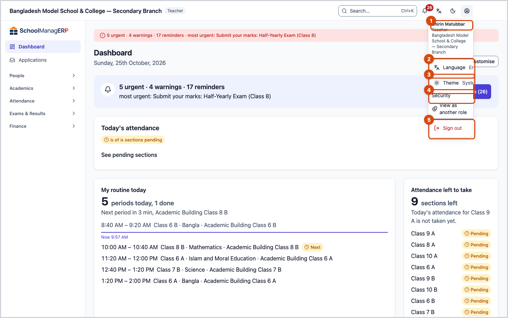
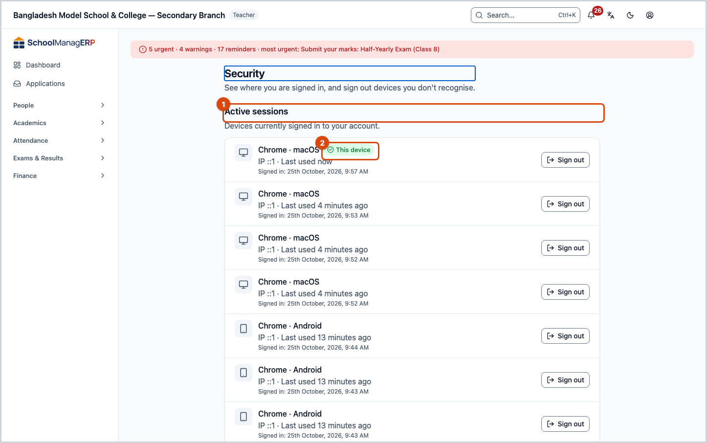

<!-- guide:meta
feature: start.account
title: Your account
summary: Sign out from the account menu, sign out a lost phone, manage your password and Google or Facebook, and approve contact changes the school sends.
roles: [ADMIN, EXECUTIVE, TEACHER, ACCOUNTANT, OFFICE_STAFF, EXAM_CONTROLLER, COMMITTEE, PARENT, STUDENT]
sources:
  - client-admin/src/components/staff-user-menu.tsx
  - ui/src/components/user-menu.tsx
  - client-admin/src/routes/_staff/security.tsx
  - client-admin/src/features/sign-in-methods/sign-in-methods-card.tsx
  - client-admin/src/routes/verify-email.tsx
  - client-admin/src/routes/_staff/staff/-edit-user-dialog.tsx
  - server/src/modules/users/users.controller.ts
  - server/src/modules/account-access/first-password.service.ts
labels:
  [
    nav:userMenu.*,
    nav:items.security,
    nav:security.pageDescription,
    nav:tenantBar.*,
    nav:schoolInvites.*,
    nav:installPrompt.menuItem,
    nav:language.groupLabel,
    nav:theme.*,
    auth:sessions.*,
    auth:verifyEmail.*,
    signInMethods:*,
  ]
helpIds: [start.account, start.account.action.signOutDevice, start.account.action.signOutAll]
devices: [desktop, phone]
entry: [notification:contact-change]
keywords: [account, sign out, security, lost phone, change password, change email, change phone number]
appVersion: 0.1.0 (c08a9eb19)
owner: tareq89
lastVerified: 2026-10-24
knownIssues: []
-->

# Your account

Sign out from the account menu, sign out a lost phone, manage your password and Google or Facebook, and approve contact changes the school sends.

**Where to go:** **Account menu** at the top right (the round person-icon button), on both computer and phone. From there, **Security**.
**Before you start:** [Sign in](sign-in.md).

**Account menu** is the place for everything that is yours: name, role, language, switching school and signing out. The **Security** page shows which phones or computers you are signed in on, and lets you close them.

[Sign out](#task-main) · [Sign out a lost phone](#task-lost-phone) · [Approve a contact change](#task-contact) · [Problems and fixes](#trouble)

**On this page**

- [How you get here](#arrive)
- [Sign out](#task-main)
- [How to know you are signed out](#confirm)
- [Other situations](#other)
  - [Sign out a lost phone or someone else's computer](#task-lost-phone)
  - [Set a password, connect Google or Facebook](#task-methods)
  - [If you want to change your own phone number or email](#task-contact)
  - [Switch school or role](#task-switch)
  - [School invitations](#task-invites)
- [Problems and fixes](#trouble)
- [Who can do what](#roles)
- [Learn more](#more)

---

## How you get here 

**From the account menu:** Tap the round button at the top right. Start at step 1 below.

**From a link the school sent:** If an admin changes your phone number or email, and you are also a member of another school, a link is sent to your current email or phone. Tapping it opens the page **{school name} wants to change your contact details**. See [If you want to change your own phone number or email](#task-contact).

---

## Sign out 

1. Tap **Account menu** at the top right.

   → The menu opens. At the very top is your name, and below it your role and the school's name.

2. At the very bottom of the menu, tap **Sign out**.

   → **Signing out…** shows, then the **Sign in** page appears.

**On a phone** it is the same two steps; **Account menu** is at the right corner of the top row.

> **Remember:** **Sign out** signs out only this phone or computer. If you are signed in on other devices, they stay on. To close them, see [Sign out a lost phone](#task-lost-phone).

---

## How to know you are signed out 

Signing out reaches the school's system at once; there is no state kept only on this phone, so the three-state table is not needed here.

- On this device: the **Sign in** page appears. Opening any page of the app asks you to sign in again.
- When you close another device: the message **That device has been signed out.** appears, and the device leaves the **Active sessions** list.

**To check:** Sign in from another device, then open **Account menu** → **Security**. The **Active sessions** list should contain only the devices you want to keep.

**If the message did not appear:** See [Problems and fixes](#trouble). If the device stays in the list, it is still signed in.

---

## Other situations 

### Sign out a lost phone or someone else's computer 

1. Sign in on any phone or computer, tap **Account menu**, then tap **Security**.

   → The **Security** page opens. At the top is **Active sessions**: the devices you are signed in on, each with its browser and phone or computer type, when you signed in and when it was last used. The one you are on now has **This device** next to it.

2. On the row of the device you want to close (for example the lost phone's browser), tap **Sign out**.

   → The message **That device has been signed out.** appears. Nobody can work in your account on that device until it signs in again.

If you cannot tell which device is which, tap **Sign out everywhere**:

| You tapped                                | What happens                                                                                                  | Signed out?     |
| ----------------------------------------- | ------------------------------------------------------------------------------------------------------------- | --------------- |
| **Sign out everywhere** (in the question) | Every device is signed out, including this one, and you land on the **Sign in** page. You must sign in again. | Yes, everywhere |
| **Cancel**                                | Nothing changes.                                                                                              | No              |

If your phone is stolen, or you think someone knows your password, also get a new password with **Forgot password?** on the [sign in](sign-in.md#task-forgot) page.

### Set a password, connect Google or Facebook 

On the **Security** page, in the **Sign-in methods** section:

- **Password** — If your account has no password yet, tap **Set or change password**, type the new password twice, and tap **Set a password**. → The message **Your password is set.** appears.
- **A code by SMS or email** — **Always on**. You can also sign in with a code, without a password.
- **Google** / **Facebook** — Shown when the school turns them on. Tap **Connect**, type your **Current password** and tap **Continue**, then sign in to Google or Facebook. → When you come back, the message **(Google/Facebook) is now connected.** appears. After that, **Continue with Google** or **Continue with Facebook** on the sign in page works.

Connecting needs your current password; if you have no password, it shows **Set a password above first, then connect.** To remove one, tap **Disconnect**; if it is your only way in, it shows **Set a password first, so you still have a way in.**

### If you want to change your own phone number or email 

Teachers and staff cannot change their own phone number or email. Ask the admin; they change it from the **Staff** page.

- If you are a member of only this school, the change happens at once.
- If you are also a member of another school, the change stays **pending** until you approve it yourself. Reason: the same account is used at the other school too, so one school cannot change your sign-in details alone.

To approve a pending change:

1. Tap the link that arrived on your **current** email or phone.

   → The page **{school name} wants to change your contact details** opens, with the new email or phone. Just opening the link changes nothing.

2. If you want the change, tap **Approve**. If you do not, tap **Decline**.

   → If you tap **Approve**, **Enter the code we sent to the new contact** appears.

3. Type the 6-digit code that arrived on the new email or phone, then tap **Confirm**.

   → **Your contact details have been updated.** shows. Tap **Sign in** and sign in again with the new number or email.

| You tapped              | What happens                                                                             | Changed?    |
| ----------------------- | ---------------------------------------------------------------------------------------- | ----------- |
| **Approve**             | A code goes to the new address. Nothing changes until you tap **Confirm** with the code. | No, not yet |
| **Confirm** (with code) | The phone number or email changes.                                                       | Yes         |
| **Decline**             | **Declined. Nothing was changed, and (school name) has been told.**                      | No          |

If you do not get the code, the new address may be wrong; tap **Decline** and give the admin the correct address.

### Switch school or role 

If you are in more than one school, or in more than one role at the same school, **Account menu** shows **Switch school or role**.

1. Tap **Switch school or role**, then pick one under **Switch school** or **Switch role at this school**.

   → A question appears: your current view will close and everything cached on this device will be cleared.

2. Tap **Switch school** or **Switch role**. (If you change your mind, tap **Cancel**.)

   → The message **Switched to (name)** appears, and the first page of the new school or role opens.

### School invitations 

If another school invites you to join, **Account menu** shows **School invitations (number)**. Tap it to open the list of invitations; on each one, tap **Accept** or **Decline**. If you then have more than one school, see [Switch school or role](#task-switch).

---

## Problems and fixes 

| What you see                                                         | What to do                                                                                                                        | Who can help |
| -------------------------------------------------------------------- | --------------------------------------------------------------------------------------------------------------------------------- | ------------ |
| **Couldn't load your sessions. Please try again.**                   | Tap **Try again**. Check your internet.                                                                                           | —            |
| **That password is not correct.** (while connecting Google/Facebook) | Type your current password, not a new one.                                                                                        | —            |
| **That account is already connected to someone else.**               | This Google or Facebook account is connected to someone else's SchoolManager account. Use a different Google or Facebook account. | School admin |
| **This link has expired or has already been used.**                  | Ask the admin to make the change again; a new link will come.                                                                     | School admin |
| **That code didn't work. …**                                         | Check the code and type it again, or open the link again to get a new code.                                                       | —            |
| **Too many wrong codes. …**                                          | Wait 15 minutes, then open the link again.                                                                                        | —            |
| **This change can no longer be made. …**                             | The school may have withdrawn the request. Nothing changed.                                                                       | School admin |
| **This change can't be made right now: …**                           | The new email or phone is already on another account. Give the admin a different address.                                         | School admin |
| **Switch school or role** is not in the menu                         | You have one role at one school; there is nothing to switch.                                                                      | —            |

---

## Who can do what 

| Role                          | Sign out and **Security**                                     | Change own phone/email                            | Connect Google/Facebook      |
| ----------------------------- | ------------------------------------------------------------- | ------------------------------------------------- | ---------------------------- |
| Teachers and all staff, admin | Yes                                                           | No, the admin changes it (approval may be needed) | Yes                          |
| Guardians, students           | Yes; **Security** in the menu opens the portal's account page | Yourself, from the portal's account page          | On the portal's account page |

---

## Learn more 

<strong>What is in the account menu</strong>

1. Name, role and school.
2. **Language** — [Change language](language.md).
3. **Theme** — **Light**, **Dark** or **System**.
4. **School invitations** — when you have a pending invitation.
5. **Security** — signed-in devices, sign-in methods, and some notification settings.
6. **Switch school or role** — when you have more than one school or role.
7. **Install app** — when the browser offers it ([Open on your phone and install as an app](phone.md)).
8. **Sign out**.

<strong>How a contact change works</strong>

<figure>
  
</figure>

- The admin makes the change; if you are in more than one school, the change waits as pending.
- Opening the link changes nothing; you need both **Approve** and the code sent to the new address.
- If you tap **Decline**, the school is told.

**Related pages**

- [**Signing in**](sign-in.md) — Forgot password, and signing in with Google or Facebook.
- [**Changing the language**](language.md) — **Language** in the account menu.
- [**Open on your phone and install as an app**](phone.md) — **Install app** in the account menu.
- [**Finding any page**](find-anything.md) — The other buttons in the top bar.
- [**Changing the school's settings**](../administration/settings.md) — Set the school's profile, academic rules, fee rules, communication, printing, sign-in, backup and alerts on one page, in nine categories.
- [**Account (parent and student)**](../portal/account.md) — the same account page for guardians and students.
- [**Applications (parent and student)**](../portal/applications.md) — sending a leave or other application from the portal.

---

_Version 0.1.0 · Last verified 2026-10-24_
