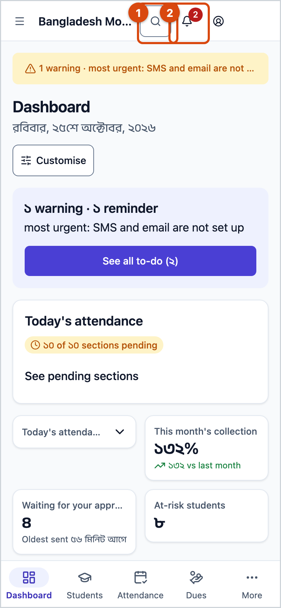

<!-- guide:meta
feature: start.findAnything
title: Finding any page
summary: Press Ctrl+K or the search button to open any page, action or student by name, and use the bell to see what needs you.
roles: [ADMIN, EXECUTIVE, TEACHER, ACCOUNTANT, OFFICE_STAFF, EXAM_CONTROLLER, COMMITTEE]
sources:
  - client-admin/src/components/command-palette-launcher.tsx
  - client-admin/src/nav-tree.ts
  - client-admin/src/action-registry.ts
  - ui/src/components/shortcuts-sheet.tsx
  - ui/src/components/notification-bell.tsx
  - client-admin/src/features/attention/attention-center.tsx
  - client-admin/src/routes/_staff.tsx
labels: [nav:commandPalette.*, nav:notifications.*, attention:bar.*, attention:modal.*, common:shortcuts.*]
helpIds: [start.findAnything, start.findAnything.action.open]
devices: [desktop, phone]
entry: [palette]
keywords: [search, find, Ctrl+K, shortcut, to-do, alerts]
appVersion: 0.1.0 (c08a9eb19)
owner: tareq89
lastVerified: 2026-10-24
knownIssues: []
-->

# Finding any page

Press Ctrl+K or the search button to open any page, action or student by name, and use the bell to see what needs you.

**Where to go:** On a computer, the **Search…** box in the top bar, or **Ctrl+K** on the keyboard (**⌘K** on a Mac). On a phone, the search button (magnifying glass) at the top right.
**Before you start:** [Sign in](sign-in.md). This search is in the app for teachers and staff.

The **search window** is one place from which you can reach any page without digging through menus. It has three tabs: **People** (students, guardians, staff, invoices, receipts), **Page** and **Action** (for example taking attendance, generating fees).

[Open a page by searching](#task-main) · [Find a student](#task-people) · [Your to-do](#task-alerts) · [Problems and fixes](#trouble)

**On this page**

- [Open a page by searching](#task-main)
- [How to know the right page opened](#confirm)
- [Other situations](#other)
  - [Find a student, guardian or invoice](#task-people)
  - [Start an action directly](#task-action)
  - [See your to-do](#task-alerts)
- [Problems and fixes](#trouble)
- [Who can do what](#roles)
- [Learn more](#more)

---

## Open a page by searching 

1. Press **Ctrl+K** on the keyboard, or tap the **Search…** box in the top bar.

   → The **Search** window opens in the middle, with a box to type in. If you opened pages before, a **Recent** list shows below.

<!-- image pending: img/find-anything-01-palette.png — Search window: 1 text box, 2 People / Page / Action tabs, 3 results, 4 shortcut hint at the bottom -->

2. Go to the **Page** tab (tap it, or press the right arrow). Type part of a page name, for example `Attendance`.

   → Pages that match the name appear. A page whose name starts with what you typed comes first.

3. Tap the page you want. (On the keyboard, choose with the up and down arrows and press **Enter**.)

   → The window closes and that page opens.

**On a phone:** tap the search button at the top right; the rest of the steps are the same.

> **Remember:** Searching changes nothing; it only opens a page. A page you are not allowed to open does not appear in the results either.

---

## How to know the right page opened 

Searching does not submit anything, so there is no three-state list here. When the page opens, its name shows at the top and the page is highlighted in the left menu.

**To check:** Press **Ctrl+K** again; the page is in the **Recent** list.

**If no result comes:** See [Problems and fixes](#trouble).

---

## Other situations 

### Find a student, guardian or invoice 

1. Press **Ctrl+K**. The **People** tab is open first.
2. Type a student's name, roll number, a guardian, a staff member or an invoice number.

   → Results appear under **Students**, **Guardians**, **Staff**, [**Invoices**](../finance/invoices.md) and **Receipts**.

3. Tap the one you want. → Their page opens.

Only people who can see student information get the **People** tab. If you cannot, the window shows only **Page** and **Action**.

### Start an action directly 

On the **Action** tab, type the name of an action (for example attendance or fees), then tap a result. → That action's page opens directly. Only the actions your role can do are shown. If an action needs something opened first (for example a student), it is greyed out with the words **Open a student first**.

### See your to-do 

The bell button (**Notifications**) in the top bar shows your to-do and notifications. When something needs you, the bell shows a number.

1. Tap the bell button.

   → A small panel opens. At the top is **Needs your attention**: the most urgent item, with **Show** beside it. If there is nothing, it says **Nothing needs you right now.** Below, **On this device** shows the results of your recent work.

2. Tap **Show**.

   → The **Your to-do** window opens, with **Urgent**, **Warning** and **Reminder** groups. Tapping the main button of an item opens the page for that work.

To see the whole list, tap **See all to-do** in the panel. Tapping the coloured strip at the top of a page (for example **2 urgent**) also opens the same **Your to-do** window.

---

## Problems and fixes 

| What you see                              | What to do                                                                                                                         | Who can help |
| ----------------------------------------- | ---------------------------------------------------------------------------------------------------------------------------------- | ------------ |
| **No matches for "…".**                   | Try other words: Bangla or English, the full name or part of it. Check that you are on the right tab.                              | —            |
| You cannot find a page                    | Your role may not be able to open that page. See [Who can do what](#roles).                                                        | School admin |
| The **People** tab is missing             | Your role is not allowed to search student information. Use the **Page** tab.                                                      | School admin |
| Nothing happens when you press **Ctrl+K** | The window may have opened and closed again (pressing a second time closes it). Press once, or tap the **Search…** box at the top. | —            |
| **Could not load alerts.**                | Tap **Try again** in the panel.                                                                                                    | —            |

If a page or button is missing, see [Why can't I see this?](../help/cant-see-this.md).

If a word is not clear, see the [Glossary](../help/glossary.md).

What's newo see what is new, read [T](../help/whats-new.md).

---

## Who can do what 

| Role                          | **Page** tab       | **Action** tab     | **People** tab                     |
| ----------------------------- | ------------------ | ------------------ | ---------------------------------- |
| Teachers and all staff, admin | Pages you can open | Actions you can do | If you can see student information |

---

## Learn more 

<strong>Keyboard shortcuts</strong>

Press **?** (when you are not in a text box) to open the **Keyboard shortcuts** list.

| Key        | What it does                        |
| ---------- | ----------------------------------- |
| Ctrl/⌘ + K | Open command palette                |
| ?          | Open this list                      |
| ← →        | Switch tab                          |
| Ctrl + 1-3 | Jump to a tab                       |
| /          | Jump to Page (as first character)   |
| >          | Jump to Action (as first character) |
| ↑ ↓        | Move selection                      |
| Enter      | Open selection                      |
| Esc        | Close                               |

<strong>How searching works</strong>

<figure>
  
</figure>

- A page name matches the name written in the current language, and for some pages extra words (for example the [**Applications**](../applications/applications.md) page also appears if you type "leave").
- Results show only the pages and actions for your role.
- **People** search comes from the school's system, a moment after you stop typing.

**Related pages**

- [**Signing in**](sign-in.md) — the first page after you sign in.
- [**Open on your phone and install as an app**](phone.md) — where the search button is on a phone.
- [**Your account**](account.md) — the account menu in the top bar.

---

_Version 0.1.0 · Last verified 2026-10-24_
