<!-- guide:meta
feature: start.ifSomethingGoesWrong
title: If something goes wrong
summary: What you see and what to do when the internet goes off, the connection is slow, or the app asks you to sign in again. What you typed is kept when the same person signs in again to the same school.
roles: [ADMIN, EXECUTIVE, TEACHER, ACCOUNTANT, OFFICE_STAFF, EXAM_CONTROLLER, COMMITTEE, PARENT, STUDENT]
sources:
  - ui/src/components/connection-banner.tsx
  - ui/src/components/session-expired-dialog.tsx
  - ui/src/components/sync-status.tsx
labels: [states:offline.*, states:slow.*, states:expired.*, common:sync.*]
helpIds: [start.ifSomethingGoesWrong]
devices: [desktop, phone]
entry: [public]
keywords: [no internet, slow internet, sign in again, offline, session, session expired, ইন্টারনেট নেই, নেট ধীর]
appVersion: 0.1.0 (c08a9eb19)
owner: tareq89
lastVerified: 2026-11-16
knownIssues: []
-->

# If something goes wrong

What you see and what to do when the internet goes off, the connection is slow, or the app asks you to sign in again. What you typed is kept when the same person signs in again to the same school.

**Where to go:** Nowhere. These messages appear by themselves: a bar at the very top of the page, and a small window in the middle.
**Before you start:** Nothing is needed.

[No internet](#task-main) · [Slow internet](#task-slow) · [Sign in again](#task-expired) · [Problems and fixes](#trouble)

**On this page**

- [How you get here](#arrive)
- [No internet](#task-main)
- [How to know it is fixed](#confirm)
- [Other situations](#other)
  - [Slow internet](#task-slow)
  - [Sign in again](#task-expired)
- [Problems and fixes](#trouble)
- [Who can do what](#roles)
- [Learn more](#more)

---

## How you get here 

**In the middle of your work:** if a grey bar appears at the top of the page, or a window called **Sign in again** opens in the middle, see the matching part below.

---

## No internet 

When the internet goes off, a bar appears at the top of the page. It says **No internet**.

1. Read the bar. On a wide screen it also says more: check your connection, and what you typed is kept on this page.
2. Fix the Wi-Fi or mobile data.
3. Press **Try again** on the bar.

   → When the internet is back, the bar goes away and the page loads fresh data.

If some changes are waiting to be sent, the bar shows how many. For example, "2 changes waiting to be sent".

> **Remember:** **Try again** only reloads what the page shows. It does not send your unsaved or waiting work by itself. To send those, press **Send now** in the changes list, or press **Save** yourself again.

---

## How to know it is fixed 

| State                    | How you can tell                           | What next                         |
| ------------------------ | ------------------------------------------ | --------------------------------- |
| **Internet is back**     | The bar at the top is gone                 | Carry on                          |
| **Still waiting**        | The bar says "changes waiting to be sent"  | Wait for the internet to return   |
| **All changes saved**    | It says "All your changes are saved."      | Done                              |

**To check:** reload the page and see whether your entry is there.

---

## Other situations 

### Slow internet 

If something takes more than 4 seconds, the bar at the top says **Slow internet**, with: this is taking longer than usual, please wait a little.

1. Wait. There is no button to press here.
2. Do not press the same button again and again. Once is enough.

   → When the connection recovers, the bar goes away by itself.

### Sign in again 

For your safety, the app can sign you out after a while. If this happens while you are working, the page does not change. A window called **Sign in again** opens in the middle. What you typed stays on the page behind it, as it was.

1. In the window, enter your email or mobile number and your password, then press **Sign in**.

   → The window closes. You are back where you were, and what you typed is still there.

2. Press **Save** or **Submit** again for the thing you were doing.

> **Remember:** Nothing is saved for you after you sign in. You press the button again yourself. You must sign in as the same person to the same school. If someone else, or another school, signs in, you are taken to the sign-in page for safety, and what you typed is gone.

---

## Problems and fixes 

| What you see                                      | What to do                                                                              | Who can help       |
| ------------------------------------------------- | --------------------------------------------------------------------------------------- | ------------------ |
| **No internet**, but other apps work              | Copy any text you have not saved. Then reload the page. If that does not help, close the browser and open it again.            | —                  |
| The bar stays after you press **Try again**       | Check the Wi-Fi or mobile data, then press it again.                                    | The school's admin |
| I was taken to the sign-in page and my text is gone | This happens when another person or school signs in. Sign in and do the work again.   | —                  |
| **Slow internet** for a long time                 | Try again in a little while. On a phone, switch between Wi-Fi and mobile data.          | —                  |

---

## Who can do what 

| Role      | Sees these | Where                                         |
| --------- | ---------- | --------------------------------------------- |
| All roles | Yes        | The bar at the top of the page, and the window in the middle |

---

## Learn more 

<strong>Why what you typed is not lost</strong>

<figure>
  
</figure>

- While the **Sign in again** window is open, your page stays open behind it, so the text is not cleared.
- The text is not stored anywhere else. If you close or reload the page, it is gone.
- The app never sends any work a second time by itself. So the same money or the same message cannot go twice.

---

_Version 0.1.0 · Last verified 2026-11-16_
