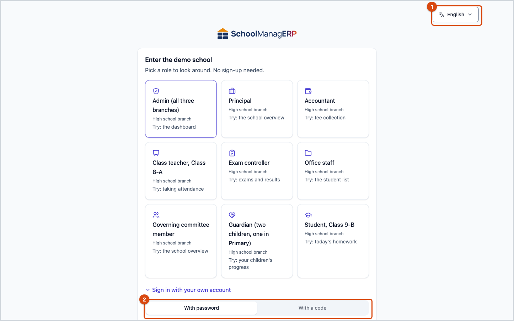
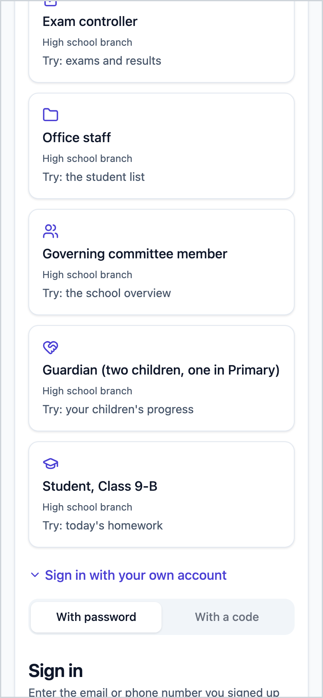

<!-- guide:meta
feature: start.signIn
title: Signing in
summary: Sign in to SchoolManager with your phone number or email, set a password the first time, and get a new one if you forget it.
roles: [ADMIN, EXECUTIVE, TEACHER, ACCOUNTANT, OFFICE_STAFF, EXAM_CONTROLLER, COMMITTEE, PARENT, STUDENT]
sources:
  - client-admin/src/routes/login.tsx
  - client-admin/src/routes/activate.tsx
  - client-admin/src/routes/forgot-password.tsx
  - client-admin/src/routes/reset-password.tsx
  - client-admin/src/routes/select-school.tsx
  - client-admin/src/features/first-password/first-password-step.tsx
  - client-admin/src/features/demo/test-environment-notice.tsx
  - ui/src/components/otp-sign-in-form.tsx
  - ui/src/components/set-password-form.tsx
  - ui/src/components/school-picker.tsx
  - shared/src/auth/password-rules.ts
labels:
  [
    auth:heading,
    auth:identifier.*,
    auth:password.*,
    auth:submit.*,
    auth:errors.*,
    auth:tabs.*,
    auth:otp.*,
    auth:login.*,
    auth:firstPassword.*,
    auth:setPassword.*,
    auth:passwordRules.*,
    auth:activate.*,
    auth:forgot.*,
    auth:help.*,
    demo:testInbox.*,
    auth:reset.*,
    auth:schoolPicker.*,
    auth:selectSchool.*,
    nav:userMenu.signOut,
    nav:tenantBar.switchSchoolOrRole,
  ]
helpIds: [start.signIn, start.signIn.action.submit, start.signIn.field.identifier]
devices: [desktop, phone]
entry: [public]
keywords: [sign in, login, password, code, OTP, forgot password]
appVersion: 0.1.0 (c08a9eb19)
owner: tareq89
lastVerified: 2026-10-24
knownIssues: []
-->

# Signing in

Sign in to SchoolManager with your phone number or email, set a password the first time, and get a new one if you forget it.

**Where to go:** Open the address your school gave you in a browser. If you are not signed in, the **Sign in** page is the first thing you see.
**Before you start:** The school admin has added you to the app, and the school has your phone number or email. If not, ask the admin.

The phone number or email the school used to add you is your **account**. The same account works on a computer and on a phone.

[Sign in with a password](#task-main) · [First time, with a code](#task-code) · [Forgot your password](#task-forgot) · [Problems and fixes](#trouble)

**On this page**

- [How you get here](#arrive)
- [Sign in with a password](#task-main)
- [How to know it worked](#confirm)
- [Other situations](#other)
  - [First time, or no password: sign in with a code](#task-code)
  - [If you got an invitation link](#task-invite)
  - [Forgot your password](#task-forgot)
  - [If you are in more than one school](#task-school)
  - [With Google or Facebook](#task-social)
- [Problems and fixes](#trouble)
- [Who can do what](#roles)
- [Learn more](#more)

---

## How you get here 

**From the browser:** Opening the school's address shows the sign-in page. Opening a link to any other page also shows the sign-in page first; after you sign in, the app takes you to that page.

**From an invitation text message or email:** When the school adds you, it sends a link. Tap the link, then see [If you got an invitation link](#task-invite).

**After signing out:** Tapping **Sign out** in the account menu brings you back to this page ([Your own account](account.md)).

---

## Sign in with a password 

1. Open the school's address in a browser.

   → The **Sign in** page appears. There are two tabs at the top: **With password** and **With a code**. **With password** is already selected.

2. In the **Email or phone number** box, type your phone number (for example `01712345678`) or your email.
3. In the **Password** box, type your password. To check what you typed, tap **Show password** next to the box.
4. Tap **Sign in**.

   → The app's first page opens: the **Dashboard** for teachers and staff, the portal for parents and students. If you are in more than one school, the **Choose a school** page comes first ([If you are in more than one school](#task-school)).

**On a phone** the four steps are the same. The page fills the whole screen; the language button is at the top right.

> **Remember:** When you finish on a school computer or someone else's, tap **Sign out** in the account menu. If you do not, the next person may stay in your account.

---

## How to know it worked 

Signing in does not submit anything, so there is no three-state list here. When you are signed in:

- The sign-in page goes away and the app's first page opens.
- Tapping the **Account menu** at the top right (the round person button) shows your name at the top, and below it your role and the school name.

**To check:** Match the name and school in the account menu. If it shows the wrong school, see [If you are in more than one school](#task-school).

**If you do not leave the sign-in page:** A red message appears above or below the boxes. Find that message in [Problems and fixes](#trouble). The email or phone number you typed stays in the box.

---

## Other situations 

### First time, or no password: sign in with a code 

If you have no password, or cannot remember it, you can sign in with a code sent to your phone or email.

1. On the **Sign in** page, tap the **With a code** tab. (Or, under the **With password** tab, tap **First time here? Sign in with a code**.)
2. In the **Mobile number or email** box, type the number or email and tap **Send code**.

   → The **Enter the code** page appears. If the number or email is on an account, a 6-digit code is sent to it.

3. Type the code in the **6-digit code** box and tap **Sign in**.

   → If this is your first time signing in with a code, the **Set a password** card appears (see below). If you already set a password, the app's first page opens directly.

If no code arrives, you can tap **Resend code** after 60 seconds. If you typed the wrong number, tap **Use a different number or email**.

On the **Set a password** card, type the same password in the **New password** and **Confirm password** boxes. The rules show under the box; **Set password** can be tapped only when all rules are met.

| For whom                | Password rules                                                                                                |
| ----------------------- | ------------------------------------------------------------------------------------------------------------- |
| Teachers, staff, admins | At least 8 characters, one capital letter (A-Z), one small letter (a-z), one number, one symbol (like ! or @) |
| Parents and students    | At least 8 characters and one number                                                                          |

| You tapped                                                 | What happens                                                                                                   | Password saved? |
| ---------------------------------------------------------- | -------------------------------------------------------------------------------------------------------------- | --------------- |
| **Set password**                                           | The password is saved and the app's first page opens. Next time you can sign in **With password**.             | Yes             |
| **Skip for now** (parents and students only)               | The app opens without a password. You will need a code again next time.                                        | No              |
| **Sign in with another account** (teachers and staff only) | You are signed out and return to the sign-in page. Tap this if you got into someone else's account by mistake. | No              |

Teachers and staff must set a password: the card comes back if you reload the page or open a new tab, until you set one. The exception: if Google or Facebook is connected to the account, a password is not required.

### If you got an invitation link 

1. Tap the link in the text message or email.

   → **Checking your link…** appears, then a card that says **Welcome, (your name) — (school name)**.

2. Type the same password in the **New password** and **Confirm password** boxes (rules are in the table above).
3. Tap **Set password**.

   → Your account is switched on and the app's first page opens. From next time, [sign in with a password](#task-main).

If there is a problem with the link, the card says why: **This link has expired.**, **This link has already been used.**, **This link is no longer valid.** or **This link isn't valid.** Then type your number or email in the **Email or phone number** box below and tap **Send a new link**, or ask whoever invited you for a new link.

### Forgot your password 

1. On the **Sign in** page, tap **Forgot password?**.
2. Type your email or phone number in the **Email or phone number** box and tap **Send code or link**.

   → If you gave a phone number, the **Enter the code** page appears. If you gave an email, it shows **If an account exists for that email, a reset link has been sent.**

3. **If a code came to your phone:** type it in the **6-digit code** box and tap **Continue**. **If a link came by email:** tap the link.

   → The **Choose a new password** page appears.

4. Type it in the **New password** and **Confirm password** boxes and tap **Set password**.

   → The new password is saved and you land on the app's first page, already signed in. You do not need to sign in again.

If the code is wrong or has expired, it shows **That code is incorrect or has expired.** and takes you back to the code page. If the email link does not work, it shows **This link has expired or has already been used.**; tap **Ask for a new link** and start again.

### If you are in more than one school 

If the same account is in two or more schools (or in one school with two roles), the **Choose a school** page appears after you sign in.

1. Tap the card of the school you want to work in now. The card shows the school name and your role.
2. Tap **Continue**.

   → That school's first page opens.

To switch school later: tap **Switch school or role** in the account menu ([Your own account](account.md)). If you got into the wrong account, tap **Sign in with another account** at the bottom of the page.

If a school invitation is waiting, a **School invitations** card shows at the top of this page; you can tap **Accept** or **Decline** there.

### With Google or Facebook 

If your school has turned it on, the sign-in page shows **Continue with Google** or **Continue with Facebook** buttons at the top. If there is no button, your school has not turned it on; sign in with a password or a code.

These buttons work only when the Google or Facebook account is already connected to your SchoolManager account. If it is not, you return to the sign-in page with the message **That account is not connected yet. Sign in with a code, then connect it from your account page.** The steps to connect are on [Your own account](account.md).

---

### Where do codes and messages go on the demo? 

On the demo site and the staging site nothing is really sent. No code reaches a phone or an email. Every code and message goes to a **test inbox** instead. A thin bar at the top of every page tells you this.

1. Ask for a code as usual: in the **Mobile number or email** box, type the number and tap **Send code**.
2. In the bar at the top of the page, or in the line under the code box, tap **Open test inbox**.

   → The test inbox opens in a new tab. The newest message is at the top.

3. Copy the 6-digit code from the message, go back to the first tab, type it in the **6-digit code** box and tap **Sign in**.

If the bar is in your way, tap **Hide**. It shrinks to a small button at the top that still opens the test inbox. On a normal school's site there is no bar and no test inbox: the code goes to the real phone or email.

---

## Problems and fixes 

| What you see                                                                     | What to do                                                                                                                                                     | Who can help |
| -------------------------------------------------------------------------------- | -------------------------------------------------------------------------------------------------------------------------------------------------------------- | ------------ |
| **That email/phone or password is incorrect.**                                   | Check the number or email and the password and type them again. If you cannot remember, see [Forgot your password](#task-forgot).                              | —            |
| **Enter a valid email or an 11-digit phone number.**                             | Start the phone number with 0 and type all 11 digits, for example `01712345678`.                                                                               | —            |
| **Too many attempts. Try again in … seconds.**                                   | Wait for the time shown in the message, then try again.                                                                                                        | —            |
| **This account isn't linked to a school yet. …**                                 | The account exists, but is not added to any school.                                                                                                            | School admin |
| **You are not in any school yet**                                                | Same reason. Ask the admin to add you.                                                                                                                         | School admin |
| **That number, email or code is incorrect.**                                     | Check the code and type it again. If it still does not match, tap **Resend code** to get a new one.                                                            | —            |
| The code does not come                                                           | Check that the number is right. If it still does not come after a few tries, try again after an hour. For email, check the spam folder.                        | School admin |
| **This account has been suspended.** (only on the page an invitation link opens) | The school has put your account on hold, so the invitation cannot be used. Contact the school office. At the sign-in page itself this message does not appear. | School admin |
| **This link has expired.**                                                       | For an invitation link, see [If you got an invitation link](#task-invite); for a reset link, see [Forgot your password](#task-forgot).                         | School admin |
| **Set password** cannot be tapped                                                | Not all the rules under the box are met, or the two passwords differ (**Passwords do not match.**).                                                            | —            |
| **Use a shorter password — at most 72 letters, or 24 Bangla letters.**           | Make the password shorter.                                                                                                                                     | —            |
| **Something went wrong. Please try again.**                                      | Check your internet and try again. If it keeps happening, tell the admin.                                                                                      | School admin |

More help with this: [What to do when something goes wrong](../help/troubleshooting.md#signin).

---

## Who can do what 

| Role                                                                                              | Where you go after signing in | Password when first signing in with a code                 | Password rules                                          |
| ------------------------------------------------------------------------------------------------- | ----------------------------- | ---------------------------------------------------------- | ------------------------------------------------------- |
| Admin, academic coordinator, teacher, accountant, office staff, exam controller, committee member | **Dashboard**                 | Required (not required if Google or Facebook is connected) | 8 characters, capital and small letters, number, symbol |
| Parent, student                                                                                   | Portal                        | Optional; tap **Skip for now** and set one later           | 8 characters and one number                             |

---

## Learn more 

<strong>How signing in works</strong> — which path leads to which page

<figure>
  
</figure>

- Whether you use a password or a code, both paths end in the same place: one school goes straight into the app, more than one shows **Choose a school**.
- Signing in with a code for the first time asks for a password; for teachers and staff it is required.
- After a password reset or an invitation, you do not need to sign in separately.

<strong>Short help for the boxes (the (?) button)</strong>

<!-- guide:generated:fields:auth -->

| Field                 | What to enter                                                                               | Required? |
| --------------------- | ------------------------------------------------------------------------------------------- | --------- |
| Test inbox            | This is a test site, so no code reaches your phone or email. Find it in the test inbox:     | No        |
| Email or phone number | The email or the 11-digit phone number your account was made with, for example 01712345678. | Yes       |

<!-- /guide:generated -->

**Related pages**

- [**Open on your phone and install as an app**](phone.md) — opening the address in a phone browser and putting it on the home screen.
- [**Changing the language**](language.md) — the language button at the top of the sign-in page.
- [**Your account**](account.md) — signing out, signing out of other devices, connecting Google or Facebook.
- [**Finding any page**](find-anything.md) — opening pages quickly after you sign in.

---

_Version 0.1.0 · Last verified 2026-10-24_
