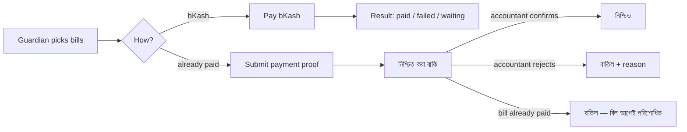

# Epic 3.0 glossary — guardian online payments

Plain words for every screen, message and error of Epic 3.0 (#291).
Use the **Say** columns in the app. Never use the **Never say** column on a
screen, button, error or message a guardian or accountant reads.

## Words

| Say (bn) | Say (en) | Never say | Where it shows |
| --- | --- | --- | --- |
| নিশ্চিত করা বাকি | Waiting for confirmation | pending verification | status tag on bills and proofs, first tab on Online payments |
| পেমেন্টের প্রমাণ | Payment proof | attachment, receipt upload | portal tab, pay form step 3, review screen title |
| লেনদেন নম্বর (TrxID) | Transaction ID | reference id, txn id | proof form, review screen, tables |
| নিশ্চিত করুন | Confirm | approve | review screen primary button |
| বাতিল করুন | Reject | decline | review screen button |
| বাতিল — বিল আগেই পরিশোধিত | Discarded — already paid | expired, void | proof status when a bill was paid meanwhile |
| অমিল জমা | Unmatched receipt | orphan payment | third tab on Online payments |
| জমা টাকা | Wallet | credit, balance | where extra online money goes |
| পরিশোধ করুন | Pay | checkout, make payment | due card button, portal page action |
| বিকাশে পরিশোধ করুন | Pay with bKash | gateway, redirect | choice card |
| আগেই দিয়েছি — প্রমাণ জমা দিন | Already paid — submit proof | upload | choice card |
| তুলে নিন | Withdraw | cancel, delete | guardian's button on a waiting proof |
| অনলাইন পেমেন্ট | Online payments | gateway payments | staff page, settings section |
| সংযোগ পরীক্ষা করুন | Test connection | validate credentials | settings button |
| বিদ্যালয় অফিসে পরিশোধ করুন | Pay at the school office | payments disabled | due card when both methods are off |

Reject reasons (guardian sees these): লেনদেন নম্বর পাওয়া যায়নি (TrxID not
found), টাকার অঙ্ক মিলছে না (amount does not match), ছবি পরিষ্কার নয়
(image unclear), আগেই জমা হয়েছে (duplicate), অন্য কারণ (other, note needed).

Never on screen: pending verification, attachment, reference id, approve,
decline, callback, gateway, attempt.

## Example

Guardian rejected proof, portal row says: **বাতিল** · কারণ: ছবি পরিষ্কার নয়।
বিদ্যালয়ে ফোন করুন: ০১৭১১-০০০০০০. No code, no English word.
