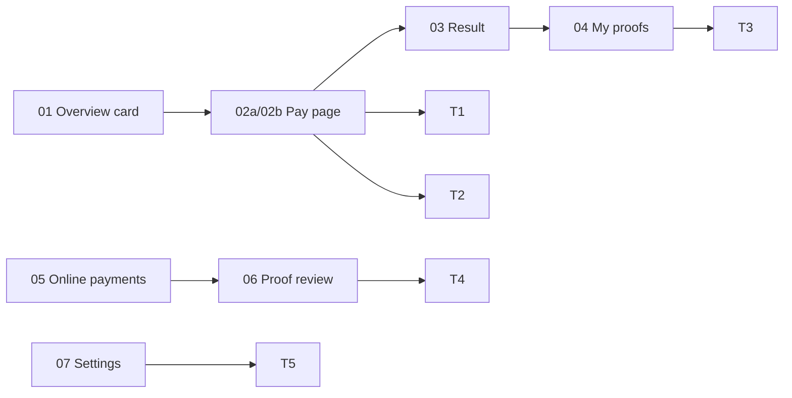

# Epic 3.0 usability test: online payments (status: NOT RUN YET)

Ticket 3.0.01 (#3959) asks for clickable mockups and a test of 5 tasks with 2
guardians, 1 accountant (task 5 with an admin). **The mockups and glossary are
built. The test needs real people and has not been run.** The ticket's box
"every task passed unaided within its target on the final round" stays
**unticked** until the Results table is filled and every row passes. Mockups
are not a gate for later waves.

## Mockups

Folder `docs/ux-research/3.0-online-payments/`. Each has `.html`, `-1440.png`,
`-390.png`. Built from the real design tokens and the redesign-page kit. Fake
names and numbers only. Shoot report: no sideways scroll, one `<h1>`, no
unlabeled buttons, no page errors at both sizes.

| Screen | File | Shows |
| --- | --- | --- |
| Overview due card | `01-portal-overview-due-card` | Total due, one Pay button, "Pay at school office" state, waiting tag |
| Pay, bKash | `02a-portal-pay-bkash` | Bills pre-ticked, two choice cards, no extra fee note |
| Pay, proof | `02b-portal-pay-proof` | Method, amount, TrxID, date, school instruction, 2 images (D6) |
| Result | `03a/03b/03c-pay-result-*` | Paid, failed, waiting |
| My payment proofs | `04-portal-my-proofs` | Status, reject reason, Withdraw; cards on phone |
| Online payments | `05-staff-online-payments` | 3 tabs, overdue and duplicate-TrxID flags (D25) |
| Proof review | `06-staff-proof-review` | Images first, bills, history, Confirm & next / Reject / Call / Send SMS |
| Settings | `07-settings-online-payments` | 2 toggles, methods and instructions, bKash credentials, Test connection |

Gaps left for the built screens (mockup limits): no clickable zoom viewer,
Reject reason list shown as one select (closed), history shows only the submit
event, a phone sticky action bar is drawn in normal flow.

## Tasks

| # | Who | Task (say it in these words) | Screens | Target |
| --- | --- | --- | --- | --- |
| 1 | Guardian | "Pay April's fee with bKash" | 01, 02a, 03a | 2 min |
| 2 | Guardian | "You paid by bKash send-money; submit the proof" | 01, 02b, 04 | 2 min |
| 3 | Guardian | "Find out why your proof was rejected" | 04 | 1 min |
| 4 | Accountant | "Confirm 3 waiting proofs. One has a wrong TrxID: reject it and call the guardian" | 05, 06 | 30 s per proof |
| 5 | Admin | "Turn on online payments" | 07 | 2 min (expected: finds Test connection first) |

Rules: nobody gets help; no developers; note the first hesitation and the
words they use. Record only fake data on screen.

## Results (fill in on the day)

| Round | Task | Participant | Time | Unaided? | Where they hesitated | Quote | Change made | Pass? |
| --- | --- | --- | --- | --- | --- | --- | --- | --- |
| 1 | 1 | guardian A | | | | | | |
| 1 | 1 | guardian B | | | | | | |
| 1 | 2 | guardian A | | | | | | |
| 1 | 2 | guardian B | | | | | | |
| 1 | 3 | guardian A | | | | | | |
| 1 | 3 | guardian B | | | | | | |
| 1 | 4 | accountant | | | | | | |
| 1 | 5 | admin | | | | | | |

Re-run failed tasks after fixing the mockups; add a block per round.
